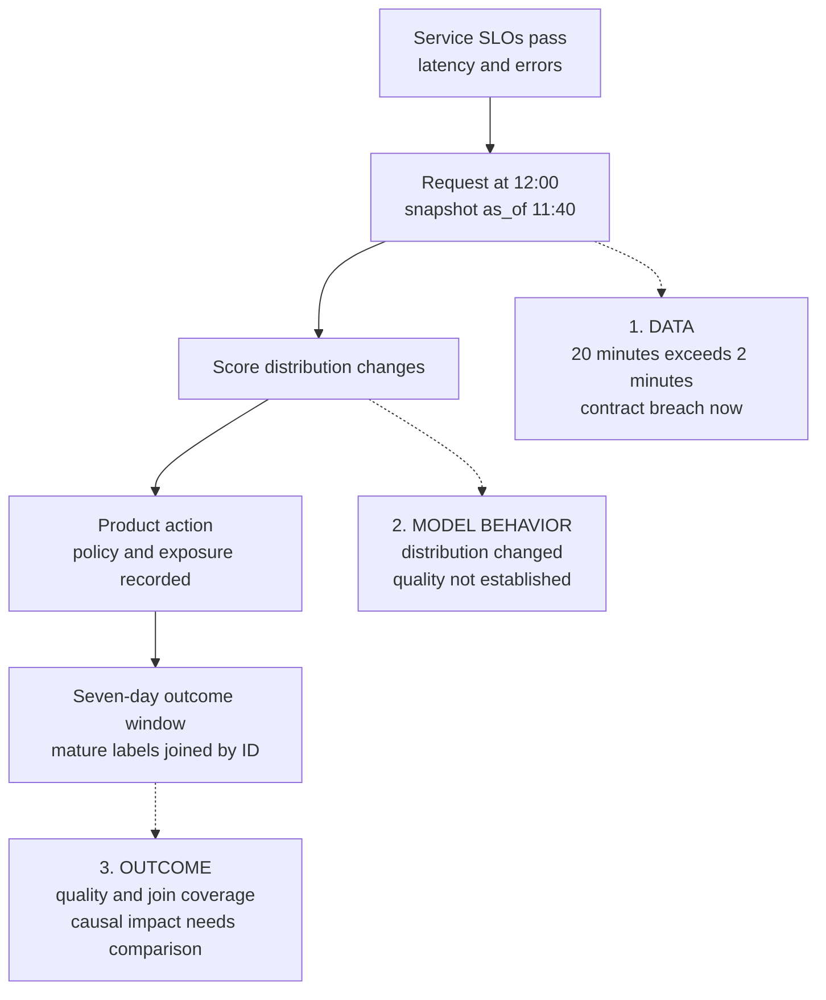

Design monitoring and an incident response when a model service looks healthy but its inputs and scores have changed.

## Problem

**Context.** An online model uses timestamped session features, while its outcome labels require a seven-day observation window.

**Task.** Specify signals, immediate actions, and later comparisons for the incident below, including owners and evidence for recovery.

**Constraints.** Distinguish service availability, feature freshness, distribution changes, and measured outcome quality.
Account for missing label joins and important slices; unavailable mature labels cannot establish current quality.

At 12:00, an ML endpoint meets its latency and error objectives.
Its session-feature snapshot has `as_of=11:40`, despite a two-minute maximum-age contract.
Model score distributions also changed.
The outcome definition requires seven days of observation.

Design the signals, immediate response and later comparison needed to decide what happened.
Specify how missing label joins and important slices affect the conclusion.

<span id="what-ml-monitoring-is-for"></span>

## Picture: Different Evidence Arrives at Different Times

The snapshot is twenty minutes old, exceeding the two-minute limit.
That is a data-contract breach now, even though requests return successfully.
The score change is another observable fact, not proof of lower accuracy.
Seven-day outcomes cannot establish current cohort quality before their window matures.

Use the declared fallback for affected requests while the data owner investigates.
It might use approved rules or a model that does not require the stale feature.
Do not replace missing values with zero unless that behavior was validated.
Record affected versions, cohorts, actions and exposure so later outcomes remain interpretable.

<p class="visual-title">Stale features fail now; quality labels arrive later</p>

<!-- visual:ml-monitoring-observability-layers -->


<p class="diagram-caption"><strong>Read it this way:</strong> solid arrows follow serving and later outcomes. Dashed taps show where each signal becomes available. Freshness establishes a contract violation now. Changed scores do not establish degraded quality; mature outcomes do not alone establish causal impact.</p>

<span id="what-an-l5-answer-sounds-like"></span>

## Give Each Signal a Claim and Response

| Layer | Signal | Supported conclusion | Owner and response |
| --- | --- | --- | --- |
| Service | Latency, errors, throughput, resources | Endpoint operating condition | Service owner: capacity/failure runbook |
| Data | Schema, nulls, freshness, distributions | Contract breach or input change | Data owner: repair source; approved consumer fallback |
| Behavior | Score/rank distributions and slices | Outputs changed | ML owner: inspect versions, inputs and applicable baseline |
| Outcome | Mature labels, join coverage, product effects | Observed quality/impact in covered cohort | Product/ML: investigate; causal claim needs valid comparison |
| Cost | Cost/request, utilization, batching | Resource/economic change | Service/platform: evaluate throughput and task-success effects |

Declare which signals are proxies, directly observed outcomes or causal estimates.
An engagement proxy or confidence shift is not a substitute for correctness labels.

```text
PredictionRecord
	prediction_id, request_id, decision_time, cohort_id
	model_version, feature_version, feature_as_of, action_id
	policy_version, exposure_assignment, score, slice_keys
LabelRecord
	prediction_id, target_definition, outcome_time
	available_time, maturity_time, join_status, censoring_reason
Alert
	signal_id, window, baseline, slice, numerator, denominator
	magnitude, uncertainty, severity, owner, runbook, deadline
```

## Check the Denominator Before Trusting Quality

Suppose 1,000 mature label IDs are eligible, but only 900 join to predictions.
Of the joined rows, 810 are correct: reported accuracy is 90%, and join coverage is 90%.
Without resolving the missing rows, full-cohort accuracy could range from 81% to 91%.
A critical slice might account for all 100 missing joins.

Track eligibility, maturity, missingness and coverage by slice alongside quality.
Distinguish source delay, join failure and censoring from an observed negative outcome.

## Change 1: A Campaign Changes Normal Traffic

**New task.** Input distributions shift during a seasonal campaign.

**Picture and change.** Compare appropriate seasonal/context baselines, sample sizes and practical effect sizes.
Inspect contract breaches and mature quality rather than equating a small statistical p-value with degradation.

**Check.** A detectable distribution change can be harmless.
Historical context helps diagnosis but does not excuse a broken freshness limit.

**Use when.** Traffic composition has legitimate causes.

<span id="common-follow-up"></span>

## Change 2: One Failed Job Creates Many Alerts

**New task.** Many feature alerts share one upstream failure.

**Picture and change.** Group by lineage and root cause; separate pages, tickets and dashboard signals.
Retain consequential slice alerts, a named responder and the fallback state.
Record acknowledgment, action and resolution evidence for later threshold review.

**Check.** Silencing a root alert does not repair stale features.
There is no universal useful-alert percentage that validates the monitoring system.

**Use when.** Noise hides actionable incidents.

<span id="tells-that-get-you-down-leveled"></span>

## Failure: The Global Metric Stays Calm

A stable aggregate can hide lost label coverage or worse performance in a critical slice.
Monitor counts, uncertainty and severe failures, not just an average.

## Transfer Check

Can a shadow deployment establish a new model's lift in user outcomes?

### Reasoned Answer

Not generally. Shadow traffic can check integration and compare predictions without changing user exposure.
User effects require actual exposure with a valid experiment or justified identification assumptions.

<!-- learning:core-end -->
<div class="learning-extension" data-learning-extension>

<span id="what-an-l6-answer-adds"></span>

## Select Diagnostics, Not Universal Thresholds

KS tests compare continuous distributions; chi-square tests compare categorical counts under their assumptions.
PSI depends on binning and reference choice; it is not a universal quality test.
Consider dependence, repeated testing, sample size, effect magnitude and historical noise before setting thresholds.

Monitor schema and freshness contracts separately from statistical drift.
Track target distributions, label availability and calibration on supported mature cohorts.
An input shift alone does not establish a changed conditional relationship between inputs and targets.

Predetermine important product and safety slices, then investigate newly affected groups.
Sparse slices need uncertainty and sufficient observation, not automatic reassurance from a quiet test.
Govern sensitive attributes and trace access under the applicable data policy.

<span id="tells-that-get-you-a-strong-hire-vote"></span>

## Connect Observation to Operation

Service and data-contract breaches need explicit objectives, fallback rules and response deadlines.
Behavior alerts require diagnosis; retraining is not a default repair for stale inputs or broken joins.
Record incident ownership, affected versions, containment, recovery evidence and rollback scope.

Audit representative mature samples to evaluate proxies; retain selection and observation limits.
Version baselines, target definitions, thresholds and runbooks with model and feature changes.
Review alert volume, action usefulness, missed incidents and time to resolution without imposing an arbitrary success percentage.

*Related: [multi-team ML platform design](/questions/design-multi-team-ml-platform/), [ML data lineage and versioning](/concepts/ml-data-lineage-versioning/), [delayed and selective labels](/concepts/delayed-labels-selective-labels-feedback-loops/), and [A/B testing for ML systems](/concepts/ab-testing-for-ml/).*

</div>
