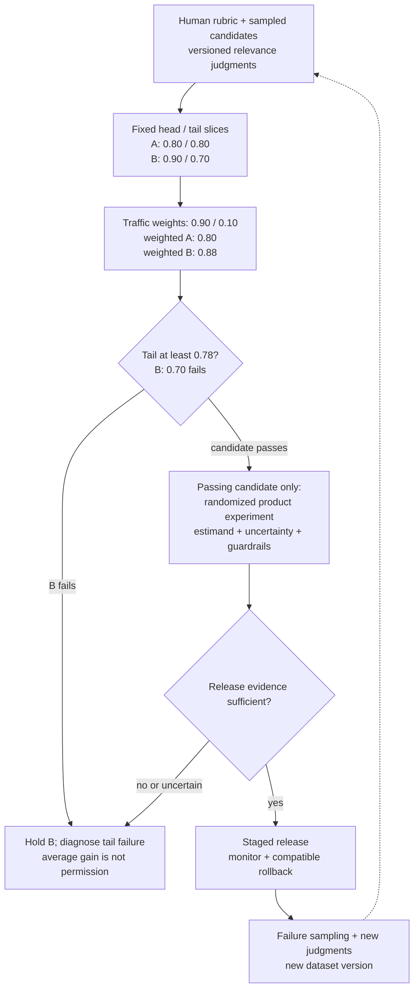

Decide whether a proposed search ranker improves the relevant metric and satisfies a required query-slice quality gate.

## Problem

**Context.** Two rankers have relevance judgments for frequent head queries and less frequent tail queries.
NDCG@10 summarizes ranking quality over the first ten results.

**Task.** Compute the traffic-weighted comparison below, apply the tail gate, and identify evidence still needed for a launch decision.

**Constraints.** Use the stated traffic weights rather than equal slice weights.
These invented offline scores do not by themselves measure user outcomes or causal product impact.

Compare A and B on two equally sized sets of judged queries: head and tail.
Suppose traffic is 90% head and 10% tail.
These are fictional slice means and traffic weights, not measured production results.

| Ranker | Head NDCG@10 | Tail NDCG@10 |
| --- | ---: | ---: |
| A | 0.80 | 0.80 |
| B | 0.90 | 0.70 |

The proposed offline gate requires tail NDCG@10 of at least 0.78.
Does B improve the headline metric, pass the gate or establish better user outcomes?

## Picture: The Weights Change the Headline

Imagine one equal-sized stack of judged queries for each slice.
Equal-slice averaging gives both rankers 0.80.
Traffic averaging gives the head stack nine times the tail stack's weight.

$$
\begin{aligned}
A_{\text{traffic}}&=0.9(0.80)+0.1(0.80)=0.80\\
B_{\text{traffic}}&=0.9(0.90)+0.1(0.70)=0.88.
\end{aligned}
$$

B gains 0.08 in traffic-weighted NDCG but loses 0.10 on tail queries.
It fails the declared 0.78 tail gate.
Neither weighted average establishes causal user benefit.

A weighted gain cannot erase a failed tail guardrail

<!-- visual:search-ranker-evidence-flywheel -->

<strong>Read it this way:</strong> calculate the weighted average, then apply the tail constraint. Passing offline screening permits further evaluation; it does not prove product lift.

## Decision Contract: Three Different Questions

| Layer | Measures | Important limit |
| --- | --- | --- |
| Human judgments | Relevance under a documented rubric | Rater agreement is not truth or user satisfaction |
| Offline metrics | Fixed-label ranking comparison, including slices | NDCG: graded ordering; MRR: first relevant result; Recall@K: relevant-result coverage |
| Online experiment | Defined behavioral/product effect under randomized exposure | Clicks depend on position and prior exposure; no-click can also mean success |

Freeze an evaluation manifest: query/candidate/judgment/exposure versions, cutoff, gains, weights, slices and uncertainty.
Also declare randomization unit, target effect, outcome maturity, guardrails, decision owner and rollback conditions.
Define zero-ideal-gain queries and relevance thresholds before computing metrics.

## Change 1: New Documents Have No Judgments

**New task.** A new retriever finds documents absent from the old judging pool.

**Picture and change.** Mark them unknown, pool candidates from multiple systems and obtain rubric-based judgments.
Version the resulting comparison and report judged coverage by slice.

**Check.** The old ranker must not win merely because its documents already have labels.

**Use when.** Candidate support changes.

## Change 2: The Goal Is Long-Term Satisfaction

**New task.** Relative click preference is insufficient for the release decision.

**Picture and change.** Choose a product experiment with suitable randomization, duration, mature outcomes and safety/cost/latency guardrails.
Interleaving can still compare rankers through attributed clicks under its protocol.

**Check.** Interleaving preference is not automatically long-term causal value or universally more powerful than A/B testing.

**Use when.** The target effect changes.

## Failure: Production Clicks Become Relevance Truth

Sampling only the current ranker's top results excludes unseen candidates.
Treating their raw clicks as relevance labels also confounds exposure, position and usefulness.
More data from that same selection process does not resolve missing support.

## Transfer Check

Does refreshing labels every quarter keep the evaluation valid?

### Reasoned Answer

No fixed calendar guarantees validity.
Monitor intents, candidates, policy, data and raters; refresh versioned rubrics while protecting ongoing comparisons.

<!-- learning:core-end -->

## Position and Counterfactual Evidence

Position-aware prediction alone does not identify relevance independently of exposure.
Randomized swaps and explicit click models need their own design and assumptions; they are not synonyms for interleaving.
Cascade and dynamic Bayesian click models impose behavioral assumptions, not guaranteed bias removal.

Logged-policy evaluation requires valid exposure propensities, support for evaluated actions, an identified outcome and controlled confounding/interference assumptions.
Inverse propensity weighting can have high variance.
It cannot recover unsupported actions by assigning them invented probabilities.
Record clipping and sensitivity analyses when used; correction changes uncertainty and sometimes the target.

## Build and Maintain the Judged Set

Sample production queries across head, torso, tail, verticals and relevant user segments.
Record sampling weights and privacy constraints; pool candidate documents beyond the current ranker's results.
Document graded relevance criteria, rater training, adjudication and disagreement.
Measure agreement by slice and investigate shared rubric errors; agreement alone cannot establish validity.
Rejudge ambiguous/new candidates and retain a protected comparison set with versioned updates.
There is no universal agreement target or refresh interval.

---

*Related: [learning-to-rank losses](/concepts/learning-to-rank-losses/), [counterfactual ranking](/concepts/position-bias-counterfactual-learning-to-rank/), [A/B testing for ML systems](/concepts/ab-testing-for-ml/), and [personalized search ranking](/guides/personalized-search-ranking/).*
