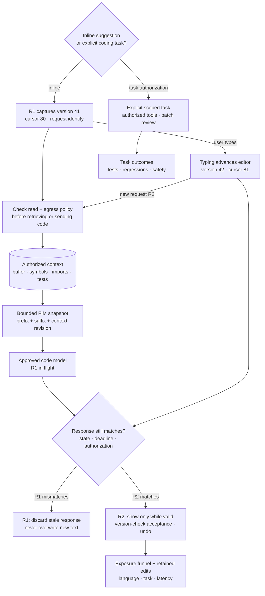

An inline completion belongs to one editor state; typing can make a valid-looking response stale before it arrives.

## Problem

A hypothetical request R1 targets document version 41 at cursor 80.
The user types, producing version 42 and cursor 81 before R1 returns.
R2 targets the new state.
R1's suggested code parses correctly. Which result may the editor display or accept?

## Picture

Treat each response as a proposal for its captured document, cursor, context and policy, not as free-floating code.
Cancellation can save work, but a late response still needs a validity check.

<!-- visual:coding-assistant-two-latency-paths -->

<strong>Read it this way:</strong> R1 can be syntactically correct but invalid for the current editor. R2 also needs a fresh check when displayed and accepted.

References: <a href="https://arxiv.org/abs/2207.14255">FIM</a>, <a href="https://arxiv.org/abs/2303.12570">RepoCoder</a>, and <a href="https://docs.github.com/en/copilot/concepts/context/repository-indexing">repository indexing</a>.

## Capture and check request identity

| Captured field | Validity dependency |
| --- | --- |
| Request/document ID, version, cursor/selection | Locates the suggestion's exact edit target |
| Prefix/suffix hashes and context revision | Detects changed prompt dependencies |
| Policy identity and live authorization | Prevents reuse after access or egress changes |
| Cancellation and deadline | Prevents abandoned or late presentation |
| Suggestion/edit IDs | Connects exposure, acceptance and ordinary undo |

Compare these fields on return; recheck state and authorization at acceptance.
Use the editor platform's version-aware APIs for an atomic, undoable edit.
A successful earlier check does not prevent a later race.

| Event | Current state | Decision |
| --- | --- | --- |
| R1 captured | Version 41, cursor 80 | Start bounded work |
| User types | Version 42, cursor 81 | Cancel R1; capture R2 |
| R1 returns | Still version 42 | Discard despite valid syntax |
| R2 returns | Its snapshot still matches | Show only if authorized and before deadline |

## Frame before architecture

Scope completion type, repository context, deployment policy and measured latency target first.
Inline suggestions, function generation, chat and agent tasks need different interaction and evaluation contracts.

For FIM-capable models, serialize prefix, suffix and insertion position using the supported template.
Retrieve bounded relevant context: imports, definitions, structural neighbors, recent edits/navigation and tests.
BM25, embeddings and symbol/import graphs are options; benchmark retrieval quality under access and prompt-budget constraints.

## Change the workflow or deployment policy

### 1. Request a multi-file refactor

**Picture and change:** move to explicit scope, tool authorization, patch review and task-level verification.
Use tests, regressions, safety and task outcomes rather than inline acceptance.

**Check:** an inline completion cannot authorize a shell command.

**Use when:** work requires actions across files, not a cursor-bound insertion.

### 2. Keep private code on device

**Picture and change:** use approved local inference and context processing; disable incompatible remote routes and content telemetry.

**Check:** remote embedding uploads also violate the policy, even if generation is local.
Credential filtering alone does not authorize egress.

**Use when:** residency covers source and its derived representations.

## Failure and transfer

A cached suggestion keyed only by prefix can survive a changed suffix or revoked permission.
Cache identity must cover its actual dependencies, model and prompt configuration; recheck access on reuse.

Acceptance rises after fewer suggestions are shown. Did useful assistance improve?

Check your answer

Not necessarily. Compare eligible opportunities, shown suggestions, acceptance, retained output and user outcomes, not acceptance's selected denominator alone.

<!-- learning:core-end -->

## Choose measured model paths

A small fast model for inline work and another model for explicit tasks is one design, not a universal requirement.
Size and latency depend on hardware, context, batching and network conditions.
FIM capability requires compatible training and formatting; a template alone does not create it.

## Speculation and caching

Debounce speculative requests, cancel obsolete work and still reject stale results.
Measure saved wait against wasted compute and privacy exposure.

Embedding caches need content/model revisions and access controls.
Prefix KV reuse requires the actual compatible serialized prefix, model state, positions and attention rules.
It is different from reusing a complete suggestion after the suffix changes.

## Common follow-up

For a fast model, compare an existing FIM-trained code model, authorized continued pretraining and distillation.
Train only on approved code/prompts and retain permissions through data collection, storage and evaluation.
Distillation can specialize to production prompts, but quality and out-of-distribution behavior require measurement.
No model-size range or training method guarantees the best result.

## Evaluate the complete product

Slice retained edits, dismissals, latency and task outcomes by language and task type.
Compare the previous assistant and appropriate no-assistant baselines.
Filter sensitive content, honor retention controls and test tools under real task boundaries.
No architecture vocabulary or answer guarantees a hiring outcome.

*Related: [design an AI coding product](/questions/design-ai-coding-product/), [enterprise agent-platform design](/questions/design-enterprise-agent-platform/), [build evals for a coding assistant](/questions/evals-for-coding-assistant/), and [reduce LLM inference cost](/questions/reduce-llm-inference-cost-10x/).*

