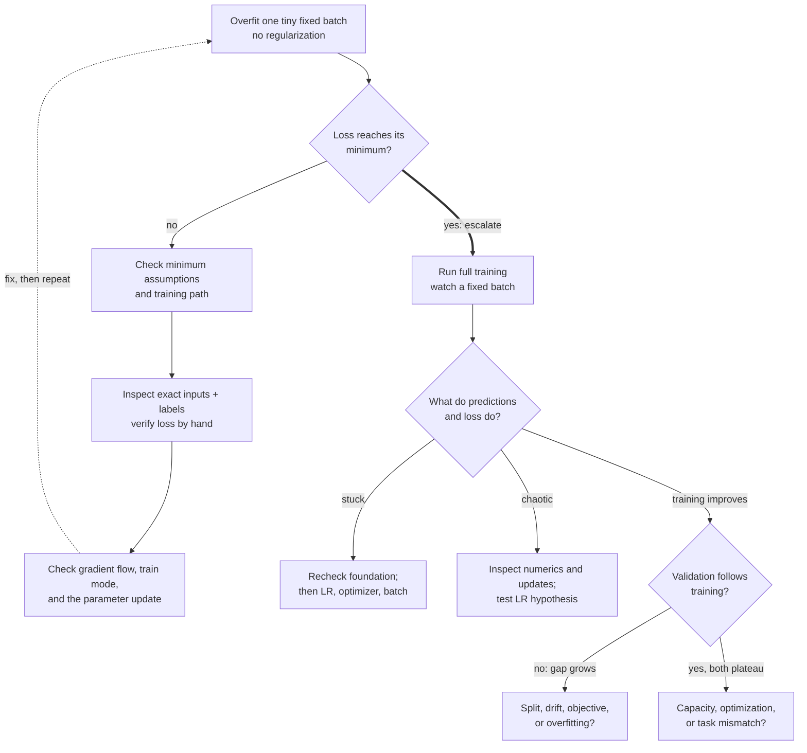

Investigate a training run that appears not to learn, and propose checks that distinguish competing explanations.

## Problem

**Context.** A hypothetical model-training run shows flat loss or unchanging task performance, despite apparently completing training steps.
You can inspect a small batch, the objective, gradients, parameters, and evaluation outputs.

**Task.** Define the failing observation, prioritize hypotheses, and choose cheap tests with predicted results before changing the training system.
Explain how the investigation changes if loss falls but task performance does not.

**Constraints.** Distinguish objective computation, gradient flow, optimizer updates, and evaluation correctness.
Control randomness and change one causal factor per check; an observed correlation alone does not identify the defect.
The retained level headings organize examples, not hiring guarantees.

## What an L4 answer sounds like

"Check the learning rate, loader, loss, and optimizer" names possibilities without an observation that distinguishes them.
Changing all four together may improve loss while leaving the actual fault unidentified.

## What an L5 answer sounds like

Freeze a tiny batch, inspect its actual inputs and targets, and disable optional regularization or augmentation for the diagnostic.
State an attainable loss before asking the model to memorize it.
Two identical inputs with opposite binary labels have minimum mean cross-entropy $\log2$, not zero, for a deterministic shared prediction.

Use a scalar control with parameter $w=0$, loss $L=\tfrac12(w-3)^2$, and SGD rate $0.1$.
The initial loss is $4.5$, gradient $-3$, expected updated parameter $0.3$, and new loss $3.645$.
If the gradient is $-3$ but $w$ remains zero, the gradient alone has not established a working update.
Inspect optimizer membership, whether the step executed, resets, finite-value guards, and frozen parameters before changing capacity.

For the real batch, record the hand-computed loss, reduction, gradient, and before/after parameter values.
Keep a hypothesis/test/result ledger; change one supported cause, then repeat the same check.

Diagnostic path

A fixed-batch check selects hypotheses; its symptoms do not identify one cause automatically.

<!-- visual:model-not-learning-diagnostic-path -->

<strong>Read it this way:</strong> establish the batch's attainable minimum first. Check exact inputs, loss, gradients, and updates before escalating. Later symptoms select hypotheses, not unique diagnoses. Original synthesis follows <a href="https://karpathy.github.io/2019/04/25/recipe/">Karpathy's training recipe</a> and the <a href="https://cs231n.github.io/neural-networks-3/">CS231n learning notes</a>.

## What an L6 answer sounds like

Extend the evidence, not the number of simultaneous interventions.
Check target conventions, masks, sum-versus-mean reduction, accumulation counts, train/eval mode, and finite gradients alongside parameter changes.
Evaluation mode does not universally disable gradients; its effect depends on the layers.
Measure device throughput and completed optimizer steps separately from mathematical learning progress.

### The Loss Improves but the Task Does Not

**New task:** Diagnose useful-output failure after verifying the update path.

**Picture and change:** Construct low-loss failure cases and inspect targets, masks, scoring, and deployment objectives.

**Check:** Ninety-nine padding tokens improving from loss one to zero can hide one important token remaining at loss one.
The all-token mean falls from one to $0.01$ without fixing that important prediction.

**Use when:** The optimized measurement and required task disagree; this does not establish a gradient fault.

### Training Improves but Validation Degrades

**New task:** Explain a growing gap without assuming one cause.

**Picture and change:** Audit split validity, target consistency, distribution differences, and evaluation mode before testing ordinary overfitting.

**Check:** A validation-only class cannot be supplied merely by adding dropout.

**Use when:** The two datasets may no longer support the same inference.
Regularize or change data only after a discriminating check supports that intervention.

<!-- learning:core-end -->

## The tells that get you a strong-hire vote

Use the retained heading as a response-quality checklist, not a prediction of an interviewer vote.
Show an ordered test, its possible outcomes, actual observed evidence, and the next conditional action.
Discuss real experience honestly; do not invent debugging history to imitate these examples.

## The tells that get you down-leveled

An unordered optimizer/LR/initialization/loader sweep cannot isolate a fault, even if the final run improves.
Likewise, frozen predictions can reflect update failures, saturation, insensitive measurements, or logging errors rather than one proven cause.

## A follow-up the interviewer often asks

For slow progress, compare loss per completed update and wall-clock step rate before selecting an optimization or systems hypothesis.
Inspect gradient scale, numerical precision, conditioning, data coverage, and update magnitude where evidence points.
Squared error on class probabilities can be a legitimate Brier objective; classification alone does not make MSE invalid.
It can still differ from cross-entropy in gradients, calibration behavior, and the intended decision target.

---

*Related: [How would you evaluate an LLM application?](/questions/how-would-you-evaluate-an-llm-application/), [Walk me through bias-variance tradeoff](/questions/bias-variance-tradeoff/).*

