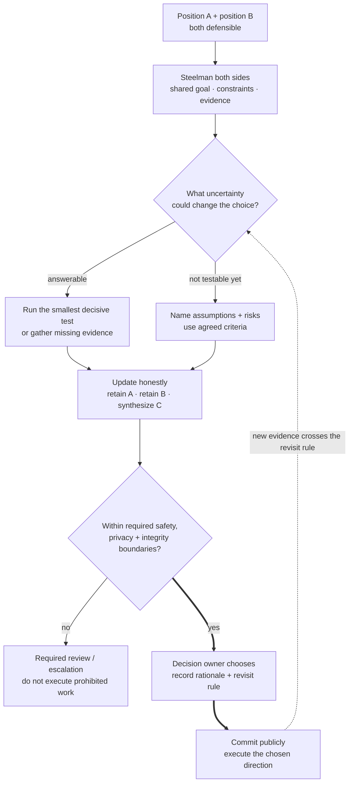

Explain a technical disagreement with a senior colleague through both positions, the deciding evidence, and your role in the resolution.

## Problem

**Context.** An interviewer asks about a real disagreement; the fictional choice below provides a rehearsal of the decision mechanics.

**Task.** Explain the competing goals, gather deciding evidence, identify the decision owner, and describe the outcome and follow-through.
For the rehearsal, decide which option currently satisfies the requirements and what new evidence could reopen the choice.

**Constraints.** Mandatory processing-region rules cannot be traded away for speed or cost without authorized requirement changes.
Use your own experience in an interview, distinguish facts from assumptions, and represent the other position fairly.

Use this fictional rehearsal, not a personal project claim:

| Option | Latency | Cost | Approved processing region? |
| --- | ---: | ---: | --- |
| A | 80 ms | $100,000 | Yes |
| B | 60 ms | $70,000 | No |

The requirements are latency below 100 ms and an approved processing location.
Someone favors B's speed and cost; you favor A's compliance with the current boundary.
What evidence resolves the choice? What could reopen it?

## Picture: Evidence Before Commitment

A declared boundary can reject the faster option

<!-- visual:disagreement-evidence-commit-loop -->

<strong>Read it this way:</strong> test the deciding uncertainty, not the other person's status. Commit to allowed work; a decision owner cannot remove every external obligation.

## Apply the Constraints Independently

Both 80 and 60 ms are below 100 ms.
B's lower cost cannot compensate for its failed region requirement.
The owner can select A or investigate an approved B configuration.
Record regional approval as a possible reopening condition; do not assume it will occur.

## Change 1: The Other Approach Is Selected

**New task.** The owner chooses another defensible, permitted approach.

**Picture and change.** Execute it responsibly; observe the distinguishing metrics and agreed revisit condition.

**Check.** Commitment does not require pretending your earlier uncertainty vanished or waiting to say you were right.

**Use when.** Your recommendation is not selected.

## Change 2: The Decision Crosses a Hard Boundary

**New task.** The chosen action violates a non-negotiable safety, privacy or integrity rule.

**Picture and change.** Use required review/escalation and keep appropriate records; do not treat ordinary commitment as authorization.

**Check.** An owner cannot waive every external duty.

**Use when.** The issue is a prohibited action, not an ordinary preference.

## Failure: A Scripted Victory or Conversion

A story fails to explain the decision when it omits credible opposition or invents a change of mind.

## Transfer Check

Must a disagreement end with a third option C?

### Reasoned Answer

No. Evidence can support retaining A or B. Synthesis is a possible result, not a required narrative.

<!-- learning:core-end -->

## What the question actually tests

Describe technical conviction, productive challenge and willingness to update when warranted.
Do not fabricate disagreement or opposing competence to fit a story.

## Evidence Worksheet

Use STAR(L) as optional prompts, not memorized filler:

| Prompt | Record |
| --- | --- |
| Situation/task | Shared goal, constraints, responsibility and decision rights |
| Positions | Strongest actual argument for each option |
| Action | Your discussion, document, test, collaboration or escalation |
| Evidence | Measured facts, assumptions and remaining uncertainty |
| Decision/result | Owner, selected option, what shipped and observed outcome |
| Learning | What changed or remained; revisit condition |

Separate personal/team contributions and observed/counterfactual impact.
When a decisive test is unavailable, state criteria and risks instead of inventing certainty.
Technical versus strategic topic labels do not determine scope or company level.

## Check the Account

Can another person probe the technical decision and reconstruct your actual contribution?
Neither changing your view nor creating C is mandatory.

## Missing Evidence

Replace generic advocacy with the missing rationale, action, outcome limit or reopening rule.

## A trap to avoid

Respectful representation does not require pretending an unsafe proposal is acceptable.
Avoid caricaturing the other person; explain the disputed reasoning and constraint.

## Common follow-up

What if your recommendation lost? Explain allowed execution, distinguishing observations and agreed review, not a grudge.

## Sources

- [Amazon leadership principles](https://www.amazon.jobs/content/en/our-workplace/leadership-principles).
- [Psychological safety and team learning](https://doi.org/10.2307/2666999).
- [NASA decision analysis](https://ntrs.nasa.gov/citations/20170001761).

---

*Related: [The 5 things every applied scientist interview is testing for](/guides/five-things-as-interview-tests/), [senior through senior-principal ML scope](/guides/l5-vs-l6-faang-ml/).*

