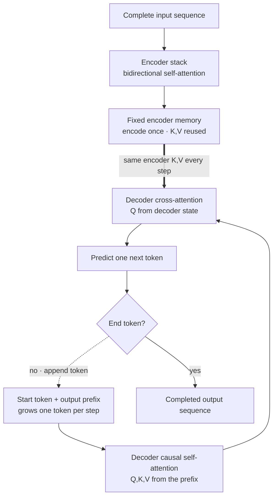

## Summary

An attention-based autoregressive encoder-decoder routes source representations and a growing target prefix through different attention paths.
Its source memory can remain fixed during generation while target state grows; this requires fixed source input and parameters.
Other encoder-decoder systems, including nonautoregressive decoders, need not share this factorization.

## The structure

For one decoder layer, let $H=Encoder(source)$ and use:

$$
Q=target\_states\,W_Q,\qquad K=HW_K,\qquad V=HW_V.
$$

Source K/V projections belong to that layer; different layers need not share them.
Target self-attention reads the causal target prefix, whereas cross-attention reads the permitted source memory.
Padding and source-availability masks remain separate from the target causal mask.

Consider three source positions producing $H\in\mathbb R^{3\times2}$, then output token y1 followed by EOS.
One encoder pass produces H and the layer's source K/V.
BOS supplies the first incremental target query: three source score pairs precede y1.
The next query, after appending y1, contributes three more pairs before EOS.
Total: one encoder pass, two incremental decoder steps, and six cross-score pairs per head and layer.

Source and target state

Reuse fixed source memory while causal target state grows.

<!-- visual:encoder-once-decoder-loop -->

<strong>Read it this way:</strong> encode a fixed source once, then append target tokens through the decoder path. Target queries read each layer's reusable source K/V. The target cache grows; the source length does not. Original synthesis follows the <a href="https://arxiv.org/abs/1706.03762">Transformer paper</a>, <a href="https://arxiv.org/abs/1409.3215">sequence-to-sequence formulation</a>, and <a href="https://huggingface.co/docs/transformers/en/model_doc/encoder-decoder">implementation documentation</a>.

### Switch to Teacher-Forced Scoring

**New task:** Score observed labels y1, EOS rather than sampling them.

**Picture and change:** Decoder inputs are BOS, y1; labels are y1, EOS.
Suitable causal-transformer implementations evaluate both target positions in parallel, with source access retained except padding.

**Check:** The first prediction cannot read the second input position containing y1.
Two target positions still make six source score pairs.
Unshifted inputs y1, EOS would leak each answer through its own position despite a causal mask.

**Use when:** Computing training loss or conditional sequence likelihood.

### Change the Source

**New task:** A fourth token arrives for a bidirectional encoder.

**Picture and change:** Recompute or explicitly invalidate affected source encodings and derived caches; older source states can change too.

**Check:** New H has shape $4\times2$ and four cross keys, not three old keys plus an independently encoded token.
Previously decoded target states may also be incompatible with the changed source.

**Use when:** The input changes; streaming needs a separately specified information-flow and cache policy.

## Cross-attention complexity

For source length $n$ and evaluated target length $m$, dense cross-attention makes $mn$ score pairs per head and layer.
Score and value arithmetic also depend on their dimensions; projection, encoder, and target-self-attention costs are additional.
The incremental trace evaluates only new target queries; repeatedly recomputing the full prefix performs different work.

<!-- learning:core-end -->

## Encoder-only vs. decoder-only vs. encoder-decoder

| Model class | Use cases | Examples |
|------------|-----------|----------|
| **Encoder-only** | Embeddings, classification, retrieval | BERT, RoBERTa, sentence-T5 |
| **Decoder-only** | Generation, chat, code | GPT-2/3/4, Llama, Mistral, Claude |
| **Encoder-decoder** | Translation, summarization, structured output | T5, BART, mT5, FLAN-T5 |

## Why decoder-only models took over chat

The retained historical heading is not an architectural superiority theorem.
Compare training recipe, source/target lengths, reuse, quality, and deployment costs rather than asserting that a clear split guarantees victory.

## Variants and their distinctions

- **Original transformer** [(Vaswani 2017)](https://arxiv.org/abs/1706.03762): encoder-decoder for NMT.
- **BERT**: encoder-only, masked-language-model objective.
- **GPT**: decoder-only, autoregressive next-token.
- **T5** [(Raffel 2019)](https://arxiv.org/abs/1910.10683): encoder-decoder, span-corruption objective; everything is text-to-text.
- **BART**: encoder-decoder, denoising autoencoder.
- **FLAN-T5**: T5 + instruction fine-tuning.

## Common pitfalls

- **Unshifted targets:** causality alone does not hide the current input token.
- **Wrong cache lifetime:** source memory is reusable only under its fixed-input/parameter contract.
- **Universal dominance:** neither a separate encoder nor a single stack guarantees better cost or quality.

## Related

- [Transformer architecture](/concepts/transformer-architecture/). Block-level structure.
- [Attention mechanism](/concepts/attention-mechanism/). Both self- and cross-attention.

