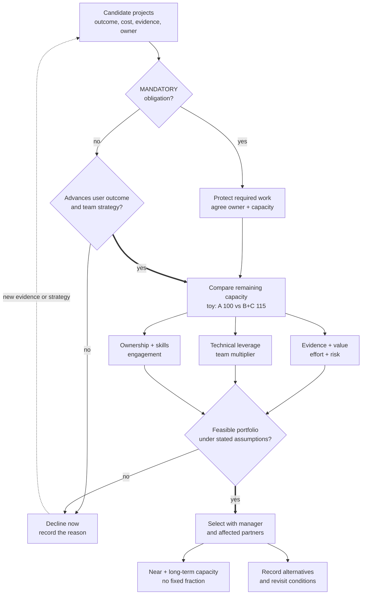

Choose work against its next-best feasible alternative, not against doing nothing.
Protect obligations before comparing optional projects.

## Problem

In this hypothetical exercise, four engineer-weeks are available:

| Project | Engineer-weeks | Modeled value units |
| --- | ---: | ---: |
| A | 4 | 100 |
| B | 2 | 60 |
| C | 2 | 55 |

All projects are optional, independently staffed and indivisible; benefits add without overlap on this invented common scale.
Which portfolio fits? What could reverse the choice?

## Picture: Choosing One Uses Capacity Elsewhere

<!-- visual:work-prioritization-counterfactual-portfolio -->

<strong>Read it this way:</strong> protect required work before optional scoring. Compare portfolios using the same remaining capacity, then record what would change the decision.

## Compare the Feasible Portfolios

A uses four weeks for 100 units.
B+C uses $2+2=4$ weeks for $60+55=115$ units: 15 more under the stated assumptions.
This is modeled value, not measured impact.

Do not add incompatible real-world metrics into a precise-looking score or double-count shared benefits.
Use ranges and explicit outcome/guardrail trade-offs instead.

## Change 1: B Needs an Unfunded Platform

**New task.** B requires two additional engineer-weeks before delivering value.

**Picture and change.** Include prerequisite cost, timing and shared benefits. B+C now needs six weeks and is infeasible.

**Check.** A's 100 beats feasible C's 55 here; B alone offers 60 within four weeks.

**Use when.** Projects share dependencies or scarce skills.

## Change 2: A Is Assigned Required Work

**New task.** A satisfies a mandatory obligation.

**Picture and change.** Represent its rationale fairly; agree authority, scope and capacity before proposing alternatives.

**Check.** Optional value cannot cancel an obligation. Saying no is not itself impact.

**Use when.** Priorities conflict with another owner.

## Failure: Criteria Without a Decision

Interests and strategy slogans do not identify a forgone alternative, evidence or actual outcome.

## Transfer Check

Why might a lower estimated-value project still be selected?

### Reasoned Answer

A duty, dependency, risk, skill constraint or uncertain forecast can change feasibility or utility.
Name the reason rather than hiding it inside a score.

<!-- learning:core-end -->

## Evidence Worksheet

Use a real recent choice, not the fictional value exercise as a personal achievement.

| Field | Record |
| --- | --- |
| Candidate/outcome | User population, outcome and guardrails |
| Evidence | Known facts, uncertainty and modeled versus observed impact |
| Future cost | People, time and next-best alternative; do not justify from sunk effort |
| Leverage | Technical prerequisites and team multiplier without double counting |
| Fit | Skills, owner, delegation and sustained engagement |
| Decision | What you chose/declined, with whose authority |
| Revisit | What shipped, measured outcomes and reopening evidence |

Balance delivery and longer-term investment against strategy and obligations.
Two-thirds/one-third is an illustrative allocation, not a rule.
Engagement informs ownership feasibility; it does not override user duties.

## Check the Account

Can another person reconstruct the alternative, rationale, personal contribution and observed result?
Decision rights vary by team; independence is not a universal level test.

## Missing Evidence

Add missing user value, strategic rationale, ownership or a concrete trade-off. Do not invent an example or outcome.

## Common follow-up

Describe a time you proposed not doing assigned work.
Explain the original rationale, alternative, assigning party's response, final decision, actual delivery and what you would change.

## Sources

- [NASA decision analysis](https://ntrs.nasa.gov/citations/20170001761).
- [OpenStax opportunity cost](https://openstax.org/books/principles-economics-3e/pages/2-1-how-individuals-make-choices-based-on-their-budget-constraint).
- [Project portfolio research](https://doi.org/10.1111/1467-9310.00225).

---

*Related: [The 5 things every applied scientist interview is testing for](/guides/five-things-as-interview-tests/), [senior through senior-principal ML scope](/guides/l5-vs-l6-faang-ml/).*

