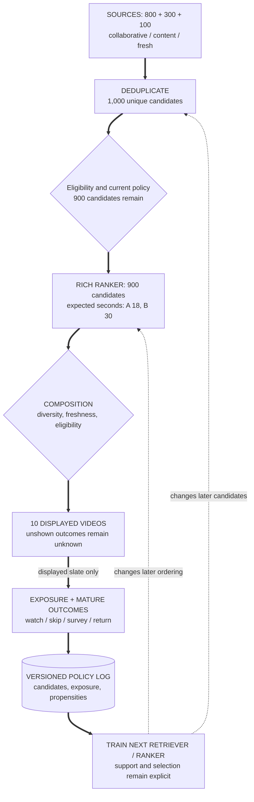

Retrieval limits what ranking can show, and the displayed slate limits ordinary feedback; choose surface and objective first.

## Problem

Design a YouTube-like home feed, not search or watch-next.
This is a hypothetical design, not a claim about YouTube's current internal system.
Specify catalog/request scale, permitted signals, useful viewing, cost, latency and safety before selecting models.

Two eligible videos have stipulated component estimates:

| Video | P(watch given impression) | Expected seconds given watch |
| --- | ---: | ---: |
| A | 0.90 | 20 |
| B | 0.50 | 60 |

Choose between watch probability and expected watch duration.
Then explain what retrieval, composition and exposure must retain for reliable feedback.

## Picture: The Objective Changes the Order

Assume zero watch seconds without a watch and the stated conditional durations.
Multiplying each video's probability by its conditional seconds gives its expected seconds per impression.

$$
\begin{aligned}
A &: 0.90\times20=18\text{ seconds}\\
B &: 0.50\times60=30\text{ seconds}.
\end{aligned}
$$

Watch probability prefers A; expected duration prefers B.
Neither order establishes satisfaction, safety, content quality or long-term retention.

For one toy request, three sources return 800 collaborative, 300 content and 100 fresh candidates.
Overlap leaves 1,000 unique candidates; eligibility leaves 900, and the displayed slate contains ten.
Ranking cannot recover a useful video absent from retrieval.

Candidate coverage and selective feedback

The ten displayed videos, not the 1,000 retrieved candidates, generate ordinary exposed feedback.

<!-- visual:youtube-recommender-selective-feedback-loop -->

<strong>Read it this way:</strong> follow the candidate counts, then compare A and B's expected seconds. Only displayed videos can produce ordinary exposed feedback; unshown outcomes remain unknown.

Original synthesis informed by the <a href="https://research.google/pubs/deep-neural-networks-for-youtube-recommendations/">YouTube candidate-generation and ranking paper</a>, its <a href="https://research.google/pubs/recommending-what-video-to-watch-next-a-multitask-ranking-system/">multitask ranking follow-up</a>, and <a href="https://arxiv.org/abs/1710.11214">Chaney, Stewart, and Engelhardt on algorithmic confounding</a>. No source figure or layout is reproduced.

## Decision Contract

| Boundary | Required record/check |
| --- | --- |
| Surface | Home-feed users, catalog/request scale, permissions, useful-viewing objective and constraints |
| Retrieval | Source coverage, eligible candidates, model/index/embedding versions and recall diagnostics |
| Ranking | Richer features, conditional targets, units, missing-label rules and serving utility |
| Composition | Eligible slate, freshness/diversity constraints, exposure policy and bounded exploration |
| Feedback | Request/item/position, policy/propensity, observed exposure, outcome definition, maturity and censoring |
| Release | Temporal/user separation, slice metrics, supported counterfactual checks, mature experiment, guardrails and rollback |

Measure end-to-end latency, including queueing, networking and feature retrieval; stage p95 values do not sum into an end-to-end p95.
Retain compatible versions and a policy-approved fallback when retrieval, features or ranking fail.

## Change 1: A Video Has Content but No History

**New task.** A new eligible video has no interaction data.

**Picture and change.** A content-aware tower can embed it; alternatively add a validated content/new-item source.
Use bounded exploration, retaining exposure and quality checks.
For new users, combine permitted context, optional preferences and content without a fixed session-count switch.

**Check.** Not all towers require item history; a boost cannot bypass policy or prove value.

**Use when.** Collaborative evidence is missing.

## Change 2: Category Exposure Narrows

**New task.** Users see fewer categories over time.

**Picture and change.** Define per-user category entropy, catalog impression concentration and eligible creator/content coverage.
Inspect exposure, position, user intent and satisfaction; test a justified coverage intervention with explicit constraints.

**Check.** Entropy, replay or concentration alone does not prove a harmful filter bubble or a causal remedy.

**Use when.** Feedback may reduce coverage or satisfaction.

## Failure: More Clicks Become Long-Term Satisfaction

Learning only from narrow displayed slates and labeling unshown items negative reinforces the prior policy.
Higher click rates do not establish useful viewing or mature retention.

## Transfer Check

Can calibrated task heads automatically produce one calibrated probability after combination?

### Reasoned Answer

No. Heads can represent different events, conditional populations and units.
Define the serving utility and estimate each required component on its proper population.
The expected-seconds score above is not a probability.

<!-- learning:core-end -->

## Conditional Heads and Training

Two-tower retrieval can use sampled softmax or in-batch negatives, with attention to sampling, false negatives and train/serve compatibility.
Approximate-neighbor search trades recall, latency and cost; benchmark it on eligible candidate coverage.
A richer ranker can share features across tasks, but shared training can create interference.
Architecture names such as DCN-V2 or transformers do not establish fitness.

Calibrate probability heads on their declared populations, using suitable held-out data and slice checks.
Platt or isotonic calibration does not correct missing exposure or survey-response selection by itself.
Watch duration conditional on watching differs from per-impression duration; completion fractions also change the product objective.
Handle censoring explicitly.

## Exposure and Long-Horizon Limits

Inverse-propensity and doubly robust estimators need supported actions, valid logged policy information and identified outcomes.
They do not reveal arbitrary unseen-video outcomes or remove every confound.
Exploration needs safety constraints, acceptable exposure risk and an observation policy, not synthetic negative labels.

Surveys measure respondents under their sampling process, not automatic all-user satisfaction.
Choose an appropriate randomized experiment, duration, assignment unit, mature target and safety/diversity/cost guardrails.
Account for interference and attrition where relevant.
Offline screening, surveys and experiments each contribute evidence with different population and measurement limits.
None is a universal replacement for the others.

---

*Related: [short-form video ecosystem design](/questions/design-short-form-video-ecosystem/), [annotated ecosystem-strategy mock](/guides/annotated-ecosystem-strategy-mock/), [multi-task learning](/concepts/multi-task-learning-objective-interference/), and [counterfactual ranking](/concepts/position-bias-counterfactual-learning-to-rank/).*
