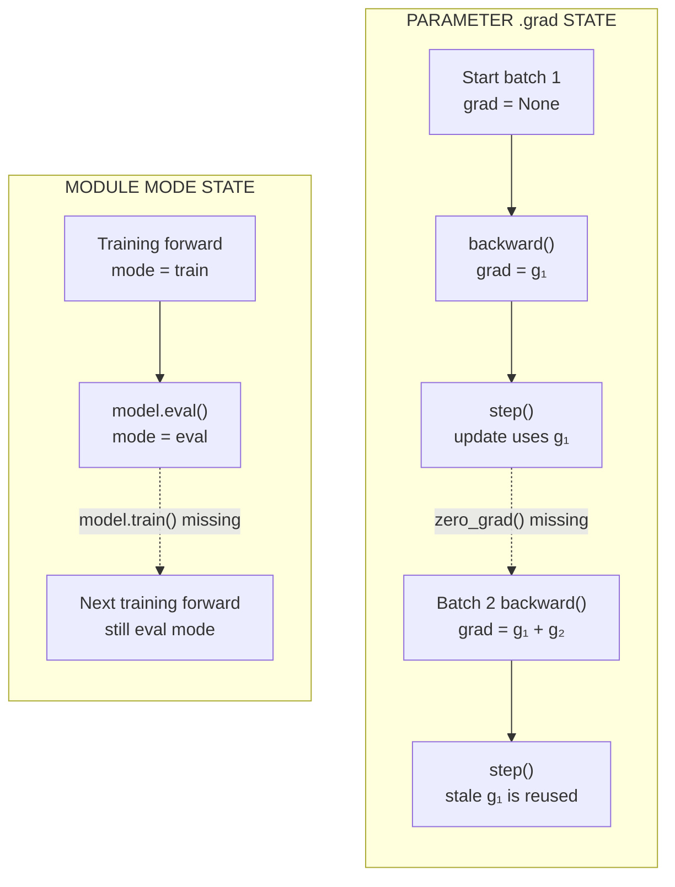

A training loop carries parameter gradients and module mode between batches.
Trace those states before changing the loss or guessing which task the model performs.

## Problem

Inspect the supplied loop. Assume ordinary PyTorch module and optimizer behavior.
Identify persistent-state defects, then separate them from questions requiring missing model, data or device information.
The following is deliberately broken exercise code, not a runnable reference.

<span id="example-a-bug-laden-pytorch-loop"></span>

```python
import torch
import torch.nn as nn
import torch.optim as optim

model = MyModel()
optimizer = optim.Adam(model.parameters(), lr=1e-3)
criterion = nn.MSELoss()

for epoch in range(10):
    for x, y in dataloader:
        # forward
        pred = model(x)
        loss = criterion(pred, y)

        # backward
        loss.backward()
        optimizer.step()

        # eval inside training loop
        if epoch % 2 == 0:
            model.eval()
            val_pred = model(x_val)
            val_loss = criterion(val_pred, y_val)
            print(f"epoch {epoch} val loss: {val_loss}")
```

## Picture

`optimizer.step()` does not clear `.grad` buffers.
`model.eval()` persists until the mode is changed again.
Gradient recording is a third, separate setting: `no_grad()` does not restore training mode.

<!-- visual:training-loop-persistent-state -->


<p class="diagram-caption"><strong>Read it this way:</strong> follow each lane into the next batch. A parameter update leaves gradient buffers intact. An evaluation-mode switch persists. A local no-grad context changes neither of those reset requirements.</p>

## Calculate the stale-gradient effect

Use a scalar SGD calculation, not Adam: $w_0=0$, rate $0.1$, loss $(w-t)^2/2$.
The first target $t=1$ gives gradient $-1$ and $w_1=0.1$.
For target $t=2$, the new gradient is $-1.9$.

| Buffer before the second update | Used gradient | Next weight |
| --- | --- | --- |
| Cleared before backward | $-1.9$ | $0.29$ |
| Old $-1$ retained | $-2.9$ | $0.39$ |

Stale accumulation changes the update. It is not generally an N-times learning-rate multiplier, especially with Adam's moments.
Intentional accumulation needs its own reduction and reset boundary.

## Code with an explicit task

This complete CPU fixture uses two-class logits and integer class targets.
Its tiny split tests execution, not convergence or evaluation validity.

```python
import torch
from torch import nn
from torch.utils.data import DataLoader, TensorDataset

torch.manual_seed(0)
device = torch.device("cpu")
train_data = TensorDataset(
	torch.tensor([[0., 0.], [1., 0.], [0., 1.], [1., 1.]]),
	torch.tensor([0, 1, 1, 0]),
)
val_data = TensorDataset(
	torch.tensor([[0.2, 0.1], [0.8, 0.1]]),
	torch.tensor([0, 1]),
)
dataloader = DataLoader(train_data, batch_size=2, shuffle=False)
val_loader = DataLoader(val_data, batch_size=2, shuffle=False)
model = nn.Sequential(
	nn.Linear(2, 4), nn.ReLU(), nn.Dropout(0.2), nn.Linear(4, 2)
).to(device)
optimizer = torch.optim.Adam(model.parameters(), lr=1e-3)
criterion = nn.CrossEntropyLoss()
for epoch in range(2):
	model.train()
	for batch_inputs, batch_targets in dataloader:
		batch_inputs = batch_inputs.to(device)
		batch_targets = batch_targets.to(device)
		optimizer.zero_grad(set_to_none=True)
		loss = criterion(model(batch_inputs), batch_targets)
		loss.backward()
		optimizer.step()
	model.eval()
	val_sum, val_count = 0.0, 0
	with torch.no_grad():
		for batch_inputs, batch_targets in val_loader:
			batch_inputs = batch_inputs.to(device)
			batch_targets = batch_targets.to(device)
			val_sum += criterion(model(batch_inputs), batch_targets).item() * batch_targets.numel()
			val_count += batch_targets.numel()
	print(epoch, val_sum / val_count)
	model.train()
```

## Change the loop requirement

### 1. Validate between training updates

**New task:** run one diagnostic validation batch immediately after an update.

**Picture and change:** replace the epoch validation block with this excerpt after `optimizer.step()`.
It uses the fixture's existing model, device, loss and validation loader.

```python
validation_inputs, validation_targets = next(iter(val_loader))
validation_inputs = validation_inputs.to(device)
validation_targets = validation_targets.to(device)
previous_mode = model.training
model.eval()
try:
	with torch.no_grad():
		val_loss = criterion(model(validation_inputs), validation_targets)
finally:
	model.train(previous_mode)
```

**Check:** entered from training mode, it exits in training mode and `val_loss.requires_grad` is false.

**Use when:** more training forwards follow the diagnostic in the same epoch.

### 2. Bound measured gradient growth

**New task:** require a maximum gradient norm of one after observing finite gradient growth.

**Picture and change:** insert this between backward and the optimizer step, retaining gradient clearing.

```python
torch.nn.utils.clip_grad_norm_(
	model.parameters(), max_norm=1.0, error_if_nonfinite=True
)
```

**Check:** gradient $[3,4]$ has norm five and becomes approximately $[0.6,0.8]$.
Nonfinite norms raise an error.

**Use when:** evidence motivates clipping. Its absence alone is not a demonstrated defect.

## Do not invent the task from the loss name

MSE can be correct for regression with matching floating targets and outputs.
The original excerpt does not establish classification, validation overlap or a GPU requirement.
Check those contracts before changing them.

## Try separating recording from mode

Validation uses `no_grad()`, but the next training batch behaves differently. Which state must be inspected?

<details>
<summary>Check your answer</summary>

Inspect `model.training` and mode-sensitive layers such as dropout and BatchNorm.
`no_grad()` controls recording, not persistent module mode.

</details>

<!-- learning:core-end -->

<div data-learning-extension>

<span id="senior-debugging-procedure-the-actual-signal"></span>
<span id="what-an-l4-candidate-misses"></span>
<span id="what-an-l5-candidate-finds"></span>
<span id="what-an-l6-candidate-adds"></span>
<span id="tells-that-get-you-a-strong-hire-vote"></span>
<span id="tells-that-get-you-down-leveled"></span>

## Choose the next discriminating check

| Suspected defect | Cheap check | Possible consequence |
| --- | --- | --- |
| Broken gradient flow | Inspect `requires_grad`, parameter gradients and parameter changes | No learning or an incorrect update |
| Wrong loss contract | Check output shape, target dtype, reduction and API inputs | Crash or silently wrong objective |
| Mode or recording leak | Inspect module mode and validation graph state | Changed dropout/BatchNorm or unnecessary graph memory |
| Device mismatch | Compare parameter, input and target devices | Runtime error or an unintended CPU run |
| Unstable numerics | Locate the first nonfinite value and inspect gradient scale | Corrupted update; clipping may not repair the cause |

Missing validation variables can crash; a fixed batch may instead mislead evaluation.
Neither consequence follows without checking what those variables contain.
Repeated validation inside every batch also changes cost and selection exposure.

## Common follow-up

"You've fixed all the bugs. The model still isn't training. What now?"

If the repaired loop still fails, try overfitting one batch and inspect predictions and gradients.
Then test a controlled rate change; see [model debugging](/questions/debug-model-not-learning/).

API references: [zero_grad](https://docs.pytorch.org/docs/stable/generated/torch.optim.Optimizer.zero_grad.html), [module modes](https://docs.pytorch.org/docs/stable/generated/torch.nn.Module.html), [no_grad](https://docs.pytorch.org/docs/stable/generated/torch.no_grad.html), and [gradient clipping](https://docs.pytorch.org/docs/stable/generated/torch.nn.utils.clip_grad_norm_.html).

Related: [attention implementation](/questions/implement-attention-from-scratch/) and [learning-rate selection](/questions/how-to-choose-learning-rate/).

</div>
