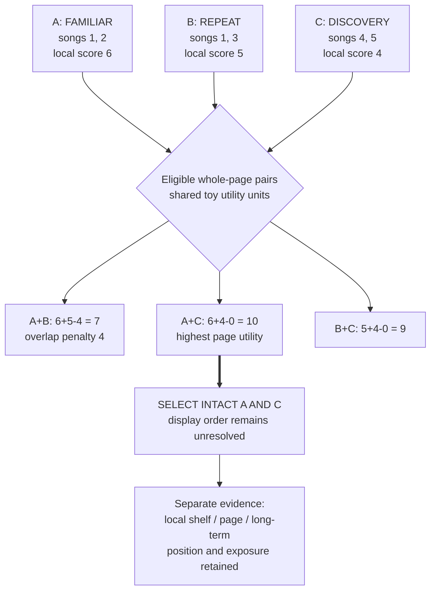

Two strong shelves can repeat the same songs and intent; compose the page, not just independent lists.

## Problem

Design a Spotify-like homepage with coherent shelves for familiar favorites, discovery, new releases and editorial selections.
These names illustrate the surface, not Spotify's current internal implementation.

Choose two shelves from three eligible candidates.
For this toy calculation only, local scores share utility units; showing A with B incurs an overlap penalty of four.
Other pair penalties are zero, and every pair meets the hard policy constraints.

| Shelf | Intent and illustrative contents | Local score |
| --- | --- | ---: |
| A | Familiar: songs 1, 2 | 6 |
| B | Repeat: songs 1, 3 | 5 |
| C | Discovery: songs 4, 5 | 4 |

Which pair wins page utility, and does that calculation establish its display order?

## Picture: A Shelf Is One Page Candidate

Keep each shelf's coherent item list intact, then compare whole-page choices.

$$
U(\{i,j\})=s_i+s_j-\operatorname{penalty}(i,j).
$$

| Pair | Raw local score | Pair penalty | Page utility |
| --- | ---: | ---: | ---: |
| A+B | 11 | 4 | 7 |
| A+C | 10 | 0 | 10 |
| B+C | 9 | 0 | 9 |

Sorting local scores selects A+B; the explicit page objective selects A+C.
This symmetric utility determines membership, not relative position.
Ordering needs a position-sensitive policy and exposure evidence.

Local scores versus whole-page utility

A+C beats the locally strongest pair under the stated overlap penalty.

<!-- visual:spotify-two-level-shelf-composition -->

<strong>Read it this way:</strong> compare intact pairs, not pooled songs. The penalty reverses the local-score choice; it is an explicit assumption, not a measured interaction effect.

## Decision Contract

| Stage | Required state |
| --- | --- |
| Shelf | ID, intent, content membership, eligibility, score semantics and generator version |
| Page | Candidate shelves, session context, position/exposure, utility and hard constraints |
| Editorial | Authorized curation, market/rights constraints, commitments and overrides |
| Freshness | Cache/version dependencies, privacy scope, expiry and invalidation |
| Evaluation | Separate local, page and mature long-term targets, assignment, uncertainty and guardrails |

Local click, completion and listen-time scores do not automatically share units.
Use a defensible composer model or explicit common utility, and validate whole-page interactions.
Specify diversity within shelves, across shelf intents and over time.
Keep safety/rights constraints separate from soft novelty or repetition penalties.

## Change 1: No Personal History or Preferences

**New task.** A new user supplies no optional preferences.

**Picture and change.** Use permitted context, eligible editorial/content priors and bounded exploration.
Test new-user outcomes and abandonment; no universal familiar-first ordering is established.

**Check.** Weak evidence does not authorize demographic inference or a fixed interaction-count switch.

**Use when.** Personalized shelf scores lack support.

## Change 2: One Item Just Finished

**New task.** Recent activity changes one shelf while most cached candidates remain valid.

**Picture and change.** Invalidate affected compatible state when useful; recheck page-wide repetition and policy constraints.
Keep version, session, privacy and eligibility dependencies in cache keys/invalidation rules.

**Check.** A high hit rate can hide stale or duplicated content.

**Use when.** Recomputing every shelf is unnecessary.

## Failure: Every Shelf Wins the Same Click

Independent local optimization can repeat one artist and intent across the page.
Local engagement then overstates the value of the composed session.

## Transfer Check

Must every shelf have a learned multi-stage ranker?

### Reasoned Answer

No. Recently played can use recency; editorial shelves can be curated.
Use retrieval and learned ranking only when justified by the shelf's requirements.

<!-- learning:core-end -->

## Shelf and Page Evidence

Familiar, discovery and new-release shelves need different definitions of useful listening, novelty and freshness.
Do not define discovery solely as distance from history or assume novelty improves retention.
Content features can support eligible new items before interactions; any exposure boost remains bounded by policy and quality.

Multi-task heads can estimate listen, completion, save, share and return outcomes on their proper populations.
Combining calibrated heads does not automatically yield a calibrated utility or correct exposure bias.
Log position, slate, eligibility and selection policy; counterfactual estimates require support and valid assumptions.

Choose an end-to-end latency/cost target from product needs, then measure it under load.
Cache duration depends on content, policy and session change, not a universal refresh interval.
Compare composer changes with an appropriate randomized baseline and predefined local/page/long-term targets.
Set experiment duration from outcome maturity, cycles and power; there is no mandatory four-to-eight-week window.
Check attrition, creator/content coverage, satisfaction and operational guardrails before staged release and rollback readiness.

## Sources

- [Spotify shelf-generation research](https://arxiv.org/abs/2607.25823).
- [Spotify homepage calibration](https://research.atspotify.com/2025/9/calibrated-recommendations-with-contextual-bandits-on-spotify-homepage).
- [Multi-carousel evaluation study](https://doi.org/10.3389/fdata.2022.910030).

---

*Related: [Design YouTube's recommender](/questions/design-youtube-recommender/), [Two-tower vs cross-encoder: when to use which?](/questions/two-tower-vs-cross-encoder/), [System design case study: building personalized search ranking](/guides/personalized-search-ranking/).*
