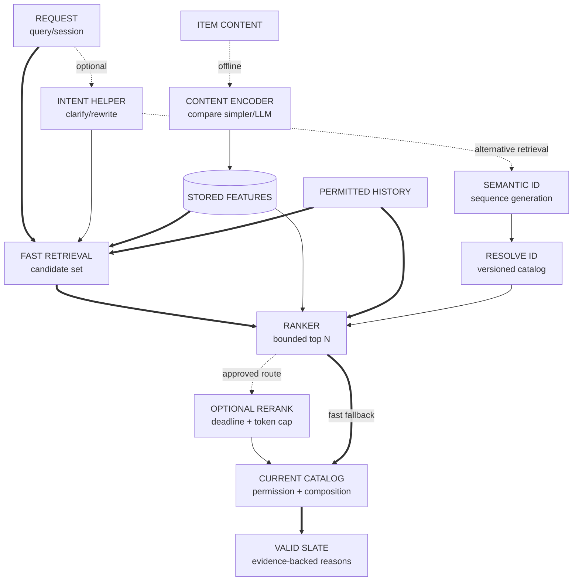

Choose one changed task, then budget the LLM stage and validate every catalog item before display.

## Problem

A fictional recommender handles 1,000 requests/second.
An optional reranker receives 10% of requests.
Its mean service time is 0.1 seconds; each call bills 2,000 input tokens.
Assume stable flow, no retries and this service boundary only.
Estimate its load, and assess a proposed 50-millisecond hard request deadline.

## Picture: Optional Work Still Consumes Capacity

Choose placement, not a universal replacement

Intent, stored content and bounded reranking solve different tasks; every displayed item must remain valid.

<!-- visual:recsys-llm-bounded-augmentation -->

<strong>Read it this way:</strong> follow the fast path, then inspect each optional branch's cost and validation boundary. Semantic-ID generation changes retrieval, not permission to display an unresolved item.

## Calculate the Routed Load

| Quantity | Calculation | Meaning |
| --- | --- | --- |
| Reranker arrivals | 1,000 x 0.10 = 100/second | This route only |
| Mean calls in service | 100 x 0.1 = 10 | Little's law at the service boundary |
| Billed input rate | 100 x 2,000 = 200,000 tokens/second | Output, retries and other stages additional |

Ten is mean occupancy, not a safe capacity limit or p99 bound.
As a counterexample, let every routed call take 100 milliseconds and every bypass take five.
The service assumptions hold, but 10% of whole requests already exceed 50 milliseconds before other work.
Use a deadline-aware optional route with valid fallback; count timeout/cancellation costs and quality loss.

## Contract: Budget the Stage, Validate the Output

Specify route predicate, candidate/token caps, deadlines, model/prompt/catalog identity and fallback compatibility.
Keep current existence, permission, region, availability and composition checks across every path.
Support explanations with actual decision evidence, not fluent guesses.
Predictive quality does not settle causal product value or participant policy.

## Change 1: Move Content Work Offline

**New task.** New items have text, but request latency is strict.

**Picture and change.** Compare stored LLM and simpler content features under the same publication-freshness and cold-item evaluation.

**Check.** Classical content models also represent items without engagement.

**Use when.** Representation, not dialogue, is the bottleneck.

## Change 2: Clarify Constraints Through Conversation

**New task.** Users need iterative preference clarification.

**Picture and change.** Retrieve/rank through tools, confirm constraints and revalidate catalog choices.

**Check.** Compare task completion and interaction friction, not just pleasant chat.

**Use when.** Dialogue solves a real expression problem; preserve the effective low-friction surface otherwise.

## Failure: A Plausible ID Is Displayed Without Resolution

A generated sequence can be invalid, ambiguous, stale or unauthorized.
An explanation cannot repair a missing item or invent its selection reason.

## Transfer Check

Does an unseen semantic-ID sequence prove discovery of a valid new item?

### Reasoned Answer

No. Resolve it against the versioned catalog and check identity, eligibility and representation quality.

<!-- learning:core-end -->

## Compare at the Changed Boundary

| Placement | Compare and control |
| --- | --- |
| Intent | Rewrite/disambiguation versus simpler parsing; preserve user constraints and timeout behavior |
| Stored content | Matched simpler encoder, freshness, versioned vectors, publication cost and cold/warm slices |
| Top-N reranking | Relevance/satisfaction, bounded work, tail latency, billing, fallback and evidence-backed reasons |
| Conversation | Completion, useful clarification, privacy and extra effort versus existing surfaces |
| Generated retrieval | Semantic-token mapping, collisions/invalid IDs, updates, current catalog checks and supported relevance |

Semantic IDs encode catalog items as token sequences, not unrestricted permission to invent products.
New-item support depends on mapping/publication, representation and retrieval evidence.

Compare automated judges with human-reviewed slices, failure types and bias.
Judge agreement is not ground truth or causal preference.
Use product experiments or other justified identification for incremental outcomes.
Keep calibration, support, feedback, cold-start and diversity contracts appropriate to the selected architecture.
Neither behavioral dominance nor a universal two-stage design follows from using an LLM.

## Sources

These papers document particular designs, not current adoption or universal performance.

- [YouTube retrieve-then-rank architecture, 2016](https://research.google/pubs/deep-neural-networks-for-youtube-recommendations/).
- [Language-based item representations, 2023](https://arxiv.org/abs/2305.13731).
- [LLM reranking, 2023](https://arxiv.org/abs/2305.08845).
- [Generative retrieval with semantic IDs, 2023](https://arxiv.org/abs/2305.05065).

---

*Related: [Design YouTube's recommender](/questions/design-youtube-recommender/), [Two-tower vs cross-encoder: when to use which?](/questions/two-tower-vs-cross-encoder/), [How would you do cold-start for a new user?](/questions/cold-start-new-user/), [Designing a RAG system that actually works](/guides/designing-rag-that-works/).*

