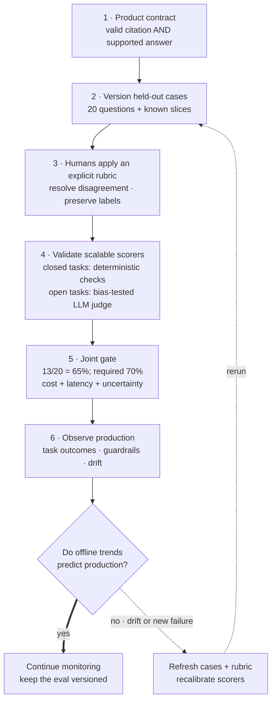

Evaluate the user's task and unacceptable failures before choosing scorers, then connect offline evidence to product outcomes.

## Problem

For 20 hypothetical held-out document questions, 18 answers cite valid IDs and 14 have independently human-reviewed substantive support.
Thirteen satisfy both requirements; total cost is $0.40.
The predeclared observed joint-quality floor is 70%.
What should the report and release decision say?

## Picture

Citation syntax and semantic support are different checks; an answer must pass both.
Five answers pass citation validation alone, one passes support alone, and one passes neither.

Separate checks, then combine requirements

Eighteen valid citation IDs and 14 supported answers yield 13 jointly valid answers.

<!-- visual:llm-eval-calibration-loop -->

<strong>Read it this way:</strong> keep hard-check validity and human-reviewed support separate before applying their joint gate. Offline success still needs confirmation against the product outcome.

References: <a href="https://arxiv.org/abs/2306.05685">LLM-as-judge study</a>, <a href="https://developers.openai.com/api/docs/guides/evaluation-best-practices">OpenAI evaluation guidance</a>, and <a href="https://doi.org/10.6028/NIST.AI.100-1">NIST AI RMF</a>.

## Report the joint outcome

| | Supported | Unsupported | Total |
| --- | --- | --- | --- |
| Valid citation | $13$ | $5$ | $18$ |
| Invalid citation | $1$ | $1$ | $2$ |
| Total | $14$ | $6$ | $20$ |

Citation validity is 90%; support is 70%; joint validity is $13/20=65\%$.
Their arithmetic mean, 80%, is not the required success rate.
The union is $18+14-13=19$, which also answers a different question.
Cost per jointly valid answer is $0.40/13\approx0.03077$ dollars.

The observed joint floor fails.
Report counts, sampling unit and an uncertainty method separately from this descriptive release rule.
Twenty cases do not establish population quality; passing this floor would not prove improved user task completion.

## Keep a case-level record

Record `case_id`, source/evidence version, slice, rubric, hard-check results, semantic labels, judge/model/prompt versions, latency and cost.
Assign dataset ownership, review disagreements and preserve labels.
Use deterministic checks for exact requirements and qualified humans to validate open-ended scoring.

## Change the output or severity

### 1. Require a structured record

**New task:** the answer must satisfy an exact schema and field constraints.

**Picture and change:** validate parseability, types and constraints deterministically before semantic grading.

**Check:** malformed output fails its hard gate despite supported prose.

**Use when:** the consumer depends on an exact output contract.

### 2. Increase failure severity

**New task:** answers concern medication instructions.

**Picture and change:** add expert review, harmful-error slices, abstention and a governed release process.

**Check:** routine successes cannot compensate for a prohibited harmful answer.

**Use when:** errors can create high-impact harm; this example provides no domain validation.

## Failure and transfer

After tuning prompts on these final cases, later scores become development evidence, not independent confirmation.
Keep fresh confirmation data separate from rubric repair.

Is easy-question judge agreement enough when unsupported legal claims are missed?

Check your answer

No. Validate the consequential slice and route unreliable cases to qualified humans or abstention.

<!-- learning:core-end -->

## A metric list is incomplete

BLEU, ROUGE, METEOR and perplexity measure particular properties, not every product's task success.
Public benchmarks can supplement product-specific evidence, not replace it.

## Cases and scorer validation

Stratify representative traffic and known failure slices.
Size the set for coverage and uncertainty needs, not a universal 50–200-example rule.
Check scorer mistakes by slice, not agreement alone.
Chance-corrected agreement can complement, not replace, consequential-error analysis.

## Lifecycle and tradeoffs

Test judge sensitivity to position, verbosity, model family and domain gaps.
Pairwise comparisons can help; counterbalance order and validate their reliability.
Bradley–Terry ranking introduces assumptions, not guaranteed agreement.

Version scorer changes and retest against humans.
Measure quality, latency and cost jointly; inspect nondominated choices rather than optimizing a score alone.
Track user task completion, corrections or feedback with suitable denominators.
No universal offline-online correlation cutoff certifies an evaluation.

## Inspectable reasoning

State task, costly failures, evidence limits and the decision each measurement supports.
Use only truthful experience; no answer guarantees a hiring outcome.

## Avoid unsupported certainty

A judge prompt is not calibration, and aggregate quality can hide consequential regressions.

## Scope the answer

Explain what the system must do, how errors are checked and who owns evaluation changes.

*Read the long-form essay this distills: ["LLM Evals: The hardest part of shipping LLMs"](/guides/llm-evals-the-hardest-part/).*

