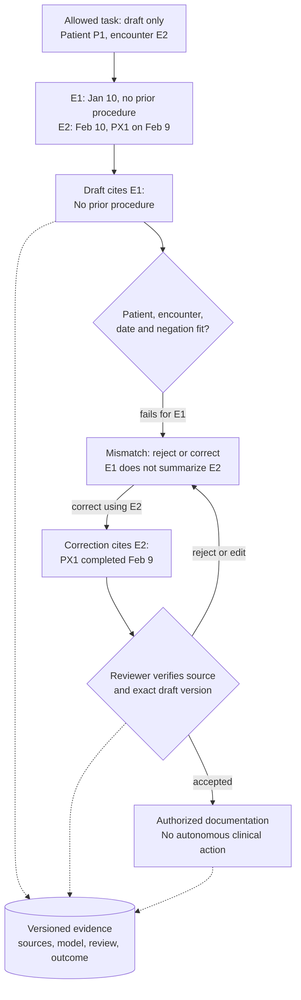

An authentic citation can still describe the wrong encounter; bind each claim to its patient, date and intended use.

## Problem

Design a draft-only record-summary service for this fictional case.
The task requests patient P1's encounter E2, dated February 10.

| Record | Patient | Record date | Documented fact |
| --- | --- | --- | --- |
| E1 | P1 | January 10 | No prior procedure was recorded at that encounter |
| E2 | P1 | February 10 | Procedure PX1 was completed on February 9 |

A draft says “No prior procedure” and cites the authentic E1 passage.
Decide whether to accept it and specify the review, action and operating boundaries.
No diagnosis or treatment recommendation is requested.

## Picture: Join the Claim to the Right Encounter

Treat a claim as a row joined to patient, encounter, source version and time.
Citation existence checks only one part of that join.
E1 describes the January record, not the requested February encounter.
Its negative statement cannot replace E2's documented event.

The reviewer rejects or corrects the draft.
A supported correction is “E2 records procedure PX1, completed February 9.”
Retain February 10 as the source date; it is not the procedure date.
An identical statement about patient P2 also fails this task.

<span id="what-an-l5-answer-sounds-like"></span>

### Keep Drafting Separate From Action

The service may retrieve authorized records and propose a summary.
It cannot order treatment, prescribe, or silently replace the clinical record.
An authorized reviewer inspects evidence and accepts an exact document version through the existing workflow.
Review permission does not itself grant every downstream clinical-action permission.

<p class="visual-kicker">Patient, encounter and time</p>
<p class="visual-title">A real source fails when its claim does not fit the requested encounter.</p>

<!-- visual:healthcare-llm-clinician-gate -->

<p class="diagram-caption"><strong>Read it this way:</strong> solid arrows show the draft and review path. Dashed arrows retain evidence for controlled updates and incident review. Patient IDs and dates are fictional.</p>

## Specify the Boundary Before the Model

```text
IntendedUse
  user_role, permitted_task, patient_population, setting
  excluded_uses, downstream_actions, responsible_owner
Draft
  patient_id, encounter_id, draft_version, task_version
  claims: text, source_id, source_version, source_date, event_date
  uncertainty, missing_evidence, abstention_reason
Review
  reviewer_identity, authority, decision, exact_draft_version
  corrected_claims, source_refs, timestamp
```

Retrieve only authorized, necessary records and applicable approved reference material.
Keep source identity through retrieval, generation, review and acceptance.
Schema checks catch missing fields, not incorrect negation or patient fit.
Unsupported claims must remain unsupported, not acquire a “high confidence” label.
Provide inspectable source passages and a refusal path when evidence or scope is inadequate.

## Change 1: The Task Starts Informing Clinical Decisions

**New task.** Move from record drafting to clinical decision support.

**Picture and change.** Reopen intended use, consequence, classification, evidence, validation, review interface and operating ownership.
A documentation evaluation cannot validate the new decision-support workflow.
Restrict actions through permissions and application controls, not prompts or disclaimers alone.

**Check.** A qualified clinical and regulatory review must approve the new contract before deployment.

**Use when.** Outputs change a clinical decision or enable a different action.

<span id="common-follow-up"></span>

## Change 2: Reviewers Frequently Override Drafts

**New task.** Investigate repeated clinician-model disagreements.

**Picture and change.** Independently adjudicate sampled disagreements using the available patient context and source versions.
Inspect missing context, outdated sources, unclear wording, workload and patient-fit differences.
Preserve reviewer authority; do not presume the model is correct.

**Check.** Override frequency alone measures neither clinician error nor model accuracy.
Even a correct correction rate needs an independently established reference and uncertainty.

**Use when.** Offline accuracy fails to describe real review behavior.

## Failure: Confirmation Becomes Automatic

A confidence badge can encourage acceptance despite an omitted negation or stale encounter.
Require review time, usable evidence, appropriate authority and workflow testing.
A mandatory click does not establish any of those properties.

## Transfer Check

Would adding valid citations and mandatory confirmation establish safe deployment?

### Reasoned Answer

No. Citations can reference the wrong patient or time, and confirmation can become routine.
Evaluate the complete workflow, including review quality, delayed errors, refusal, access control and changed uses.

<!-- learning:core-end -->
<div class="learning-extension" data-learning-extension>

<span id="what-an-l4-answer-sounds-like"></span>
<span id="tells-that-get-you-down-leveled"></span>

## Scope and Regulatory Review

HIPAA, GDPR and FDA requirements have different scopes.
Applicability depends on entities, jurisdiction, intended use, functionality and current rules.
Documentation labels and clinician involvement do not automatically establish exemption.
Use qualified regulatory, legal and clinical review; this lesson provides system-design reasoning, not professional advice.

<span id="what-an-l6-answer-adds"></span>
<span id="tells-that-get-you-a-strong-hire-vote"></span>

## Validate the Intended Workflow

| Contract | Evidence to collect |
| --- | --- |
| Population | Intended setting, patient groups, language, case mix, source completeness and reviewer roles |
| Failure taxonomy | Wrong patient/encounter, lost negation, unsupported claim, privacy breach, unsafe action, inappropriate refusal and review failure |
| Evaluation | Clinician-adjudicated cases, controlled adversarial inputs, missing evidence and delayed downstream outcomes |
| Subgroups | Relevant demographic and clinical slices, counts, uncertainty and review of severe failures |
| Refusal | Appropriate abstention and blocked valid work, separately by task/consequence |

Knowledge benchmarks can inform model selection; they do not validate workflow safety.
A no-regression point estimate cannot establish subgroup safety, especially with small samples.
Judge clinical harm separately from average usefulness.

## Operate and Change the Service

```text
ChangeManifest
  intended_use, population, model, retrieval, prompt, schema
  source_policy, permissions, review_ui, evaluation_receipts
  clinical_owner, deployment_owner, incident_owner, rollback_unit
RetentionPolicy
  data_class, purpose, permitted_readers, region, retention
  payload_redaction, deletion, audit_metadata
```

Retain permitted lineage for records, retrievals, drafts, reviewer decisions and outcomes.
Do not log all patient payloads by default.
Restrict trace access and keep prohibited data out of general analytics.

Revalidate material model, source, interface, permission or intended-use changes.
Stage deployment with monitoring and an available ordinary documentation workflow.
An incident plan names containment, investigation, notification and applicable reporting owners.
Rollback stops or restores software behavior; it cannot erase a clinical action already taken.

## Sources

- [FDA: Clinical Decision Support Software](https://www.fda.gov/regulatory-information/search-fda-guidance-documents/clinical-decision-support-software).
- [WHO: Ethics and governance of artificial intelligence for health](https://www.who.int/publications/i/item/9789240029200).
- [NIST: AI Risk Management Framework](https://doi.org/10.6028/NIST.AI.100-1).

*Related: [How do you handle hallucinations in production?](/questions/handle-hallucinations-in-production/), [LLM Evals essay](/guides/llm-evals-the-hardest-part/), [RAG for legal documents](/questions/rag-for-legal-docs/).*

</div>
