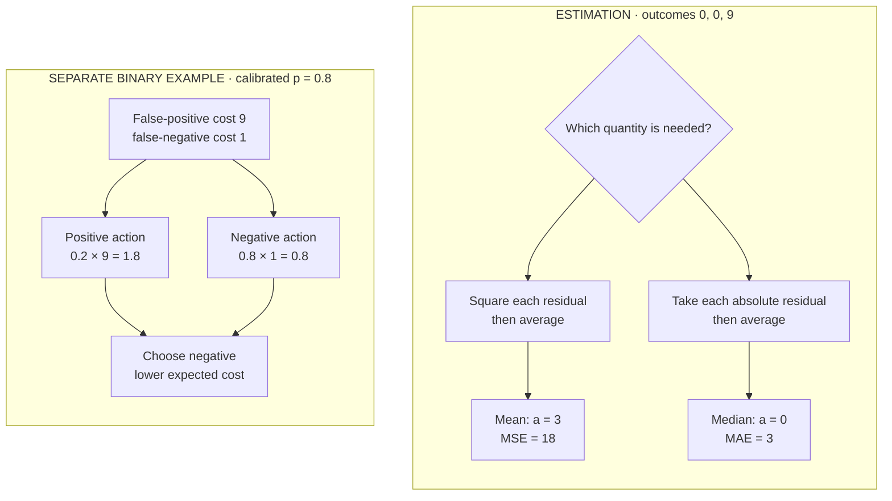

A loss defines which prediction minimizes expected error.
The prediction target and the deployment action are separate decisions.

## Problem

Predict one constant $a$ for three equally weighted outcomes: $0,0,9$.
All three represent the intended population.
Find the best constant under squared error and absolute error.
Then ask whether changing action costs requires a different prediction model.

Estimate a quantity, then choose an action

The same observations support different prediction targets

<!-- visual:loss-estimation-vs-decision -->

<strong>Read it this way:</strong> the upper example chooses a statistical target. The separate binary example chooses an action from probabilities and costs. Neither calculation establishes that one loss is universally better.

References: <a href="https://doi.org/10.1198/016214506000001437">Gneiting and Raftery on proper scoring rules</a>, <a href="https://doi.org/10.1214/aoms/1177703732">Huber on robust location</a>, and <a href="https://scikit-learn.org/stable/modules/classification_threshold.html">scikit-learn's threshold guidance</a>.

## Calculate both targets

For $n$ observations, define $\mathrm{MSE}(a)=n^{-1}\sum_i(a-y_i)^2$ and $\mathrm{MAE}(a)=n^{-1}\sum_i|a-y_i|$.
Here,

$$
\mathrm{MSE}(a)=\frac{a^2+a^2+(a-9)^2}{3},\qquad
\frac{d\,\mathrm{MSE}}{da}=2a-6.
$$

Squared error selects $a=3$, the mean. Absolute error selects $a=0$, the median.

| Constant | MSE | MAE |
| --- | --- | --- |
| $0$ | $27$ | $3$ |
| $3$ | $18$ | $4$ |

If nine is a genuine costly outcome, discarding it as an outlier changes the task.
At each input, squared and absolute loss similarly target conditional means and medians when their risks exist.

## Change the requirement

### 1. Limit contamination influence

**New task:** nine may be corrupted, and the required output is a robust location.

**Picture and change:** Huber loss bounds each residual's gradient.
For residual $r=a-y$ and scale $\delta>0$,

$$
H_\delta(r)=\begin{cases}
r^2/2,&|r|\le\delta,\\
\delta(|r|-\delta/2),&|r|>\delta.
\end{cases}
$$

**Check:** with $\delta=1$ at $a=0$, the nine observation contributes gradient $-1$, not squared-error gradient $-18$.
The mean Huber loss here is minimized at $a=0.5$ because $2a-1=0$.

**Use when:** contamination may cause large residuals, rather than a genuine tail needed for mean estimation.

### 2. Change action costs

**New task:** false positives cost $9$, false negatives cost $1$, and the calibrated positive probability is $p=0.8$.
Correct decisions have zero cost.

**Picture and change:** compare the expected costs of both actions before retraining.
Choose positive when

$$
C_{\mathrm{FP}}(1-p)<C_{\mathrm{FN}}p
\quad\Longleftrightarrow\quad
p>\frac{C_{\mathrm{FP}}}{C_{\mathrm{FP}}+C_{\mathrm{FN}}}.
$$

**Check:** the threshold is $0.9$.
Positive action costs $1.8$ in expectation; negative costs $0.8$. Choose negative.

**Use when:** probabilities remain suitable but the cost of acting changes.
Capacity and other constraints may require a different decision rule.

## Do not treat every score as a probability

Weighted or focal objectives can change score meaning.
Check calibration before applying a threshold derived for true probabilities.
Focal modulation emphasizes difficult examples; it does not specify which error costs more.

## Try increasing the precision requirement

The model already ranks relevant cases well. What changes first?

Check your answer

Test thresholds on representative validation data, separate from final evaluation.
Report recall and accepted volume. Retrain only if the resulting operating choices fail the requirement.

<!-- learning:core-end -->

## Likelihood and output meaning

Negative log likelihood is $-\log p_\theta(y\mid x)$.
Fixed-variance Gaussian likelihood gives squared error up to constants and scale.
Fixed-scale Laplace likelihood gives absolute error. Learned scales require their log terms too.
These likelihood assumptions are not required merely to target means or medians.

Categorical cross-entropy is $-\sum_c y_c\log p_c$ for one-hot targets.
Squared error on probability vectors can also be a proper Brier score.
Gradient problems depend on the output link and parameterization, not just the loss name.

Focal loss multiplies log loss by $(1-p_t)^\gamma$ for the true-class probability $p_t$.
Optional class weights are separate from that modulation; see the [original focal-loss paper](https://arxiv.org/abs/1708.02002).

## Common follow-up

For a higher precision target, thresholding may suffice.
Other options include cost-sensitive retraining, a ranking surrogate, or high-recall retrieval followed by a precision-focused filter.
Evaluate representative held-out precision, recall, volume and segment behavior.

## Combined objectives

Ranking losses target order; contrastive and triplet losses shape embedding relationships.
Multi-task weights change the combined objective.
[Uncertainty weighting](https://arxiv.org/abs/1705.07115) and [GradNorm](https://arxiv.org/abs/1711.02257) use different weight-selection rules.
Auxiliary reconstruction or load-balancing losses also change the optimized objective, even when the main term stays unchanged.
Next-token, preference and reward-based training objectives need downstream behavioral evaluation rather than assuming equal loss reductions mean equal improvements.

Related: [multi-task learning](/concepts/multi-task-learning-objective-interference/), [cross-entropy and softmax](/concepts/cross-entropy-softmax/), [regularization](/concepts/regularization/), and [calibration](/concepts/calibration/).

