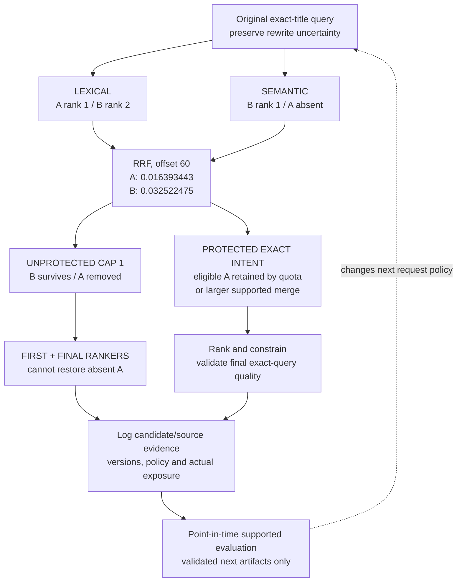

Personal history must not replace exact query intent; trace a missing result through retrieval and merging before changing the ranker.

<span id="the-prompt"></span>

## Problem

Design search for a fictional global media product.
The scenario has 100 million monthly users, ten million items, 10,000 peak queries/second and twenty result positions.
The server target is below 200 milliseconds at p99, not an established benchmark.
Use query, locale, device, session and consented history; region, rights and safety eligibility remain mandatory.

The current lexical/popularity path handles exact titles but struggles with broad queries, fresh inventory and several locales.
Improve broad-query success without violating exact-lookup, latency, discovery or market guardrails.

For one exact-title query, eligible item A is lexical rank 1 and absent from semantic retrieval.
B is lexical rank 2 and semantic rank 1.
Fuse ranks with reciprocal-rank fusion at offset 60, then keep one candidate.
Can a better final ranker restore A?

## Picture: The Correct Item Disappears Before Ranking

RRF adds $1/(60+\text{rank})$ for each source that retrieved the item.
An absent source contributes nothing; its absence remains explicit in the record.

| Item | Lexical contribution | Semantic contribution | Fused score |
| --- | --- | --- | ---: |
| A | 1/61 | Absent | 0.016393443 |
| B | 1/62 | 1/61 | 0.032522475 |

B wins the unprotected one-candidate merge, so A never reaches either ranker.
The final ranker cannot recover an item outside its candidate set.
A high-confidence exact-intent quota or a sufficiently large supported merge can retain eligible A.
That protects candidate access, not final placement or relevance for every rewritten query.

<p class="visual-kicker">Candidate loss before the final model</p>
<p class="visual-title">RRF favors B here; an exact-intent protection rule must act before A is discarded.</p>

<!-- visual:personalized-search-request-learning-loop -->

<p class="diagram-caption"><strong>Read it this way:</strong> follow A's membership, not only its score. The protection path retains a candidate; later ranking and current eligibility still need validation. Logging reconstructs the decision, not unshown outcomes.</p>

<span id="state-the-design-thesis-first"></span>

## Decision Contract

| Boundary | Retain and evaluate |
| --- | --- |
| Query | Original/transformed text, intent uncertainty and reversible correction |
| Retrieval/merge | Canonical IDs, every source rank/score, missing-source state, eligible coverage and quotas |
| First/final rankers | Cutoff recall/regret, conditional head populations/units, model/calibrator and feature versions |
| List policy | Hard eligibility, soft diversity/freshness, pre/post ranks and policy owner |
| Learning | Point-in-time availability, actual exposure, assignment/propensity, maturity, retention and replay manifest |
| Release | Exact-intent non-inferiority, broad-query benefit, mature outcomes, slices, cost/latency and compatible rollback |

At 10,000 queries/second and twenty positions, output capacity is 200,000 result positions/second.
This is not 200,000 examined items or complete outcome labels.
Keep retrieval recall, cutoff loss, final/list utility and causal product effect separate.

## Change 1: Half the Users Disable History

**New task.** Personal history becomes impermissible or unavailable.

**Picture and change.** Use a validated query/context-only mode with compatible features, cache scope and current policy.
Maintain exact intent and compare consent-cohort quality without treating missing history as service failure.

**Check.** Defaults and old cache entries cannot invent consent or silently restore personal state.

**Use when.** Personalization lacks legitimate support.

## Change 2: A Billion Items and Subminute Publication

**New task.** The catalog grows while new entries must become searchable within one minute.

**Picture and change.** Reprice sharding, replicas, ANN recall and streaming publication/deletion.
Keep a lexical freshness path and tested compatible model/index/embedding/tokenizer versions.

**Check.** Incremental speed does not replace count, schema, recall, current eligibility or rollback validation.

**Use when.** Inventory scale and freshness change.

## Change 3: A Source Adds 40 Milliseconds to p99

**New task.** Semantic retrieval raises measured end-to-end p99 despite parallel execution.

**Picture and change.** Measure unique relevant contribution by intent, deadlines, cancellation and missing-source behavior.
Narrow or remove the source where marginal quality cannot justify the tail cost.

**Check.** Parallel work is not free on the critical path.
Per-stage quantiles cannot generally be added into an end-to-end percentile guarantee.

**Use when.** Local quality and whole-request performance disagree.

## Failure: A Locale Outage Hides in Aggregate NDCG

A rewriter translates rare proper names; semantic candidates consume the merge quota and remove the exact item.
Positive aggregate NDCG does not excuse that slice failure.
Reconstruct query, source membership, cutoff, constraints and versions before choosing a fix.

## Transfer Check

Does complete exposure logging reveal user outcomes for unshown items?

### Reasoned Answer

No. It reconstructs the policy-created observation process.
Counterfactual claims still require support, assignment/examination assumptions and valid outcomes.

<!-- learning:core-end -->
<div class="learning-extension" data-learning-extension>

## Clarify the product decision

<span id="user-intent"></span>
<span id="inventory"></span>
<span id="personalization-and-policy"></span>
<span id="operations"></span>

| Boundary | Questions that change scope |
| --- | --- |
| Intent | Lookup/discovery/navigation/factual task, success, ambiguous intents, wrong/empty-result cost and explanations/citations? |
| Inventory | Changes/expiry, regional/subscription/rights/age policy, immediate searchable fields and available modalities? |
| Personalization | Consent/purpose/retention, history-free modes, prohibited attributes and supplier quality/exposure commitments? |
| Operations | Request/index/feature targets, partial-failure fallback, stage owners and shadow capability? |

For this case, protect exact lookup while improving broad discovery; catalog and eligibility can change continuously.

## Define success at three levels

<span id="request-success"></span>
<span id="product-outcome"></span>
<span id="guardrails"></span>

| Level | Definition and limit |
| --- | --- |
| Request | Useful consumption, reformulation, abandonment, dissatisfaction, zero/low results; clicks alone are not satisfaction |
| Product | Successful search session with mature return/consumption evidence; avoid assigning every delayed outcome to one request |
| Guardrails | Exact lookup, latency, cost, errors/timeouts, new/tail exposure, diversity, policy, locale/device and repetition |

Predefine broad-query benefit, exact-title non-inferiority and critical stop thresholds before selecting a loss.

## Build a workload and latency budget

The core gives output rate, not examined-item count.
Candidate reduction and batching bound the expensive model's workload.
This table partitions a 200-millisecond planning envelope, not measured stage quantiles.

| Stage | Planning allocation |
| --- | ---: |
| Request parsing, policy, and query understanding | 15 ms |
| Parallel candidate retrieval | 35 ms |
| Candidate merge and first-pass ranking | 35 ms |
| Final ranking | 55 ms |
| List constraints and response assembly | 20 ms |
| Network variance and safety margin | 40 ms |

Measure end-to-end tails under realistic load and retain headroom; allocated deadlines do not guarantee p99.
For the full workload, merge about 5,000 candidates, keep 500, then score 100-500 with the final model.
These scenario counts differ from the core's deliberately tiny failure example.

## Draw the request and learning loops

Online serving ends with constrained results; learning starts from versioned decision, exposure and outcome records.
Missing exposure cannot establish dislike.

## Stage 0: understand the query without delaying it

Normalize/tokenize, detect locale/entities/intent/safety, embed queries and extract structured date/category/language constraints where justified.
Preserve the original alongside reversible corrections.

### Exact versus broad intent

Use validated exact-intent features/quotas; broad intent can justify different semantic, personal and exploratory budgets.
Start with transparent query classes rather than one universal source mixture.

### Query rewriting

Log rewrite confidence and retain original-query retrieval when uncertainty matters.
Check exact entities, sensitive topics, negation and tail languages; better lexical coverage does not justify changed intent.

## Stage 1: retrieve with complementary sources

No one retriever handles every query. Run several sources in parallel and preserve source identity as a feature.

### Lexical retrieval

An inverted index supports titles, names, identifiers, rare terms, analyzer variants and fresh items.
Keep field/phrase distinctions and apply hard eligibility before expensive ranking where possible.

### Semantic retrieval

Two towers encode request context online and items offline/on publication.
Training can combine outcomes, judgments and teachers.
Random, in-batch, impression and hard negatives imply different tasks and false-negative risks; cross-encoder distillation transfers teacher limitations too.
Benchmark ANN against exact neighbors by head/tail, locale and freshness; measure memory, latency and task recall separately.

### Query-conditioned personalization

Condition history on the query through session-adjusted vectors, query/user fusion, selected-history attention or preferences above a relevance floor.
Bound consented history; validate session versus long-term value.
History-free query/context operation is a normal supported mode.

### Freshness and popularity sources

A fresh source offers eligible new items without interaction history.
Use region/language/time/category-aware popularity when justified; global counts can erase local intent.

### Source budgets

Budget by query class and unique relevant contribution, not source appearance frequency alone.

## Merge candidates without losing source evidence

Candidate lists use incomparable scores. A lexical score, vector distance, and popularity count do not share a natural scale.

Deduplicate canonical IDs while retaining every source/rank/raw score, any calibrated score and explicit missing-source state.
Apply eligibility, justified quotas and overload caps.
RRF avoids common-score-unit assumptions but can still lose exact candidates, as the core demonstrates.
A learned merger also needs source-failure validation; absence is not an ordinary score of zero.

## Stage 2: optimize recall with a cheap ranker

Reduce about 5,000 candidates to 500 using inexpensive batched features, not remote per-candidate calls.
Trees, crossed linear models or small networks can use source/lexical/embedding, freshness, intent, lightweight interaction and quality/policy evidence.

### Stage metric

Measure cutoff recall and losses against a justified teacher or mature useful outcome.
Improved local ordering does not compensate for dropping the final model's useful candidates.

### Distillation

Combine labels/teacher scores where useful, then validate against real outcomes and policy; teacher bias can transfer.

## Stage 3: rank several outcomes

Score hundreds with richer crosses/sequence context.
Compare trees, deep crosses, history attention, cross-encoders or selective cascades using data, feature shape, interpretability and quality/cost/latency.

### Multi-task outputs

Define each engagement, conditional consumption, completion, reformulation, negative, satisfaction or risk head's population, units and maturity.
Calibrate probability heads where used as probabilities; a combined utility is not automatically a probability.
One possible product-owned utility is:

$$
S(x) = \sum_k w_k \hat{u}_k(x) - \sum_j \lambda_j \hat{c}_j(x)
$$

Assign an owner and evaluation plan to the weights.

### Constrained decisions

Unacceptable region, rights, safety or severe-quality violations are hard constraints, not cheap score penalties.
Record ownership for soft diversity/freshness trade-offs.

## Stage 4: optimize the result list

Evaluate complete pages for duplicates, redundancy and supplier/intent coverage.
Options include maximum marginal relevance, category/creator caps, freshness floors, source/format diversity, business rules and bounded exploration.

### Constraint ordering

Apply hard exclusions before optimization. Then solve soft trade-offs. Finally validate that post-processing did not reintroduce an invalid item or empty the page.

Log both pre-constraint and post-constraint ranks. Otherwise teams may blame the model for a policy-layer change.

## Build labels from decisions, exposure, and outcomes

```text
DecisionRecord
  request_id, session_id, original_query, transformed_query
  candidates, all_source_evidence, pre_post_constraint_ranks
  exposed_items, positions, examination_evidence
  model, calibrator, index, tokenizer, policy_versions
  point_in_time_features, availability_times, assignment_probability
  interactions, delayed_outcomes, maturity, interventions
  privacy_class, purpose, consent, retention, replay_manifest
```

### Do not call every non-click a negative

Unclicked can mean unexamined, earlier success or departure.
Examined skips, visible comparisons, reformulations, explicit negatives, judged candidates and sampled catalog negatives have different semantics.
Retain negative type and its weighting assumptions; examination evidence is not perfect relevance truth.

### Delayed outcomes

Declare windows and completeness for consumption, return, refund, complaint or other delayed outcomes.
Pending labels are not mature negatives; apparent gains can reverse after late outcomes.

### Selective labels

Exposure and downstream actions select which labels exist.
Preserve permitted audit/randomized samples; unsupported policy changes cannot be evaluated merely by adding ordinary logs.

## Correct exposure bias without claiming impossible counterfactuals

Clicks mix relevance, examination, presentation and policy.
Randomized swaps/exploration can help identify exposure under their design.
IPS requires valid propensities and support; self-normalization, clipping and doubly robust models have distinct bias/variance/identification conditions.
State assignment, confounding, interference and outcome-maturity assumptions, then perform appropriate sensitivity checks.
None reveals arbitrary unshown outcomes.

## Choose losses by stage and evidence

Retrieval, first-pass ranking, and final ranking should not share a loss by default.

### Retrieval loss

A contrastive objective can separate positive query-item pairs from sampled negatives. Sampling defines the task. Include hard negatives and control false negatives within a batch.

### First-pass loss

Pointwise or pairwise objectives often work because throughput and recall dominate. Distillation can preserve teacher ordering near the cutoff.

### Final-rank loss

Pairwise, listwise, or lambda-weighted objectives can align updates with top-rank metric changes. Multi-task heads may use classification, regression, or survival-style objectives based on the outcome.

### Calibration

A ranker can order correctly while producing unusable probabilities. Calibrate heads when downstream thresholds, utility weights, or interventions treat scores as probabilities.

The [learning-to-rank loss guide](/concepts/learning-to-rank-losses/) covers the objective families. The system-design decision is which label, sampling process, and product metric make each surrogate meaningful.

## Preserve point-in-time correctness

Historical examples must reconstruct what the system could know at request time.

Version query processing, history, item/rights metadata, popularity, indices, transformations, labels, models and policy.
Use event and availability time; later corrections must not leak into earlier requests.

### Splits

Use deployment-realistic temporal splits and justified user/item/query grouping.
Check new users/items, tail queries, unseen combinations and changed locales/catalogs; random rows can leak near-duplicate sessions.

## Handle cold start as several problems

<span id="new-user"></span>
<span id="new-item"></span>
<span id="new-query"></span>
<span id="new-market"></span>

| Cold case | Supported path and check |
| --- | --- |
| User | Permitted query/session/context/popularity; optional preference friction; confidence-based handoff |
| Item | Content/metadata/publisher features, fresh source, bounded exploration and logged assignment; exposure is not proven value |
| Query | Lexical/semantic/spelling/intent; zero results, reformulation and known-query distance |
| Market | Local language/inventory/policy/behavior and labels; strong baseline, not assumed translation transfer |

## Evaluate each stage and the complete system

<span id="retrieval"></span>
<span id="first-pass-ranking"></span>
<span id="final-ranking"></span>
<span id="list-quality"></span>
<span id="end-to-end-replay"></span>

| Stage | Evidence |
| --- | --- |
| Retrieval | Budgeted/unique task recall, ANN exact-neighbor recall, latency/memory and fresh/head/tail/locale/cold slices |
| First pass | Cutoff recall/regret, latency and missing-source robustness |
| Final | NDCG/MRR/defined utility plus probability calibration where required |
| List | Deduplication, diversity, coverage, hard constraints and page judgments |
| Replay | Full query/index/feature/model/policy path; model-only tests cannot reconstruct changes elsewhere |

## Use human judgments for coverage and diagnosis

Sample intent, locale, popularity, tail and failure cases beyond the old top results.
Separate topical/exact relevance, authority, freshness, harm, redundancy and confidence.
Adjudicate ambiguity, including underspecified intent; agreement is not validity.
Version refreshes and protect a stable regression subset.

## Design the online experiment around the decision

Choose randomization to handle cross-session effects; query assignment is not universally more powerful or uncontaminated.
Predefine eligibility, actual exposure, mature target, exact-title non-inferiority, other guardrails, worthwhile effect, power/duration, carryover, stops and slices.

### Ramp sequence

1. Offline and replay checks.
2. Shadow scoring on production requests.
3. Internal or bounded canary traffic.
4. Small randomized experiment with automatic system stop conditions.
5. Planned ramp after enough mature outcome data.
6. Long-horizon holdout when feedback effects matter.

Shadowing validates features, latency, and score behavior. It does not measure user response because the candidate ranking is not shown.

### Interpret disagreement

Check objective, selection, leakage, feature/index/policy differences, latency, novelty, slices and logging.
Validate online assignment/exposure/instrumentation rather than automatically trusting either side.

## Control feedback loops and exploration

Consider bounded exploration/fresh quotas, diversity, supported counterfactual checks, stable holdouts and judgments beyond current results.
Monitor concentration, query coverage and resulting confidence, not only engagement.

### Exploration policy

Separate experiment assignment from product exploration; declare eligibility, user-cost limits, exclusions and action probabilities.
Exact/high-risk tasks may forbid exploration.
Small buckets need not support large policy changes; use targeted judgments and appropriate new experiments.

### Ecosystem effects

Monitor supplier response, concentration, discovery and strategic low-quality optimization over suitable horizons.

## Design the serving path for partial failure

Authenticate the request and consent context, process the query, then retrieve with deadlines.
Merge and filter, fetch features in batches, rank and constrain results.
Cache only valid responses and durably log actual exposure.
Allow explicit partial results only when the reduced mode remains valid.

### Fallback ladder

1. Full personalized multi-stage ranking.
2. Query ranking without unavailable user features.
3. Lexical plus semantic retrieval with lightweight scoring.
4. Lexical retrieval plus contextual popularity.
5. A clear error only when no safe result path exists.

Test each mode. A fallback that is never exercised may have stale schemas, missing indices, or invalid policy logic.

### Timeouts

Assign deadlines by marginal value. If personalized retrieval has low unique contribution on exact queries, it should not consume the request budget.

Cancel or ignore late work. Record timeout, candidate contribution, and quality under degraded mode.

## Keep features available and temporally correct

Group online features by freshness and failure behavior.

<span id="request-features"></span>
<span id="user-features"></span>
<span id="item-features"></span>
<span id="cross-features"></span>

| Family | Update/contract |
| --- | --- |
| Request | Query, locale, device, session and current context |
| User | Batch preferences/stream interactions with timestamps, defaults and current consent |
| Item | Publication/content metadata/embeddings and declared popularity/quality cadence |
| Cross | Batched or bounded query-item/user-item computation; no unbounded per-candidate remote work |

### Feature failure

Declare safe defaults, maximum-age cache, validated reduced/missingness-aware model or failure when legally/operationally required.
Do not simply omit a required model input; record versions and actual missingness.

## Update indices without corrupting availability

Catalog and embedding indices change independently from model releases.

Use versioned index builds:

1. produce a new immutable index version;
2. validate document count, schema, sample queries, and approximate recall;
3. load or warm the index on a subset of servers;
4. shadow queries against current and candidate versions;
5. move traffic through an alias or desired-state pointer;
6. retain the previous compatible index for rollback.

Incremental updates reduce freshness delay but add compaction, deletion, and consistency complexity. Choose them when publication latency justifies the operational cost.

A model version should declare compatible index and embedding versions. Rolling back only the model can fail when vector dimensions or tokenization changed.

## Monitor quality, system health, and learning health

<span id="request-path"></span>
<span id="retrieval-and-ranking"></span>
<span id="user-outcomes"></span>
<span id="slices"></span>
<span id="learning-loop"></span>

| Layer | Signals |
| --- | --- |
| Request | Stage latency/errors/saturation/timeouts, cache, counts and degraded mode |
| Models/index | Contributions, scores/rank movement, missing features, freshness and constraint effects |
| Outcomes | Success, reformulation, abandonment, consumption, complaints and maturity |
| Slices | Intent, frequency, locale/device, cold user/item and policy-sensitive groups |
| Learning | Concentration/support, delay, data age, drift and offline/online relationship |

Alerts need severity, owner and response; drift is diagnostic evidence, while policy or exact-query failures may require stopping.

## Protect privacy, safety, and user control

Collect the minimum history needed for the declared purpose. Enforce retention, deletion, regional, and age requirements before features reach general training systems.

Provide a non-personalized mode whose quality is measured. Personalization should not become a hidden availability dependency.

Sensitive attributes may be needed for fairness evaluation while prohibited as ranking features. Separate access, purpose, and retention for evaluation data.

### Memorization and retrieval safety

Text or multimodal encoders can expose sensitive or disallowed content through nearest neighbors. Apply source policy before indexing, validate deletion, and keep item-level blocks outside learned scoring.

### Explanation

User-facing explanations should describe defensible factors such as query match, recency, or followed creator. Do not infer a causal explanation from a feature attribution alone.

## Model cost and capacity explicitly

Price index memory/replicas, embeddings, feature reads, scored candidates, operations/batching, logs, training/evaluation and human judgment.

### Quality-cost frontier

Measure quality against candidate count, model size, precision, cache policy, and stage latency. Choose a point with headroom rather than the largest model that fits one benchmark.

Use a cascade when expensive scoring has value only for uncertain queries or candidates. For easy exact matches, a simple path may be both faster and more accurate.

### Overload

During load spikes:

1. shed optional diagnostics;
2. reduce low-value retriever budgets;
3. use the lightweight ranker for more candidates;
4. skip expensive reranking on high-confidence requests;
5. move to a tested fallback;
6. reject only after quality-preserving options are exhausted.

Log the active mode so product metrics are not compared as if the same policy served every request.

## Launch by capability, query class, and market

Avoid replacing the complete system in one release.

<span id="phase-1-logging-and-replay"></span>
<span id="phase-2-hybrid-retrieval"></span>
<span id="phase-3-first-pass-learning"></span>
<span id="phase-4-richer-final-ranking"></span>
<span id="phase-5-personalization"></span>
<span id="phase-6-controlled-exploration"></span>

| Phase | Standalone evidence before expansion |
| --- | --- |
| 1 | Correct decision/exposure/feature/model/outcome joins and replay |
| 2 | Shadowed hybrid retrieval, unique broad-query recall and protected exact lookup |
| 3 | Cheap ranker cutoff recall and missing-source robustness |
| 4 | Properly calibrated heads, independent list policy and fallback |
| 5 | Session/broad-intent value before expanded consented history |
| 6 | Bounded exploration with probabilities, support and cold-start evidence |

Each phase has a compatible rollback target and useful standalone result.

## Walk through an incident

Suppose broad-query success rises after launch, but exact-title success drops in one locale. Overall NDCG remains positive.

Investigate in this order:

1. Confirm experiment assignment, exposure, and locale instrumentation.
2. Slice the drop by query intent, language, device, and result availability.
3. Compare original and rewritten queries.
4. Inspect lexical candidate recall before ranking.
5. Check whether semantic candidates consumed the merge quota.
6. Compare first-pass drops and final-rank movements.
7. Inspect list constraints and regional availability filters.
8. Reproduce requests with the recorded index, model, and policy versions.

Assume the query rewriter translated rare proper names and the merge reserved no lexical quota. The semantic source crowded out the exact item before final ranking.

Immediate response:

- disable rewriting for low-confidence entities in the affected locale;
- restore a lexical quota for exact-intent queries;
- roll back the query-policy version if the bounded fix is unsafe;
- add rare-name and transliteration cases to the stable evaluation set;
- review other locales using the same policy.

This incident shows why model-only metrics were insufficient. The model never saw the missing correct candidate.

## Make staff-level decisions visible

<span id="own-the-interfaces"></span>
<span id="protect-stage-metrics"></span>
<span id="migrate-without-dual-confusion"></span>
<span id="measure-adoption-through-outcomes"></span>
<span id="preserve-exceptions"></span>

| Boundary | Accountability |
| --- | --- |
| Teams | Stable query/candidate/feature/log/release interfaces with named stage operators |
| Metrics | Retrieval recall/latency, ranking order/calibration, list constraints and product ship decision |
| Migration | One authority/assignment record at a time, not dual uncontrolled production writers |
| Adoption | Faster delivery, fewer repeated failures or new useful evidence, not client counts |
| Exceptions | Named market/safety owners and compatible logging for justified specialized paths |

## Add the principal portfolio view

### Shared capabilities

Share identities/availability, exposure, assignment, safe index publication, telemetry and common evaluation where semantics agree.

### Specialized capabilities

Keep intent, market policy, labels/utility, specialized encoders, supplier constraints and high-risk fallback with accountable domain owners.

### Portfolio choices

Balance broad quality, exact reliability, cold/tail coverage, operations, privacy/safety, expansion and retirement.
Compare the next model against repairing logging or freshness; state opportunity cost.

### Decision checkpoints

Quarterly, expand/narrow/stop using unique recall, product/feedback health, headroom, market transfer, delivery, support/incidents and actual retirement.
Keep portable query/item/exposure/model/policy identities and evidence for exit.

## Structure a 45-minute answer

<span id="minutes-0-to-5-product-and-decision"></span>
<span id="minutes-5-to-12-workload-and-request-path"></span>
<span id="minutes-12-to-22-data-and-models"></span>
<span id="minutes-22-to-32-evaluation-and-launch"></span>
<span id="minutes-32-to-39-serving-and-failure"></span>
<span id="minutes-39-to-45-staff-or-principal-depth"></span>

| Minutes | Practice focus |
| --- | --- |
| 0-5 | Intent, decision, inventory, consent, scale and failure cost |
| 5-12 | Workload, complete request path and exposure |
| 12-22 | Sources, labels/negatives, heads and temporal reconstruction |
| 22-32 | Stage/human/counterfactual/online evidence and launch |
| 32-39 | Deadlines, fallback, compatibility, monitoring and incident |
| 39-45 | Ownership, migration, shared boundary, portfolio and checkpoints |

## Answer-level signals

<span id="mid-level"></span>
<span id="senior"></span>
<span id="staff"></span>
<span id="principal"></span>

Distinguish correct components, a complete product lifecycle, cross-team contracts/migration and a reversible investment portfolio.
Company titles vary; these scope descriptions do not predict hiring outcomes.

## Observer scorecard

Score each dimension from 0 to 2.

| Dimension | 0 | 1 | 2 |
| --- | --- | --- | --- |
| Product framing | Optimizes clicks | Names intent and guardrails | Defines a decision across users and ecosystem |
| Retrieval | Uses one source | Combines complementary sources | Budgets sources and measures unique stage value |
| Ranking | Names a model | Connects labels and losses | Handles calibration, constraints, and delayed outcomes |
| Bias and feedback | Ignores exposure | Mentions position bias | Designs logging, support, exploration, and controls |
| Evaluation | Reports offline NDCG | Adds online testing | Validates assignment, maturity, slices, and counterfactual assumptions |
| Serving | Draws a request path | Adds latency and monitoring | Defines deadlines, degradation, compatibility, and rollback |
| Technical depth | Lists patterns | Defends one component | Traces a changed condition through several stages |
| Staff scope | Mentions teams | Defines ownership | Changes interfaces, migration, and measured operating outcomes |
| Principal scope | Says multi-year | Gives a roadmap | Makes portfolio, boundary, checkpoint, and exit decisions |

## Strong signals

Traceable stage value, explicit temporal/exposure assumptions, compatible recovery, accountable owners and measured portfolio choices support the design.

## Weak signals

Unbiased-click claims, missing-candidate blindness, invalid rollback, unsupported counterfactuals and unmeasured diversity violate those contracts.

## Changed-condition follow-ups

1. History use is disabled for half of users. How does quality degrade, and which model remains valid?
2. The catalog grows from 10 million to one billion items. Which stage changes first?
3. New items must become searchable in under one minute. How do index publication and embeddings change?
4. One locale has little interaction data and unreliable translations. What is the launch sequence?
5. A semantic retriever improves recall but adds 40 milliseconds to end-to-end p99 latency despite parallel execution. What evidence decides whether it stays?
6. Query-level randomization contaminates later sessions. How do you redesign the experiment?
7. A creator group receives less exposure despite stable user success. What do you measure and who owns the trade-off?
8. The online feature store fails during peak traffic. Which fallback preserves intent?
9. The final ranker doubles in size for a small NDCG gain. How do you evaluate the quality-cost frontier?
10. Search reformulation falls, but long-term consumption also falls. Which objective or behavior may have changed?
11. An index update removes valid items in one region. How do you detect, contain, and roll back it?
12. Two teams want incompatible utility functions on the same surface. Which capability stays shared?

For each follow-up, state which assumption changed, which stage absorbs the change, and which metric decides the next action.

---

## Sources

- [Joachims et al.: unbiased learning-to-rank](https://arxiv.org/abs/1608.04468).
- [Swaminathan and Joachims: counterfactual risk minimization](https://proceedings.mlr.press/v37/swaminathan15.html).
- [Rules of Machine Learning](https://developers.google.com/machine-learning/guides/rules-of-ml).

*Related: [learning-to-rank losses](/concepts/learning-to-rank-losses/), [position bias and counterfactual ranking](/concepts/position-bias-counterfactual-learning-to-rank/), [negative sampling](/questions/negative-sampling-strategies/), [multi-task interference](/concepts/multi-task-learning-objective-interference/), [evaluate a search ranker](/questions/evaluate-search-ranker/), and [senior through senior-principal ML scope](/guides/l5-vs-l6-faang-ml/).*

</div>
