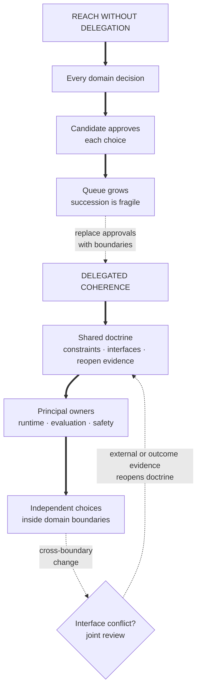

A title does not show which decisions you owned.
Connect the problem boundary, technical mechanism and other teams' changed behavior. Add delegation, durability and reversal only where evidence supports them.

## Problem

Audit two fictional records:

| Record | Observed evidence | Missing evidence |
| --- | --- | --- |
| A: "I led a company-wide platform" | Mandatory rollout to 200 engineers | Personal authority, changed decisions, durable benefit |
| B: Temporal data contract | Independent adoption by three products; fewer repeat leakage incidents recorded | Baseline comparability, confounders, attribution and successor operation |

Which record supports leverage rather than reach? Can either alone establish a company-specific level?

## Picture: Decisions Must Survive the Original Architect

Delegation and reopen conditions

Contrast every-choice approval with independent domain decisions inside shared boundaries.

<!-- visual:senior-principal-delegated-coherence -->

<strong>Read it this way:</strong> count the decisions requiring the original architect. Every-choice approval creates a queue. Explicit boundaries permit local decisions; defined interface conflicts require joint review. Recorded outcome or external evidence can reopen constraints. This teaching synthesis references <a href="https://dropbox.github.io/dbx-career-framework/">Dropbox's framework</a> and <a href="https://staffeng.com/guides/staff-archetypes/">StaffEng's archetypes</a>, not a universal employer level rubric.

## Work the Evidence Audit

A establishes reach, not voluntary adoption, personal authority or benefit.
B is a more inspectable leverage hypothesis, not automatic causal proof or a level certificate.
Check the contract, comparable incident measurement, concurrent changes, collaborator ownership and operating responsibility.

A concrete technical descent: a record with event time 1 arrives at time 5, after a decision at time 4.
The historical join must not use that record merely because $1\le4$; availability $5>4$ excludes it.
Inspect the actual point-in-time contract and test late corrections, not just the architecture diagram.

Then test durability: can another authorized owner operate, revise or retire the contract without the author?
State the evidence that reopens its assumptions. Neither three products nor 200 users resolves that question.

## Use five axes instead of a title map

These are company-dependent scope archetypes, not transferable numeric labels or required career events.

| Axis | Senior | Staff | Principal | Senior principal |
| --- | --- | --- | --- | --- |
| Problem ownership | Ambiguous project | Shared cross-team problem | Investment portfolio | Coherence across portfolios |
| Technical direction | Approach and delivery | Shared interfaces | Durable options/constraints | Constraints across independent directions |
| Time horizon | Project checkpoints | Adoption and recovery | Revisit investment assumptions | Adapt through external/organizational change |
| Influence | Direct partners | Other teams' decisions | Organizational investment | Delegated domain authority |
| Evidence | Sound project judgment | Changed behavior and leverage | Portfolio choices and succession | Independent owners, adaptation and reversal |

## Senior owns the project area

Show the objective, baseline, alternatives, owned decisions and observed outcome.
Explain why the approach was chosen; do not substitute an implementation inventory for judgment.

## Staff chooses problems and creates leverage

Show the shared risk, technical boundary and decisions other teams changed.
Inspect migration, valid exceptions, adoption and operating results. Technical influence is not line management.

## Principal manages direction and option value

Compare product, platform, research, migration and retirement investments.
Specify checkpoints, costs and expand/narrow/stop/reverse evidence. More teams alone do not establish portfolio judgment.

## Senior principal creates coherence across directions

Show real domain owners deciding independently inside shared constraints, plus interface review and succession.
Identify external changes that reopen the direction without routing every choice through one architect.

## The interview still tests the role's technical core

Scope does not remove role-specific depth. Possible technical cores include:

| Role | Retained technical depth |
| --- | --- |
| Applied Scientist | Modeling, experiment validity, causal threats, calibration and product decisions |
| Machine Learning Engineer | Software/data contracts, serving, recovery, observability and cost |
| Research Scientist | Claims, derivations, baselines, uncertainty and research alternatives |
| Research Engineer | Implementation, distributed execution, performance and scientific validity |

Descend in three steps:

1. State the organizational/product decision.
2. Explain the architecture or scientific approach.
3. Inspect an algorithm, invariant, experiment or failure trace you understand directly.

## Change 1: The Employer Uses Different Titles

**New task.** Principal sits below staff, or influence bands are private.

**Picture and change.** Map real decisions to expected first-year scope and the local rubric.

**Check.** A previous title cannot establish a new level.

**Use when.** Labels conflict.

## Change 2: The Story Has Depth but Limited Authority

**New task.** A strong technical example lacks cross-organization decision rights.

**Picture and change.** Use it for depth; supply another real example or mark the scope evidence gap.

**Check.** Do not inflate ownership to cover missing evidence.

**Use when.** One story cannot support every dimension.

## Change 3: An Owner Leaves or an Assumption Fails

**New task.** Succession or external change tests durability.

**Picture and change.** Use successor authority, recorded evidence, compatibility and reversible interfaces to adapt the direction.

**Check.** If every change still needs the original architect, delegation is unsupported.

**Use when.** Leadership or external conditions change.

## Failure: Scope Words Without Changed Decisions

Strategy language, mandatory usage, elapsed years and committee attendance do not establish leverage or delegated authority.

## Transfer Check

What separates delegated coherence from a large architecture council?

### Reasoned Answer

Real domain owners decide within explicit boundaries. Defined interface conflicts receive joint review; recorded evidence reopens constraints without one indispensable approver.

<!-- learning:core-end -->

## How the main interview rounds change

The table adapts practice demands, not a universal employer rubric. Scope archetypes build on technical depth rather than replace it.

| Round | Project/shared capability | Portfolio/coherence demands |
| --- | --- | --- |
| Project depth | Decision, alternatives, personal ownership, mechanism, measured outcome | Investments, other owners, changed behavior, unresolved limits and succession |
| ML design | Data/train/eval/serve/rollback; shared versus product-owned interfaces | Migration, blast radius, exceptions, adoption, build/buy/exit and external adaptation |
| Strategy | Constraints and linked choices, not aspirations | Investment order, checkpoints, stop/reverse evidence and delegated authority |
| Behavioral/influence | Direct disagreement and changed decisions | Different incentives, roadmap/interface changes, accepted risk and successors |

### Technical strategy

Keep seven fields:

1. Constraint/opportunity.
2. Evidence available then.
3. Capabilities to strengthen.
4. Work to stop/defer.
5. Investment order.
6. Decision checkpoints.
7. Risks and exit paths.

Add owners, delegated decisions and reopening evidence where relevant.
For example, standardize artifact identity and promotion evidence while preserving specialized runtimes behind reversible adapters.
The choice addresses shared risk without requiring every runtime to converge.

## Build an evidence portfolio

Nine evidence functions do not require nine separate projects. One real incident can support several; do not invent missing career events.

### One architecture story

Explain workload, alternatives, interfaces, state, recovery, migration and operating owner.

### One problem-selection story

Explain the competing choices and information available then, without hindsight certainty.

### One wrong-bet story

If available, explain the hypothesis, disconfirming signal, delay cost and recovery.

### One stopped-work story

If available, explain the alternative use of resources, commitments, residual risk and responsible stop.

### One influence story

Explain real disagreement, differing incentives and evidence that changed a decision, including your own.

### One operating story

Explain post-launch incidents, adoption, support, cost or quality drift and remaining limits.

### One technical deep dive

Inspect the algorithm, experiment, performance trace or distributed invariant behind a broad claim.

### One delegated-authority story

Identify domain decisions, boundaries, interface conflicts and independent owners' actual choices.

### One external-change story

Explain the invalid assumption, preserved constraint, changed implementation and evidence for adaptation.

## Partition ownership precisely

Use an editable record: claim, authority, alternatives, evidence then, collaborators, changed behavior, measurement limits, operating owner and reopen condition.

Test three layers:

1. What did you personally decide?
2. What did another person own?
3. Which outcome is reasonably attributable to your decision?

Use "proposed" for a proposal, "decided" for actual authority, and "recommended" when another person decided.
Use "we built" for shared implementation and name other teams' ownership.
Credit is not all-or-nothing; disclose causal and measurement limits.

## Distinguish leverage from scale

Weak scale evidence: mandated tool use, large request volume with a narrow contribution, stalled multi-year migration or unchanged review attendance.
More inspectable mechanisms include temporal contracts, safer promotion gates, comparable evaluators, stopped expensive designs or successor-led improvement.
Verify baseline, operating outcome, adoption reasons and confounders before claiming causal benefit.

## Avoid down-leveling and inflation

An information gap is not proof of incompetence. Label missing support and choose truthful examples.

Prior titles and headcount cannot substitute for a target employer's documented scope contract.

## Run the upper-IC practice path

Keep role-specific technical coverage; add scope practice relevant to the target work.

1. Calibrate evidence on the five axes.
2. Attempt the multi-team platform case closed-book.
3. Attempt the enterprise agent-platform case with changed constraints.
4. Study the annotated mock; retry without copying its wording.
5. Defend a real problem-selection decision.
6. Examine wrong-bet/stopped-work evidence if available; mark gaps otherwise.
7. Practice delegated authority and external change.
8. Descend from strategy to technical detail.
9. Use a relevant simulation with an experienced observer.
10. Select bounded repairs and repeat after spacing.

Use the [level path](/prep/level-paths/staff-principal/), [multi-team case](/questions/design-multi-team-ml-platform/) and [enterprise case](/questions/design-enterprise-agent-platform/).

## Score the evidence before the interview

This 0–2 diagnostic records evidence quality, not competence, level certification or hiring probability.
Zero can mean unavailable evidence. Do not average away a critical technical or authority gap.

| Dimension | 0: missing/unsupported | 1: partial support | 2: inspectable support |
| --- | --- | --- | --- |
| Problem selection | No comparison | Compared choices | Owned and revisited allocation |
| Technical depth | Component names | Defends design | Strategy-to-mechanism challenge |
| Cross-team influence | Shared information | Agreement | Changed roadmap/interface/operation |
| Recovery | No observed update | Local fix | Evidence-driven direction change |
| Leverage | Reach only | Reuse | Mechanism and durable measured outcome |
| Ownership | Unclear contribution | Personal work | Authority, collaborators and attribution |
| Time horizon | Launch only | Future plan | Checkpoints preserve options |
| Succession | Author indispensable | Documentation | Other owners operate and improve |
| Delegated authority | Coordination only | Named owners | Exercised domain decision rights |
| External adaptability | Ignored assumption | Contingency | Reopened invalid constraint with evidence |

Use missing dimensions to choose information requests and practice, not to manufacture experiences.

## Company variation and evidence limits

Labels, planning cycles and authority boundaries vary by employer, role and date.
No employer-specific rubric was newly verified for this guide.

Ask five questions:

- What scope does this level own in the first year?
- Which rounds contribute to the level decision?
- Is architecture, research direction, or organizational influence evaluated separately?
- What evidence distinguishes the target level from the one below?
- Can the company share a role or level rubric?

[Uber's ML/AI guide](https://jobs.uber.com/en/uber-interview-guide/ml-ai-engineering-interview-guide/) and [Sciences guide](https://jobs.uber.com/en/uber-interview-guide/sciences-interview-guide/) are role-specific references, not a universal title map.

---

*Related: [choose what to work on](/questions/decide-what-to-work-on/), [multi-team ML platform design](/questions/design-multi-team-ml-platform/), [enterprise agent-platform design](/questions/design-enterprise-agent-platform/), [annotated upper-IC mock](/guides/annotated-upper-ic-agent-platform-mock/), and the [senior-principal simulation](/prep/simulations/#senior-principal).*

