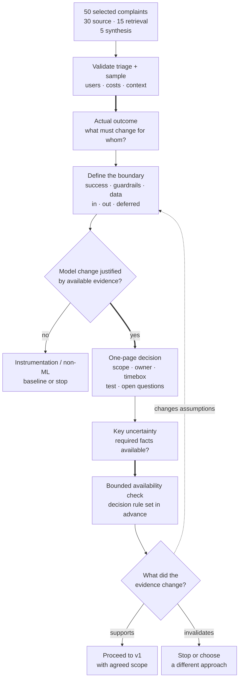

Turn a symptom into a bounded decision before committing to a model.
A prototype is useful when it resolves the deciding uncertainty.

## Problem

A requester wants a larger generator because answers are poor.
In this fictional triage, 50 selected complaint cases have disjoint assigned causes:

| Assigned cause | Cases |
| --- | ---: |
| Missing source information | 30 |
| Retrieval omission | 15 |
| Answer synthesis | 5 |

What should the first investigation change? Which conclusion cannot be drawn from these counts?

## Picture: Find the Decision-Changing Unknown

<!-- visual:ambiguous-problem-scope-loop -->

<strong>Read it this way:</strong> the request names a component, not yet a scoped problem. Define the decision and evidence before choosing v1, a non-ML baseline, further discovery or stop.

## Work the Triage

$30+15+5=50$. Under this taxonomy, a generator-only change directly targets the five synthesis cases.
The other 45 motivate source/retrieval investigation, not an assumed larger-model fix.

First validate the categories and source availability against an authoritative version.
If required facts are absent but permitted to obtain, scope ingestion; if already available, revisit retrieval and triage.
If necessary inputs cannot lawfully be obtained, narrow the task or stop.

The sample estimates neither overall failure prevalence nor causal improvement.
Real failures can overlap; the disjoint categories are an exercise assumption.

## Make the Decision Artifact

Name the affected population, outcome/guardrails, inputs/outputs/labels, data quality, owner, timebox and deciding uncertainty.
Record in-scope work, explicit non-goals, deferred work and the result that means proceed, rescope or stop.
Agree a decision date and review authority; duration depends on risk and evidence cost, not a universal week.

## Change 1: Labels or Logging Are Missing

**New task.** Reliable outcome evidence does not exist.

**Picture and change.** Scope instrumentation, representative labeling or a smaller decision first.

**Check.** A convenient proxy does not automatically identify the intended outcome.

**Use when.** Evidence availability is the biggest unknown.

## Change 2: A Quality Promise Is Demanded

**New task.** Stakeholders request a guarantee before discovery.

**Picture and change.** Give conditional ranges, assumptions, a decision date and staged scope; escalate incompatible constraints honestly.

**Check.** Do not say yes externally while hiding an incompatible internal plan.

**Use when.** Commitment pressure conflicts with unresolved uncertainty.

## Failure: Architecture Without a Stop Rule

An elaborate design does not define non-goals, required evidence or when discovery should end.

## Transfer Check

When is coding a valid first scoping action?

### Reasoned Answer

When a bounded prototype targets a named uncertainty and its result changes scope or allocation.
It need not build the complete system.

<!-- learning:core-end -->

## Six Scoping Steps

1. Ask requesters about actual users, outcomes and failure costs.
2. Define the decision, inputs, outputs, truth and evaluation; allow non-ML.
3. Inspect data availability, quality, labels and permission.
4. Compare the simplest reasonable rule/model baseline.
5. Identify shift, noise, regulation, cost, latency and other invalidating risks.
6. Agree a bounded one-page decision with the responsible stakeholders.

## Use a Real Incident

State your actual negotiation, framing and test contribution, what changed and what remained uncertain.
The hypothetical triage is not a story to claim as personal experience.

## Check the Scope

Can another person reconstruct the boundary, baseline, biggest unknown, test, owner and end date?
Make v1, later work and exclusions explicit; document open questions instead of concealing them.

## Missing Evidence

Add the missing measurement, risk, non-goal or decision rule before assuming model choice answers the request.

## Common follow-up

If asked for quality before discovery, state assumptions and the evidence needed to narrow the range.
Distinguish an estimate, a target and an accepted commitment.

## Sources

- [GOV.UK discovery](https://www.gov.uk/service-manual/agile-delivery/how-the-discovery-phase-works).
- [GOV.UK alpha](https://www.gov.uk/service-manual/agile-delivery/how-the-alpha-phase-works).
- [Google ML problem framing](https://developers.google.com/machine-learning/problem-framing/problem).

---

*Related: [The 5 things every applied scientist interview is testing for](/guides/five-things-as-interview-tests/), [senior through senior-principal ML scope](/guides/l5-vs-l6-faang-ml/), [How do you decide what to work on?](/questions/decide-what-to-work-on/).*

