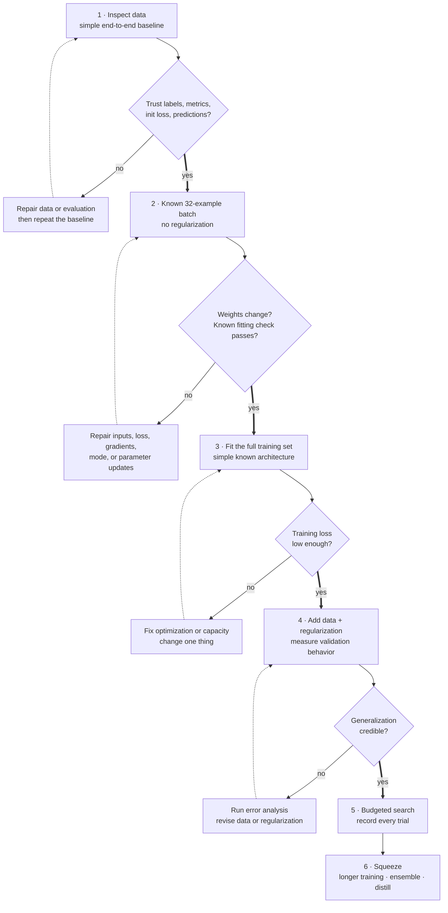

## Summary

A training recipe orders evidence checks before expensive changes: inspect, build a baseline, fit, regularize, tune and refine.
Passing a fitting check does not establish generalization.

Consider 32 distinct separable inputs, eight per class, with four classes and no regularization.
Zero logits predict each class with probability $1/4$, giving mean cross-entropy $\log4\approx1.386294$.
Suppose gradients are nonzero but parameters never change.
Should you search architectures, or inspect the update path?

<p class="visual-kicker">Return to the earliest failed check</p>
<p class="visual-title">Nonzero gradients do not prove that an optimizer changed the model.</p>

<!-- visual:training-recipe-evidence-gates -->


<p class="diagram-caption"><strong>Read it this way:</strong> verify the update before tuning its hyperparameters. Each failed gate sends you back to the evidence needed for that stage, not to an unrelated architecture search.</p>
<p class="diagram-source">References: <a href="https://karpathy.github.io/2019/04/25/recipe/">Karpathy's recipe</a>, <a href="https://www.deeplearningbook.org/contents/guidelines.html">Deep Learning practical methodology</a>, and <a href="https://jmlr.org/papers/v13/bergstra12a.html">Bergstra and Bengio</a>.</p>

## Check the update, then fit the known batch

With no update, the same fixed inputs retain the same predictions and loss.
Inspect optimizer ownership, learning rate and `step()`, not only `backward()`.

This complete CPU fixture separates gradient creation from a parameter update.
Its 500-update budget and $0.02$ loss threshold are diagnostic choices, not convergence guarantees for other datasets.

```python
import torch
from torch import nn

torch.manual_seed(0)
scales = torch.linspace(0.9, 1.1, 8).repeat(4)
inputs = torch.eye(4).repeat_interleave(8, dim=0) * scales[:, None]
targets = torch.arange(4).repeat_interleave(8)
model = nn.Linear(4, 4)
with torch.no_grad():
	model.weight.zero_()
	model.bias.zero_()
optimizer = torch.optim.Adam(model.parameters(), lr=0.05)
criterion = nn.CrossEntropyLoss()
model.train()

before = model.weight.detach().clone()
optimizer.zero_grad(set_to_none=True)
initial_loss = criterion(model(inputs), targets)
initial_loss.backward()
assert model.weight.grad.abs().sum().item() > 0
assert torch.equal(before, model.weight)
optimizer.step()
assert not torch.equal(before, model.weight)

for update in range(499):
	optimizer.zero_grad(set_to_none=True)
	loss = criterion(model(inputs), targets)
	loss.backward()
	optimizer.step()

model.eval()
with torch.no_grad():
	final_loss = criterion(model(inputs), targets)
assert final_loss.item() < 0.02
print(initial_loss.item(), final_loss.item())
```

A true-class probability of $0.99$ gives $-\log0.99\approx0.0100503$, below that illustrative threshold.
Neither number establishes held-out performance.

## Follow the evidence gates

| Stage | Evidence before proceeding |
| --- | --- |
| Inspect | Raw and transformed examples, labels, duplicates, corruption, leakage and slice distributions |
| End-to-end baseline | Checkable metrics, predictions, expected loss and correct updates |
| Fit | Appropriate known architecture can fit the attainable training signal |
| Regularize | Held-out quality improves under task-valid interventions |
| Tune | Search space, budget, selection and all outcomes recorded |
| Refine | Longer training, ensemble or distillation justified by measured value and cost |

## Change the prior or search purpose

### 1. Initialize a nonuniform prior

**New task:** class proportions become `[0.7, 0.1, 0.1, 0.1]`.

**Picture and change:** use zero final-layer weights and biases $b_k=\log\pi_k$, for positive priors.
Softmax then predicts the declared proportions.

**Check:** mean loss at those frequencies is $-\sum_k\pi_k\log\pi_k\approx0.940448$, not $\log4$.
That lower initial loss is not a bug.

**Use when:** a deliberate marginal baseline replaces uniform predictions.

### 2. Spend 12 trials on search

**New task:** the verified pipeline has 12 tuning trials left.

**Picture and change:** sample learning rate and weight decay jointly over declared log ranges.
For causal diagnosis, instead vary one factor under a matched comparison.

**Check:** a three-rate by four-decay grid tests only three rates.
Twelve continuous random draws can explore twelve, but do not isolate a causal learning-rate effect.

**Use when:** broad search coverage, rather than an explanatory intervention, is the goal.

## A tiny-batch failure is not always a bug

Two identical inputs with contradictory binary labels cannot both be fitted by a deterministic predictor.
Their minimum mean cross-entropy is $\log2$, reached by predicting one half.
Inspect target consistency, capacity and the attainable loss before demanding zero.

## Transfer to a binary baseline

For a 1% positive prior, must initial loss equal $\log2$?

<details>
<summary>Check your answer</summary>

No. With zero weights, bias $\log(0.01/0.99)\approx-4.5951$ predicts that prior.
At matching class frequencies, binary entropy is about $0.0560$.

</details>

<!-- learning:core-end -->

<div data-learning-extension>

## Step 1: Become one with the data

Inspect the exact transformed tensors and labels entering the model, not only raw files.
Look for shortcuts, outliers and corruption.

## Step 2: End-to-end skeleton + dumb baseline

Use simple, input-independent and task-appropriate human baselines.
Track fixed predictions as well as loss.
Simplify augmentation and regularization during diagnosis.
Seeds help reproduce a comparison but do not guarantee determinism or generalization.

## Step 3: Overfit

Prefer a known architecture while separating fitting from generalization.
Adam near $3\times10^{-4}$ is a starting hypothesis for some tasks, not a correctness condition.
Do not copy an epoch-based schedule without checking its update and data units.

## Step 4: Regularize

Options include relevant clean data, valid augmentation, synthetic data, pretraining, smaller models, bottlenecks and lower input dimensionality.
Also test weight decay, dropout and early stopping.
Remove leakage before evaluation; it is not a regularization strategy.
More data or a larger early-stopped model is not universally better.

## Step 5: Tune

Random search can cover influential dimensions more effectively than a grid with repeated values.
Bayesian optimization is another budget-dependent option.
Preserve untouched confirmation data after adaptive selection.

## Step 6: Squeeze the last drops

Evaluate longer training, ensembles and distillation against latency, memory, quality and compute budgets.
No fixed ensemble gain or improvement from indefinite training is guaranteed.

## What an interviewer expects you to say

Name the failed gate and the observation that would justify proceeding.
For loop-state details, use [the complete debugging fixture](/questions/debug-training-loop/).

## Common confusions

Initial loss depends on predictions, targets, weighting and reduction.
Failed fitting, generalization and search are different problems.
Use declared evidence and stopping rules, not remembered defaults.

---

*Related: [How would you debug a model that's not learning?](/questions/debug-model-not-learning/), [Debug this training loop](/questions/debug-training-loop/), [How to choose a learning rate](/questions/how-to-choose-learning-rate/), [Regularization](/concepts/regularization/), [Exploding and vanishing gradients](/concepts/exploding-vanishing-gradients/).*

</div>
