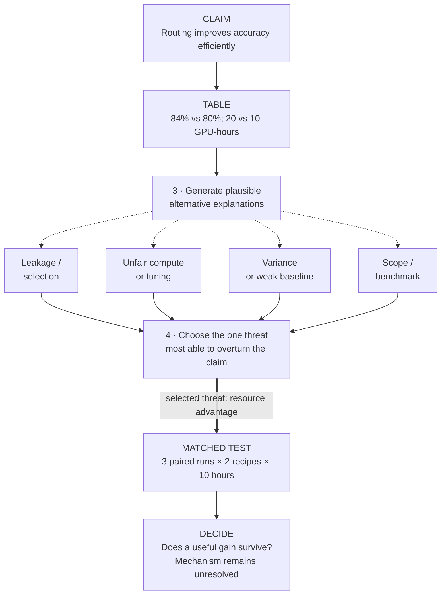

Assess an ML paper's central claim by identifying what its reported experiment establishes and which alternative explanation remains unresolved.

## Problem

**Context.** You have ten minutes and only an abstract, method figure, and main table from a hypothetical routing paper.
The table reports accuracy and total tuning/training cost for two recipes.

**Task.** Separate the empirical observation from the mechanism and efficiency claims, then propose one feasible deciding experiment.
Explain how its possible outcomes would change your conclusion.

**Constraints.** Do not invent missing implementation details, variance estimates, datasets, or unpublished results.
Account for unequal resource budgets and distinguish absence of evidence from evidence that the mechanism cannot work.

You have ten minutes to inspect an abstract, method figure and main result table.
An explicitly hypothetical paper claims: “Our routing mechanism improves accuracy efficiently.”

| Main-table recipe | Accuracy | Total tuning/training cost |
| --- | --- | --- |
| Baseline | $80\%$ | $10$ GPU-hours |
| Routing | $84\%$ | $20$ GPU-hours |

Choose the most important unresolved explanation and propose one feasible next experiment.
Do not assume anything else about the unpublished method or evaluation.

## Picture

The reported four-percentage-point gain is a real strength within this hypothetical table.
But routing and resource advantage changed together.
Matched resources could distinguish a resource-only explanation from a gain that survives the comparison.

Does the gain survive matched compute?

<!-- visual:paper-critique-prioritization-funnel -->

<strong>Read it this way:</strong> both method and resources changed in the table. Select resource advantage for the next test, rather than requesting every possible experiment.

## Write the decision record

| Field | This hypothetical decision |
| --- | --- |
| Claim and evidence | Exact abstract quote; main-table rows; versioned paper copy |
| Selected alternative | More resources, rather than routing, explain the useful gain |
| Comparison | Same hardware, data, evaluation and total budget |
| Resource plan | Three paired runs per recipe; each gets two tuning hours and eight final-training hours |
| Primary effect | Paired accuracy difference in percentage points |
| Useful threshold | At least two points, declared before confirmation |
| Opposing predictions | Gain disappears under matching, or a useful gain remains |
| Uncertainty | Declare seed pairing, evaluation sampling unit and analysis method |
| Stop rule | Fixed budget; retain failed attempts and all outcomes |

The six training/tuning allocations total $3\times2\times(2+8)=60$ GPU-hours.
Declare tuning opportunities and account for failed attempts within each allocation.
Budget evaluation overhead separately.
Equal FLOPs, wall time, GPU-hours and tuning opportunities are different contracts; choose one matching the claim.

Suppose a justified analysis reports $+0.2$ points with interval $[-0.6,+1.0]$.
This is an interpretation fixture, not an interval calculated from three seeds.
Its upper endpoint remains below the declared useful threshold.
That outcome would not justify a larger reproduction based on this efficiency claim.

A supported retained three-point gain would weaken the resource-only explanation.
It would not prove the proposed routing mechanism or generalization beyond the evaluated setting.
Training-seed variation and uncertainty over evaluation items need separate treatment.

## Change the threat or decision

### 1. Suspect shared source documents

**New task:** budgets already match, but evaluation items may share training-document ancestry.

**Picture and change:** freeze the original result and build a source-disjoint confirmation set from provenance.
Keep tuning away from it.

**Check:** compare matched clean and overlapping strata.
A clean-set decline alone cannot prove leakage; difficulty or domain may also change.

**Use when:** source overlap directly threatens out-of-source generalization.

### 2. Judge operating value

**New task:** slower batches reduce failure recovery work.

**Picture and change:** measure end-to-end cost, reliability and intervention time, not kernel speed alone.

**Check:** compare the same workload and service objective over the same observation window.
Operational value can justify adoption without establishing a novel learning mechanism.

**Use when:** the decision is deployment rather than scientific novelty.

## Failure and transfer

Requesting five datasets is not discriminating if every experiment retains the same confound.
Which competing predictions would the added observations separate?

Does a fair reproduction retaining the gain prove the mechanism?

Check your answer

No. It supports the observed comparison and weakens the selected resource explanation.
Mechanism evidence still needs an intervention with competing predictions.

<!-- learning:core-end -->

## A reading order

1. State the claim precisely.
2. Locate its supporting evidence.
3. Check baseline and resource fairness.
4. Identify leakage, selection and variance threats.
5. Ask what isolates the mechanism.
6. Bound generalization and failure settings.
7. Compare value with compute and complexity.
8. Choose one belief-changing experiment.

## Be fair before you criticize

Distinguish an overstated correct result, useful engineering without novel science, an unsupported mechanism, and an invalid evaluation.
Absence of evidence is not evidence of failure.

## Unfocused critique

“Small gain” needs uncertainty and practical-cost context.
“More baselines” needs a comparison that tests the claim.

## Claim-specific critique

Match the measurement to efficiency, robustness or mechanism, then explain the result that would alter the conclusion.

## Strategic value

Ask what survives scale, what reproduction requires, and whether the contribution is a primitive, recipe or local optimization.

## Useful evidence

Prioritize impact, acknowledge a genuine strength and make the next test falsifiable.
No response format guarantees a hiring outcome.

## Avoid unsupported judgments

Judge evidence, not authors or venue.
Avoid long criticism lists without a decision.

## Common follow-ups

- Would you spend a month reproducing this paper?
- Which claim would you narrow?
- What is the strongest alternative explanation?
- How would you test whether the result survives scale?
- What if the method is slower but easier to operate?

## Sources

Checklist items cover claims, uncertainty and compute; they are not a mechanical accept/reject rubric.

- [NeurIPS 2025 reviewer guidance](https://neurips.cc/Conferences/2025/ReviewerGuidelines).
- [NeurIPS paper checklist](https://neurips.cc/public/guides/PaperChecklist).
- [Pineau et al., JMLR reproducibility-program report](https://jmlr.org/papers/v22/20-303.html).

*Related: [design an ablation study](/questions/design-ablation-study/), [bias-variance of estimators](/concepts/bias-variance-of-estimators/), and [lessons from Marin 8B](/guides/lessons-from-marin-8b/).*

