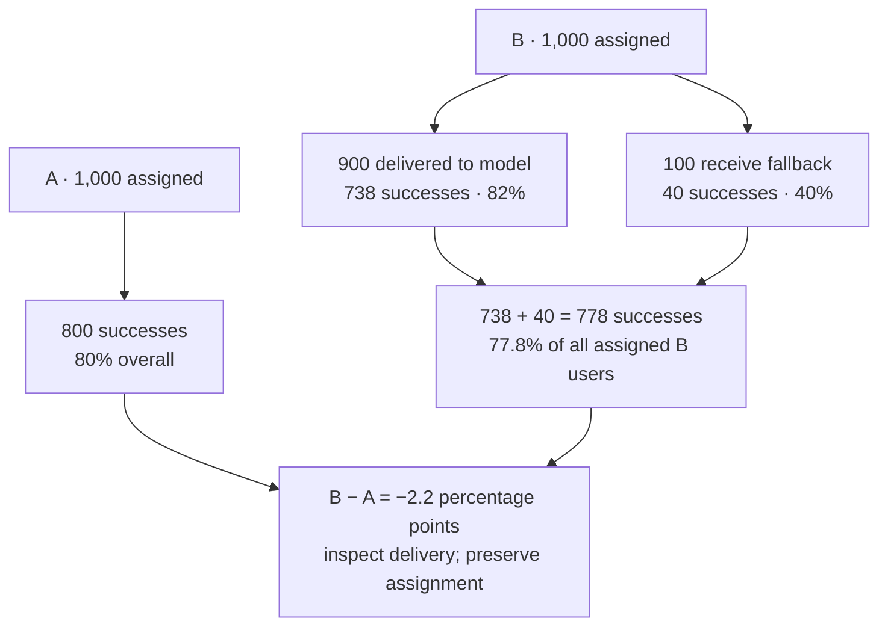

An online regression does not yet identify a model defect: contain unacceptable harm, verify measurement, then verify delivered treatment.

## Problem

A report says offline quality improved 8% while the online primary metric declined 2%.
Check each metric's denominator, baseline and relative-change definition before comparing them.

In a separate hypothetical delivery fixture, A serves 1,000 assigned users and records 800 successes.
B delivers the new model to 900 users, recording 738 successes.
Its other 100 users receive fallback, with 40 successes.
Where should the next discriminating check focus?

## Picture

Keep assigned users in the product denominator while tracing delivery branches separately.

<!-- visual:offline-online-gap-diagnostic-order -->

<strong>Read it this way:</strong> add branch successes before dividing by assigned users. The delivered subset's 82% success rate cannot replace B's 77.8% product outcome.

## Calculate, then test a cause

$$
	ext{B overall}=\frac{738+40}{1000}=0.9(0.82)+0.1(0.40)=0.778.
$$

A's rate is $0.80$; the difference is $-0.022$, or $-2.2$ percentage points.
This is not the prompt's separate reported relative change.
The $0.82$ delivered-model rate conditions on routing and does not identify a causal model improvement.

## First: verify the observation

1. Contain harm under declared rollback conditions; preserve logs and versions.
2. Check assignment, exposure, sample ratios, instrumentation, uncertainty, delayed outcomes and novelty or seasonality.
3. Replay production inputs through the actual model, feature, candidate and preprocessing versions.
4. Inspect latency, errors, fallback and differences by user, item, time and surface.
5. After validity and delivery pass, test a specific model-quality or feedback hypothesis.

| Hypothesis | Predicted observation | Cheap discriminating check | Next action |
| --- | --- | --- | --- |
| Latency triggers fallback | Fallback rises on slow requests | Join routing reasons with latency/version records | Contain; repair and measure again |
| Preprocessor is stale | Same raw input yields different features | Compare versioned feature snapshots | Fix parity before retraining |

Record actual results and rollback conditions alongside the hypothesis.
These observations can localize delivery faults; they do not prove fallback is the only cause.
Restoring delivery needs a new controlled measurement of product effects.

## Change the population or label source

### 1. Only new users regress

**Picture and change:** compare feature defaults, candidate coverage and exposure using new-user traces.

**Check:** a replay matching returning users but failing new users localizes the next parity test.

**Use when:** a specific slice explains the aggregate change; do not jump directly to general drift.

### 2. Labels came from the old ranker

**Picture and change:** inspect logged exposure support and negative sampling after delivery checks.
Use independent judgments or justified randomized exploration.

**Check:** an unexposed item with no click is not an observed negative.

**Use when:** the previous policy selected the evaluation population.

## Failure and transfer

Immediate retraining changes the model while a stale serving preprocessor remains deployed, obscuring the fault.

What can shadow replay establish?

Check your answer

Prediction-path parity on replayed inputs, not how users respond to a changed live policy.

<!-- learning:core-end -->

## The main cause families

**Objective mismatch:** a better proxy such as clicks or NDCG need not improve satisfaction or the declared user outcome.

**Evaluation bias:** inspect time/label leakage, repeated entities, biased negatives and unrepresentative data.

**Skew:** check feature definitions, freshness, defaults, preprocessing, versions and candidates.

**System effects:** latency, downstream load, inventory diversity and fallbacks can change product outcomes.

**Feedback:** exposure changes future labels; users, suppliers and adversaries may adapt.

## Distinguish evidence types

Counterfactual estimates require exposure support and justified assumptions.
Long-term holdbacks need valid assignment, enough duration and consideration of interference.
Neither is a universal substitute for controlled product measurement.

## Keep the investigation falsifiable

Compare permissioned sampled inputs and outputs without exposing sensitive data.
Predeclare what result changes the next action, then improve the evaluation that missed the fault.

## Common follow-ups

New-user regression needs slice-specific parity checks.
For noisy delayed outcomes, wait for mature cohorts and use the planned uncertainty method.
Keep running only within authorized risk limits and predeclared monitoring/stopping rules, not because offline quality improved.

*Related: [delayed and selective labels](/concepts/delayed-labels-selective-labels-feedback-loops/), [point-in-time correctness](/concepts/data-leakage-point-in-time-correctness/), [causal inference](/concepts/causal-inference-for-ml-decisions/), and [A/B testing for ML](/concepts/ab-testing-for-ml/).*

