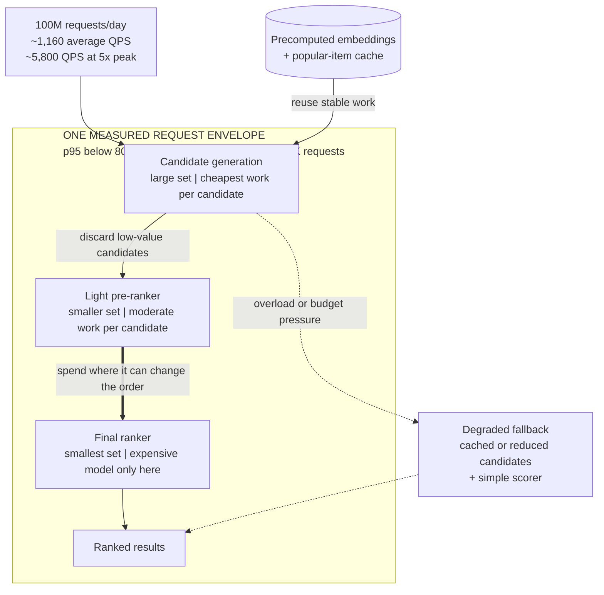

> Design a personalized ranking system for 20 million daily users. The serving budget is $3 million per year and p95 latency must stay below 80 ms. What do you ship?

Estimate request volume and unit cost before choosing hardware.
The useful picture is a narrowing candidate set: cheap stages reject work before an expensive model sees it.

## Clarify before calculating

Ask how many requests each user makes, how traffic peaks and what the annual budget includes.
Also define quality, freshness, availability and fallback requirements.
These determine which operating points are allowed.

## Build an order-of-magnitude model

Assume five requests per daily user: 100 million requests per day.
Use 365 days and a fivefold peak factor for this example.

| Quantity | Calculation | Result |
| --- | --- | --- |
| Average requests/second | $100{,}000{,}000/86{,}400$ | About 1,157 |
| Assumed peak | $5\times1{,}157.4$ | About 5,787 requests/second |
| Annual requests | $100{,}000{,}000\times365$ | 36.5 billion |
| Daily budget | $3{,}000{,}000/365$ | About $8,219 |
| Unit ceiling | $3{,}000{,}000/36.5\text{ billion}\times1{,}000$ | About $0.08219 per thousand |

The unit ceiling covers the declared budget scope, not just model kernels.
Subtract included feature, logging, storage and operational costs before allocating inference spend.
Excluded costs still belong in a separately reported total.

<!-- visual:fixed-budget-ranking-funnel -->

<strong>Read it this way:</strong> follow one request as its candidate set shrinks. Expensive scoring runs on fewer candidates. Measure the whole path against the latency and cost ceilings. The dashed fallback also needs measured cost and quality.

## A defensible architecture progression

Start with a heuristic, linear or tree baseline. Measure a quality, cost and latency point before adding stages.
For an illustrative funnel, retrieval keeps 200 of 10,000 candidates; the final ranker scores 20 of those 200.
Measure retrieval recall: no final ranker can recover a relevant item already discarded.

Precompute stable embeddings and reuse candidates when their age is acceptable.
Batch only within the latency limit. Test quantization or distillation against the measured bottleneck.
They can reduce work without improving latency if another stage dominates.

Measure end-to-end p95 under representative peak load, including queueing, features, network calls and fallbacks.
Adding stage p95 values does not produce the request's p95.
Track per-stage work and cost to explain the total.

## Change the operating point

### 1. Only 5% of requests benefit from expensive ranking

**New task:** concentrate extra work where it improves the outcome.

**Picture and change:** put a router before the expensive branch.
Measure missed opportunities and segment quality as well as the fraction routed.
Include router cost and shared work.

**Check:** 5% observed use does not prove that the other 95% never benefits.

**Use when:** measured marginal value differs across requests.

### 2. The cache meets cost but returns stale candidates

**New task:** retain useful results as items and users change.

**Picture and change:** include versioned keys, invalidation and an age limit.
Measure outcome quality by age, plus miss and fallback cost.

**Check:** a high hit rate can coexist with unacceptable freshness.

**Use when:** reuse trades computation against changing eligibility or relevance.

## Try doubled traffic

Traffic doubles without a budget increase. What happens to the unit ceiling?

Check your answer

It halves to about $0.04110 per thousand requests.
Peak capacity must also be retested. The old operating point no longer proves feasibility.

<!-- learning:core-end -->

## Check a hardware proposal

"Use a two-tower model and autoscale GPUs" does not supply a capacity or cost calculation.
Record workload shapes, current prices, utilization, batching limits and availability reserves.
Autoscaling cannot make an unaffordable peak fit the budget.

## Choose a feasible point

Compare quality, full cost and end-to-end tail latency under the same traffic assumptions.
Include a measured degraded path, rollout limit and rollback trigger.
Use cost per useful outcome alongside cost per request.

## Compare further investment

Test better candidate generation against a larger ranker.
Compare building infrastructure with buying capacity, including maintenance and price changes.
Stop adding work when its measured value no longer justifies its cost.

## Evidence for a recommendation

A claimed 1% conversion gain at triple cost needs a causal value estimate and actual cost accounting.
Check uncertainty, cheaper alternatives and the hard budget before recommending shipment.

## Failure cases

A larger final model cannot repair retrieval that dropped every relevant item.
An inference-only spreadsheet cannot establish total serving cost.

## Common follow-ups

- Traffic doubles with no budget increase. What changes first?
- The largest model adds 1% conversion but triples cost. Do you ship it?
- How do prefill and decode change the cost model for an LLM ranker?
- What if only 5% of requests need personalization?
- How do you detect that caching is silently harming freshness?

*Related: [reduce LLM inference cost 10×](/questions/reduce-llm-inference-cost-10x/), [GPU memory hierarchy](/concepts/gpu-memory-hierarchy/), and [quantization](/concepts/quantization/).*

