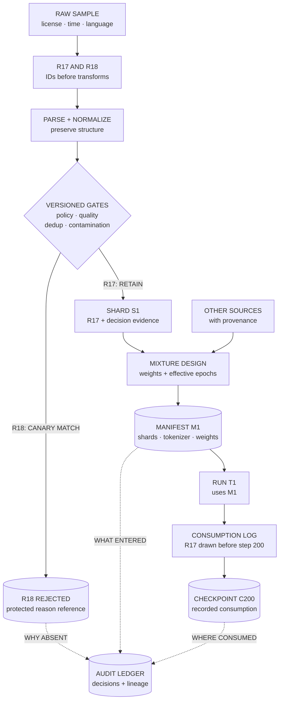

## Summary

Data curation selects a versioned training distribution, with evidence for both retention and rejection.
Mixture weights control exposure, not just how many unique records are stored.

Suppose post-gate corpora A and B contain 600 and 200 eligible token positions.
Unique here means positions in the deduplicated corpus, not distinct vocabulary IDs.
Plan a 1000-token training budget with intended shares $0.6$ and $0.4$.
How often is each source consumed, and can a restricted record be traced to affected checkpoints?

One record, explicit decisions

Trace R17 through shard S1, manifest M1, run T1 and recorded checkpoint consumption.

<!-- visual:foundation-data-curation-lineage -->

<strong>Read it this way:</strong> R17 retains its identity through each decision. R18 has a protected rejection record. A manifest describes eligible inputs; consumption logs establish which inputs were actually drawn before a checkpoint.

References: <a href="https://arxiv.org/abs/2406.11794">DataComp-LM</a>, <a href="https://aclanthology.org/2022.acl-long.577/">Lee et al. on deduplication</a>, <a href="https://arxiv.org/abs/2303.03915">ROOTS</a>, and <a href="https://arxiv.org/abs/2203.15556">Hoffmann et al.</a>

## Calculate realized exposure

Suppose consumption logs record exactly 600 draws from A and 400 from B.
Intended weights alone would not establish those realized counts.

$$
\operatorname{effective\ epochs}(s)=\frac{\text{realized token draws from }s}{\text{eligible unique token positions in }s}.
$$

| Source | Eligible positions | Intended share | Realized draws | Effective epochs |
| --- | --- | --- | --- | --- |
| A | $600$ | $0.6$ | $600$ | $1$ |
| B | $200$ | $0.4$ | $400$ | $2$ |

B contains one quarter of eligible positions but receives two effective epochs.
Reducing its realized draws to 200 gives one effective epoch, without establishing a capability improvement.

## Keep the decision artifact

R17's record binds its source, parsing version, decision and shard.
M1 also fixes source snapshots, transforms, gates, tokenizer, sampling policy, weights and removal-list version.
T1 binds that manifest; C200 binds actual consumption up to its saved step.
Store a protected reason reference for R18, not secret material in ordinary logs.

A later restriction on R17 can trace through S1, M1 and T1 to affected consumption and checkpoints.
Removing its raw file does not remove derived records or learned effects.

## Change the selection rule

### 1. Deduplicate spans rather than whole documents

**New task:** two documents share a license block but contain different proofs.

**Picture and change:** retain both record identities and unique proofs.
Handle repeated training spans without discarding required legal notices or provenance.
Version the deduplication representation and action.

**Check:** both unique proof sections remain available after handling repetition.

**Use when:** document similarity hides valuable nonrepeated material.

### 2. Tighten a quality threshold

**New task:** a stricter prose filter removes many low-resource-language records.

**Picture and change:** audit accepted and rejected slices, including a controlled below-threshold sample.
Compare threshold variants under equal training budgets.

**Check:** a higher accepted mean score with lower language coverage does not establish a better mixture.
Use fresh-task and coverage evidence.

**Use when:** selection changes the population beyond its intended target.

## A filter cannot validate itself

A polished-prose judge can reject correct informal technical answers.
Its accepted mean score then rises while useful coverage falls.
Independent audit must test the capability and risk that motivated the filter.

## Synthetic data

Synthetic examples can target rare skills or provide verifier checks.
Record generator provenance, verification, diversity and evaluation exclusions.
Generator, filter and student can share the same unchecked error; agreement is not independent validation.

## Measuring curation

Measure source coverage, duplication, policy errors, known evaluation overlap, repetition, task outcomes and memorization.
Audit whether removal requests reach derived shards, manifests and consumed checkpoints.
Decontamination reduces known overlap but cannot establish complete evaluation independence.

## Try changing a source share

A source has 50 eligible token positions and receives 250 draws.
What happens if its realized draws halve at fixed total budget?

Check your answer

Exposure falls from five effective epochs to $2.5$.
Then test whether changed repetition affects memorization or capability; exposure arithmetic alone does not decide.

<!-- learning:core-end -->

## Pipeline stages

### Acquisition and provenance

Record source, usage basis, collection time, language, content type and access constraints before transformations.

### Parsing and normalization

Preserve meaningful code, tables, formulas and dialects while extracting text, normalizing encoding and removing boilerplate.

### Policy and privacy filtering

Check secrets, personal information, malware and source restrictions.
Audit thresholds and false positives by slice; filtering changes the population.

### Quality filtering

Heuristics and learned filters can detect spam or incoherence while also rejecting valuable unusual material.

### Deduplication

Hashes detect exact matches; MinHash, locality-sensitive hashing, suffix or n-gram methods identify particular near-duplicate patterns.
Embedding similarity can collapse distinct examples.
State the unit, threshold and action.

### Decontamination

Search prompts, answers, source overlap and transformed variants.
Exact matching misses formatting and paraphrase changes.

### Mixture design

Choose weights from capability, coverage and risk requirements, not raw size alone.
Track actual repetitions and sampling behavior.

### Versioning and audit

Version raw snapshots, parsing code, filter models, thresholds, dedup indexes, tokenizer, weights and removal lists.
Retain aggregate and sampled audits.

## Common confusions

- Quality depends on the intended task and population, not one score.
- Deduplication changes exposure as well as compute.
- Known-overlap checks do not certify independence.
- Synthetic generation still needs verification and diversity controls.
- Mixture selection is a model-design choice.
- Raw-file deletion is not model unlearning.

## In an interview

Connect the target capability to source decisions, measured exposure and independent evidence.

*Related: [design a foundation-model data platform](/questions/design-foundation-model-data-platform/), [ML data lineage and versioning](/concepts/ml-data-lineage-versioning/), [lessons from Marin 8B](/guides/lessons-from-marin-8b/), and [preference data and reward models](/concepts/preference-data-and-reward-models/).*

