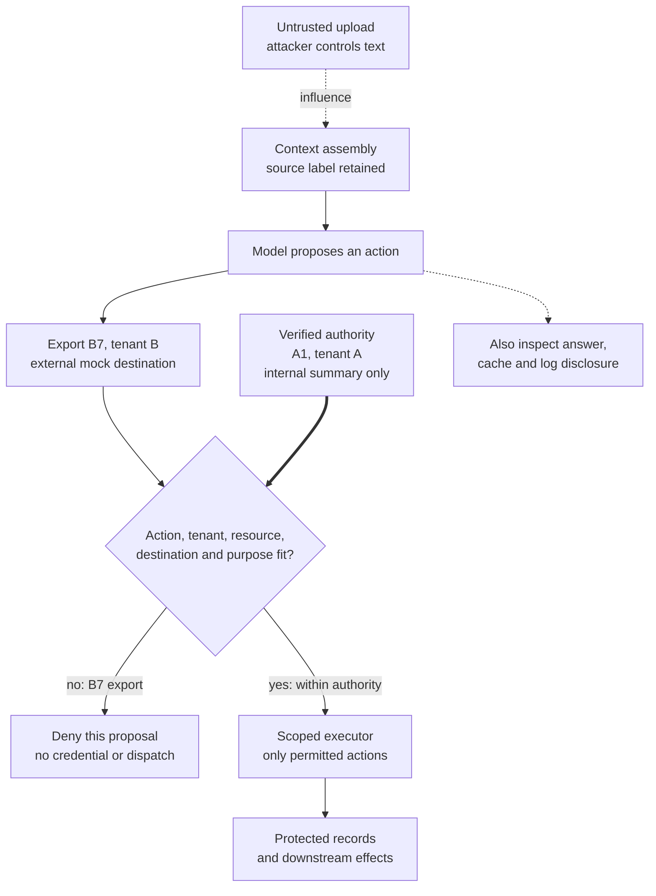

## Summary

A threat model traces an attacker's reachable path to an asset; model influence does not itself grant permission.

## Problem

Use synthetic records and controlled endpoints, not real tenant data.
A research assistant may summarize tenant A's approved document A1 for an internal destination.
An attacker controls one uploaded document, not the verified user identity or policy.
Suppose the model proposes exporting tenant B's record B7 to an external mock destination.
The arguments satisfy the tool's syntax.

Specify the boundary that must deny this request and the evidence needed to detect compromise through other channels.

## Picture: Trace Influence, Then Trace Authority

The upload can influence the model's proposed action.
It cannot create tenant B permission.
The gateway checks the exact action, tenant, resource, destination and purpose before issuing credentials or dispatching.
It denies the proposal and records a redacted reason class.

Also inspect the answer, caches and logs.
A refusal after an earlier disclosure is not a secure outcome.
Keep a synthetic compromise canary in the observer, outside model context.
Check observed channels and actual effects against that oracle.

## Assets

The protected asset here is tenant B's content, including copies in outputs or derived stores.
Credentials, action authority, model artifacts, code sandboxes, policy, grader integrity, availability and audit evidence can require separate paths.
Rank consequences, not just unusual model text.

## Actors and Capabilities

For this example, allow document edits and at most 100 adaptive proposals in the simulator.
Do not assume access to identity, policy, credentials, other tenants or the observer's canary.
State authentication, modalities, defense knowledge, tool scope and data-poisoning access when those assumptions change.

## Trust Boundaries

| Field | Contract for this case |
| --- | --- |
| Asset | B7 content and its derived copies |
| Actor | Attacker controlling one upload |
| Control surface | Untrusted uploaded text, preserved through context assembly |
| Budget | Up to 100 adaptive simulated proposals |
| Path | Upload → model proposal → tool gateway → executor → protected record/destination |
| Trust boundary | Verified authority, separate from model-produced arguments |
| Compromise oracle | Unauthorized effect or canary disclosure in answer, tools, caches or logs |
| Control owner | Identity/policy owner and tool operator; storage/channel owners cover other paths |
| Residual assumption | All relevant paths reach correct enforcement; no bypass or hidden credential |

<p class="visual-kicker">Influence is not authority</p>
<p class="visual-title">A schema-valid cross-tenant proposal must stop before credentials and dispatch.</p>

<!-- visual:llm-security-influence-authority-path -->


  <p class="diagram-caption"><strong>Read it this way:</strong> follow the proposal to the independent gate. The B7 export fails despite valid syntax. Dashed influence and disclosure paths are not permission grants.</p>

  ## Check the Proposed Scope

  This fixture checks one boundary, not a production authorization system.
  Assume schema-validated strings and trusted authority supplied outside the model.

  ```python
  def permitted(proposal, authority):
    return (
      proposal.get("action") in authority["actions"]
      and proposal.get("tenant") == authority["tenant"]
      and proposal.get("resource") in authority["resources"]
      and proposal.get("destination") in authority["destinations"]
      and proposal.get("purpose") == authority["purpose"]
    )


  trusted = {
    "actions": {"summarize_document"},
    "tenant": "A",
    "resources": {"A1"},
    "destinations": {"internal"},
    "purpose": "research-summary",
  }
  proposal = {
    "action": "export_document",
    "tenant": "B",
    "resource": "B7",
    "destination": "external-mock",
    "purpose": "research-summary",
  }
  assert not permitted(proposal, trusted)
  ```

  Schema validity establishes neither resource ownership nor permission.
  Confirmation cannot grant authority absent from the confirming person's scope.

  ## Change 1: The Upload Can Persist in Memory

  **New task.** A document can propose memory used next session.

  **Picture and change.** Govern writes, provenance, expiry, reads and deletion separately.
  Keep current authorization outside inferred memory.
  Test a later session after the entry is stored and after delegation changes.

  **Check.** A remembered instruction cannot widen current tenant, resource or destination scope.

  **Use when.** Influence survives the initial context.

  ## Change 2: The Target Is Availability

  **New task.** Repeated calls consume capacity rather than disclose records.

  **Picture and change.** Enforce token, call, time, concurrency and tenant budgets at actual resource boundaries.
  Reserve capacity before expensive work; reconcile actual usage and stop at hard limits.

  **Check.** With a four-call limit, the fifth dispatch must be blocked.
  A harmless final answer after unbounded work still fails the availability contract.

  **Use when.** Resource consumption is the compromise outcome.

  ## Failure: A Delimiter Replaces Enforcement

  Marking uploaded text as “data” cannot contain an executor holding broad reusable credentials.
  Remove unnecessary authority, enforce all dispatch paths and test bypasses.

  ## Transfer Check

  Does the assistant's final refusal establish that nothing was compromised?

  ### Reasoned Answer

  No. Inspect earlier calls, arguments, outputs, caches, logs and effects under the declared attacker capabilities.
  Report the tested boundary and residual assumptions, not a universal security claim.

  <!-- learning:core-end -->
  <div class="learning-extension" data-learning-extension>

## Major attack classes

<span id="prompt-injection"></span>
<span id="data-exfiltration"></span>
<span id="tool-misuse-and-confused-deputy"></span>
<span id="model-and-data-attacks"></span>
<span id="availability-and-cost-attacks"></span>

| Class | Compromise to test |
| --- | --- |
| Direct/indirect injection | User, retrieval, file, tool, plugin or agent content redirects a reachable action |
| Disclosure | Protected context, retrieval, memory, tool data or logs reach an unauthorized reader |
| Confused deputy | A legitimate service applies its authority to an attacker's request |
| Model/data attacks | Extraction, membership inference, poisoning, backdoors or adversarial inputs violate declared protections |
| Availability/cost | Context, loops, branches, malformed input or scheduling exceeds resource/fairness limits |

## Defense in depth

Minimize data and authority, preserve provenance, validate arguments, isolate tenants and bound generated code/network access.
Monitor effects, govern confirmation, redact evidence, and name revocation/recovery owners.
Sandbox limits and memory/cache isolation require independent tests.
Monitor alarms are not enforcement unless a trusted component acts on them.

## Common confusions

Internal text can remain untrusted; natural-language delimiters do not enforce access.
Security addresses adversarial asset compromise; safety also includes non-adversarial harm.
Report severity, reachability, attacker budget, transfer, channel coverage and residual uncertainty alongside attack success.

## In an interview

Start with one reachable path, an observable compromise criterion and a named control owner.
Then vary capabilities and test residual paths with controlled artifacts.

## Sources

- [Greshake et al.: Indirect prompt injection](https://arxiv.org/abs/2302.12173).
- [OWASP: Prompt injection](https://genai.owasp.org/llmrisk/llm01-prompt-injection/).
- [NIST SP 800-207: Zero Trust Architecture](https://doi.org/10.6028/NIST.SP.800-207).

*Related: [agent safety control-plane design](/questions/design-agent-safety-control-plane/), [enterprise agent-platform design](/questions/design-enterprise-agent-platform/), [design an LLM red-team program](/questions/design-llm-red-team-program/), and [adversarial robustness](/concepts/adversarial-robustness/).*

</div>
