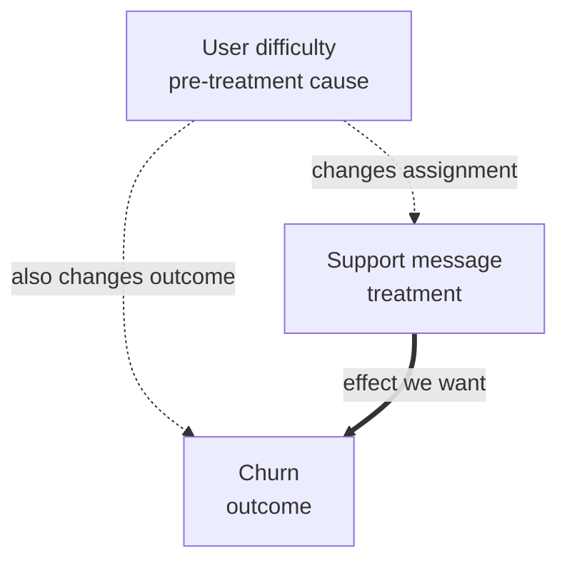

## Summary

Prediction asks what is likely under observed data; a causal decision asks what a defined intervention would change.
Specify the target population, assignment mechanism, identification assumptions, and estimator before interpreting an association as an effect.

## A Support-Message Decision

Consider this hypothetical two-hundred-user population, with difficulty measured before any message:

| Difficulty | Messaged: churn/users | Unmessaged: churn/users |
| --- | --- | --- |
| High | $16/80$ | $6/20$ |
| Low | $1/20$ | $8/80$ |

Recipients churn at $17/100$ versus $14/100$ for nonrecipients, an observed difference of positive three percentage points.
Should messages be withheld because recipients churn more?
Not from this association alone: the high-difficulty group is much more likely to receive messages.

## Potential outcomes and estimands

For each unit $i$, define two potential outcomes:

$$
Y_i(1) \quad \text{and} \quad Y_i(0).
$$

Let treatment one mean receiving the defined support message and treatment zero mean not receiving it.
Fix a churn window and assume no cross-user spillovers for this simple unit-level target.
Only one potential outcome is observed per user; the individual effect $Y_i(1)-Y_i(0)$ is unavailable directly.

A common target is the average treatment effect:

$$
\operatorname{ATE}=\mathbb{E}[Y(1)-Y(0)].
$$

Effects on treated users, eligible users, compliers, or conditional subgroups target different populations.
Policy value additionally depends on the proposed treatment rule and its constraints.

## Why prediction can mislead

Difficulty affects both message assignment and churn, opening a noncausal route between the two.
The graph asserts that causal structure; predictive accuracy alone cannot establish or remove the confounding.

A directed acyclic graph can express the claim:

Confounding

Difficulty changes both message assignment and churn, so observed association alone cannot identify the intervention effect.

<!-- visual:causal-confounding-dag -->

<strong>Read it this way:</strong> difficulty opens a backdoor path from support messages to churn. The observed association mixes that path with the message's causal effect.

For this calculation only, assume pre-treatment difficulty suffices to block confounding and both actions have support in each group.
Within high difficulty, observed rates are $0.20$ versus $0.30$; within low difficulty, $0.05$ versus $0.10$.
The target population is half high difficulty and half low difficulty, so standardization gives:

$$
\widehat E[Y(1)]=0.5(0.20)+0.5(0.05)=0.125,
\qquad
\widehat E[Y(0)]=0.5(0.30)+0.5(0.10)=0.20.
$$

The adjusted contrast is $-0.075$, or 7.5 percentage points less churn, under the declared assumptions.
This is teaching arithmetic without estimated uncertainty, not evidence that actual support messages reduce churn.

## Randomized experiments

Valid random assignment provides independence from potential outcomes under its design.
Analyze assignment and the resulting intervention using the correct randomization units and outcome weights.
With noncompliance, the assignment effect need not equal the effect of actually receiving the message.

Check:

- assignment versus actual exposure;
- sample-ratio mismatch;
- interference between units;
- attrition and missing outcomes;
- novelty and long-term effects;
- heterogeneous effects;
- guardrail outcomes.

Randomization does not fix an undefined intervention, missing outcomes, interference, or an inappropriate target population.

## Backdoor adjustment

In observational data, a backdoor adjustment set blocks noncausal paths from treatment $T$ to outcome $Y$.

Under consistency, positivity, and no unmeasured confounding given covariates $X$,

$$
\mathbb{E}[Y(t)] = \mathbb{E}_X[\mathbb{E}[Y\mid T=t,X]].
$$

These assumptions mean:

- **consistency:** the observed outcome under the received treatment matches the defined potential outcome;
- **positivity:** each relevant covariate group has some chance of each treatment;
- **exchangeability:** conditional on $X$, treatment assignment is independent of the potential outcomes, not necessarily the observed outcome.

These assumptions cannot all be verified from this table.
Adjusting for post-message satisfaction can remove mediated effects or introduce bias; adding variables is not automatic identification.

## Change the Requirement

### Remove Observable Support

**New task:** Nobody with severe difficulty goes untreated.

**Picture and change:** That group's untreated propensity becomes zero, removing its observed comparison.

**Check:** A zero untreated count cannot supply the group's $0.30$ counterfactual risk.

**Use when:** A proposed policy includes actions absent from historical data.
Seek defensible additional evidence or explicitly narrow the target; outcome-model extrapolation alone does not restore identification.

### Change the Assignment Evidence

**New task:** Compare before/after churn in rollout and comparison regions.

**Picture and change:** Use outcome changes and justify parallel untreated trends, including anticipation and composition checks.

**Check:** Treated churn $20\%\to16\%$ versus comparison $15\%\to14\%$ gives $-4-(-1)=-3$ percentage points.

**Use when:** A defensible time-comparison design replaces individual randomization.
The two before/after numbers alone cannot verify the counterfactual parallel-trends assumption.

<!-- learning:core-end -->

## Propensity scores and weighting

The propensity score is

$$
e(X)=P(T=1\mid X).
$$

Inverse-propensity weighting estimates a pseudo-population in which treatment is less associated with measured covariates. For the ATE, treated units receive weight $1/e(X)$ and control units receive weight $1/(1-e(X))$.

The fixture has propensities $0.8$ and $0.2$.
Its weighted message risk is $(16/0.8+1/0.2)/200=0.125$; untreated risk is $(6/0.2+8/0.8)/200=0.20$.
Large weights can indicate weak overlap and high variance; inspect distributions and effective sample sizes.
Weight capping changes the estimator and can introduce bias; trimming or redefining the population needs an explicit target and justification.

A propensity model balances measured covariates. It does not remove unmeasured confounding.

## Doubly robust estimation

A doubly robust estimator combines outcome and propensity models.
Under identification, overlap, and suitable convergence conditions, consistency can survive misspecification of one nuisance model if the other is correct.

This does not protect against a wrong estimand, poor overlap, interference, or unmeasured confounding. Use cross-fitting for flexible ML nuisance models to reduce overfitting bias.

## Difference in differences

Difference in differences compares outcome changes over time between treated and comparison groups:

$$
(\bar{Y}_{T,after}-\bar{Y}_{T,before})
-
(\bar{Y}_{C,after}-\bar{Y}_{C,before}).
$$

The main assumption is parallel trends: without treatment, the average outcome paths would have changed similarly. Inspect pre-treatment trends and consider anticipation, changing group composition, and treatment timing.

## Regression discontinuity

A sharp cutoff design can identify a local effect when potential-outcome means are continuous through the threshold.
Check manipulation, other simultaneous policy changes, covariate behavior, bandwidth sensitivity, and functional forms.
An inability to manipulate the score is not alone sufficient; fuzzy compliance needs a separate identification argument.
Do not generalize the local effect across the entire population without additional assumptions.

## Interference and feedback

Standard potential-outcome notation assumes one unit's treatment does not change another unit's outcome. This fails in social networks, marketplaces, auctions, and shared-capacity systems.

Cluster randomization, switchbacks, and exposure models must match the plausible spillovers and carryover; their names do not remove interference.
Recommendation policies also change future training data, so define the horizon and feedback included in the target policy value.

## Worked example

As a separate decision illustration, high-intent users receive more premium content and subscribe more often.
The observed association does not identify exposure's effect because intent changes both assignment and outcome.
Transporting the support-message calculation would require this setting's own population, intervention, support, and identification argument.

## In an interview

Use this order:

1. Separate prediction from intervention.
2. Define treatment, outcome, population, and estimand.
3. Draw the assignment process or causal graph.
4. Prefer randomization when feasible.
5. State every observational identification assumption.
6. Check overlap, interference, missing outcomes, and sensitivity.
7. Connect the estimate to a decision.

A strong answer says what cannot be learned from the available data. Method names do not replace identification.

## Common mistakes

- Interpreting feature importance as causal effect.
- Controlling for variables produced after treatment.
- Assuming propensity weighting removes all confounding.
- Ignoring overlap and extreme weights.
- Using difference in differences without checking pre-treatment trends.
- Generalizing a regression-discontinuity estimate far from the cutoff.
- Ignoring interference or policy feedback.

## Practice next

Apply this framework in [A/B testing for ML](/concepts/ab-testing-for-ml/), [ML experiment design](/questions/design-ml-ab-test/), [offline-online metric debugging](/questions/debug-offline-online-metric-gap/), and [personalized ranking](/guides/personalized-search-ranking/).

For deeper study, see [Causal Inference: What If](https://www.hsph.harvard.edu/miguel-hernan/causal-inference-book/) by Hernán and Robins.

