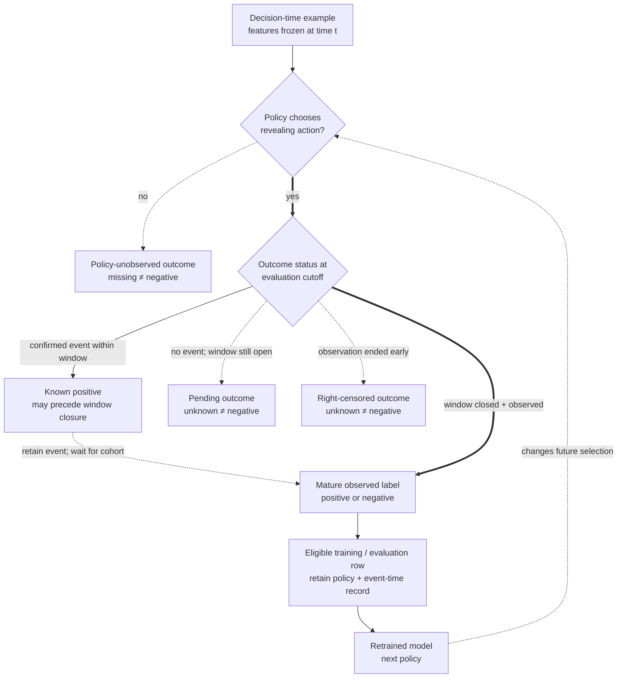

## Summary

A production label can be pending, censored, observed, or unavailable under the current policy.
No recorded event does not automatically establish a negative outcome.
Ask whether the revealing action occurred and whether follow-up supports the chosen outcome definition.

Our hypothetical target is a confirmed chargeback within 45 days of an approved payment.
Keep decision-time features frozen; later outcome corrections must not introduce future information into those features.

<p class="visual-title" id="policy-label-visual-title">Selection and observation are separate gates</p>

<!-- visual:policy-label-observation-loop -->


<p class="diagram-caption"><strong>Read it this way:</strong> selection determines whether approval's outcome is observable; follow-up determines whether absence supports a negative. Confirmed positives can be known early, but ordinary cohort evaluation still waits for the declared boundary. The return edge changes future selection, not just model weights. Waiting longer does not create outcomes for actions never taken.</p>

## Delayed labels

An event can occur or be reported after its prediction.
Group evaluation by decision cohort and retain event time, observation coverage, label arrival, and correction history separately.
A confirmed in-window event can establish a positive before day 45.
Absence establishes a negative only under the declared complete-follow-up and reporting rule.

## Worked example

Among 100 fully followed approved payments, two chargebacks are known at day 1 and ten by day 45.
Day 1 therefore has two positives and 98 pending rows, not 98 confirmed negatives.
At day 45, the mature cohort has ten positives and 90 negatives.
The shortcut would have mislabeled eight eventual positives; mature prevalence is $10/100=0.10$, not $2/100$.

| Record | Revealing action | Age / followed days | Observation status |
| --- | --- | --- | --- |
| Event confirmed day 1 | Approved | 1 / 1 | Known positive |
| No event yet | Approved | 7 / 7 | Pending |
| No event; observation stopped | Approved | 50 / 15 | Right-censored |
| Approval never occurred | Blocked | 50 / none | Policy-unobserved approval outcome |
| No event; complete window | Approved | 45 / 45 | Mature negative |

The day-50 row is not mature merely because it is old.

## Right censoring

Without a confirmed event, follow-up ending at day 15 leaves the 45-day binary outcome unresolved.
Survival methods can use event-time and censoring information under explicit assumptions.
Conditional independence of censoring is not automatic: outcome-related departures from coverage can violate it.
Closed cohorts sacrifice freshness and may still have selection bias.

## Selective labels

Repayment after approval, clicks after exposure, and review outcomes after selection have different observation support.
Approved-cohort risk is not automatically risk across all eligible applicants.
Neither chronological splitting nor waiting repairs missing counterfactual outcomes.

## Safe ways to gain labels

**New task:** estimate recent risk before 45-day outcomes mature.

**Picture and change:** validate an early proxy or specify an event-time model; retain mature evaluation as the reference.

**Check:** a seven-day proxy finding eight of ten mature positives has sensitivity $8/10$.
Without its false positives, precision remains unknown.
That proxy has not changed the ground-truth outcome definition.

**Use when:** waiting is costly, with proxy error and cohort age reported explicitly.

## Evaluation under policy change

**New task:** evaluate approvals where the old policy always rejected.

**Picture and change:** identify missing action support before choosing a counterfactual estimator.

**Check:** approval propensity zero makes an approval importance weight undefined, not zero.
Even propensity $0.01$ gives a selected approval weight $100$, creating variance risk.
Weighting requires adequate support and a defensible assignment/observation model.

**Use when:** a proposal changes observed actions; lawful independent evidence or tightly bounded safe collection may be necessary.
Adjudication can assess a proxy without revealing an unperformed action's actual outcome.

## Logging contract

For each decision, log:

- decision timestamp and entity;
- feature-snapshot identifier;
- candidate set and available actions;
- chosen action, score, threshold, model, and policy versions;
- action probability when randomized;
- label-window end and observation end;
- outcome timestamp, observation status, and corrections.

Backfilling labels while recomputing historical features from today's warehouse leaks future information despite correct maturity handling.

<!-- learning:core-end -->

<div data-learning-extension>

## Feedback loops

A deployed policy changes the evidence available to its successor:

```text
model score -> action or ranking -> user exposure -> behavior -> label -> retraining
```

Training on the selected subset can narrow future coverage even when loss on that subset decreases.

## Direct and indirect feedback

Direct feedback changes measured responses, such as ranking-induced clicks reused as labels.
Indirect feedback changes the population or behavior, such as which applicants return under stricter approvals.
Track coverage and action mixtures alongside outcome metrics; retain stable controls when long-term feedback matters.

Randomized audits, permitted independent reviews, and external adjudication can broaden evidence within lawful risk limits.
Shadow predictions alone do not reveal counterfactual actions' outcomes.
Positive-unlabeled methods need assumptions about positive-label selection; survival models need justified censoring assumptions.
Simulation and expert review can inform a decision without becoming measured deployment evidence.
Do not introduce unacceptable risk merely to collect labels.

## In an interview

A shown result receives no click; an unshown result has no click record. Are both negatives?

<details><summary>Answer</summary>

No. The first is a response under one exposure; the second lacks that exposure outcome.
Neither alone establishes universal relevance across positions, users, and contexts.

</details>

## Common mistakes

Report estimand, age, maturity coverage, selection policy, and remaining unknown outcomes together.
A well-defined mature complete-case estimate can still target the wrong population.
Preserve original scores and feature versions when later labels arrive.

</div>

## Practice next

Apply these ideas in [point-in-time correctness](/concepts/data-leakage-point-in-time-correctness/), [counterfactual ranking](/concepts/position-bias-counterfactual-learning-to-rank/), [fraud-system design](/questions/design-fraud-detection/), and [offline-online metric debugging](/questions/debug-offline-online-metric-gap/).
