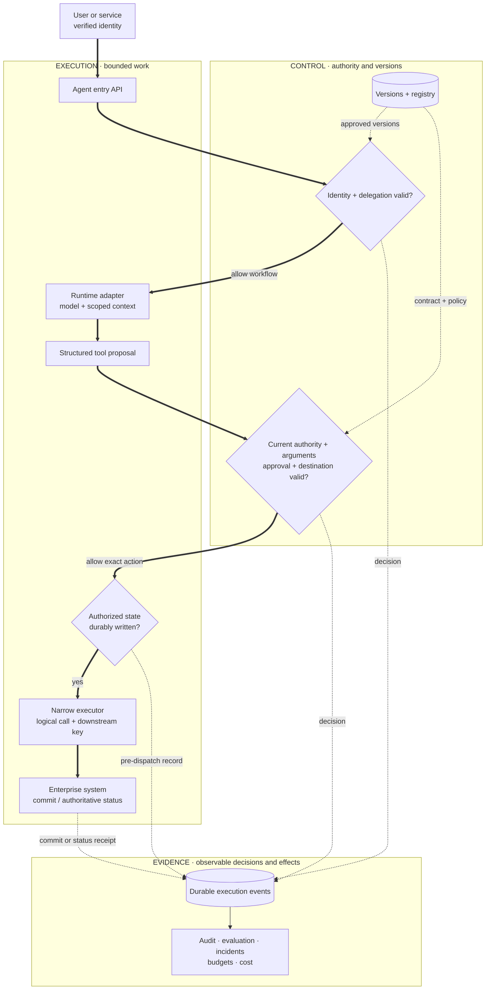

Agents propose, policy authorizes, and tools create effects; a timeout does not prove an effect failed.

<span id="the-prompt"></span>

## Problem

A fictional company has 40 agent teams, several model providers and about 300 tools.
Independent systems disagree on schemas, permissions, memory, traces and retries.
Peak starts are 2,000 workflows/second; most finish within one minute and five calls, but some run for hours.
Ten tools move value or alter access; 50 read restricted data.

A support agent sends a 50-unit account credit, loses the response, then retries and creates another credit.
Separately, an uploaded report induces a research agent to propose a broader internal-data export than the user authorized.

Design a two-year platform direction with a first release in one quarter, incremental migration and regional processing restrictions.
What prevents the duplicate effect and unauthorized export without requiring every team to use one planning runtime?

## Picture: one logical action, several observations

Logical call `credit-123` uses downstream key `k-456` and exact approved arguments.
Separate its durable record from each network attempt and from the account system's authoritative state.

| Event | Durable call state | Account system | Permitted next action |
| --- | --- | --- | --- |
| Authorize exact credit | `authorized` | No dispatch yet | Persist authorization, then dispatch |
| Send `k-456` | `dispatched` | May process request | Wait or query status |
| Commit; response lost | `outcome_unknown` | One 50-unit credit exists | Reconcile, not a new logical credit |
| Replacement worker resumes | `outcome_unknown` | Same committed credit | Lookup `k-456` with current authority |
| Lookup returns commit ID | `reconciled_success` | Still one credit | Record receipt and finish original call |

The downstream contract must bind key, arguments, committed effect and recoverable result consistently.
A client-created UUID does not supply that guarantee.
Revocation after dispatch cannot erase the committed credit.

## Separate control, execution, and evidence planes

Control decides authority and versions; execution performs bounded work; evidence records decisions and observed effects.

<!-- visual:enterprise-agent-three-plane-boundary -->


<p class="diagram-caption"><strong>Read it this way:</strong> a model proposes; policy authorizes; durable state precedes consequential dispatch. Completion comes from authoritative effect evidence, not a successful-looking model explanation.</p>
<p class="diagram-source">References: <a href="https://doi.org/10.6028/NIST.SP.800-207">NIST SP 800-207</a>, <a href="https://www.rfc-editor.org/rfc/rfc8693.html">RFC 8693</a>, <a href="https://docs.temporal.io/workflow-execution">durable execution</a>, and <a href="https://github.com/open-telemetry/semantic-conventions-genai">OpenTelemetry GenAI conventions</a>.</p>

## Apply ten invariants

1. Authority comes from verified identity and explicit delegation, never prompt text.
2. Every tool call uses a versioned action contract with an owner and retry semantics.
3. Consequential calls have durable authorization before dispatch.
4. Unknown effects remain unknown until authoritative reconciliation.
5. Retrieved content, tool output and memory do not become trusted control instructions.
6. Time, tokens, calls, concurrency and cost have enforced limits and terminal reasons.
7. High-risk completion needs independent policy and final-state evidence.
8. Tenant and regional data, credentials and authority remain isolated.
9. Tool, model, workflow and policy versions can be revoked independently.
10. Contracts and evidence remain portable across runtime replacement.

## Change retry support, authority or residency

### 1. The tool lacks deduplication and status lookup

**Picture and change:** prohibit automatic retry after possible dispatch.
Add a genuinely reconcilable downstream wrapper or approved manual resolution; client bookkeeping alone is insufficient.

**Check:** timeout plus unknown external state remains unresolved, not failed-safe.

**Use when:** transport results cannot establish effect absence.

### 2. Access is revoked while approval waits

**Picture and change:** invalidate or narrow delegation and reauthorize immediately before dispatch.
Bind approval to exact arguments, policy and expiration; old approval cannot restore revoked authority.

**Check:** no new consequential call starts from the expired grant.

**Use when:** work outlives its initiating authorization.

### 3. A region prohibits external payload processing

**Picture and change:** keep model, memory, tool and trace payloads in approved regional planes.
Share only permitted identity, version, policy and aggregate metadata.

**Check:** a provider outage cannot silently reroute restricted text through a forbidden region.

**Use when:** residency governs ordinary operation and failover alike.

## Test the second incident and transfer

The uploaded report remains untrusted evidence even if its proposed export passes JSON validation.
Evaluate purpose, source-data class, destination and authority across the entire tool chain before issuing credentials.
Individually permitted read/send tools do not automatically authorize their composition.

Why is compensation not rollback?

<details>
<summary>Check your answer</summary>

Compensation is a new action that can fail; it cannot erase observations or irreversible consequences of the original effect.

</details>

<!-- learning:core-end -->

<div data-learning-extension>

## State the boundary before choosing a framework

Build a shared agent control plane and tool gateway around several execution runtimes.

First-release contracts cover identity, delegation, tools, durable state, policy, evidence, budgets and staged releases.
Keep planning and domain workflows behind adapters; shared enforcement must not be optional.

## Clarify product, authority, and risk

<span id="users-and-products"></span>
<span id="tools-and-effects"></span>
<span id="identity-and-authorization"></span>
<span id="data-and-memory"></span>
<span id="scale-and-reliability"></span>

| Boundary | Questions that change the contract |
| --- | --- |
| Product | Advice, draft or action? Interactive or asynchronous? Customer, employee or software consumer? Cross-product workflow? Useful fallback? |
| Tool | Read/write, reversibility, idempotency, status lookup, region, data classes, cost and approval support? |
| Authority | User/workload identity, joint delegation, tenant, purpose, resource, amount, expiration and revocation target? |
| Data | Permitted session/team/region/provider flows, retention, correction, deletion and provenance? |
| Reliability | Arrival distribution, duration tails, calls, recovery/audit targets and task/tenant budgets? |

Peak starts and a typical duration do not establish mean concurrency; size queues and recovery from actual distributions.

## Define success around safe useful work

<span id="product-outcomes"></span>
<span id="safety-and-control"></span>
<span id="platform-delivery"></span>
<span id="efficiency"></span>

| Role | Evidence |
| --- | --- |
| Product | Defined completion, corrections/escalations, time-to-value, abandonment/retries, reversibility and delayed errors |
| Safety | Unauthorized dispatch, approval validity, duplicate/unknown effects, bypass, tenant/region exposure and revocation time |
| Delivery | Safe onboarding, observe-mode time, trace completeness, compliant release time, support burden and diagnosis time |
| Efficiency | Cost/tokens/calls per success, p50/p95/p99 duration, queue delay, post-terminal waste, gateway and storage costs |

Do not average unauthorized effects into task success or count registrations as user value.

## Classify actions by consequence

Classify action, arguments, identity and context, not tool name alone.

| Class | Example | Default control | Completion evidence |
| --- | --- | --- | --- |
| Read-only | Search approved documents | Automatic within scoped authority | Authorized response tied to source versions |
| Reversible write | Create a draft ticket | Automatic with audit and undo window | Authoritative write ID and tested undo deadline |
| Consequential reversible | Change a reservation | Confirmation, limits, and compensation path | Committed external state and valid compensation action |
| Irreversible or regulated | Send funds, delete records, grant access | Strong authentication, explicit approval, and narrow policy | Authoritative commit ID, approval record, and immutable audit event |
| Code or infrastructure | Run code, deploy, change production state | Sandbox or controlled executor with reviewed scope | Executor result plus observed target state and health |

Reading one account differs from exporting all accounts.
Declare reversibility, compensation and neither explicitly; compensation requires its own authorization and evidence.

## Establish platform invariants

The core's [ten invariants](#apply-ten-invariants) define the common boundary, not a prescribed planning algorithm.

<span id="control-plane"></span>
<span id="execution-plane"></span>
<span id="evidence-plane"></span>

Keep control metadata transactional; keep sensitive payloads in separately governed stores referenced by identity, hash and redacted summary.

## Model identity and delegated authority

Represent user/service and agent workload authority separately; permission for a human read does not imply permission for external-model export.

```text
Delegation
  delegation_id
  principal_identity
  agent_workload_identity
  tenant_id
  purpose
  allowed_actions
  resource_scope
  argument_constraints
  region
  expires_at
  confirmation_policy
  approval_policy
  issuer
  policy_version
```

### Short-lived capability

Bind narrow executor credentials to action, arguments, resource, tenant, purpose and expiration after policy approval.
Refresh requires another decision; expansion requires new delegation and applicable confirmation.
Reauthorize consequential dispatch, record revocation timing and reconcile effects already sent.

### Authorization versus instruction

Prompts guide behavior, not permission.
Central policy sets a floor; product, tool and regional owners may tighten it.
Exceptions need an authorized owner, bounded scope, evidence and expiration.

### Revocation

Support revocation by principal, workload, model/workflow/tool version, tenant, region, rule and credential issuer, with a declared propagation target.

## Define a complete tool contract

Keep contracts machine-readable and reviewable, with exact versions on calls.

```text
ToolAction
  tool_id
  action_id
  version
  owner
  input_schema
  output_schema
  side_effect_class
  data_classes_read
  data_classes_written
  authorization_attributes
  idempotency_mode
  status_lookup
  timeout_semantics
  compensation_action
  rate_limit
  cost_model
  region_support
  logging_policy
  retention_policy
  deprecation_state
```

Use a common result envelope while keeping the result body tool-specific.

```text
ToolResult
  logical_call_id
  outcome
  result
  error_code
  external_operation_id
  observed_at
  retry_after
```

`outcome` distinguishes succeeded, failed, partial and unknown.
Partial results identify completed effects and approved compensation; each contract specifies authoritative completion fields.

### Schema

Validate types, bounds, enumerations, resources, cross-field constraints and unexpected fields.
Then evaluate authorization: syntactically valid amounts can still be prohibited.

### Side effects

| Retry mode | Required downstream contract |
| --- | --- |
| `safe_retry` | Repeating the logical action converges without a key |
| `key_deduplicated` | Downstream binds key, arguments, effect and recoverable result |
| `reconcile_before_retry` | Authoritative lookup establishes effect absence before another dispatch |
| `no_automatic_retry` | Unknown effects need review or a separately approved action |

Also declare read/write, compensation and irreversibility; HTTP method alone proves none of these properties.

### Ownership and service level

Name owner, escalation, service target and timeout meaning: “never started” differs from “effect unknown.”

### Versioning

Declare compatibility ranges; breaking contracts need new versions and migration periods.

## Enforce policy at the tool boundary

All governed calls pass enforcement before credentials issue.
Evaluate identities, tenant/region, workflow/model/action versions, arguments, data classes, delegation, prior state, budgets and approval evidence.

```text
allow | deny | require_confirmation | require_approval | reduce_scope
```

Record reason class and policy version without exposing sensitive decision details.

### Fail behavior

Fail high-risk actions closed; only explicitly approved low-risk reads may use narrow cached grants.
Advice/drafts can remain available without action authority.

### Policy conflicts

Define regional/tenant/product/central precedence mechanically; stricter applicable rules win unless an authorized bounded exception says otherwise.

## Treat untrusted content as data

Preserve provenance/trust for user uploads, retrieval, emails, tool results, memory, generated code and other agents' messages.

### Separate control context

Separate platform policy, product instructions, user request, evidence, tool results and working state.
Typed sections aid inspection but do not replace enforced authorization and egress policy.

### Data-flow policy

Check source-data class against model/tool destination before each flow; internal readability does not imply permission to publish or export.

### Argument construction

Resolve typed account, repository and file identifiers through authorized lookups; do not trust raw paths from retrieved text.

### Generated code

Bound filesystem, network, process, secret, time and compute access; passing sandbox tests does not prove broad safety.

## Use a durable execution state machine

| Prior state | Event/guard | Next state |
| --- | --- | --- |
| `created` | Admission succeeds | `running` |
| `running` | User/approval/tool needed | Corresponding `waiting_for_*` |
| Waiting | Authorized response/receipt arrives | `running` |
| Nonterminal | Verified task completion | `completed` |
| Nonterminal | Unrecoverable failure | `failed` |
| Nonterminal | Cancellation resolved under policy | `cancelled` |
| Nonterminal | Hard resource limit | `exhausted` |

Use expected-version CAS or equivalent concurrency control for every transition; terminal states are not sequential stages.

### Execution identity

```text
Execution
  execution_id
  tenant_id
  workflow_version
  model_policy_version
  delegation_id
  current_state
  step_number
  budget_state
  created_at
  deadline
  terminal_reason
```

Model output is an event, not authoritative workflow state.

### Leases and workers

Use expiring worker leases and fencing/concurrency checks.
Replacement workers reconcile dispatched calls before resuming effects; lease expiry does not prove downstream failure.

### Cancellation

Cancellation stops new calls, not existing effects; reconcile or approve compensation before declaring a resolved terminal outcome.

### Branching and replay

Replay with simulated tools, recorded outputs or read-only environments; label events and exclude them from production outcomes.

## Design tool-call state for ambiguous outcomes

A tool call needs its own state machine.

```text
proposed
  -> authorized
  -> dispatched
     -> succeeded
     -> failed
     -> outcome_unknown
outcome_unknown
  -> reconciled_success
  -> reconciled_failure
  -> manual_review
succeeded
  -> compensation_requested
compensation_requested
  -> compensated
  -> compensation_failed
```

Persist logical identity, exact arguments, authorization and supported downstream key before dispatch.
Partial/irreversible unresolved effects need review; failed compensation is a new incident.

### Idempotency key

Reuse the logical key across transport attempts; later intentional actions receive new keys.
Downstream enforcement, not client UUID generation, prevents duplicate effects.

### Unknown outcome

Query authoritative status, preserve unknown if unresolved, and retry only under the declared safe-retry contract.
Elapsed time alone never proves effect absence.

### Tools without safe retry support

A wrapper must genuinely reconcile downstream effects; otherwise prohibit automatic retry and use approved manual resolution.

### Exactly-once language

Deduplication/status contracts can support one logical outcome despite repeated attempts; do not promise exactly-once physical execution.

## Add human approval without creating theater

Review requires a person with information, authority and time to change the decision.

```text
Approval
  approval_id, principal, reviewer_role, delegation_id
  action, target, exact_arguments_or_bounds, arguments_hash
  agent_version, workflow_version, policy_version
  evidence_refs, uncertainty, expected_effect, reversibility
  reason, expires_at, safe_alternative
```

### Confirmation versus approval

Confirmation verifies initiating intent; approval accepts risk under a reviewer's authority.
Match frequency to consequence to avoid routine click-through.

### Approval binding

Changed recipient, amount, repository or scope needs a new decision outside the approved bounds.

### Delegated approval

Delegate reviewer roles by action class, retain stricter regional rules and review authority periodically.

## Partition working state and durable memory

<span id="execution-state"></span>
<span id="conversation-context"></span>
<span id="user-preferences"></span>
<span id="domain-knowledge"></span>
<span id="learned-workflow-knowledge"></span>
<span id="audit-evidence"></span>

| Store | Contract |
| --- | --- |
| Execution | Structured plan/state, calls, budgets and approvals; explicit lifecycle |
| Conversation | Authoritative transcript distinct from compacted model context |
| Preferences | User-visible purpose, correction and retention; inferred text is not automatically durable fact |
| Domain knowledge | Governed source identities/versions, not unrestricted vector-store copies |
| Learned workflows | Reviewed provenance and tenant isolation for reusable examples/plans |
| Audit | Restricted access/retention, excluded from ordinary agent context |

## Make memory writes explicit

Treat writes and deletions as separately authorized tools, with product-selected policy rather than model-chosen retention.

```text
MemoryWrite
  class, subject, tenant, source_execution, provenance
  confidence, visibility, permitted_readers
  retention, correction_path, deletion_policy
MemoryDeletion
  memory_id, authorized_requester, tombstone_version
  required_stores, acknowledgements, deadline, status
```

### Poisoning

Restrict durable sources, review inferred entries and test delayed-session poisoning.
A stored preference must not suppress current delegation or required confirmation.
Deletion records retain structure, not prohibited payloads.

### Deletion guarantees

Tombstone the authoritative read path first; invalidate indexes, summaries, caches and replicas by identity.
Keep retrieval blocked and deletion pending until all required stores acknowledge; failures page the owner.
Verify across tenants/regions.
Trained-model influence needs separate lineage, retraining, approved unlearning or retirement, not a vector-store deletion claim.

### Context compaction

Keep permissions, intent, unresolved calls, negative constraints and source references outside lossy summaries; compare decisions across compaction.

## Route model calls through a gateway

Record provider, model, policy, region, context classification, tokens, schemas and safety settings.
Also record output identity, cache behavior, latency, errors, retries, usage and cost.

### Routing

Route by task, risk, latency, cost and data policy; larger models do not replace deterministic authorization or qualified review.

### Provider failure

Evaluate each fallback pair for policy, context, action sequence, timing and cost, not final-text similarity alone.

### Caching

Cache against actual identity/context/tool/freshness dependencies; reauthorize when delegation, policy or resources change.

### Model retries

Repeated model calls get new output identities and can propose different actions; model retry is not tool-retry safety.

## Isolate tool execution

<span id="credential-broker"></span>
<span id="network-and-data-boundaries"></span>
<span id="code-execution"></span>
<span id="browser-and-user-interface-tools"></span>
<span id="tool-composition"></span>

| Boundary | Enforcement |
| --- | --- |
| Credentials | Narrow, short-lived executor grants; no reusable secrets in prompts, traces or general runtime environments |
| Network | Action-specific destinations/egress; private reads do not imply arbitrary internet access |
| Code | Ephemeral bounded sandboxes, clean images, controlled packages/mounts, captured artifacts; separate build/test/deploy authority |
| Browser | User/origin-bound sessions; protect uploads, cross-site actions and stale authentication |
| Composition | Enforce source-to-destination information flow across the whole trajectory |

## Bound loops, concurrency, and budgets

Enforce time, calls, tokens, money, branches, retries, data volume and approval-wait limits.
Distinguish completed, cancelled, denied, exhausted, expired and unresolved-side-effect outcomes.

### Loop progress

Detect repeated plans, identical failures, unchanged state and oscillation; deterministic limits remain authoritative over model judgment.

### Concurrency

Declare dependencies/conflict keys; serialize same-resource writes unless downstream concurrency is safe.

### Tenant fairness

Use tenant quotas, weighted queues, bursts and reviewed priorities; reserve incident capacity without creating permanent privilege.

## Make multi-agent coordination explicit

Use multiple agents only for measured value.
Each needs identity, role, input/output, authority, budget, state access, parent, termination rules and evidence requirements.

### Shared state

Use structured task ownership and events, not inferred ownership from shared chat.

### Delegation

Child capabilities and budgets are subsets of the parent's; recursion cannot manufacture authority.

### Independent checking

Shared model/prompt/data can reproduce errors; checking needs genuinely distinct evidence or constraints.

### Deadlock and duplication

Lease task claims with logical action IDs, detect duplicate claims and reconcile before replacement side effects.
Bound delegation depth and deadlocks.
Runtime delegation transfers capabilities; delegated technical authority assigns engineering decision rights.

## Build observability for decisions and effects

<span id="execution-health"></span>
<span id="model-behavior"></span>
<span id="tool-health"></span>
<span id="policy-health"></span>
<span id="product-outcomes-1"></span>
<span id="cost"></span>

| View | Signals |
| --- | --- |
| Execution | Queues, duration, steps, retries, leases, terminal/unknown state |
| Model | Routing, tokens, proposals, denials, repetition and meaningful uncertainty |
| Tool | Dispatch, outcome, reconciliation, errors, limits and saturation |
| Policy | Allow/deny/confirmation/approval/exception by tenant and action |
| Product | Completion, corrections, escalation, incidents and delayed results |
| Cost | Execution/task/tenant/model/tool/outcome breakdown and tails |

## Preserve useful traces without over-collecting

Use event metadata, redacted arguments, approved samples, restricted incident evidence and prohibited-storage classes as separate tiers.
Encrypt, restrict access, audit trace reads and redact before analytics.

### Reasoning traces

Record observable proposals, decisions, effects and user-facing rationale, not private model reasoning as a required security record.

### Deletion

Remove governed payloads while retaining permitted structural evidence of the event and deletion.

## Evaluate agents at several layers

<span id="final-state"></span>
<span id="permission-and-side-effects"></span>
<span id="trajectory"></span>
<span id="product-outcome"></span>
<span id="cost-and-latency"></span>

| Layer | Required evidence |
| --- | --- |
| Final state | Authoritative accounts, repository/tests or research artifacts/claims |
| Authority | Delegation, confirmation/approval, prohibited and unnecessary effects |
| Trajectory | Tool/argument correctness, recovery, repetitions, efficiency and termination; allow multiple valid paths |
| Product | Real completion, corrections and delayed failures |
| Economics | Fixed-cost success, cost/success and latency/resource tails |

## Construct representative evaluation suites

Cover tasks/difficulty, outages, ambiguity, permissions, sensitive data, injection channels, memory, corrections, providers, regions and unknown effects.
Hold out scenario families, not just strings.

### Deterministic checks

Check final state, authority, schemas, approvals, data flow, duplicates, budgets, termination and artifact integrity directly.

### Semantic graders

Use qualified humans or calibrated judges for ambiguous usefulness; blind comparisons and inspect disagreements.

### Safety-utility frontier

Report false allows and false blocks by consequence; severe-harm protection must not hide blocked valid work.

### Stochasticity

Repeat representative cases with justified uncertainty; nine successes do not compensate for one prohibited severe action.

## Test the whole system adversarially

Test controlled adversarial scenarios across every input and infrastructure boundary, without exposing real assets.

| Family | Boundary to verify |
| --- | --- |
| Injection/forgery | User, retrieval, arguments, tool results, code and agent messages cannot grant authority |
| Isolation/exfiltration | Confused deputy, escalation, cross-tenant retrieval and composed-tool data flow |
| Durability | Duplicate effects, delayed results, unknown outcomes and stale grants |
| Persistence | Memory poisoning, delayed triggers and compaction |
| Operations | Approval fatigue, sandbox boundaries, resource exhaustion and fallback downgrade |

Adaptive testing supplements static lists; record owner, severity, fix, retest and residual risk without publishing sensitive exploit details.

## Use production evidence carefully

Sample success/failure, corrections, escalation, costly tails, denials, unknowns, rare high-risk tools and new tenants/regions.
Respect purpose and privacy before training on traces.
Replay checks compatibility, not reactions to unobserved policies; deployed-policy selection remains a bias.

## Stage releases by risk and authority

Progress through offline tests, simulated replay, shadow planning, internal reads, confirmed reversible writes and narrow consequential canaries.
Then use suitable controlled experiments, regional/tenant rollout, retained holdouts and monitoring; benchmark success does not grant write authority.

### Release unit

```text
DeploymentManifest
  workflow, model, provider, runtime, tool_contract_versions
  policy_version, memory_policy, region, owner
  compatibility_ranges, evaluation_receipts, rollback_units
ExecutionEvent
  execution_id, event_id, expected_state_version, timestamp
  logical_call_id, attempt_id, actor, decision, policy_version
  evidence_refs, result_identity, outcome, budget_delta
```

Roll components independently only within declared compatibility ranges.

### Stop conditions

Stop or narrow authority for unauthorized/duplicate effects, cross-tenant exposure, severe policy changes, overdue unknowns, unsafe budgets or invalid evidence.

### Rollback

Rollback units include workflow/model versions, individual tools, policy, memory writes and advice-only mode; narrow containment can beat global shutdown.

## Design for degraded operation

<span id="model-provider-outage"></span>
<span id="policy-service-outage"></span>
<span id="tool-outage"></span>
<span id="event-store-delay"></span>
<span id="memory-unavailable"></span>
<span id="budget-service-unavailable"></span>

| Failure | Degraded behavior |
| --- | --- |
| Provider | Queue durable work or use evaluated policy-compatible fallback/advice; no unauthorized new destination |
| Policy | Block high risk; only approved narrow low-risk grants or advice |
| Tool | Preserve state, explain unavailable action, offer manual/later path; no retry loop |
| Event store | No consequential dispatch without durable pre-write |
| Memory | Use explicit context or ask again; invent no preferences |
| Budget | Conservative local limits; queue expensive work until reliable accounting |

## Isolate tenants, regions, and environments

<span id="tenant-isolation"></span>
<span id="regional-processing"></span>
<span id="environment-isolation"></span>

| Partition | Required separation |
| --- | --- |
| Tenant | State, memory, credentials, retrieval, traces, quotas and security-relevant cache keys; test missing/confused identity |
| Region | Model/memory/tool/trace payloads local where required; share only approved control metadata |
| Environment | Distinct dev/eval/staging/production credentials; simulated tools share schema, never production authority |

## Attribute and control cost

Include context, planning, tools, retrieval/memory, sandboxes, approvals/support, traces and abandoned work in cost/success and tail accounting.

### Cost controls

Evaluate smaller-model routing, provenance-preserving compaction, valid read caches, progress stops, branch/retry caps, background batching and risk-targeted review.
Estimate long jobs; cheap calls can produce expensive workflows through extra steps and corrections.

### Budget response

Soft limits request bounded replanning; hard limits stop calls with a partial/escalated outcome.
The model cannot increase its own hard budget.

## Decide what to build, buy, and standardize

<span id="common-candidates-to-buy-or-adopt"></span>
<span id="common-candidates-for-company-specific-integration"></span>

| Adopt where suitable | Integrate with company semantics |
| --- | --- |
| Models, generic workflows, queues, secrets, telemetry, policy engines and sandboxes | Identity/delegation, tools, data flow, approvals, evaluation, releases, incidents/revocation and cost attribution |

### Portability

Keep tools, events, cases, policy inputs and manifests portable; declare provider-specific dependencies instead of flattening every capability.

### Exit test

Price provider/runtime/policy/memory replacement before adoption.

## Migrate existing agents incrementally

<span id="phase-0-inventory-and-baseline"></span>
<span id="phase-1-observe-only-evidence"></span>
<span id="phase-2-enforced-low-risk-gateway"></span>
<span id="phase-3-consequential-actions"></span>
<span id="phase-4-shared-evaluation-and-release"></span>
<span id="phase-5-retire-bypass-paths"></span>

| Phase | Acceptance evidence |
| --- | --- |
| 0: Inventory | Owners, tools, credentials, risk, incidents/cost and unknown retry semantics; choose read-heavy and reversible-write pilots |
| 1: Observe | Adapter events match current behavior; identify bypass and missing identity/schema/outcome |
| 2: Low risk | Enforce schemas, delegation, budgets and traces; tested bounded incident exception |
| 3: Consequential | Deduplication/status, approval and reconciliation pass simulation/canary |
| 4: Shared release | Manifest, comparable evaluation, model/policy revocation |
| 5: Retire bypass | Gateway reliability and product degradation proven before removing direct credentials |

One authority controls each action during migration; dual enforcement creates conflicting decisions.

## Define ownership around semantics

<span id="central-platform-owns"></span>
<span id="product-teams-own"></span>
<span id="tool-owners-own"></span>
<span id="security-and-policy-owners-own"></span>

| Owner | Decision/operating responsibility |
| --- | --- |
| Platform | Identity/enforcement, registry/gateway, events, policy infrastructure, budgets/telemetry, release/revocation, migration and platform incidents |
| Product | Task/UX, workflow/prompts, outcomes, tools, fallback, confirmation, incidents/residual risk |
| Tool | Action semantics, schema/compatibility, side effects/retries, service levels, data policy, status/compensation and incidents |
| Security/policy | Classification, authorization, approvals, bounded exceptions, threats and audit interpretation |

## Make adoption reveal product quality

Provide registration, approved tools, typed clients, local simulation, standard evaluations, shadow/canary, traces/cost and bounded exceptions.
Measure safe onboarding, ticket-free releases, diagnosis and bypass attempts; repeated exceptions reveal missing capabilities or misplaced ownership.

## Walk through the duplicate-credit incident

The [core ledger](#picture-one-logical-action-several-observations) retains `credit-123` through the lost response and authoritative lookup.
Before dispatch, validate account, amount, reason, tenant, region and required confirmation.
After reconciliation, cite the commit/audit IDs; unsupported downstream semantics require manual handling, not another key.

## Walk through the malicious-document incident

Preserve the report's trust label through retrieval/context, deny prohibited export before credentials issue, and log policy version/reason class.
Offer an approved internal summary and retain a controlled regression case; model obedience is not the security boundary.

## Staff-level decisions

Reusable cross-team contracts need migration, tested degradation and aligned owners; defend one mechanism rather than listing interfaces.

## Principal-level decisions

Choose shared versus local boundaries, portfolio, migration/retirement and exit evidence while developing independent technical owners.

## Senior-principal decisions

Titles below describe scope archetypes, not employer grading rules or hiring guarantees.

### Define a doctrine, not one implementation

Keep authority, typed effects, trust, portable evidence, product ownership and stricter regional policy stable across implementation changes.

### Federate technical authority

Delegate domain decision rights, interface review, incident authority and escalation instead of creating a single-person approval bottleneck.

### Balance several portfolios

Balance control, models, products, security, migration and retirement; revisit funding using incidents, adoption, costs and changed capabilities.

### Coordinate external constraints

Preserve provider/regional variation and decide when external standards improve portability versus freezing an immature boundary.

### Design succession and reversal

Retain decision records, owners, compatibility, incident practice and portable evidence through leadership changes.
A regulated product may separate execution while retaining tool/audit contracts; state evidence that would reverse centralization.

### Retain technical depth

Defend unknown effects, capabilities, event consistency, data flow, evaluator support or regional failover under a concrete changed condition.

## Compare rejected architectures

### One universal agent runtime

Standardize authority/evidence first; consolidate planning only when operating evidence supports the coupling.

### Permissions in prompts

Prompt instructions do not enforce authorization.

### Direct tool credentials in each agent

Broad direct credentials defeat governed revocation, audit and data flow.

### Retry every timeout

Unknown effects need reconciliation, not automatic new dispatch.

### Store every trace forever

Classify retention instead of accumulating privacy and cost risk.

### Human approval for every write

Match review to consequence, reversibility and uncertainty; universal review creates fatigue.

### Central team owns all tools

Tool owners retain semantics and operation under shared contracts.

## Structure a 60-minute interview

### Minutes 0 to 7: scope authority and incidents

Scope users, consequences, identity, regions, scale and incidents.

### Minutes 7 to 15: invariants and architecture

Draw authority, tools, state, evidence, budgets and isolation.

### Minutes 15 to 27: deep technical boundary

Defend one boundary: capability, retries, state, memory/data flow, coordination or isolation.

### Minutes 27 to 38: evaluation and rollout

Cover final state, permissions, trajectories, repeated/adversarial evaluation, staged authority, stops and rollback.

### Minutes 38 to 48: migration and operation

Show pilots, single-authority migration, degradation, ownership, cost and adoption evidence.

### Minutes 48 to 55: principal portfolio

Choose shared/local boundaries, sourcing, portability, retirement and review points.

### Minutes 55 to 60: senior-principal scope

Explain doctrine, delegated technical authority, external constraints, succession and reversal evidence.

## Distinguish answer levels

### Senior

One reliable product workflow, tools, state, evaluation and confirmation.

### Staff

Reusable cross-team contracts, retries, migration and ownership.

### Principal

Cross-organization boundaries, delivery balance, provider options and delegated owners.

### Senior principal

Several independently owned directions with coherent doctrine, external constraints, succession and reversible decisions.

## Observer scorecard

Score each dimension from 0 to 2.

| Dimension | 0 | 1 | 2 |
| --- | --- | --- | --- |
| Authority | Trusts prompts | Names permissions | Binds identity, delegation, arguments, and credentials |
| Tool contract | Names schemas | Adds side effects | Defines retry, status, policy, version, and ownership |
| State | Keeps a transcript | Adds checkpoints | Separates workflow and tool-call state with reconciliation |
| Security | Says filter injections | Adds allowlists | Enforces data flow, sandbox, tenant, and approval boundaries |
| Evaluation | Measures task success | Adds trajectories | Tests final state, authority, severe tails, and held-out families |
| Reliability | Adds retries | Adds fallback | Handles unknown effects, degraded modes, revocation, and rollback |
| Migration | Requires adoption | Suggests pilots | Transfers authority incrementally and retires bypass paths |
| Principal scope | Adds more teams | Gives a roadmap | Chooses shared boundaries, portfolio, owners, and exit evidence |
| Senior-principal scope | Says company-wide | Adds multi-year scale | Defines doctrine, federated authority, succession, and reversal |
| Communication | Lists components | Uses a structure | Preserves the decision while changing depth under challenge |

Use this as a practice diagnostic, not a validated hiring rubric; explain evidence behind each score.

## Strong signals

Inspectable authority, effect state, provenance, outcome evidence, staged rollout, ownership and exit paths support the design.

## Weak signals

Broad credentials, transcript-only state, blind retries, ungoverned memory and model-only security violate those boundaries.

## Changed-condition follow-ups

1. A region prohibits sending customer text to the primary model provider. What remains shared?
2. A tool reports success but the downstream state is inconsistent. Which record is authoritative?
3. A user revokes access while an asynchronous workflow is waiting for approval. What happens next?
4. A product needs a tool action that cannot support idempotency or status lookup. Can it join the platform?
5. A malicious tool result asks the agent to send prior context to an external endpoint. Where is it blocked?
6. A model update doubles denied-action proposals while task success improves. Do you ship?
7. A research agent needs broad read access for one week. How do you grant and review it?
8. One tenant consumes half the model budget during a customer incident. How does scheduling change?
9. A vendor offers an integrated runtime, memory, and tool gateway. Which contracts must remain portable?
10. Product teams bypass the gateway because policy evaluation adds 100 milliseconds. What do you change?
11. A regulator requires explanations for every denied financial action. What evidence is safe and sufficient?
12. Two principal engineers disagree on whether memory should be centralized. How does the decision proceed?
13. A new model can plan across 1,000 steps. Which platform limits should change, if any?
14. The platform reduces incidents but slows agent launches by 40%. Is the program succeeding?
15. The executive sponsor leaves. Which mechanisms keep the direction valid, and which decisions reopen?
16. An external tool standard gains adoption but omits your data-flow policy. Do you adopt, extend, or reject it?

For each follow-up, state which invariant changes, which authority decides, which evidence is required, and what remains reversible.

---

*Related: [agent safety control-plane design](/questions/design-agent-safety-control-plane/), [evaluate an agent](/questions/evaluate-an-agent/), [LLM security threat models](/concepts/llm-security-threat-models/), [design a multi-team ML platform](/questions/design-multi-team-ml-platform/), and [the annotated upper-IC agent-platform mock](/guides/annotated-upper-ic-agent-platform-mock/).*

</div>
