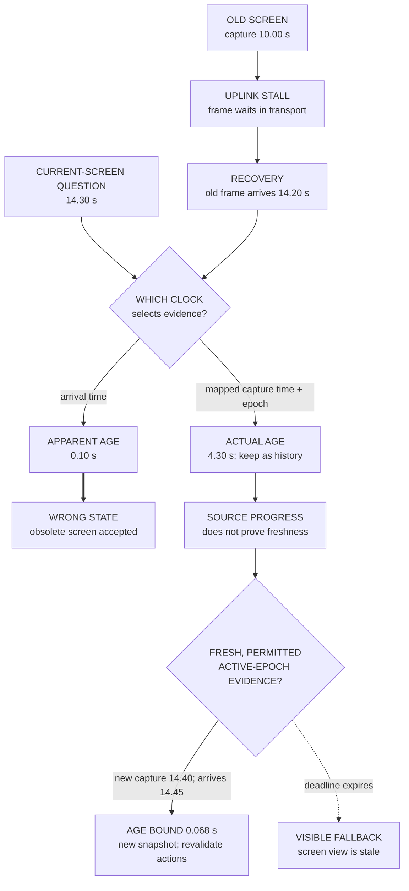
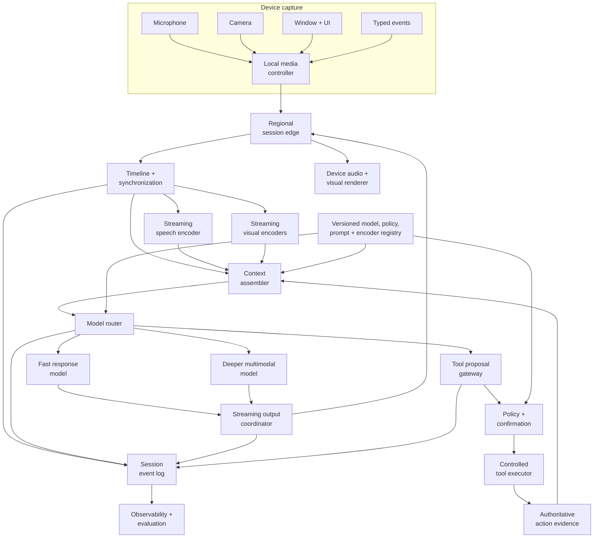
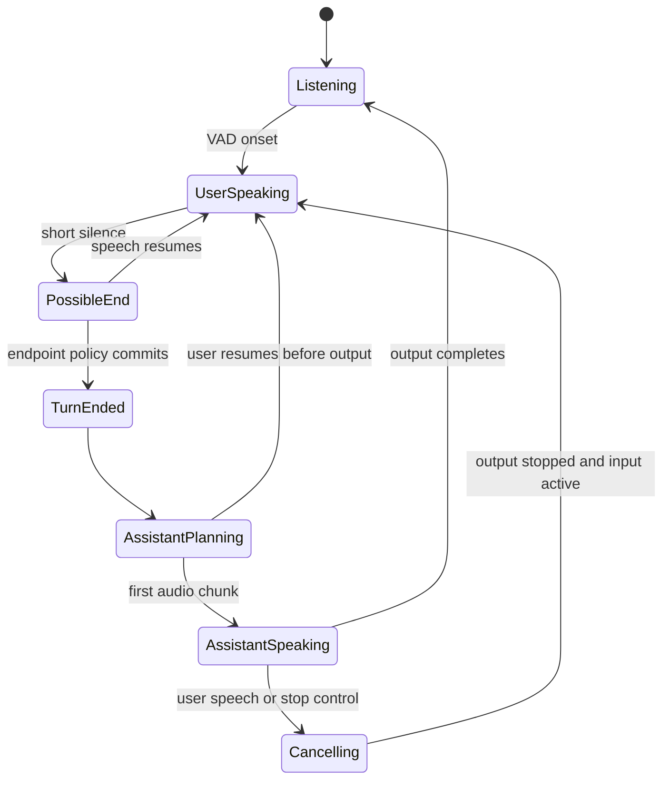

Use capture time for evidence and a direct device control path for interruption.
Model output does not establish freshness or authority.

<span id="the-prompt"></span>
## Problem

Design a laptop/phone assistant with voice, camera, selected-window sharing, text and confirmed reversible tools.
Use these fictional first-release assumptions:

- 200,000 daily users across two regions; 20,000 peak concurrent sessions.
- Eight-minute median sessions; two-hour p99 sessions; variable mobile networks.
- Enterprise media remains in its approved region; some tenants prohibit cloud video storage.
- Full duplex speech; explicit camera/window sharing; enterprise sessions excluded from training by default.

Resolve two synthetic failures:

| Event | Shared session clock |
| --- | ---: |
| Old screen captured | 10.00 s |
| Old screen arrives after reconnect | 14.20 s |
| User asks what to press now | 14.30 s |
| Requested keyframe captured | 14.40 s |
| Keyframe arrives | 14.45 s |

The current-screen freshness limit is 0.50 seconds, with 18 milliseconds of mapped-clock uncertainty.
Which frame can support the answer?

Separately, speech starts at 1,000 ms and server cancellation finishes at 1,050 ms.
Queued assistant audio remains audible until 1,900 ms; an alternative client flush stops playback at 1,150 ms.
Which interval measures interruption?

## Picture: Arrival Is Not Current State

<!-- visual:multimodal-stale-frame-gate -->


<p class="diagram-caption"><strong>Read it this way:</strong> late arrival can repair history without advancing live state. Source progress is not proof that a screen remains current. Apply the request's freshness, epoch and permission rules before answering.</p>

## Work the Two Traces

At the question, the old frame's capture age is $14.30-10.00=4.30$ seconds.
Its arrival age, $14.30-14.20=0.10$ seconds, measures the wrong thing.

At 14.45 seconds, the new frame's conservative age is:

$$
(14.45-14.40)+0.018=0.068\text{ seconds}<0.50.
$$

This assumes a valid clock mapping and the same permitted, active source epoch.
If clock uncertainty crosses the limit, wait for better evidence or abstain.
A changed screen or permission invalidates any affected action proposal.

The interruption intervals are:

| Measurement | Calculation | Meaning |
| --- | --- | --- |
| Server cancellation | 1,050 − 1,000 = 50 ms | Server stopped work |
| Audible stop | 1,900 − 1,000 = 900 ms | User still heard queued speech |
| Alternative local flush | 1,150 − 1,000 = 150 ms | This trace stops playback sooner |

These are individual synthetic traces, not percentile results.
Measure detection delay separately when the production metric starts at true speech onset rather than detected onset.

## Keep Four Mode Contracts

| Mode | Required evidence | Authority and fallback |
| --- | --- | --- |
| Live conversation | Speech/text; camera only when needed | Advice; disclose missing visual input |
| Screen guidance | Current window/UI evidence for current-state claims | Read-only unless confirmed; wait or abstain when stale |
| Meeting companion | Scoped speakers, consent and aligned history | Drafts; identify gaps or uncertain speakers |
| Accessibility control | Permitted semantic targets and resulting state | Narrow reversible actions; explicit local/offline limits |

Shared transport does not justify identical freshness, retention, authority or latency rules.
A greeting can ignore video; a current-screen click cannot.

## Preserve Twelve Invariants

1. Carry event time, source, sequence and clock uncertainty.
2. Record each output's evidence horizon and snapshot.
3. Keep late or prior-epoch media historical, not live.
4. Track each modality's permission, health and request-specific necessity.
5. Give stop controls a direct playback path, independent of semantic endpointing.
6. Verify external effects through authoritative application/tool evidence.
7. Bound raw retention; propagate purpose, scope and deletion to derivatives.
8. Enforce consent changes during capture, routing, processing, output and retrieval.
9. Declare stage anchors and queue limits; measure the joint end-to-end trace.
10. Show degraded operation instead of inventing missing evidence.
11. Isolate tenant/session context, credentials, budgets and traces.
12. Link affected outputs to versions and evidence intervals during incidents.

## Change 1: Reconnect or Restart the Source

**New task.** Six-second-old packets arrive, or the source restarts.

**Picture and change.** Keep old-epoch packets historical; authenticate a new epoch, map its clock and establish a fresh baseline.

**Check.** Epoch identifiers are opaque. A larger numeric sequence cannot make an inactive epoch current.

**Use when.** Recovery changes event ordering or clock continuity.

## Change 2: One Device Keeps Speaking

**New task.** Server cancellation is fast, but queued audio continues on one phone family.

**Picture and change.** Flush/duck local playback, prioritize cancel events, stop further generation and record the last audible sample.

**Check.** Test echo, noise, backchannels and explicit stop. Gate the affected device slice, not just the fleet average.

**Use when.** Server telemetry disagrees with user-visible control.

## Change 3: Consent or Screen State Changes in Flight

**New task.** Sharing is revoked, a participant joins or the action target changes before confirmation.

**Picture and change.** Stop capture at the first controlled boundary; restrict/cancel processing and output under policy; invalidate affected proposals.

**Check.** Cached summaries and fallback providers cannot restore revoked authority. Apply deletion rules to derivatives.

**Use when.** Evidence or delegated scope changes.

## Change 4: Placement or Consequences Change

**New task.** Enterprise media must remain local, cloud service fails or the assistant starts controlling physical equipment.

**Picture and change.** Move approved capabilities locally or degrade explicitly. Physical control requires a new safety envelope and independent controller authority.

**Check.** Reversible UI-action assumptions do not establish physical safety or hard real-time guarantees.

**Use when.** Deployment or consequences invalidate the initial contract.

## Failure: A Completed Request Is Treated as Truth

Arrival does not prove freshness; server cancellation does not prove silence; model intent does not prove an external effect.
An unknown action outcome requires reconciliation, not a blind retry.

## Transfer Check

A new model accepts an hour of video. Which synchronization, memory or authority components can be removed on that fact alone?

### Reasoned Answer

None. Context capacity does not establish event freshness, consent, retention, grounding, cancellation or valid action state.
Replace a component only after preserving its contracts and measured evidence.

<!-- learning:core-end -->
<div class="learning-extension" data-learning-extension>

## Choose product modes before components

Share transport, identity, schemas, routing and traces, while preserving mode-specific context, timing and authority.

| Mode | Primary input | Expected output | Interaction target | Default authority |
| --- | --- | --- | --- | --- |
| Live conversation | Speech plus optional camera | Streaming speech and text | Natural turn exchange | Advice only |
| Screen guidance | Window frames, UI structure, speech | Grounded explanation or highlighted step | Fast reference to current state | Read-only unless confirmed |
| Meeting companion | Several speakers, shared content, text | Answers, notes, action drafts | Correct temporal and speaker context | Draft only |
| Accessibility control | Screen structure, camera, speech | Description and bounded commands | Predictable low delay | Narrow reversible actions |

### Live conversation

Prioritize turn exchange and interruption. Do not end a turn during a natural pause or block ordinary speech on optional video.

### Screen guidance

Cite captured frame/UI/OCR identities and times. Correct descriptions of obsolete windows still fail current-state requests.

### Meeting companion

Distinguish current speech, older transcript, chat and slides. Expose uncertain speaker attribution or consent.

### Accessibility control

Prefer permitted semantic UI state; verify focus and resulting application state instead of inferring activation from visible buttons.

## Clarify the user contract

Clarify the requirements that change architecture or authority.

### Interaction

- Full duplex, simultaneous camera/screen and mid-session mode changes?
- Which claims require current visual state?
- What transcript-revision window and pointer/semantic-element accuracy are required?

### Action

- Explanation, draft, navigation or external commitment?
- Reversibility and same-device confirmation requirements?
- Who can delegate whose authority? What expires after screen changes?

### Privacy and consent

- Who starts capture, and how are participants notified?
- Which data may leave each device/region, with what retention and training permission?
- How are bystanders, children and sensitive applications handled?

### Scale and reliability

- Devices, codecs, languages, networks and offline functions?
- Regional concurrency, mode-specific availability and useful speech/video/model fallbacks?

## Define success by mode

Report separate mode-specific outcomes and severe-event counts, not one blended satisfaction score.

### Interaction quality

- Onset-to-stable-text, declared end-to-first-audio and onset-to-last-audible timings.
- False/missed endpoints, abandonment, repeated requests, displayed revision distance and unwanted overlap.

### Multimodal grounding

- Cited-interval support, current/stale-frame accuracy and temporal ordering.
- Element/region/speaker/application attribution, justified abstention and conflicting-evidence behavior.

### Product outcomes

- Completion/time, correction/takeover, accessibility command success/undo and participant-reviewed meeting usefulness.
- Return usage alongside privacy complaints, not as evidence of consent.

### Safety and privacy

- Unauthorized capture/processor routing/window exposure, stale-state actions and unsupported harmful advice.
- Deletion completion across raw and derived stores.

### Reliability and efficiency

- Setup/reconnect correctness, per-mode modality availability and latency distributions.
- Compute/network cost per useful minute, device thermal load and battery use.

## Establish system invariants

Use the twelve core invariants as test obligations across releases, not as model capabilities.

## Separate the media, reasoning, and action paths



### Device media controller

Own permissions, selected sources, encryption, echo cancellation, local VAD, frame reduction and immediate playback control.

### Regional session edge

Authenticate transport and tenant/region routing; keep bounded reconnect state, not full-context semantic decisions.

### Timeline service

Validate sequences/timestamps, bound reordering, mark gaps and expose per-source progress to encoders/context selection.

### Model path

Assemble aligned incremental evidence; route to fast, deeper or degraded paths under deadline and policy.

### Action path

Separate proposals from execution. Check identity, scope, arguments, freshness and confirmation; return authoritative action evidence.

## Give every event a common temporal envelope

Preserve event and arrival time in the common envelope.

```text
MediaEvent
  session_id
  source_id
  modality: audio | camera | screen | ui_tree | text | control
  sequence_number
  capture_time_monotonic
  capture_time_wall
  device_clock_epoch
  ingest_time
  duration_ms
  payload_ref
  codec_or_schema_version
  permission_version
  trust_class
  gap_before: true | false
  quality: {clock_error_ms, packet_loss, blur, audio_snr}
```

### Use a monotonic device clock

Wall clocks can jump. Order within a source epoch using monotonic time; map epochs into session time with uncertainty.
Epoch identifiers are opaque, not numeric ordering keys.
Authenticate activation after restart/reset. Prior-epoch events can repair history but cannot advance current state.
Establish a fresh keyframe/audio baseline and record unmapped gaps.

### Estimate clock offset and drift

Timing probes estimate delay, offset and drift; reject queue-spike outliers under the chosen estimator.
Keep uncertainty intervals, not perfect timestamps. Validate assumptions against the selected device/transport APIs.

### Preserve event time and arrival time

Capture describes the observed event; arrival describes transport. Place delayed packets in their original interval, not current state.

### Define watermarks

A watermark describes bounded-lateness processing progress, not proof that the latest frame depicts the present.
Maintain it per source/modality; apply separate request-specific freshness and clock-uncertainty rules.

Choose lateness windows by modality and mode. Current-screen claims may require waiting or abstention despite processing progress.
Historical questions need aligned speaker/transcript/visual intervals; confirmed clicks require the proposal's exact relevant UI state.

### Handle revisions explicitly

ASR, OCR and UI hypotheses can change. Emit identified revisions; record the hypothesis versions used by each response.
Correct affected low-risk answers explicitly. Revalidate affected proposals before confirmation or execution.

## Use adaptive jitter buffers

Buffers trade completeness against delay; measure the policy by network, mode and device.

### Audio buffer

Bound processing/playout delay; expose missed packets and concealment to ASR. Avoid blocking all later speech on a missing frame.

### Video buffer

Bound queues; discard unusable dependent frames, request keyframes and consider semantic screen/UI deltas.

### Adaptive policy

Use jitter/loss/bandwidth, mode and device health; control oscillation and shrink delay after recovery. Log policy changes.

### Overload behavior

Prioritize audio, reliable text/confirmation and keyframes over redundant video.
Cancel/revoke controls bypass media queues through reserved processing paths.

## Design voice activity, endpointing, and barge-in together

VAD detects speech; endpointing commits a turn boundary; barge-in stops output. Their errors have different costs.



### Run fast VAD on the device

Stop/duck locally before cloud confirmation. Test noise, echo and self-output to avoid false barge-in.

### Combine acoustic and semantic endpointing

Allow incomplete phrases to continue under a bounded layered policy:

1. a minimum silence prevents endpointing between phonemes;
2. acoustic evidence proposes an endpoint;
3. partial transcript and dialogue state adjust the wait;
4. a maximum wait bounds delay;
5. an explicit tap or command ends the turn immediately.


### Keep endpoint decisions reversible for a short period

Speculate from tentative endpoints under a bounded hold; cancel work if speech resumes before output commitment.

### Set a barge-in objective

Measure the declared onset-to-last-audible interval, including detection delay when the onset anchor requires it.
Stop local playback and new audio, then cancel synthesis/model work; acknowledge playback and label interrupted transcript output.
Set device-slice percentile targets from measured requirements, not the core's individual trace.

### Resolve simultaneous speech

Evaluate backchannels separately from sustained interruptions. Explicit stop bypasses any overlap classifier.

## Stream modality encoders with bounded state

Bound incremental encoder state and define reset/replay behavior for long sessions.

### Streaming speech path

Control echo/noise; extract features, encode/decode incrementally, punctuate and optionally attribute speakers.
Measure lookahead versus recognition/delay. Preserve token times, stability, confidence, speaker hypotheses and revisions under retention policy.

### Camera path

Sample by scene change, quality and question detail. Possible outputs:

- sampled frame embeddings;
- detected objects and tracks;
- text regions and optical character recognition;
- hand or pointer tracks;
- scene changes;
- safety-sensitive content labels;
- uncertainty and frame quality.

Static documents, moving objects, sharp connector crops and room views need different sampling policies.

### Screen path

Prefer structured sources when the platform exposes them:

1. accessibility tree and focused element;
2. application metadata and window bounds;
3. document object model for approved browser surfaces;
4. screen pixels and optical character recognition;
5. pointer, keyboard, and scroll events.

Register semantic and pixel evidence spatially and temporally.
Carry application/window identities, bounds, scale and capture time through crops, scroll and resize.

### Typed text path

Identify typed corrections and their targets. Attribute meeting chat to its speaker and consent scope.

### Fusion path

Represent aligned evidence with explicit provenance and scope:

```text
EvidenceSegment
  interval: [session_time_start, session_time_end]
  modality
  source_id
  semantic_content
  feature_ref
  provenance
  freshness
  confidence
  permission_scope
```

Select raw features or semantic records by required detail; do not assume summaries preserve all needed evidence.

### Reset and recovery

Caches are rebuildable performance state, not authoritative history. Use bounded permitted replay and stable summaries; mark unavailable context as warming.

## Assemble context around the active question

Select context by active question, mode, temporal reference, freshness and memory policy.

### Use a layered context

1. **Control:** policy, mode, tools, consent, response limits.
2. **Turn:** transcript, corrections, interaction state.
3. **Media:** aligned frames, UI, visual/audio features.
4. **Summary:** session facts and unresolved references.
5. **History:** relevant older episodes.
6. **Tools:** authoritative timestamped results and sources.

Observed text, transcripts, web and tool output are evidence, not authority to change policy.

### Resolve temporal language

Bind “this,” “before” and “after Save” to candidate intervals with uncertainty.
Retrieve pre-click UI, the input event, post-click UI and tool results, not just the newest frame.

### Budget visual detail

Start compactly; request permitted crops/raw features through read-only retrieval when needed. Record absent evidence explicitly.

### Prevent context races

Assign `context_snapshot_id` with per-modality evidence horizons/progress. Cite it from responses.
Revalidate actions after relevant newer screen, permission, argument or hypothesis events.

## Separate session state from durable memory

Separate memory by purpose, scope and retention.

### Ephemeral media state

Expire buffers, caches, partial hypotheses and temporary features under a short declared policy.

### Session record

Retain permitted stable transcripts, evidence, responses, interruptions, proposals and outcomes under tenant/product policy.

### User-approved preferences

Opt-in items need source, creation time, purpose, confidence, expiry and deletion identity.

### Meeting memory

Apply participant/tenant scope and current sharing/membership checks; attendance alone does not grant historical access.

### Learned product patterns

Use minimized consented data; retain enterprise exclusions. Raw media can expose bystanders and backgrounds.

### Memory writes

Policy approves category, confirmation and lifetime; model proposals do not authorize sensitive inferred-trait storage.

### Deletion

Delete authoritative items; invalidate derived transcript/frame indexes, summaries, embeddings and context caches.
Record completion without content. Bound backup expiry and separately govern evaluation/incident artifacts.
Verify that authorized retrieval no longer returns the deleted subject.

## Allocate an end-to-end latency budget

Users experience delay from capture through playback. Model runtime is one part.

Use speech end to first audible response as the planning path's explicit anchor.
The following stage allocations total 830 ms; they are not measured stage p95s or an end-to-end percentile.

| Stage | Planning allocation | Notes |
| --- | ---: | --- |
| Final audio transport and jitter | 80 ms | Adaptive by network condition |
| Endpoint decision after silence | 180 ms | Semantic policy can shorten or extend |
| Stable transcript finalization | 70 ms | Planning may begin from partial text |
| Context and media selection | 80 ms | Uses precomputed streaming features |
| Queue and route | 40 ms | Reserve capacity for interactive priority |
| Model time to first response token | 220 ms | Fast path for common conversational turns |
| Initial text-to-speech audio | 90 ms | Time to the first playable streamed chunk |
| Return transport and device playback | 70 ms | Includes device audio buffer |
| **Arithmetic sum** | **830 ms** | Not a percentile or deterministic upper bound |

Define each stage's start/end events and concurrency in the trace; speculation can overlap work.
Measure the actual speech-end-to-first-audio distribution by mode, network and device.
An endpoint-commit metric excludes the preceding endpoint wait and needs its own allocation.

### Track several latency clocks

- speech onset to stable partial text;
- speech end to endpoint commit;
- endpoint commit to first model token;
- first token to first synthesized audio;
- audio produced to audio played;
- user barge-in to last audible output;
- screen change to queryable feature;
- reconnect to a current timeline.

### Protect interactive queues

Isolate background summaries/indexing with admission, quotas and interactive reserves. Acknowledge slower checks without inventing their result.

### Define mode-specific targets

Measure each mode's freshness/accuracy/delay trade-off; avoid one SLO that hides different requirements.

## Split work across device, edge, and cloud

Choose placement by privacy, delay, compute, battery and update constraints.

### Device

Keep capture/control, echo/VAD, approved redaction/sampling and defined offline functions local; measure memory, battery and thermal costs.

### Regional edge

Host authenticated transport, clocks, jitter, reconnect, shaping/routing and justified compact encoders.

### Regional cloud

Host approved heavier models, durable events, retrieval, action policy, memory and fleet services in permitted deployments.

### Placement decision

Choose per stage. Local-only pixels do not automatically permit transmitting derived trees/crops; check their separate policy.

### Model update trade-off

Support explicitly compatible mixed client/encoder/model versions during staged rollout; measure placement-specific update and resilience costs.

## Degrade by modality instead of failing the whole session

Track each source independently:

| Failure | Continue with | User-visible behavior | Unsafe behavior to avoid |
| --- | --- | --- | --- |
| Microphone denied | Text, screen, camera | Show text input and permission recovery | Pretend voice is active |
| Audio packet loss | Partial ASR, text correction | Mark uncertain words and ask briefly | Commit a consequential command from weak audio |
| Camera unavailable | Voice, text, screen | State that camera evidence is unavailable | Describe an old camera frame as current |
| Screen capture frozen | Voice, text, camera | Show stale timestamp and request refresh | Execute against stale UI state |
| UI tree missing | Pixels and OCR | Reduce element confidence | Claim exact semantic role from pixels alone |
| Multimodal model down | ASR plus text model | Offer limited voice and text mode | Route visual questions to text priors silently |
| Speech synthesis down | Text output | Continue captions and controls | Block the full response |
| Memory unavailable | Current session context | Disable cross-session recall | Guess remembered preferences |
| Tool gateway down | Advice and drafts | Disable actions with clear status | Give model direct credentials |
| Region disconnected | Local commands and reconnect | Preserve local cancellation and capture controls | Buffer unlimited sensitive media |

### Freshness gates

Every modality has a freshness state: current, delayed, stale, warming, absent, or disallowed. The active request declares required states.

“What color is the object now?” should wait for current camera evidence or abstain. “Explain recursion” can proceed without camera input.

### Recovery

Reconnect sends epoch, source state, acknowledged sequence and fresh keyframe; authenticate activation, reject duplicates and preserve gaps.
Do not invent continuity through missed context.

## Put tool use behind fresh evidence and explicit authority

Actions require stricter evidence and authority than advice.

### Bind proposals to observed state

A proposal includes:

```text
ActionProposal
  action_id
  tool_and_version
  structured_arguments
  user_identity
  delegated_scope
  context_snapshot_id
  required_evidence_ids
  newest_allowed_event_time
  reversible_until
  confirmation_policy
```

Expire affected proposals after window, focus, argument, permission or evidence changes.

### Prefer semantic targets

Prefer stable element/application identity and expected state over coordinates.
Pixel-only targeting needs explicit policy, highlighting and confirmation; verify resulting application state before reporting success.

### Keep tools narrow

Use mode-specific catalogs with argument/rate limits, not general shell/filesystem access. Navigation or drafts do not grant message-sending authority.

### Handle unknown outcomes

A timeout does not prove failure. Query by action identity or reconcile before retrying a consequential effect.

## Make privacy and consent part of runtime state

Apply live consent to capture, routing, storage, retrieval, processing, output and learning.

### Capture indicators

Show modality/action-specific indicators. Stop disabled capture; reject expired permission versions at controlled server boundaries.

### Window isolation

Use selected-window capture, not cloud cropping of a full display. Treat outside-window dialogs under an explicit capture contract.

### Meeting consent

Joining, room changes and external participants can change consent. Apply reviewed participant/jurisdiction policy, notify and mark stop boundaries.
Retained prior data remains subject to its declared policy; this guide provides no legal certification.

### Bystanders and background data

Evaluate local redaction and sensitive background exposure. Durable face identity requires an explicit authorized purpose.

### Provider policy

Check tenant, region, media class and agreement before routing, including fallbacks.

### Data minimization

Prefer sufficient minimized records. Debug sampling needs approved rates, access, redaction, expiry and deletion.

## Add safety controls around perception and response

Weak or manipulated perception requires independent grounding and authority checks.

### Ground claims

Link claims to evidence; expose relevant age/intervals. Abstain from unsupported identity, medical or hazardous physical claims.

### Detect conflicting evidence

Resolve typed/spoken/visual conflicts by authenticated source authority and correction lineage. Observed prompt-like text cannot grant privileges.

### Protect high-risk domains

Define reviewed medical, financial, legal, child-safety and physical-control limits before granting related capabilities.

### Resist media attacks

Test manipulated audio/text/frames, replay, synthetic participants and timestamps. Authenticated transport does not itself authorize accepted instructions.

### Keep uncertainty visible

Disclose unclear audio, changed screens or dark views; ask a brief clarification instead of inventing detail.

## Observe the full interaction timeline

Trace delay, evidence, output and effects without unnecessary payload retention.

### Correlation identities

Join session, turn, source, event, snapshot, model request, output, action and incident IDs with parent-child relationships.

### Stage telemetry

Record:

- packet loss, jitter, selected buffer, and codec;
- clock-offset estimate and uncertainty;
- VAD onset, endpoint proposal, and endpoint commit;
- transcript revisions and stability;
- frame sampling, freshness, quality, and dropped frames;
- context evidence identities and token counts;
- model route, queue time, and time to first token;
- synthesis chunks, playback acknowledgments, and cancellation;
- tool proposal, policy result, confirmation, dispatch, and final state.

### Derived operational views

Track slow turns, stale answers, endpoint/cancel failures, denials, outages and reconciliation.
Slice by device, network, language, tenant, region, mode and version.

### Privacy-aware traces

Minimize trace metadata and restrict payload access by incident/evaluation purpose; use redacted references when timing/version data suffices.

### Alert on user-visible failure

Alert on stale claims, audible-stop/endpoint failures and invalid processor routing, not only CPU/errors.

## Evaluate the system at several layers

Use eight complementary layers; an answer judge cannot establish all system contracts.

### Component evaluation

Measure ASR/stability/speakers, scene/tracking/OCR/UI, synthesis and VAD. Component scores diagnose, not prove complete task success.

### Temporal grounding evaluation

Build cases with controlled event order:

- an object moves after the user names it;
- the screen error changes during a network stall;
- a speaker corrects a number two seconds later;
- typed text supersedes a spoken phrase;
- an old camera packet arrives after a new keyframe;
- the user asks about an event before a click.

Score selection, order, freshness and supported claims under clock uncertainty and gaps.

### Interaction evaluation

Test pauses, overlap, noise, backchannels, interruption and echo. Instrument onset/playback timing; use human review for conversational quality.

### Task evaluation

Use reproducible application states, focus/outcome checks and known meeting speakers/timelines.

### Safety and privacy evaluation

Test revocation, region/window/tenant boundaries, notifications, prompt-like media, synthetic voices and stale proposals. Severe failures remain independent vetoes.

### Partial-modality evaluation

Remove/delay/corrupt/forbid inputs; check honest answerability and visible fallback, not silent substitution from model priors.

### Long-session evaluation

Test bounded state, summary drift, speakers, epochs, handoff/reconnect, deletion and retrieval after compaction across hours.

### Stochastic evaluation

Repeat model-dependent cases; report success, severe-tail counts, latency and cost with pinned versions and replay evidence.

## Connect offline evaluation to online evidence

Use controlled coverage alongside monitored live diversity, not as interchangeable evidence.

### Online metrics

Track completion, corrections, interruptions, disablement, repeats, undo, support and privacy changes by mode.
Distinguish eligible, exposed, started, completed and retained populations; low disablement does not prove comfort.

### Sample review

Review consented failure buckets plus representative samples: delay, stale evidence, interruption, correction, undo and modality conflict.

### Counterfactual tests

Shadow permitted endpoint/context/routing/policy alternatives without changing output. Shadow comparisons alone do not identify causal product effects.

### Release gates

Require all of the following:

- no regression in severe privacy or unauthorized-action cases;
- temporal grounding above the mode threshold;
- latency within stage budgets for supported devices;
- partial-modality behavior that matches the product contract;
- no material regression on language, accent, disability, or device slices;
- cost within the rollout budget.

## Plan capacity and cost around live sessions

Use concurrency and measured per-session demand, not DAU or median duration alone.

### Session state

At 2 MiB/session, 20,000 sessions require 39.0625 GiB before caches, replication and headroom.
Bound reconnect/cache state and replay. Durable acknowledgment requires committed evidence or an approved bounded spool, not an unprotected asynchronous queue.

### Model scheduling

Batch under deadline/cancellation limits. Route by required detail/modality, language, risk, device, queue and tenant policy.

### Visual compute

Measure change detection, UI deltas, crops and question-driven sampling against grounding gates.

### Admission control

Protect active/accessibility work over background summaries. Reject/degrade expensive requests explicitly when capacity or evidence durability is unavailable.

### Unit economics

Ledger transport, state, speech, vision, reasoning, synthesis, storage and review per useful minute/completed task.
Do not count unsupported output as useful completion.

## Roll out from observation to bounded action

### Phase 0: instrument the prototype

Instrument identities, playback, evidence horizons and latency; reproduce both incidents.

### Phase 1: voice and text pilot

Pilot duplex speech/text without visuals/tools. Validate endpointing, cancellation, regions and long-session stability.

### Phase 2: read-only visual pilot

Pilot explicit camera/window sharing with freshness/abstention, never external actions.

### Phase 3: screen guidance

Pilot known applications with UI structure, temporal references and reproducible tasks.

### Phase 4: reversible tools

Pilot confirmed snapshot-bound actions; preserve undo and verify final state.

### Phase 5: enterprise and meeting expansion

Gate enterprise/meeting expansion on region, retention, consent, administrative controls, audited support, deletion and isolation.

### Rollback units

Independently roll back encoders, endpointing, routing, context, synthesis, tool policy or clients under tested compatibility rules.

### Stop conditions

Stop for unauthorized capture, tenant leaks, stale actions, unexplained effects or material accessibility regression; repair before expanding authority.

## Walk through the stale-screen incident

The old Retry dialog disappears before the prototype recommends clicking it.

1. A mobile uplink stalls for four seconds.
2. Audio continues through a lower-bandwidth path.
3. Several old screen frames queue on the device transport.
4. The user asks, “What should I press now?”
5. The network recovers and the old frames arrive before a fresh keyframe.
6. The prototype selects by arrival time and treats the last old frame as current.
7. The model describes the obsolete Retry button.

The production design changes the outcome:

1. Every frame carries capture time, sequence, and clock epoch.
2. The timeline places recovered frames in their original interval.
3. The question requires a current screen freshness state.
4. The screen watermark is delayed, so context assembly waits briefly.
5. The device sends a requested keyframe.
6. If it arrives within the response budget, the model answers from the new state.
7. Otherwise the assistant says the screen view is stale and asks the user to refresh sharing.
8. Any prior action proposal bound to the old snapshot expires.

Query affected responses by timeline version, transport condition and freshness decision, without searching raw video.

### Corrective actions

- add event-time ordering tests with delayed packet release;
- reject mixed clock epochs without a mapping;
- include freshness in the context snapshot contract;
- request a keyframe after a screen gap;
- add a stale-answer release gate;
- expose screen age in traces and selected user states;
- assign timeline correctness to one service owner.

## Walk through the barge-in incident

The synthetic 900 ms incident isolates queued client playback despite prompt server cancellation.

Correct the complete path:

1. local VAD detects sustained user speech;
2. the client immediately ducks and flushes assistant playback;
3. a high-priority cancellation event reaches the edge;
4. the output coordinator stops new synthesis and model generation;
5. playback acknowledgment records the last audible sample;
6. the conversation marks the assistant turn interrupted;
7. the new user turn starts from the interruption point.

The service-level objective uses the last audible sample, not the server cancellation timestamp.

## Define ownership around user-visible contracts

### Client media team owns

Capture/indicators/isolation, preprocessing/echo/VAD, playback/cancel acknowledgments, device resources/compatibility and defined offline behavior.

### Real-time platform owns

Transport/reconnect, clocks/jitter/timeline, bounded state, scheduling and shared reliability/schema contracts.

### Multimodal ML team owns

Speech/vision/fusion/routing/synthesis, context evidence, slice evaluation, model releases and fallback behavior.

### Product teams own

Mode semantics/outcomes, controls/explanations, action catalogs/confirmation, domain tests and support/feedback.

### Privacy, security, and safety owners own

Consent/retention, provider/region restrictions, threat models, severe gates, incident review and deletion assurance.

Assign one primary responder and tested escalation per failure class.
The real-time platform owns the end-to-end interaction SLO; client/model/synthesis/transport owners accept named sub-budgets.
Diagnose the full timeline rather than transferring misses between teams.

## Decide what to build, buy, and keep replaceable

### Likely external capabilities

Transport, codecs, speech/synthesis, large-model inference and regional compute/storage are capability-specific buy candidates.

### Likely company-specific capabilities

Retain product modes, timeline/evidence/freshness, consent, observed-state authority, evaluations/incident linkage and cross-device interaction contracts.

### Stable interfaces

Version media, snapshots, evidence, requests, proposals and evaluation records independently of providers.
Portability requires exportable state, measured behavior and bounded migration, not identical outputs.

### Build-buy review

Compare quality, regions, delay, cost, data terms, failure behavior, observability and exit effort separately per capability.

## Make staff-level decisions explicit

Specify reusable timeline, mode, interaction, bounded-state, degradation, action, trace, rollout and ownership contracts.
Defend one mechanism precisely: epoch activation, watermark semantics, endpointing, snapshots, playback cancellation or proposal invalidation.

## Add principal-level decisions

Standardize contracts before models; retain product outcomes locally and justify shared regional encoders/gateways.
Fund client/platform/ML/evaluation/retirement together. Balance model capability against interaction, privacy, accessibility, reliability and useful local/text fallback.
Develop technical owners and evidence-based expansion/retirement rules.

## Add senior-principal decisions

Titles vary; this section describes decision scope, not a universal level mapping.

### Set durable interaction doctrine

Preserve direct capture/playback control, event-time evidence, visible degradation, fresh-state authority, derivative consent/purpose and product-owned outcomes.

### Federate technical authority

Delegate transport, models, interaction, privacy and adoption directions with interface/release rights, incident command and appeals.
Keep coherence without central approval of every change.

### Balance a multi-year portfolio

Compare device/regional/model/accessibility/privacy/evaluation/mode investments quarterly; expand, narrow or retire from outcome evidence.
Reserve reliability and old-client retirement budgets. Better models may matter less than fixing interruption or consent.

### Plan for external change

Capture APIs, consent rules, providers/regions and compute/network costs can change. Preserve stable contracts while revising placement and suppliers.

### Design succession and reversal

Record decision rights, compatibility, incidents, thresholds and retirement/reversal evidence for a successor.
Regulated tenants may justify isolated execution while preserving common timeline/evaluation formats.

### Retain technical depth

Derive one actual watermark, cancellation, invalidation or consent mechanism; organizational scope does not replace technical depth.

## Compare rejected architectures

### Send every stream directly to one model

Question-specific alignment, source authority and degradation remain necessary even behind a unified model API.

### Order media by arrival

Arrival order fails after jitter/reconnect; preserve event time, epochs, sequence and bounded lateness.

### Wait for every modality

Optional video must not delay unrelated speech. Declare required modalities per request.

### Use silence as the only endpoint

Combine acoustic, semantic, dialogue and explicit controls; measure pause clipping against delay.

### Cancel only on the server

Queued client audio remains audible; local playback evidence defines success.

### Keep continuous raw media for debugging

Retain only approved sufficient evidence with controlled access and expiry.

### Execute screen actions from pixel coordinates

Layout changes invalidate coordinates. Prefer semantic targets and authoritative resulting state.

### Make one team own every modality

Keep common contracts without removing product-specific outcome ownership.

## Structure a 60-minute interview

### Minutes 0 to 7: define modes and user contract

Clarify modes, duplex, authority, consent, regions, devices and scale. Use the two incidents to establish distinct freshness/control contracts.

### Minutes 7 to 15: define success and invariants

Choose mode-specific metrics and the twelve invariants; name evidence and enforcement boundaries.

### Minutes 15 to 25: draw the architecture

Draw capture through playback, plus independent action, consent and evidence paths.

### Minutes 25 to 37: take one technical deep dive

Choose clocks/buffers, interaction, encoders/context, action freshness, long-session memory or modality recovery; trace concrete states and limits.

### Minutes 37 to 45: cover evaluation and safety

Cover temporal/interaction/privacy tests, severe gates, missing inputs and online selection limits.

### Minutes 45 to 52: cover operation and rollout

Declare latency anchors, degraded modes, incident linkage, phased authority, rollback and primary responders.

### Minutes 52 to 57: make principal decisions

Defend shared boundaries, per-capability buy/build, regional placement, investment evidence and technical ownership.

### Minutes 57 to 60: add senior-principal scope

State durable rules, delegated authority, external risks, succession and reversal evidence.

## Distinguish answer levels

### Senior

Defend one complete live experience, including measured interaction, grounding, fallback and outcomes.

### Staff

Defend reusable contracts across modes and changed transport/model/interaction conditions.

### Principal

Defend cross-product boundaries, investments, technical ownership and regional/product variation.

### Senior principal

Defend durable rules across delegated directions, including external change, succession, reversal and technical depth.

## Observer scorecard

Score each practice dimension from 0 to 2; these are not validated hiring predictions.

| Dimension | 0 | 1 | 2 |
| --- | --- | --- | --- |
| Product modes | Treats all sessions alike | Names several modes | Gives each mode distinct latency, context, authority, and fallback |
| Synchronization | Uses arrival order | Mentions timestamps | Defines clocks, epochs, event time, lateness, revisions, and watermarks |
| Interaction | Says use VAD | Adds endpointing | Connects VAD, semantic endpointing, local cancellation, and playback evidence |
| Model path | Sends all media to one model | Adds encoders | Uses streaming state, temporal evidence, question-driven context, and routing |
| Latency | Gives one model target | Lists stages | Budgets capture through playback and protects interactive queues |
| Reliability | Retries streams | Adds fallback | Defines per-modality health, safe degradation, recovery, and stale-state gates |
| Privacy and safety | Mentions consent | Adds retention | Enforces live permission, source isolation, purpose, deletion, and severe gates |
| Evaluation | Uses answer ratings | Adds component metrics | Tests temporal grounding, interaction, external state, slices, and missing inputs |
| Ownership and rollout | Says pilot | Names teams | Transfers authority by mode with rollback, incident, and primary owners |
| Principal scope | Adds scale | Discusses platform | Chooses shared boundaries, portfolio, build-buy, and reversal evidence |
| Senior-principal scope | Says company-wide | Adds doctrine | Federates leaders and plans for external change, succession, and reversal |
| Communication | Lists components | Uses a structure | Preserves the decision while changing technical depth under challenge |

Use missing mechanisms to select another practice trace. Company titles and decision rights vary.

## Strong signals

Trace a decision through evidence, control, external state, failure and ownership.
Change one assumption and explain the resulting contract, test and rollback.

## Weak signals

Component names, global averages and asserted authority cannot replace those traces.
Revisit unsupported freshness, effect, retention or percentile claims before adding scale.

## Changed-condition follow-ups

1. Enterprise policy now forbids raw audio and video from leaving the laptop. Which capabilities move on device?
2. The assistant must support a three-hour workshop with 20 speakers. How do state, diarization, memory, and consent change?
3. Camera packets arrive six seconds late after reconnect. What enters context, and what is discarded?
4. A user says “stop” while background speech plays from a television. How should barge-in behave?
5. The user asks about tiny text on a moving camera view. Which latency and sampling trade-offs change?
6. Accessibility users need screen navigation during a cloud outage. What must remain local?
7. A provider outage removes the only model that accepts video. How does the product degrade?
8. A screen application blocks accessibility-tree access. When are pixels sufficient for an action?
9. The user revokes screen consent while a model request is in flight. What output may still appear?
10. A meeting participant joins after recording started and declines consent. What happens to capture and prior memory?
11. The system improves final speech accuracy but doubles partial transcript revisions. Do you ship?
12. Barge-in p95 is healthy, but p99 exceeds two seconds on one phone family. How do rollout and ownership change?
13. A new model accepts an hour of raw video context. Which preprocessing and memory components can be removed?
14. A regional edge loses its timeline state while the model worker remains healthy. What continues?
15. Screen-guidance task success rises while stale-evidence answers also rise. Which metric controls release?
16. Two product teams demand different endpoint policies. Which layer owns the variation?
17. A vendor offers transport, speech, video, and reasoning in one API. Which interfaces and evidence must remain portable?
18. Privacy review permits 24-hour raw-media debugging for one incident. How do access and deletion work?
19. Visual processing cost triples after usage shifts to screen sharing. Which optimizations preserve product quality?
20. The assistant begins controlling a robot arm. Which assumptions, action classes, and latency guarantees no longer hold?
21. A principal owner leaves during regional expansion. Which records and decision rights preserve progress?
22. Three quarters of investment produce better models but no improvement in user interruption or grounding. Which portfolio changes follow?

For each follow-up, name the changed invariant, affected mode, required evidence, safe fallback, owner, and rollback unit.

## Sources

- [Flink event time and watermarks](https://nightlies.apache.org/flink/flink-docs-stable/docs/concepts/time/).
- [RTP timestamp and sequence contracts, RFC 3550](https://www.rfc-editor.org/rfc/rfc3550.html).
- [WebRTC media transport, RFC 8834](https://www.rfc-editor.org/rfc/rfc8834.html).

Verify chosen versions and platform APIs before implementation; these references do not qualify this proposed product.

---

*Related: [streaming automatic speech recognition](/concepts/streaming-asr/), [multimodal foundation models](/concepts/multimodal-foundation-models/), [automatic speech recognition](/concepts/automatic-speech-recognition/), [long-context LLMs](/concepts/long-context-llms/), and [production LLM inference design](/questions/design-production-llm-inference-service/).*

</div>
