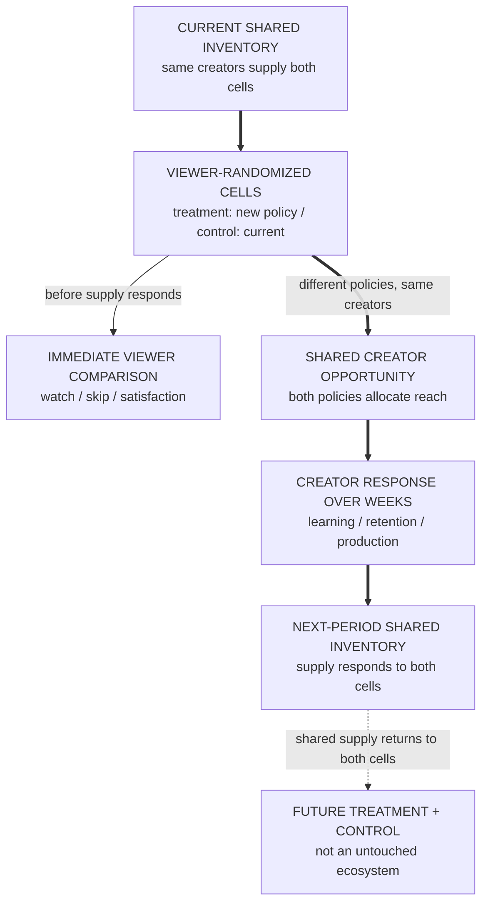
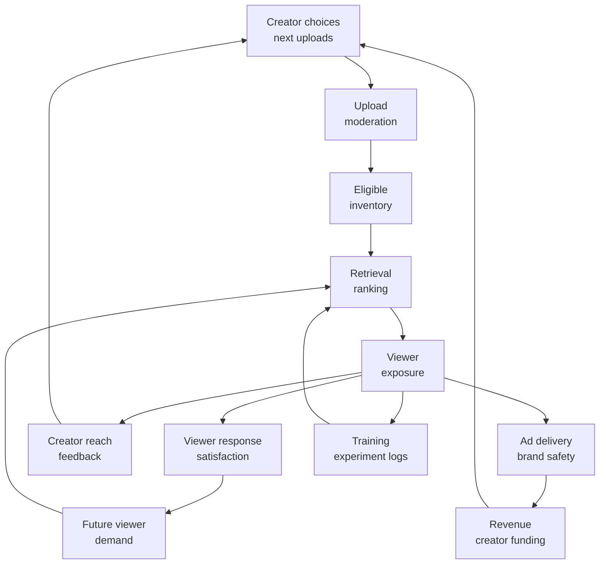
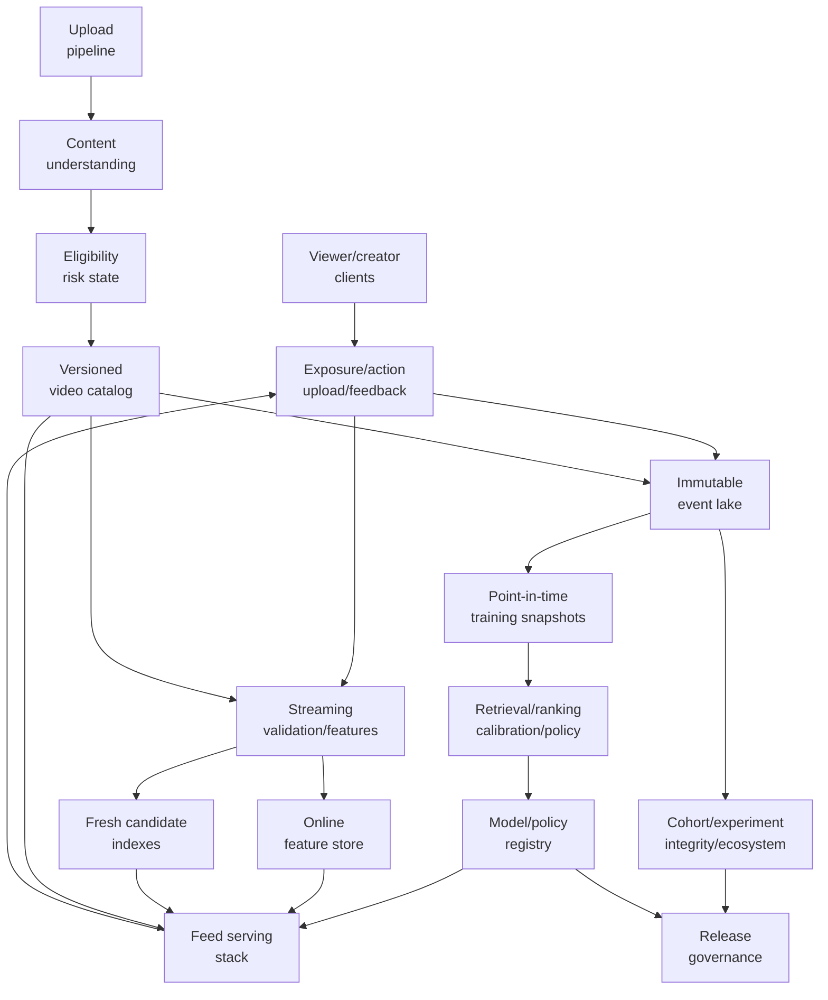

A feed allocates attention today and changes tomorrow's supply; separate hard policy, participant health, product outcomes and model diagnostics.

<span id="the-prompt"></span>

## Problem

Design a fictional short-form feed for 800 million monthly viewers and 25 million active creators.
Its scenario peak is 500,000 requests/second, ten returned items/request and 20 million daily uploads.
The server p99 target is below 120 milliseconds; media startup is separate.
These counts and the reported effects below are invented teaching assumptions, not company observations.

A release reports 4.8% higher watch time, followed by weaker new-creator retention and concentrated exposure eight weeks later.
Viewers, creators, advertisers and the platform need separate outcome contracts.
Define a two-year direction with safe launches, qualified creator opportunity, durable evidence and reversible policies.

For a smaller diagnostic, compare two policy cohorts with complete tested-creator outcomes but missing untested-creator outcomes.
Return means another policy-eligible upload on days 15-30 after the first eligible upload.

| Cohort record | Policy A | Policy B |
| --- | ---: | ---: |
| All eligible new creators | 1,000 | 1,000 |
| Creators receiving a qualified test | 400 | 200 |
| Returning creators among those tested | 200 | 120 |
| Untested creators with outcomes not retrieved | 600 | 800 |

Did creator retention improve, and what must a release decision recover?

## Picture: Keep the Whole Cohort in View

The tested-only return rate rises, but access to the tested group shrinks.

| Quantity | Policy A | Policy B |
| --- | --- | --- |
| Return among tested | 200/400 = 50% | 120/200 = 60% |
| Qualified-test receipt | 400/1,000 = 40% | 200/1,000 = 20% |
| Returning tested creators per eligible cohort | 200/1,000 = 20% | 120/1,000 = 12% |
| Possible all-eligible return rate | 20%-80% | 12%-92% |

The last bounds allow every untested creator either to return or not return.
Their outcomes are unknown, not zero.
Both total improvement and total decline remain compatible with this ledger.
Recover mature outcomes for the entire eligible cohort before evaluating its primary retention rate.
Test receipt and exposure-conditioned views remain pathway diagnostics, not replacement denominators.

Even complete outcomes do not automatically identify causality.
The cohort contrast above is not declared randomized; concurrent incentives, eligibility and acquisition can differ.
Separately, even viewer-randomized cells can share treatment-altered creator supply.

<p class="visual-kicker">Why viewer randomization may not isolate long-run supply effects</p>
<p class="visual-title">Treatment and control can consume the same inventory after creators respond to both policies.</p>

<!-- visual:ecosystem-experiment-interference -->

<p class="diagram-caption"><strong>Read it this way:</strong> follow reach into creator production, then back into both cells' inventory. A longer viewer test does not automatically restore an untreated ecosystem.</p>

<span id="state-the-answer-before-drawing-the-system"></span>

## Decision Contract: Prediction Is Not Policy Authority

| Level | Decision behavior |
| --- | --- |
| Legal/safety constraints | Block prohibited, age-inappropriate, privacy-invalid or severe-integrity exposure |
| Participant-health guardrails | Protect viewer value, creator opportunity, advertiser trust and reliability with approved stops |
| Product outcomes | Compare satisfied viewing, useful discovery, sustainable production and revenue within those bounds |
| Model diagnostics | Use loss, calibration, recall, latency and cost to explain mechanisms, not declare ecosystem success |

Version the source portfolio, task heads, calibrators, constrained composer and exposure policy.
Training loss weights control optimization; policy owners govern attention allocation, budgets, floors and exceptions.
At this workload, returned capacity is five million positions/second, not five million examined or qualified impressions.
Prefetch is not actual exposure.

## Change 1: A Proposed 20% New-Account Allocation

**New task.** Leadership wants a global new-account impression target.

**Picture and change.** Require eligible audience fit, qualified-test floors, approved budgets and randomized response curves.
Protect viewer and creator outcomes rather than guarantee equal raw reach.

**Check.** More exploration can harm viewers without improving learning when candidate quality or matching fails.

**Use when.** Opportunity is confused with guaranteed distribution.

## Change 2: Creators Supply Both Experiment Cells

**New task.** Treatment alters inventory later consumed by control.

**Picture and change.** Specify immediate versus long-run effects and spillover paths.
Choose justified creator clusters, markets, switchbacks, saturation or holdouts, with remaining contamination and power reported.

**Check.** No experiment unit universally removes network or supply interference.

**Use when.** Policy changes shared production or competition.

## Change 3: Mature Creator Damage Breaches a Guardrail

**New task.** Viewer gains remain valuable, but the approved creator bound fails.

**Picture and change.** Validate cohorts/instrumentation, then trace source, score, calibration, composition, eligibility and advertisement displacement.
Restore or narrow a known compatible manifest; test recovery separately.

**Check.** Containment can be justified before exact causal attribution.
An untested creator boost can obscure the original failure.

**Use when.** Delayed externalities require a reversible decision now.

## Change 4: Generated Uploads or Subscription Funding

**New task.** Generated uploads dominate, or subscriptions replace advertising.

**Picture and change.** Reopen provenance, integrity, incentives and creator-outcome policy with domain owners.
State the investment displaced; preserve shared exposure identity and auditable decision authority.

**Check.** Neither a blanket generated-content penalty nor raw-view incentives follow automatically.

**Use when.** Supply economics or business assumptions change.

## Failure: Selected Survivors Become the Primary Outcome

A short viewer test does not settle ecosystem health.
Replacing all-eligible retention with tested-only return hides lost opportunity and missing outcomes.
Keep mature cohort denominators, interference limits, domain owners and reversal conditions explicit.

## Transfer Check

Does rising concentration alone establish unhealthy allocation?

### Reasoned Answer

No. A major event can create legitimate concentrated demand.
Inspect qualified opportunity, participant outcomes, category supply, causal/mechanical evidence and approved policy before intervening.

<!-- learning:core-end -->
<div class="learning-extension" data-learning-extension>

## Clarify the product and authority

<span id="surface-and-viewer-intent"></span>
<span id="creator-supply"></span>
<span id="policy-and-integrity"></span>
<span id="advertising-and-business"></span>
<span id="scale-and-operations"></span>

| Boundary | Questions that change scope |
| --- | --- |
| Viewer | Swipe/follow/search/notification, promised value, session length, age/locale/device/network and topic/time controls? |
| Creator | New/professional supply, scarce opportunity/income/trust, production horizon and funding model? |
| Authority | Eligibility/restriction/reduction, appeals, human review, policy-change rights and penalty evidence? |
| Business | Organic/ad allocation, suitability, fatigue/pacing, auction transients and commercial influence? |
| Operations | Rates, publication delay, candidate/compute/tail budgets, real-time features and validated fallbacks? |

## Model the product as a coupled system

The recommender allocates scarce attention. That allocation changes creator behavior, future inventory, advertiser demand, and the next training set.



Skips arrive quickly; viewer return, creator retention and supply response need longer, different windows.
Attention, positions, creator tests, moderation, exploration, ads, compute and policy-review capacity are scarce.
Name which resource each control allocates and which participants share its consequences.

## Build an objective hierarchy

### Viewer objective

Define a durable outcome, such as incremental satisfied active days over a declared horizon.
Triangulate qualified viewing, skips, abandonment, explicit reactions/controls, sampled surveys, voluntary return and regret/time-limit behavior.
Repeated viewing and extra minutes are not automatically satisfaction.

### Creator objective

Seek sustainable useful production, not equal impressions or retention at any cost.
Track qualified tests, decision delay, reach-band transitions, repeat uploads, mature retention, audience formation, earnings, appeals and concentration by cohort.
Exclude invalid traffic and mismatched/accidental exposure from qualified opportunity.

### Advertiser objective

Track incremental conversion/lift, reach/frequency, valid viewability, suitability/adjacency, pacing, auction health and complaint/refund/make-good costs.
Extra ad revenue can hide abandonment or trust damage.

### Platform objective

Track availability/tails, cost per satisfied session, rollback, moderation/appeal delay, privacy, measurement/maturity, incident blast radius and support cost.
Require reconstructable exposure decisions.

### Hard constraints, guardrails, and diagnostics

Keep these types distinct.

| Type | Example | Decision behavior |
| --- | --- | --- |
| Hard constraint | Known prohibited content cannot be recommended | Block before ranking or composition |
| Guardrail | New-creator 30-day retention cannot fall beyond an approved margin | Stop expansion and investigate |
| Budget | Exploration may consume up to two percent of eligible impressions | Allocate within a reviewed risk limit |
| Floor | Each policy-eligible new-creator cohort receives enough qualified tests to measure opportunity | Repair candidate supply or allocation |
| Product objective | Increase satisfied active days | Compare causal estimates over a mature horizon |
| Diagnostic | Candidate recall at 10,000 | Use to explain losses before ranking |

A named cross-domain owner may approve a temporary guardrail exception after affected owners review evidence and uncertainty. A model optimizer cannot grant that exception.

## Define the measurement contract before the model

A metric needs a population, event, attribution rule, horizon, maturity rule, and owner.

For example:

```text
Metric: new_creator_d30_active_rate
Eligible cohort:
  creator published first policy-eligible video in week W
Assignment or exposure regime:
  pre-treatment creator cell when available; otherwise market policy and saturation
Primary denominator:
  all eligible creators in the cohort, regardless of later exposure
Outcome:
  creator publishes another policy-eligible video on days 15 through 30
Companion pathway:
  qualified-test receipt within 14 days and retention by exposure band
Slices:
  region, language, category, creator acquisition channel, moderation state
Maturity:
  complete 31 days after cohort week closes
Owner:
  creator ecosystem product and data science
Decision use:
  launch guardrail for broad ranking changes
```

Keep denied-exposure creators in the primary denominator; treatment-driven exposure strata are diagnostic unless a justified mediation estimand is defined.
Unmatured cohorts are not zero-return cohorts.
Version qualified-impression and metric logic so definition changes do not masquerade as product trends.

### Leading and lagging indicators

| Participant | Candidate leading indicators |
| --- | --- |
| Creator | Test-entry delay, early qualified reach, distinct tests across uploads, feedback delay, concentration and demand-matched category coverage |
| Viewer | Skips, repetitive-session abandonment, hides/reports, sampled surveys, topic/creator diversity and voluntary return |

Validate these against mature outcomes periodically; a broken relationship removes their launch authority.

### Cohort maturity board

Maintain a board for each major release:

| Horizon | Available evidence | Allowed decision |
| --- | --- | --- |
| Minutes to hours | latency, errors, policy blocks, rapid skips | stop an incident or continue a canary |
| One to seven days | session quality, survey samples, early concentration | expand cautiously or hold |
| Two to four weeks | viewer return, creator opportunity transitions | decide broad viewer rollout |
| One to three months | creator retention, supply mix, advertiser trust | confirm, repair, or reverse ecosystem policy |

The board prevents an early watch-time win from becoming a final ecosystem verdict.

## Design candidate generation as a portfolio

### Candidate sources

1. **Personalized embeddings:** viewer/session-to-video ANN retrieval.
2. **Sequence continuation:** recent watches, skips and intent changes.
3. **Follow graph:** eligible followed/social uploads.
4. **Content:** multimodal, language, topic and style matching.
5. **Fresh:** recent inventory before interaction evidence.
6. **New creators:** bounded quality-aware audience tests.
7. **Regional trends:** time-local velocity with integrity checks.
8. **Editorial/public interest:** reviewed events and underserved needs.
9. **Exploration:** uncertain plausible matches with logged propensities.
10. **Recovery/diversity:** repair missing topics, creators, languages or viewpoints.

Each source should have an owner, recall target, eligibility contract, quota range, and degradation behavior.

### Merge and deduplicate

Retain every source, score, index/eligibility version and known propensity under canonical IDs.
Use reviewed source ranges/floors responsive to viewer support and opportunity needs, not permanent universal quotas.

### Retrieval models

Two towers can combine bounded viewer context with content, language, topic, freshness and exposure-aware video history.
Sampled-softmax/in-batch objectives need false-negative and sampling/calibration checks; observed watches are policy-selected positives.
Precompute stable embeddings, stream fresh ones, partition where useful and recheck current eligibility after potentially stale index retrieval.
Keep sequence intent distinct from long-term taste and retain its source identity.

### Retrieval evaluation

Measure supported useful-item recall, eligible/cold coverage, unique contribution, locale/category, freshness/tails, propensity support and empty/poor sources.
Missing candidates cannot be repaired by final ranking.

## Build a multi-task ranker with calibrated outputs

The ranker estimates several viewer responses for each candidate. A shared trunk can use viewer, session, video, creator, context, and cross features. Task-specific experts or heads handle outcomes with different labels and time scales.

### Ranking architecture

Combine long-term/session encoders, precomputed multimodal content, opportunity-aware creator history and bounded real-time crosses.
Compare shared heads, task branches or experts through per-task ablations, gradient conflict and serving cost.
Contrast content-rich versus history-rich paths for low-exposure inventory; normalization alone does not establish causal quality.

| Head family | Label/population contract |
| --- | --- |
| Watch | Qualified-start probability, conditional seconds, completion definition and video-duration meaning |
| Reactions | Skip, like/save/share/follow/hide/block/report with observation windows |
| Satisfaction | Survey sampling/response, mature return, profile visits or voluntary continuation |
| Attribution | Masks for sampled/delayed/ineligible labels; no session outcome copied to every item without justification |
| Ads | Separate session opportunity model; bids/campaign state do not silently alter organic predictions |

### Separate training balance from product policy

A multi-task training objective can be written as

$$
L(\theta)=\sum_{t=1}^{T}w_t L_t(\theta).
$$

The weights $w_t$ control optimization. They do not state how the product values an extra share against a report or a creator opportunity.

Inspect loss/gradient scale and layerwise conflicts; compare hard sharing, experts or progressive extraction when warranted.
Auxiliary training heads need not enter utility, and policy constraints need not become heads.

### Calibrate every decision-facing head

Calibration compares predicted probabilities with event frequencies on a declared population and reference exposure regime.
Never insert unknown future position into a pre-composition item calibrator; calibrate position-conditioned response separately.
Use deployment-like held-out task, locale, duration, exposure, cold-content, source, policy and maturity slices.
Compare Platt, isotonic, beta or learned calibration with reliability and decision-weighted diagnostics.
Raw logits have incompatible meanings; calibrated heads still do not choose policy trade-offs.

### Represent uncertainty

Carry posterior/ensemble uncertainty, history support, training distance, calibration confidence, snapshot age and label uncertainty where validated.
These guide bounded eligible tests or review, not unsafe exposure.

## Correct exposure and position bias

Training data records outcomes for shown items. The current policy chose those items and positions. Raw watch and click labels therefore reward prior exposure.

Retain request/viewer, candidate support, sources/scores, pre-composition estimates, versions, slate/positions, assignment, actual exposure, propensities and mature corrections.
Viewport, autoplay, continuation and network state affect examination.

### Examination and position

Later positions require continued viewing; network/prefetch can prevent exposure.
Continuation logs record reached positions, not causal item effects.
Use justified controlled randomization or explicit structural assumptions when estimating position effects.

### Inverse propensity methods

For logged action $a_i$, context $x_i$, reward $r_i$, logging policy $\mu$, and target policy $\pi$, an inverse propensity estimate is

$$
\widehat V_{IPS}(\pi)=\frac{1}{n}\sum_i\frac{\pi(a_i\mid x_i)}{\mu(a_i\mid x_i)}r_i.
$$

Use self-normalization, clipping, or doubly robust estimation when appropriate. Report effective sample size and weight tails. None of these repairs missing support.

For non-negative weights $w_i$, report

$$
n_{eff}=\frac{(\sum_i w_i)^2}{\sum_i w_i^2}.
$$

Do not publish a counterfactual estimate when overlap is missing or effective sample size cannot support the requested precision. Narrow the target policy comparison, collect exploration data, or run an online experiment instead.

A feed slate is a structured action. Full-slate propensity is often too small for useful estimation. Item or position factorizations require assumptions about within-session interaction. Validate those assumptions against randomized online evidence.

### Creator exposure is treatment

Creator history features often include prior impressions, followers, and engagement. These values partly record earlier ranking decisions.

Use care when interpreting them as intrinsic quality. Compare models with exposure-normalized creator features, content-only paths, and limited historical windows. Audit whether an established-account feature suppresses equally good new content.

## Compose a list under explicit constraints

Compose interactions under age/region eligibility, creator/topic/format repetition, qualified freshness/opportunity, language, deduplication, fatigue, suitability and exploration constraints.
Include serving/prefetch feasibility.

Use a fast greedy re-ranker, constrained beam search, submodular objective, or integer optimization on a small top set. The choice depends on latency and interaction complexity.

A useful formulation is constrained selection after hard eligibility and policy decisions:

$$
\max_{S} U_{viewer}(S)
$$

Select only sets satisfying eligibility, risk, repetition, exploration, ad-load and opportunity requirements.
The viewer utility can combine reviewed predictions, not absorb creator, advertiser or safety authority.
Keep separate owners/guardrails and approved soft ranges; severe safety constraints remain hard.

The composer should emit reason codes. Examples are `selected_personal_fit`, `fresh_inventory_test`, `creator_repeat_cap`, `policy_ineligible`, and `topic_repair`. Reason codes support debugging, creator explanations, and incident analysis.

### Session-aware composition

Bound session topics/creators, skips/watches, repeated formats, depth/time, negatives, ad fatigue, exploration spent and wellbeing prompts.
Specify conservative repetition/ad-load fallback when state is unavailable.

## Give new creators a qualified learning opportunity, not guaranteed reach

Separate uncertain creator history from uncertain video response; provide qualified learning opportunities, not guaranteed equal reach.

### Cold-start path

1. Run content understanding and policy checks before recommendation.
2. Build embeddings from video, caption, audio, topic, language, and production features.
3. Match the video to a small plausible audience.
4. Allocate a bounded test with known propensity.
5. Compare outcomes against similar content under similar exposure.
6. Expand, hold, narrow, or stop based on calibrated evidence.
7. Let later uploads benefit from transferable creator evidence without making history permanent.

Test matched eligible audiences, not random global impressions.
Permitted randomization can estimate allocation response under its design; retain safety, support and interference limits.

### Evidence ladder

Use stages rather than one viral threshold:

- policy and technical eligibility;
- content-based audience match;
- small qualified test;
- broader matched test;
- regional or interest expansion;
- trend distribution if velocity and integrity checks pass;
- sustained personalized retrieval based on mature outcomes.

Each stage has minimum evidence, maximum exposure, and stop conditions. The thresholds can vary by category because a niche educational video and a dance trend have different audience sizes.

### Creator-facing feedback

Explain eligibility, delivery faults, audience/response ranges, appeals, repeated concerns and immature evidence.
Protect anti-abuse thresholds and sensitive signals; avoid false precision.

### Measure opportunity conditionally

For causal comparisons, use justified pre-treatment covariates and all-eligible outcomes.
Treatment-driven exposure/eligibility adjustments are pathway diagnostics unless a mediation estimand is identified.
Report raw outcomes and survival patterns; low reach and policy removals suggest different investigations.

## Explore safely and measure the exploration policy

Exploration gathers information and broadens opportunity. It consumes viewer attention and can expose low-quality content, so it needs a budget and eligibility gate.

### Exploration units

Choose eligible uncertain matched videos, qualified new creators, weak-support topics, source allocations or approved policy ranges.
Never bypass prohibitions for learning value.

### Algorithms

Compare contextual Thompson sampling, UCB or epsilon-greedy under their reward/support/nonstationarity assumptions.
A source/subset controller can limit slate complexity while the composer retains all constraints.

### Logging

Log eligible actions, choice/probability, context, version, actual exposure/position, reward horizon and safety/quality state.
Missing propensities prevent identifying the intended IPS comparison from those records alone.

### Exploration budgets

Set budgets by viewer, session, content risk, and market maturity. A new market may need more broad learning. A vulnerable age group may allow less uncertainty.

Review the budget through causal outcomes. More exploration is not automatically healthier. It can reduce viewer value without improving creator learning if candidate quality is poor.

## Control virality and concentration loops

Short-form feeds can amplify early noise. A small watch advantage creates more impressions, more engagement evidence, and an even larger ranking advantage.

### Common loops

| Loop | Amplification path |
| --- | --- |
| Popularity | Prior impressions create proof/features interpreted as merit |
| Velocity | Early engagement expands exposure, increasing measured velocity |
| Creator capital | Followers/resources/matching favor established accounts |
| Topic | Transient demand shifts training and future predictions |
| Moderation | Exposure selects reports/review; unlabeled low-reach content appears falsely clean |

### Concentration metrics

Measure top-share bands, HHI, Gini, effective meaningful-reach creators, opportunity transitions, locale/category and viewer-level repetition/diversity.
Inspect demand and supply, not an automatic flat-distribution target.

### Damp unstable amplification

Test exposure-aware estimates, bounded history, mature expansion, velocity/integrity checks, fresh capacity, repetition limits and content/history contrasts.
Keep a stable exploration cohort; version each allocation control and evaluate both participant outcomes.

## Integrate quality, moderation, and integrity

Recommendation should consume a versioned eligibility and risk contract. It should not infer all policy from engagement labels.

### Content states

A practical state machine can include:

- processing;
- eligible;
- eligible with audience restrictions;
- reduced pending review;
- ineligible;
- appealed;
- restored;
- removed.

Ranking and caching must react to state changes quickly. A removed video should leave candidate indexes, caches, and prefetched queues within a defined service level.

### Quality is broader than policy

Policy asks whether content may be shown. Product quality asks whether showing it creates value.

Quality signals may cover originality, information value, production clarity, misleading framing, spam, duplication, and viewer regret. These signals need independent labels and appeal-aware analysis.

Do not turn an opaque quality model into an unreviewable policy system. Document label sources, false-positive costs, protected slices, and the authority to change thresholds.

### Moderation selection bias

Human review is selective. Popular, reported, and model-flagged content receives more labels. Treat unlabeled content as unknown rather than clean.

Use random audits within risk strata, appeal outcomes, and independent expert samples. Separate reviewer disagreement from model error.

Eligibility labels decide whether content may enter ranking. Quality estimates decide how eligible content competes and remain subject to selection-bias audits. Do not train a quality model to reproduce the moderation queue and then present that score as intrinsic creator quality.

### Adversarial adaptation

Detect duplicates, engagement rings, bought traffic, account churn, multimodal evasion, bait-and-switch and laundering.
Feed eligibility/trend controls without exposing sensitive detector thresholds.

## Protect each participant with guardrails

<span id="viewer-guardrails"></span>
<span id="creator-guardrails"></span>
<span id="advertiser-guardrails"></span>
<span id="platform-guardrails"></span>

| Participant | Guardrail families |
| --- | --- |
| Viewer | Severe/age exposure, negative feedback, fatigue, mature retention, regret/controls and delivery cost/quality |
| Creator | Qualified tests/transitions, mature retention, concentration, appeals/false penalties, supply/earnings and reach volatility |
| Advertiser | Suitability/adjacency, invalid traffic, reach/frequency, lift, pacing, concentration, retention and make-goods |
| Platform | Availability/tails/cost, freshness/privacy, propagation/rollback, exposure shifts, assignment validity and observability |

Guardrails need thresholds, uncertainty treatment, and an owner. A dashboard without a stop rule cannot govern a launch.

## Keep advertisements and organic recommendation accountable

An opportunity allocator governs depth, fatigue, pacing, tolerance and suitability before the eligible ad auction.
Keep organic predictions, ad eligibility, auction and composition inspectable; bids cannot silently redefine creator quality.
Measure displaced creator/viewer outcomes and mature revenue effects.
Audit monetization incentives for length/repetition gaming rather than trusting revenue per request.

## Design the data and training architecture

The architecture needs event-time correctness, versioned policy, and mature outcomes.



### Event schema

An impression event should record:

```text
FeedImpression
  request_id
  viewer_id_or_privacy_safe_key
  session_id
  timestamp
  model_manifest_id
  policy_version
  candidate_snapshot_reference
  video_id
  creator_id
  retrieval_sources[]
  pre_rank_predictions{}
  final_position
  selection_reason_codes[]
  assignment_probability
  actual_exposure_state
  eligibility_version
  feature_snapshot_ids[]
```

Viewer actions reference the impression. Creator events reference upload and creator cohort. Moderation events preserve decision, reviewer source, appeal, and effective time.

### Point-in-time training data

Join features as they existed before the ranking decision. Do not use later follower counts, mature engagement, or moderation results as historical input.

Store label maturity explicitly. A 28-day return head trains only on examples whose outcome window closed. Survey labels also need sampling probabilities.

### Dataset and model manifests

```text
TrainingManifest
  event_ranges, feature_versions, eligibility_policy
  negative_sampling, propensity_treatment, label_windows, maturity
  creator_viewer_cohorts, code_digest, environment_digest
  architecture, loss_weights, calibration_data, privacy, retention
DeploymentManifest
  retrieval_indexes, ranker, calibrators, composer_policy
  moderation_version, feature_schema, assignment, compatibility
```

Rollback restores the compatible deployment manifest, not only ranker weights.

## Build the online serving path

A feed request can follow this path:

1. Resolve viewer, device, region, age policy, and session context.
2. Read bounded online features with freshness metadata.
3. Query candidate sources in parallel under per-source deadlines.
4. Merge, deduplicate, and apply current eligibility.
5. Score candidates with the multi-task ranker.
6. Apply calibrated predictions and uncertainty metadata.
7. Compose the slate under policy, diversity, exposure, and ad constraints.
8. Write decision evidence before returning the page.
9. Prefetch media and the next candidate page.
10. Emit actual exposure after client rendering.

### Example latency budget

| Stage | Planning allocation |
| --- | ---: |
| Context and feature reads | 20 ms |
| Parallel candidate retrieval | 30 ms |
| Merge and eligibility | 10 ms |
| Ranking | 35 ms |
| Composition and ads | 15 ms |
| Evidence write and response | 10 ms |

The allocations total 120 milliseconds but are not measured quantiles or an end-to-end percentile guarantee.
Measure whole-request tails and media startup separately with headroom.

### Evidence durability

For this design, durably acknowledge the decision envelope before returning a page.
The client later appends actual-render/exposure events using stable event IDs for deduplication.
If neither the log nor an approved durable spool acknowledges, do not silently serve an unrecorded experimental policy.
Use a reviewed degraded mode only if its evidence contract remains satisfied; otherwise return a clear failure.
Report missing client exposure separately from server delivery.

### Freshness

New uploads need a streaming path into content features, moderation state, and candidate indexes. A slower batch index can rebuild global structures.

Record feature age. If a real-time counter is stale, the model should know or use a bounded fallback. Silent stale values can exaggerate trend velocity.

### Caching

Cache stable content embeddings, eligibility metadata, and some viewer representations. Include policy, region, age class, and model compatibility in security-relevant cache keys.

Do not cache a final slate beyond the period where moderation, session state, or creator repetition remains valid.

### Degraded modes

- If one candidate source fails, continue with source floors relaxed and record the gap.
- If real-time features fail, use a validated stale or batch representation.
- If the ranker fails, use a conservative cached or lightweight model.
- If the composer policy fails, use a reviewed static policy with strict safety filters.
- If eligibility state is unavailable, block uncertain content rather than assume eligibility.
- If evidence writes fail, stop experiments/high-risk changes; use only evidence-valid degraded operation or return a clear failure.

Every degradation path needs offline and production tests. A fallback used only during incidents can drift for months.

## Evaluate models before online exposure

Offline evaluation supports iteration and catches regressions. It cannot establish the full ecosystem effect.

### Retrieval evaluation

Report recall, coverage, source contribution, cold-start coverage, freshness, and slice behavior. Use future qualified interactions cautiously because the logging policy shaped them.

### Ranking evaluation

Report task/ranking loss, calibration, watch/satisfaction diagnostics, severe-negative recall, participant/exposure slices, supported counterfactuals, feature robustness and cost/tails.

### List evaluation

Replay composition on frozen candidate sets. Measure repetition, diversity, policy eligibility, source coverage, creator concentration, exploration use, and ad load.

Frozen candidates isolate composer behavior. They do not reveal retrieval or future supply changes.

### Simulation limits

A simulator can model viewer continuation, creator upload response, and policy transitions. Use it to reject unstable policies and exercise incidents.

The simulator learns from historical policy and assumptions. It cannot prove a new creator economy outcome. Compare simulated predictions with mature online cohorts and update the model when they diverge.

## Design causal experiments for a coupled ecosystem

A conventional viewer-randomized A/B test estimates a treatment effect under interference assumptions that often fail here.

### Assignment and exposure

Assign viewers persistently when carryover matters. Record actual exposure because cache, eligibility, and fallback can dilute assignment.

Check sample-ratio mismatch, instrumentation, pre-period balance, and policy compatibility before reading outcomes.

### Interference

Creators supply content to treatment and control viewers. Treatment exposure can change creator production, which later changes inventory for both groups. Viral trends also cross experiment cells.

Possible designs include:

- viewer-level randomization for immediate feed effects;
- creator-cluster randomization for creator policy changes;
- market or geographic clusters when spillovers stay mostly local;
- switchback tests for auction or system-wide allocation changes;
- saturation experiments that vary treatment share by cluster;
- stable long-term holdouts for cumulative feedback loops.

Each design answers a different estimand. Creator clustering can reduce direct contamination while lowering power and creating network spillovers. Geographic tests can confound cultural and market differences.

### Long horizons

A two-week test may capture novelty and early viewer response. It may miss creator production cycles, category exit, advertiser trust, and model retraining feedback.

Use staged decisions:

1. safety and system canary;
2. short viewer experiment;
3. broader experiment with creator opportunity checks;
4. mature creator and viewer cohort review;
5. retained holdout or stepped rollout for persistent effects.

Do not keep harmful treatment live only to reach a planned duration. Predeclare emergency stop rules.

### Multiple metrics

Define one primary causal product outcome for the decision horizon. Treat severe safety events and approved ecosystem guardrails separately.

Control false discovery for secondary claims. A launch can still stop on a predeclared guardrail without claiming that every movement is causal.

### Policy learning from experiments

Experiments should record enough data to estimate response curves. Binary treatment alone tells little about whether an exploration budget should be 0.5, 1, or 2 percent.

Randomize approved parameter ranges when safe. Estimate heterogeneous effects by predeclared creator and viewer cohorts. Avoid searching many slices after observing damage and presenting one favorable subgroup as the plan.

## Investigate a watch-time win with creator damage

Suppose a ranker launch raises watch time by 4.8 percent and next-day viewer return by 0.7 percent. After eight mature weeks, new-creator 30-day retention falls by 9 percent relative. The top 1 percent of creators gain six points of impression share.

Do not assume concentration caused retention damage. Build a causal and mechanical investigation.

### Validate measurement

- Confirm the creator cohort definition did not change.
- Check maturity and exposure eligibility.
- Verify assignment, actual exposure, and sample ratios.
- Compare experiment, rollout, and policy versions.
- Check whether moderation or creator acquisition changed concurrently.
- Recompute concentration from immutable impression events.

### Trace the mechanism

Partition source, score, calibration, composer, trend, exploration, eligibility and advertisement effects.

Inspect transition rates. Did fewer new creators enter the test pool? Did they enter but lose during ranking? Did tests reach mismatched viewers? Did broad expansion thresholds become harder after calibration changed?

### Estimate affected cohorts

Compare by category, language, region, acquisition channel, upload cadence, and initial content quality. Look for a dose response between lost qualified exposure and later publishing.

Use creator-level or cluster-level experimental evidence where available. Historical correlation between reach and retention may reflect creator quality or effort.

### Choose containment

Stop expansion and restore known compatible behavior for affected traffic.
When justified, narrow containment to the implicated source, calibrator or composer; do not invent an untested boost.
Test budgeted repairs after containment.

## Operate incidents and rollback

An ecosystem incident may appear slowly. The response still needs defined severity and authority.

### Incident classes

- prohibited content receives broad distribution;
- a policy state fails to propagate;
- feed latency or empty pages rise;
- one creator or topic captures abnormal exposure;
- new inventory stops entering candidates;
- reports or hides spike in a vulnerable cohort;
- creator opportunity or retention breaches a mature guardrail;
- advertiser adjacency violates a contract;
- experiment assignment or logging becomes invalid.

### Immediate controls

Provide kill switches for:

- model manifest;
- candidate source;
- trend expansion;
- exploration policy;
- composer constraint set;
- advertisement opportunity policy;
- content, creator, topic, region, or age cohort;
- experiment cell.

Kill switches require authentication, audit, testing, and a known owner. They should not depend on the failing recommendation service.

### Rollback unit

Rollback the deployment manifest, not a loose collection of model files. Restore compatible retrieval indexes, ranker, calibration, composition, feature schema, and policy versions.

Keep a conservative fallback that has recent production evidence. Test rollback regularly and measure time to stable exposure.

### After containment

1. Reconstruct exposure and policy decisions from immutable logs.
2. Identify the earliest leading indicator that moved.
3. Quantify viewer, creator, advertiser, and platform effects.
4. Repair affected participants where possible.
5. Add regression tests and alert thresholds.
6. Revisit release gates and ownership gaps.
7. Publish an internal decision record with residual uncertainty.

An incident review should state which assumption failed. “The model changed distribution” is too broad to guide repair.

## Assign governance and metric ownership

Policy tradeoffs need explicit decision rights.

### Suggested ownership

| Domain | Accountable owner | Required partners |
| --- | --- | --- |
| Viewer product outcome | Feed product and applied science | Research, design, wellbeing |
| Creator opportunity and retention | Creator product and ecosystem science | Ranking, economics, research |
| Ranking models and calibration | Recommendation engineering and science | Data platform, product owners |
| Eligibility and integrity | Trust and safety | Legal, policy, ranking, operations |
| Advertising allocation | Ads product and auction science | Feed, brand safety, finance |
| Experiment validity | Experimentation platform and data science | Metric owners, infrastructure |
| Serving reliability | Feed infrastructure | Ranking, media delivery, incident command |
| Cross-domain tradeoff | Named product executive with technical council | All accountable owners |

The cross-domain owner does not replace domain accountability. They decide approved tradeoffs after domain owners present evidence and uncertainty.

### Policy change record

```text
PolicyChange
  problem, participants, metrics, baselines, alternatives
  hard_constraints, approved_ranges, evidence, causal_limits
  expected_short_long_effects, rollout, maturity
  stop_repair_reversal, owners, review_date
```

This record separates durable policy from model implementation. A new model may improve estimates without reopening every business rule.

### Review cadence

Use several cadences:

- daily operational review for incidents and leading indicators;
- weekly experiment review for validity and early guardrails;
- monthly mature cohort review;
- quarterly objective and portfolio review;
- immediate review after severe policy or integrity events.

Do not renegotiate every policy weight during a daily launch meeting. Escalate only when evidence crosses an approved boundary or invalidates an assumption.

## Choose an incremental roadmap

<span id="quarter-1-establish-evidence-and-control"></span>
<span id="quarter-2-improve-prediction-and-composition"></span>
<span id="quarters-3-and-4-learn-causal-response"></span>
<span id="year-2-adjust-the-portfolio"></span>

| Phase | Evidence-led investment |
| --- | --- |
| Q1 | Participant contracts, versioned policy/manifests, repaired logs, cohort/source dashboards, rollback and exposure audit before replacing ranker |
| Q2 | Calibrated heads, negative/survey labels, session composition, separate fresh/creator sources, content-only validation and safe exploration |
| Q3-4 | Creator/saturation designs, response curves, trend integrity, long holdouts, composer alternatives and retirement of unhelpful exposure features |
| Year 2 | Supported audience matching, supply causality, category maturity, regional policy under shared contracts, redundancy retirement and research checkpoints |

## Make level-specific portfolio choices

<span id="staff-level-choices"></span>
<span id="principal-level-choices"></span>
<span id="senior-principal-choices"></span>

| Scope pattern | Required decisions |
| --- | --- |
| Cross-team feed | Event/feature contracts, calibrated source/rank/list behavior, reason codes, mature data, cold/exploration, rollback and aligned operators |
| Domain portfolio | Shared exposure/experiment contracts versus owned objectives; model/label/exploration opportunity cost, intervention stops, delegated owners and regional variation |
| Organization portfolio | Observable allocation, hard safety, causal participant evidence, qualified opportunity and reversal doctrine; cross-product standards, real decision rights, research alternatives, external adaptation, retirement and succession |

Titles vary; scope is not a hiring prediction.
Defend one estimator, calibration, training, serving or experiment mechanism at every scope.

## Compare rejected approaches

<span id="optimize-raw-watch-time"></span>
<span id="put-creator-retention-in-the-item-score"></span>
<span id="give-every-new-creator-equal-impressions"></span>
<span id="add-one-diversity-penalty"></span>
<span id="trust-offline-replay"></span>
<span id="launch-on-a-short-ab-test"></span>
<span id="centralize-every-decision-in-ranking"></span>

| Rejected shortcut | Reason and replacement |
| --- | --- |
| Raw watch objective | Can hide regret and supply effects; use participant contracts |
| Creator retention in each item score | Delayed/shared attribution and gaming; govern policy with identified models/experiments |
| Equal impressions | Ignores match/quality/safety; use qualified bounded tests |
| One diversity penalty | Different participant/time dimensions need explicit constraints |
| Replay proves future economy | Historical candidates cannot identify new supply/viral response |
| Short viewer test settles launch | Mature creator/advertiser/supply evidence needs staged confirmation |
| Ranking owns every choice | Share evidence/enforcement, retain legal/product/creator/ads authority |

## Structure a 60-minute interview

<span id="minutes-0-to-6-define-the-coupled-product"></span>
<span id="minutes-6-to-12-set-the-objective-hierarchy"></span>
<span id="minutes-12-to-22-draw-retrieval-ranking-and-composition"></span>
<span id="minutes-22-to-32-go-deep-on-one-learning-problem"></span>
<span id="minutes-32-to-41-data-and-serving"></span>
<span id="minutes-41-to-49-experiments-and-long-horizons"></span>
<span id="minutes-49-to-55-incident-and-governance"></span>
<span id="minutes-55-to-60-portfolio-and-changed-conditions"></span>

| Minutes | Practice focus |
| --- | --- |
| 0-6 | Coupled participants, promise, policy, scale and failure |
| 6-12 | Hierarchy, mature outcomes, opportunity and diagnostics |
| 12-22 | Sources, calibrated heads, session constraints and new supply |
| 22-32 | One estimator/assumption/logging trace for exposure, cold start, task conflict, concentration or moderation |
| 32-41 | Temporal data, maturity, indexes, serving, cache and manifest recovery |
| 41-49 | Assignment, spillovers, design, mature cohorts and holdouts |
| 49-55 | Damage containment, mechanism, owners and repair |
| 55-60 | Deferred investment, reviewed assumption, delegated authority and reversal |

## Observer rubric

Score each dimension from 0 to 2.

| Dimension | 0 | 1 | 2 |
| --- | --- | --- | --- |
| Framing | Treats the feed as item prediction | Names viewers and creators | Models coupled attention, supply, ads, policy, and time horizons |
| Objective | Optimizes watch time | Lists many metrics | Builds an explicit hierarchy with owners and constraints |
| Retrieval | Uses one embedding index | Adds several sources | Manages a source portfolio with cold-start and degradation contracts |
| Ranking | Predicts one event | Adds multi-task heads | Separates training balance, calibration, uncertainty, and policy |
| Composition | Sorts by score | Adds a diversity penalty | Enforces session, safety, exposure, exploration, and ad constraints |
| Bias | Calls clicks labels | Mentions position bias | Logs propensities, checks support, and states estimator limits |
| Ecosystem | Says support creators | Adds retention metrics | Traces opportunity, concentration, virality, and supply response |
| Experimentation | Runs a viewer A/B test | Adds long metrics | Handles interference, maturity, clustering, and retained controls |
| Operations | Monitors latency | Adds rollback | Versions full manifests, degradation, incident authority, and repair |
| Scope | Adds teams and years | Gives a roadmap | Makes portfolio, ownership, succession, and reversal choices |

Use this unvalidated rubric to locate practice gaps, not predict hiring or company level.

## Strong signals

Defensible design connects qualified opportunity, mature participant outcomes, calibrated supported predictions and constrained allocation to accountable reversible decisions.

## Weak signals

Selected survivors, unsupported counterfactuals, automatic exposure boosts, premature cohort verdicts and unowned policy weights break those contracts.

## Changed-condition questions

1. The company removes advertising and pays creators from subscriptions. Which objectives and guardrails change?
2. A region requires chronological distribution for followed creators. What remains personalized?
3. New-creator retention rises while viewer satisfaction falls. Which ranges are negotiable, and who decides?
4. A large creator threatens to leave unless reach becomes more predictable. What product control is safe to offer?
5. Moderation appeals take ten days. How should uncertain content and restored content reenter distribution?
6. The exploration bucket improves creator learning but increases reports among teenagers. How do eligibility and budgets change?
7. A competitor pays creators for raw views. How does that external incentive alter your supply model?
8. The top one percent impression share rises because viewers strongly prefer a major live event. Is that unhealthy concentration?
9. A new ranker improves calibrated satisfaction predictions but doubles p99 latency. Which serving and product evidence decides the launch?
10. Half of watch events arrive late during a mobile telemetry outage. Which metrics and training jobs stop?
11. An advertisement model wants the same session features as organic ranking. Which data and decision boundaries remain separate?
12. Content generated by models grows to half of uploads. How do originality, cost, and creator identity controls change?
13. A policy regulator asks for explanations of creator reach changes. Which reason codes and records can you expose?
14. A new market has little local content. Do you import global supply, increase exploration, fund creation, or change the product promise?
15. Creator cluster randomization has severe spillovers through viral trends. Which estimand can a saturation design recover?
16. A viewer can explicitly choose chronological, following-only, or discovery modes. How should that control affect training and metrics?
17. A source outage removes fresh inventory for six hours. Which fallback protects viewers and creator opportunity?
18. Survey satisfaction improves while 28-day return is flat. How do you interpret disagreement between the measures?
19. A creator policy raises supply in one category and crowds out another. Which portfolio owner decides whether to continue?
20. The executive sponsor requests a global creator boost before the mature experiment finishes. What evidence permits or blocks it?

For each question, state the affected participant, decision owner, causal limit, policy range, and rollback path. Preserve technical depth when the discussion moves into strategy.

---

## Sources

- [Nandy et al.: two-sided recommender experiments](https://arxiv.org/abs/2106.00762).
- [Johari et al.: two-sided platform experiment bias](https://arxiv.org/abs/2002.05670).
- [Test-control interference in online marketplaces](https://arxiv.org/abs/2004.12162).

*Related: [Design YouTube's recommender](/questions/design-youtube-recommender/), [choose metrics for an ML product](/questions/choose-ml-product-metrics/), [multi-task learning and objective interference](/concepts/multi-task-learning-objective-interference/), [position bias and counterfactual ranking](/concepts/position-bias-counterfactual-learning-to-rank/), and the [annotated ecosystem strategy mock](/guides/annotated-ecosystem-strategy-mock/).*

</div>
