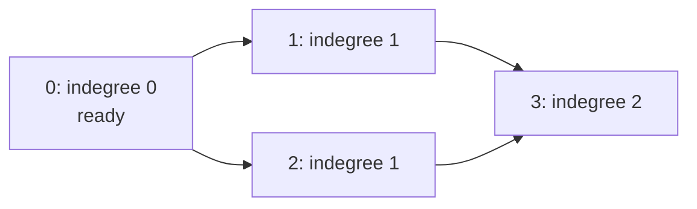

Determine whether every course can be completed while respecting all listed prerequisite requirements.

## Problem

**Input.** A nonnegative `course_count` and pairs `[course, prerequisite]` using IDs from `0` through `course_count - 1`.

**Output.** Return `True` if some order completes every course; otherwise return `False`.

**Rules.** Each listed prerequisite must finish before its course can start.
All courses count, including isolated ones. Repeated pairs are allowed, and inputs remain unchanged.
Zero courses is feasible. A course requiring itself is not feasible.

**Example.** Four courses with pairs `[[1, 0], [2, 0], [3, 1], [3, 2]]` return `True`.
One possible order is `[0, 1, 2, 3]`.
For two courses with pairs `[[1, 0], [0, 1]]`, return `False`.

## Picture

The label counts unmet incoming requirements.
Initially, only course `0` is ready:

<p class="visual-title" data-supplemental-visual="course-prerequisite-fanout">Processing 0 makes 1 and 2 ready, not 3</p>


<p class="diagram-caption"><strong>Read it this way:</strong> count incoming prerequisite edges. Readiness is indegree zero, not simply having a path from an already-ready course.</p>

Completing `0` releases `1` and `2`.
Completing `1` lowers course `3` from two requirements to one; it must still wait.
Completing `2` lowers that count to zero and releases `3`.

Indegree counts incoming requirements not yet released.
After a course's outgoing edges are processed, this equals incoming edges from unprocessed vertices.
A ready course has no remaining prerequisite.
Removing it deletes each outgoing requirement exactly once.
Duplicate pairs remain consistent parallel edges: count and decrement every copy.

<!-- visual:course-schedule-state -->
<figure class="learning-figure coding-visual-figure" aria-labelledby="course-schedule-state-title"><p class="visual-kicker">Problem trace</p><p class="visual-title" id="course-schedule-state-title">Release a dependency only when its unmet-requirement count reaches zero: Only dequeue zero-indegree courses; removing their outgoing edges may make new courses ready.</p><div class="coding-visual" data-coding-visual data-coding-mode="trace" data-coding-slug="course-schedule" role="group" tabindex="0" aria-label="Release a dependency only when its unmet-requirement count reaches zero: Only dequeue zero-indegree courses; removing their outgoing edges may make new courses ready."><div class="coding-visual-example"><span>Input and goal</span><strong>Check whether all courses can be completed.</strong></div><div class="coding-trace" data-coding-trace><div class="coding-trace-frame" data-coding-frame="0" data-frame-key="initialize-graph-and-queue" role="group" aria-label="Build the dependency graph"><div class="coding-trace-frame-heading"><span>Build the dependency graph</span><strong>The prerequisite diamond starts with indegrees [0,1,1,2]. Only course 0 is ready.</strong></div><div class="coding-trace-graph"><svg viewBox="0 0 480 230" role="img" aria-label="Remaining prerequisite edges and course requirement counts"><defs><marker id="coding-graph-arrow-0" markerWidth="8" markerHeight="8" refX="7" refY="4" orient="auto"><path class="coding-trace-graph-marker" d="M 0 0 L 8 4 L 0 8 z" /></marker></defs><text class="coding-trace-graph-region" x="60" y="146">0: ready</text><text class="coding-trace-graph-region" x="240" y="86">1: needs 1</text><text class="coding-trace-graph-region" x="240" y="206">2: needs 1</text><text class="coding-trace-graph-region" x="420" y="146">3: needs 2</text><g><line class="coding-trace-edge-line" x1="84.66576574931335" y1="96.77807808356222" x2="212.4881843565351" y2="54.1706052144883" marker-end="url(#coding-graph-arrow-0)" /></g><g><line class="coding-trace-edge-line" x1="84.66576574931335" y1="113.22192191643778" x2="212.4881843565351" y2="155.8293947855117" marker-end="url(#coding-graph-arrow-0)" /></g><g><line class="coding-trace-edge-line" x1="264.6657657493134" y1="53.221921916437786" x2="392.4881843565351" y2="95.8293947855117" marker-end="url(#coding-graph-arrow-0)" /></g><g><line class="coding-trace-edge-line" x1="264.6657657493134" y1="156.7780780835622" x2="392.4881843565351" y2="114.1706052144883" marker-end="url(#coding-graph-arrow-0)" /></g><g class="coding-trace-graph-node"><circle cx="60" cy="105" r="23" /><text x="60" y="109">0</text></g><g class="coding-trace-graph-node"><circle cx="240" cy="45" r="23" /><text x="240" y="49">1</text></g><g class="coding-trace-graph-node"><circle cx="240" cy="165" r="23" /><text x="240" y="169">2</text></g><g class="coding-trace-graph-node"><circle cx="420" cy="105" r="23" /><text x="420" y="109">3</text></g></svg></div><details><summary>Input adjacency matrix</summary><div class="coding-trace-grid" style="--trace-cols:5" role="group" aria-label="Grid state"><span class="coding-trace-grid-cell" data-motion-key="grid-0-0"><span>from\to</span></span><span class="coding-trace-grid-cell" data-motion-key="grid-0-1"><span>0</span></span><span class="coding-trace-grid-cell" data-motion-key="grid-0-2"><span>1</span></span><span class="coding-trace-grid-cell" data-motion-key="grid-0-3"><span>2</span></span><span class="coding-trace-grid-cell" data-motion-key="grid-0-4"><span>3</span></span><span class="coding-trace-grid-cell" data-motion-key="grid-1-0"><span>0</span></span><span class="coding-trace-grid-cell" data-motion-key="grid-1-1"><span>-</span></span><span class="coding-trace-grid-cell" data-motion-key="grid-1-2"><span>0-&gt;1</span></span><span class="coding-trace-grid-cell" data-motion-key="grid-1-3"><span>0-&gt;2</span></span><span class="coding-trace-grid-cell" data-motion-key="grid-1-4"><span>-</span></span><span class="coding-trace-grid-cell" data-motion-key="grid-2-0"><span>1</span></span><span class="coding-trace-grid-cell" data-motion-key="grid-2-1"><span>-</span></span><span class="coding-trace-grid-cell" data-motion-key="grid-2-2"><span>-</span></span><span class="coding-trace-grid-cell" data-motion-key="grid-2-3"><span>-</span></span><span class="coding-trace-grid-cell" data-motion-key="grid-2-4"><span>1-&gt;3</span></span><span class="coding-trace-grid-cell" data-motion-key="grid-3-0"><span>2</span></span><span class="coding-trace-grid-cell" data-motion-key="grid-3-1"><span>-</span></span><span class="coding-trace-grid-cell" data-motion-key="grid-3-2"><span>-</span></span><span class="coding-trace-grid-cell" data-motion-key="grid-3-3"><span>-</span></span><span class="coding-trace-grid-cell" data-motion-key="grid-3-4"><span>2-&gt;3</span></span><span class="coding-trace-grid-cell" data-motion-key="grid-4-0"><span>3</span></span><span class="coding-trace-grid-cell" data-motion-key="grid-4-1"><span>-</span></span><span class="coding-trace-grid-cell" data-motion-key="grid-4-2"><span>-</span></span><span class="coding-trace-grid-cell" data-motion-key="grid-4-3"><span>-</span></span><span class="coding-trace-grid-cell" data-motion-key="grid-4-4"><span>-</span></span></div></details><div class="coding-trace-meta"><span><b>example</b>course_count = 4, prerequisites = [[1,0], [2,0], [3,1], [3,2]]</span><span><b>edgeMeaning</b>matrix cell is prerequisite -&gt; course</span><span><b>completed</b>0</span></div></div><div class="coding-trace-frame" data-coding-frame="1" data-frame-key="dequeue-zero" hidden role="group" aria-label="Dequeue course 0"><div class="coding-trace-frame-heading"><span>Dequeue course 0</span><strong>Course 0 has no unmet prerequisite. Remove it from ready and increment completed from 0 to 1.</strong></div><div class="coding-trace-graph"><svg viewBox="0 0 480 230" role="img" aria-label="Remaining prerequisite edges and course requirement counts"><defs><marker id="coding-graph-arrow-1" markerWidth="8" markerHeight="8" refX="7" refY="4" orient="auto"><path class="coding-trace-graph-marker" d="M 0 0 L 8 4 L 0 8 z" /></marker></defs><text class="coding-trace-graph-region" x="60" y="146">0: emitted</text><text class="coding-trace-graph-region" x="240" y="86">1: needs 1</text><text class="coding-trace-graph-region" x="240" y="206">2: needs 1</text><text class="coding-trace-graph-region" x="420" y="146">3: needs 2</text><g><line class="coding-trace-edge-line" x1="84.66576574931335" y1="96.77807808356222" x2="212.4881843565351" y2="54.1706052144883" marker-end="url(#coding-graph-arrow-1)" /></g><g><line class="coding-trace-edge-line" x1="84.66576574931335" y1="113.22192191643778" x2="212.4881843565351" y2="155.8293947855117" marker-end="url(#coding-graph-arrow-1)" /></g><g><line class="coding-trace-edge-line" x1="264.6657657493134" y1="53.221921916437786" x2="392.4881843565351" y2="95.8293947855117" marker-end="url(#coding-graph-arrow-1)" /></g><g><line class="coding-trace-edge-line" x1="264.6657657493134" y1="156.7780780835622" x2="392.4881843565351" y2="114.1706052144883" marker-end="url(#coding-graph-arrow-1)" /></g><g class="coding-trace-graph-node is-focus"><circle cx="60" cy="105" r="23" /><text x="60" y="109">0</text></g><g class="coding-trace-graph-node"><circle cx="240" cy="45" r="23" /><text x="240" y="49">1</text></g><g class="coding-trace-graph-node"><circle cx="240" cy="165" r="23" /><text x="240" y="169">2</text></g><g class="coding-trace-graph-node"><circle cx="420" cy="105" r="23" /><text x="420" y="109">3</text></g></svg></div><details><summary>Input adjacency matrix</summary><div class="coding-trace-grid" style="--trace-cols:5" role="group" aria-label="Grid state"><span class="coding-trace-grid-cell" data-motion-key="grid-0-0"><span>from\to</span></span><span class="coding-trace-grid-cell" data-motion-key="grid-0-1"><span>0</span></span><span class="coding-trace-grid-cell" data-motion-key="grid-0-2"><span>1</span></span><span class="coding-trace-grid-cell" data-motion-key="grid-0-3"><span>2</span></span><span class="coding-trace-grid-cell" data-motion-key="grid-0-4"><span>3</span></span><span class="coding-trace-grid-cell" data-motion-key="grid-1-0"><span>0</span></span><span class="coding-trace-grid-cell" data-motion-key="grid-1-1"><span>-</span></span><span class="coding-trace-grid-cell" data-motion-key="grid-1-2"><span>0-&gt;1</span></span><span class="coding-trace-grid-cell" data-motion-key="grid-1-3"><span>0-&gt;2</span></span><span class="coding-trace-grid-cell" data-motion-key="grid-1-4"><span>-</span></span><span class="coding-trace-grid-cell" data-motion-key="grid-2-0"><span>1</span></span><span class="coding-trace-grid-cell" data-motion-key="grid-2-1"><span>-</span></span><span class="coding-trace-grid-cell" data-motion-key="grid-2-2"><span>-</span></span><span class="coding-trace-grid-cell" data-motion-key="grid-2-3"><span>-</span></span><span class="coding-trace-grid-cell" data-motion-key="grid-2-4"><span>1-&gt;3</span></span><span class="coding-trace-grid-cell" data-motion-key="grid-3-0"><span>2</span></span><span class="coding-trace-grid-cell" data-motion-key="grid-3-1"><span>-</span></span><span class="coding-trace-grid-cell" data-motion-key="grid-3-2"><span>-</span></span><span class="coding-trace-grid-cell" data-motion-key="grid-3-3"><span>-</span></span><span class="coding-trace-grid-cell" data-motion-key="grid-3-4"><span>2-&gt;3</span></span><span class="coding-trace-grid-cell" data-motion-key="grid-4-0"><span>3</span></span><span class="coding-trace-grid-cell" data-motion-key="grid-4-1"><span>-</span></span><span class="coding-trace-grid-cell" data-motion-key="grid-4-2"><span>-</span></span><span class="coding-trace-grid-cell" data-motion-key="grid-4-3"><span>-</span></span><span class="coding-trace-grid-cell" data-motion-key="grid-4-4"><span>-</span></span></div></details><div class="coding-trace-meta"><span><b>example</b>course_count = 4, prerequisites = [[1,0], [2,0], [3,1], [3,2]]</span><span><b>edgeMeaning</b>matrix cell is prerequisite -&gt; course</span><span><b>current</b>0</span><span><b>completed</b>1</span></div></div><div class="coding-trace-frame" data-coding-frame="2" data-frame-key="release-one" hidden role="group" aria-label="Release course 1"><div class="coding-trace-frame-heading"><span>Release course 1</span><strong>Following edge 0-&gt;1 decrements indegree[1] from 1 to 0, so append course 1 to ready.</strong></div><div class="coding-trace-graph"><svg viewBox="0 0 480 230" role="img" aria-label="Remaining prerequisite edges and course requirement counts"><defs><marker id="coding-graph-arrow-2" markerWidth="8" markerHeight="8" refX="7" refY="4" orient="auto"><path class="coding-trace-graph-marker" d="M 0 0 L 8 4 L 0 8 z" /></marker></defs><text class="coding-trace-graph-region" x="60" y="146">0: emitted</text><text class="coding-trace-graph-region" x="240" y="86">1: ready</text><text class="coding-trace-graph-region" x="240" y="206">2: needs 1</text><text class="coding-trace-graph-region" x="420" y="146">3: needs 2</text><g><line class="coding-trace-edge-line" x1="84.66576574931335" y1="113.22192191643778" x2="212.4881843565351" y2="155.8293947855117" marker-end="url(#coding-graph-arrow-2)" /></g><g><line class="coding-trace-edge-line" x1="264.6657657493134" y1="53.221921916437786" x2="392.4881843565351" y2="95.8293947855117" marker-end="url(#coding-graph-arrow-2)" /></g><g><line class="coding-trace-edge-line" x1="264.6657657493134" y1="156.7780780835622" x2="392.4881843565351" y2="114.1706052144883" marker-end="url(#coding-graph-arrow-2)" /></g><g class="coding-trace-graph-node"><circle cx="60" cy="105" r="23" /><text x="60" y="109">0</text></g><g class="coding-trace-graph-node"><circle cx="240" cy="45" r="23" /><text x="240" y="49">1</text></g><g class="coding-trace-graph-node"><circle cx="240" cy="165" r="23" /><text x="240" y="169">2</text></g><g class="coding-trace-graph-node"><circle cx="420" cy="105" r="23" /><text x="420" y="109">3</text></g></svg></div><details><summary>Input adjacency matrix</summary><div class="coding-trace-grid" style="--trace-cols:5" role="group" aria-label="Grid state"><span class="coding-trace-grid-cell" data-motion-key="grid-0-0"><span>from\to</span></span><span class="coding-trace-grid-cell" data-motion-key="grid-0-1"><span>0</span></span><span class="coding-trace-grid-cell" data-motion-key="grid-0-2"><span>1</span></span><span class="coding-trace-grid-cell" data-motion-key="grid-0-3"><span>2</span></span><span class="coding-trace-grid-cell" data-motion-key="grid-0-4"><span>3</span></span><span class="coding-trace-grid-cell" data-motion-key="grid-1-0"><span>0</span></span><span class="coding-trace-grid-cell" data-motion-key="grid-1-1"><span>-</span></span><span class="coding-trace-grid-cell trace-tone-focus" data-motion-key="edge-cursor"><span>0-&gt;1</span><small>remove edge</small></span><span class="coding-trace-grid-cell" data-motion-key="grid-1-3"><span>0-&gt;2</span></span><span class="coding-trace-grid-cell" data-motion-key="grid-1-4"><span>-</span></span><span class="coding-trace-grid-cell" data-motion-key="grid-2-0"><span>1</span></span><span class="coding-trace-grid-cell" data-motion-key="grid-2-1"><span>-</span></span><span class="coding-trace-grid-cell" data-motion-key="grid-2-2"><span>-</span></span><span class="coding-trace-grid-cell" data-motion-key="grid-2-3"><span>-</span></span><span class="coding-trace-grid-cell" data-motion-key="grid-2-4"><span>1-&gt;3</span></span><span class="coding-trace-grid-cell" data-motion-key="grid-3-0"><span>2</span></span><span class="coding-trace-grid-cell" data-motion-key="grid-3-1"><span>-</span></span><span class="coding-trace-grid-cell" data-motion-key="grid-3-2"><span>-</span></span><span class="coding-trace-grid-cell" data-motion-key="grid-3-3"><span>-</span></span><span class="coding-trace-grid-cell" data-motion-key="grid-3-4"><span>2-&gt;3</span></span><span class="coding-trace-grid-cell" data-motion-key="grid-4-0"><span>3</span></span><span class="coding-trace-grid-cell" data-motion-key="grid-4-1"><span>-</span></span><span class="coding-trace-grid-cell" data-motion-key="grid-4-2"><span>-</span></span><span class="coding-trace-grid-cell" data-motion-key="grid-4-3"><span>-</span></span><span class="coding-trace-grid-cell" data-motion-key="grid-4-4"><span>-</span></span></div></details><div class="coding-trace-meta"><span><b>example</b>course_count = 4, prerequisites = [[1,0], [2,0], [3,1], [3,2]]</span><span><b>edgeMeaning</b>matrix cell is prerequisite -&gt; course</span><span><b>transition</b>indegree[1]: 1 -&gt; 0; enqueue 1</span><span><b>completed</b>1</span></div></div><div class="coding-trace-frame" data-coding-frame="3" data-frame-key="release-two" hidden role="group" aria-label="Release course 2"><div class="coding-trace-frame-heading"><span>Release course 2</span><strong>Following edge 0-&gt;2 decrements indegree[2] from 1 to 0, so append course 2 after course 1.</strong></div><div class="coding-trace-graph"><svg viewBox="0 0 480 230" role="img" aria-label="Remaining prerequisite edges and course requirement counts"><defs><marker id="coding-graph-arrow-3" markerWidth="8" markerHeight="8" refX="7" refY="4" orient="auto"><path class="coding-trace-graph-marker" d="M 0 0 L 8 4 L 0 8 z" /></marker></defs><text class="coding-trace-graph-region" x="60" y="146">0: emitted</text><text class="coding-trace-graph-region" x="240" y="86">1: ready</text><text class="coding-trace-graph-region" x="240" y="206">2: ready</text><text class="coding-trace-graph-region" x="420" y="146">3: needs 2</text><g><line class="coding-trace-edge-line" x1="264.6657657493134" y1="53.221921916437786" x2="392.4881843565351" y2="95.8293947855117" marker-end="url(#coding-graph-arrow-3)" /></g><g><line class="coding-trace-edge-line" x1="264.6657657493134" y1="156.7780780835622" x2="392.4881843565351" y2="114.1706052144883" marker-end="url(#coding-graph-arrow-3)" /></g><g class="coding-trace-graph-node"><circle cx="60" cy="105" r="23" /><text x="60" y="109">0</text></g><g class="coding-trace-graph-node"><circle cx="240" cy="45" r="23" /><text x="240" y="49">1</text></g><g class="coding-trace-graph-node"><circle cx="240" cy="165" r="23" /><text x="240" y="169">2</text></g><g class="coding-trace-graph-node"><circle cx="420" cy="105" r="23" /><text x="420" y="109">3</text></g></svg></div><details><summary>Input adjacency matrix</summary><div class="coding-trace-grid" style="--trace-cols:5" role="group" aria-label="Grid state"><span class="coding-trace-grid-cell" data-motion-key="grid-0-0"><span>from\to</span></span><span class="coding-trace-grid-cell" data-motion-key="grid-0-1"><span>0</span></span><span class="coding-trace-grid-cell" data-motion-key="grid-0-2"><span>1</span></span><span class="coding-trace-grid-cell" data-motion-key="grid-0-3"><span>2</span></span><span class="coding-trace-grid-cell" data-motion-key="grid-0-4"><span>3</span></span><span class="coding-trace-grid-cell" data-motion-key="grid-1-0"><span>0</span></span><span class="coding-trace-grid-cell" data-motion-key="grid-1-1"><span>-</span></span><span class="coding-trace-grid-cell" data-motion-key="grid-1-2"><span>0-&gt;1</span></span><span class="coding-trace-grid-cell trace-tone-focus" data-motion-key="edge-cursor"><span>0-&gt;2</span><small>remove edge</small></span><span class="coding-trace-grid-cell" data-motion-key="grid-1-4"><span>-</span></span><span class="coding-trace-grid-cell" data-motion-key="grid-2-0"><span>1</span></span><span class="coding-trace-grid-cell" data-motion-key="grid-2-1"><span>-</span></span><span class="coding-trace-grid-cell" data-motion-key="grid-2-2"><span>-</span></span><span class="coding-trace-grid-cell" data-motion-key="grid-2-3"><span>-</span></span><span class="coding-trace-grid-cell" data-motion-key="grid-2-4"><span>1-&gt;3</span></span><span class="coding-trace-grid-cell" data-motion-key="grid-3-0"><span>2</span></span><span class="coding-trace-grid-cell" data-motion-key="grid-3-1"><span>-</span></span><span class="coding-trace-grid-cell" data-motion-key="grid-3-2"><span>-</span></span><span class="coding-trace-grid-cell" data-motion-key="grid-3-3"><span>-</span></span><span class="coding-trace-grid-cell" data-motion-key="grid-3-4"><span>2-&gt;3</span></span><span class="coding-trace-grid-cell" data-motion-key="grid-4-0"><span>3</span></span><span class="coding-trace-grid-cell" data-motion-key="grid-4-1"><span>-</span></span><span class="coding-trace-grid-cell" data-motion-key="grid-4-2"><span>-</span></span><span class="coding-trace-grid-cell" data-motion-key="grid-4-3"><span>-</span></span><span class="coding-trace-grid-cell" data-motion-key="grid-4-4"><span>-</span></span></div></details><div class="coding-trace-meta"><span><b>example</b>course_count = 4, prerequisites = [[1,0], [2,0], [3,1], [3,2]]</span><span><b>edgeMeaning</b>matrix cell is prerequisite -&gt; course</span><span><b>transition</b>indegree[2]: 1 -&gt; 0; enqueue 2</span><span><b>completed</b>1</span></div></div><div class="coding-trace-frame" data-coding-frame="4" data-frame-key="dequeue-one" hidden role="group" aria-label="Dequeue course 1"><div class="coding-trace-frame-heading"><span>Dequeue course 1</span><strong>Pop course 1 from the left of ready and increment completed to 2; course 2 remains queued.</strong></div><div class="coding-trace-graph"><svg viewBox="0 0 480 230" role="img" aria-label="Remaining prerequisite edges and course requirement counts"><defs><marker id="coding-graph-arrow-4" markerWidth="8" markerHeight="8" refX="7" refY="4" orient="auto"><path class="coding-trace-graph-marker" d="M 0 0 L 8 4 L 0 8 z" /></marker></defs><text class="coding-trace-graph-region" x="60" y="146">0: emitted</text><text class="coding-trace-graph-region" x="240" y="86">1: emitted</text><text class="coding-trace-graph-region" x="240" y="206">2: ready</text><text class="coding-trace-graph-region" x="420" y="146">3: needs 2</text><g><line class="coding-trace-edge-line" x1="264.6657657493134" y1="53.221921916437786" x2="392.4881843565351" y2="95.8293947855117" marker-end="url(#coding-graph-arrow-4)" /></g><g><line class="coding-trace-edge-line" x1="264.6657657493134" y1="156.7780780835622" x2="392.4881843565351" y2="114.1706052144883" marker-end="url(#coding-graph-arrow-4)" /></g><g class="coding-trace-graph-node"><circle cx="60" cy="105" r="23" /><text x="60" y="109">0</text></g><g class="coding-trace-graph-node is-focus"><circle cx="240" cy="45" r="23" /><text x="240" y="49">1</text></g><g class="coding-trace-graph-node"><circle cx="240" cy="165" r="23" /><text x="240" y="169">2</text></g><g class="coding-trace-graph-node"><circle cx="420" cy="105" r="23" /><text x="420" y="109">3</text></g></svg></div><details><summary>Input adjacency matrix</summary><div class="coding-trace-grid" style="--trace-cols:5" role="group" aria-label="Grid state"><span class="coding-trace-grid-cell" data-motion-key="grid-0-0"><span>from\to</span></span><span class="coding-trace-grid-cell" data-motion-key="grid-0-1"><span>0</span></span><span class="coding-trace-grid-cell" data-motion-key="grid-0-2"><span>1</span></span><span class="coding-trace-grid-cell" data-motion-key="grid-0-3"><span>2</span></span><span class="coding-trace-grid-cell" data-motion-key="grid-0-4"><span>3</span></span><span class="coding-trace-grid-cell" data-motion-key="grid-1-0"><span>0</span></span><span class="coding-trace-grid-cell" data-motion-key="grid-1-1"><span>-</span></span><span class="coding-trace-grid-cell" data-motion-key="grid-1-2"><span>0-&gt;1</span></span><span class="coding-trace-grid-cell" data-motion-key="grid-1-3"><span>0-&gt;2</span></span><span class="coding-trace-grid-cell" data-motion-key="grid-1-4"><span>-</span></span><span class="coding-trace-grid-cell" data-motion-key="grid-2-0"><span>1</span></span><span class="coding-trace-grid-cell" data-motion-key="grid-2-1"><span>-</span></span><span class="coding-trace-grid-cell" data-motion-key="grid-2-2"><span>-</span></span><span class="coding-trace-grid-cell" data-motion-key="grid-2-3"><span>-</span></span><span class="coding-trace-grid-cell" data-motion-key="grid-2-4"><span>1-&gt;3</span></span><span class="coding-trace-grid-cell" data-motion-key="grid-3-0"><span>2</span></span><span class="coding-trace-grid-cell" data-motion-key="grid-3-1"><span>-</span></span><span class="coding-trace-grid-cell" data-motion-key="grid-3-2"><span>-</span></span><span class="coding-trace-grid-cell" data-motion-key="grid-3-3"><span>-</span></span><span class="coding-trace-grid-cell" data-motion-key="grid-3-4"><span>2-&gt;3</span></span><span class="coding-trace-grid-cell" data-motion-key="grid-4-0"><span>3</span></span><span class="coding-trace-grid-cell" data-motion-key="grid-4-1"><span>-</span></span><span class="coding-trace-grid-cell" data-motion-key="grid-4-2"><span>-</span></span><span class="coding-trace-grid-cell" data-motion-key="grid-4-3"><span>-</span></span><span class="coding-trace-grid-cell" data-motion-key="grid-4-4"><span>-</span></span></div></details><div class="coding-trace-meta"><span><b>example</b>course_count = 4, prerequisites = [[1,0], [2,0], [3,1], [3,2]]</span><span><b>edgeMeaning</b>matrix cell is prerequisite -&gt; course</span><span><b>current</b>1</span><span><b>completed</b>2</span></div></div><div class="coding-trace-frame" data-coding-frame="5" data-frame-key="decrement-three-once" hidden role="group" aria-label="Remove the first requirement of course 3"><div class="coding-trace-frame-heading"><span>Remove the first requirement of course 3</span><strong>Following edge 1-&gt;3 changes indegree[3] from 2 to 1. Course 3 is not ready, so it is not enqueued.</strong></div><div class="coding-trace-graph"><svg viewBox="0 0 480 230" role="img" aria-label="Remaining prerequisite edges and course requirement counts"><defs><marker id="coding-graph-arrow-5" markerWidth="8" markerHeight="8" refX="7" refY="4" orient="auto"><path class="coding-trace-graph-marker" d="M 0 0 L 8 4 L 0 8 z" /></marker></defs><text class="coding-trace-graph-region" x="60" y="146">0: emitted</text><text class="coding-trace-graph-region" x="240" y="86">1: emitted</text><text class="coding-trace-graph-region" x="240" y="206">2: ready</text><text class="coding-trace-graph-region" x="420" y="146">3: needs 1</text><g><line class="coding-trace-edge-line" x1="264.6657657493134" y1="156.7780780835622" x2="392.4881843565351" y2="114.1706052144883" marker-end="url(#coding-graph-arrow-5)" /></g><g class="coding-trace-graph-node"><circle cx="60" cy="105" r="23" /><text x="60" y="109">0</text></g><g class="coding-trace-graph-node"><circle cx="240" cy="45" r="23" /><text x="240" y="49">1</text></g><g class="coding-trace-graph-node"><circle cx="240" cy="165" r="23" /><text x="240" y="169">2</text></g><g class="coding-trace-graph-node"><circle cx="420" cy="105" r="23" /><text x="420" y="109">3</text></g></svg></div><details><summary>Input adjacency matrix</summary><div class="coding-trace-grid" style="--trace-cols:5" role="group" aria-label="Grid state"><span class="coding-trace-grid-cell" data-motion-key="grid-0-0"><span>from\to</span></span><span class="coding-trace-grid-cell" data-motion-key="grid-0-1"><span>0</span></span><span class="coding-trace-grid-cell" data-motion-key="grid-0-2"><span>1</span></span><span class="coding-trace-grid-cell" data-motion-key="grid-0-3"><span>2</span></span><span class="coding-trace-grid-cell" data-motion-key="grid-0-4"><span>3</span></span><span class="coding-trace-grid-cell" data-motion-key="grid-1-0"><span>0</span></span><span class="coding-trace-grid-cell" data-motion-key="grid-1-1"><span>-</span></span><span class="coding-trace-grid-cell" data-motion-key="grid-1-2"><span>0-&gt;1</span></span><span class="coding-trace-grid-cell" data-motion-key="grid-1-3"><span>0-&gt;2</span></span><span class="coding-trace-grid-cell" data-motion-key="grid-1-4"><span>-</span></span><span class="coding-trace-grid-cell" data-motion-key="grid-2-0"><span>1</span></span><span class="coding-trace-grid-cell" data-motion-key="grid-2-1"><span>-</span></span><span class="coding-trace-grid-cell" data-motion-key="grid-2-2"><span>-</span></span><span class="coding-trace-grid-cell" data-motion-key="grid-2-3"><span>-</span></span><span class="coding-trace-grid-cell trace-tone-focus" data-motion-key="edge-cursor"><span>1-&gt;3</span><small>remove edge</small></span><span class="coding-trace-grid-cell" data-motion-key="grid-3-0"><span>2</span></span><span class="coding-trace-grid-cell" data-motion-key="grid-3-1"><span>-</span></span><span class="coding-trace-grid-cell" data-motion-key="grid-3-2"><span>-</span></span><span class="coding-trace-grid-cell" data-motion-key="grid-3-3"><span>-</span></span><span class="coding-trace-grid-cell" data-motion-key="grid-3-4"><span>2-&gt;3</span></span><span class="coding-trace-grid-cell" data-motion-key="grid-4-0"><span>3</span></span><span class="coding-trace-grid-cell" data-motion-key="grid-4-1"><span>-</span></span><span class="coding-trace-grid-cell" data-motion-key="grid-4-2"><span>-</span></span><span class="coding-trace-grid-cell" data-motion-key="grid-4-3"><span>-</span></span><span class="coding-trace-grid-cell" data-motion-key="grid-4-4"><span>-</span></span></div></details><div class="coding-trace-meta"><span><b>example</b>course_count = 4, prerequisites = [[1,0], [2,0], [3,1], [3,2]]</span><span><b>edgeMeaning</b>matrix cell is prerequisite -&gt; course</span><span><b>transition</b>indegree[3]: 2 -&gt; 1; do not enqueue</span><span><b>completed</b>2</span></div></div><div class="coding-trace-frame" data-coding-frame="6" data-frame-key="dequeue-two" hidden role="group" aria-label="Dequeue course 2"><div class="coding-trace-frame-heading"><span>Dequeue course 2</span><strong>Pop course 2 and increment completed to 3. The ready queue is temporarily empty.</strong></div><div class="coding-trace-graph"><svg viewBox="0 0 480 230" role="img" aria-label="Remaining prerequisite edges and course requirement counts"><defs><marker id="coding-graph-arrow-6" markerWidth="8" markerHeight="8" refX="7" refY="4" orient="auto"><path class="coding-trace-graph-marker" d="M 0 0 L 8 4 L 0 8 z" /></marker></defs><text class="coding-trace-graph-region" x="60" y="146">0: emitted</text><text class="coding-trace-graph-region" x="240" y="86">1: emitted</text><text class="coding-trace-graph-region" x="240" y="206">2: emitted</text><text class="coding-trace-graph-region" x="420" y="146">3: needs 1</text><g><line class="coding-trace-edge-line" x1="264.6657657493134" y1="156.7780780835622" x2="392.4881843565351" y2="114.1706052144883" marker-end="url(#coding-graph-arrow-6)" /></g><g class="coding-trace-graph-node"><circle cx="60" cy="105" r="23" /><text x="60" y="109">0</text></g><g class="coding-trace-graph-node"><circle cx="240" cy="45" r="23" /><text x="240" y="49">1</text></g><g class="coding-trace-graph-node is-focus"><circle cx="240" cy="165" r="23" /><text x="240" y="169">2</text></g><g class="coding-trace-graph-node"><circle cx="420" cy="105" r="23" /><text x="420" y="109">3</text></g></svg></div><details><summary>Input adjacency matrix</summary><div class="coding-trace-grid" style="--trace-cols:5" role="group" aria-label="Grid state"><span class="coding-trace-grid-cell" data-motion-key="grid-0-0"><span>from\to</span></span><span class="coding-trace-grid-cell" data-motion-key="grid-0-1"><span>0</span></span><span class="coding-trace-grid-cell" data-motion-key="grid-0-2"><span>1</span></span><span class="coding-trace-grid-cell" data-motion-key="grid-0-3"><span>2</span></span><span class="coding-trace-grid-cell" data-motion-key="grid-0-4"><span>3</span></span><span class="coding-trace-grid-cell" data-motion-key="grid-1-0"><span>0</span></span><span class="coding-trace-grid-cell" data-motion-key="grid-1-1"><span>-</span></span><span class="coding-trace-grid-cell" data-motion-key="grid-1-2"><span>0-&gt;1</span></span><span class="coding-trace-grid-cell" data-motion-key="grid-1-3"><span>0-&gt;2</span></span><span class="coding-trace-grid-cell" data-motion-key="grid-1-4"><span>-</span></span><span class="coding-trace-grid-cell" data-motion-key="grid-2-0"><span>1</span></span><span class="coding-trace-grid-cell" data-motion-key="grid-2-1"><span>-</span></span><span class="coding-trace-grid-cell" data-motion-key="grid-2-2"><span>-</span></span><span class="coding-trace-grid-cell" data-motion-key="grid-2-3"><span>-</span></span><span class="coding-trace-grid-cell" data-motion-key="grid-2-4"><span>1-&gt;3</span></span><span class="coding-trace-grid-cell" data-motion-key="grid-3-0"><span>2</span></span><span class="coding-trace-grid-cell" data-motion-key="grid-3-1"><span>-</span></span><span class="coding-trace-grid-cell" data-motion-key="grid-3-2"><span>-</span></span><span class="coding-trace-grid-cell" data-motion-key="grid-3-3"><span>-</span></span><span class="coding-trace-grid-cell" data-motion-key="grid-3-4"><span>2-&gt;3</span></span><span class="coding-trace-grid-cell" data-motion-key="grid-4-0"><span>3</span></span><span class="coding-trace-grid-cell" data-motion-key="grid-4-1"><span>-</span></span><span class="coding-trace-grid-cell" data-motion-key="grid-4-2"><span>-</span></span><span class="coding-trace-grid-cell" data-motion-key="grid-4-3"><span>-</span></span><span class="coding-trace-grid-cell" data-motion-key="grid-4-4"><span>-</span></span></div></details><div class="coding-trace-meta"><span><b>example</b>course_count = 4, prerequisites = [[1,0], [2,0], [3,1], [3,2]]</span><span><b>edgeMeaning</b>matrix cell is prerequisite -&gt; course</span><span><b>current</b>2</span><span><b>completed</b>3</span></div></div><div class="coding-trace-frame" data-coding-frame="7" data-frame-key="release-three" hidden role="group" aria-label="Release course 3"><div class="coding-trace-frame-heading"><span>Release course 3</span><strong>Following edge 2-&gt;3 changes indegree[3] from 1 to 0, so append course 3 to ready.</strong></div><div class="coding-trace-graph"><svg viewBox="0 0 480 230" role="img" aria-label="Remaining prerequisite edges and course requirement counts"><defs><marker id="coding-graph-arrow-7" markerWidth="8" markerHeight="8" refX="7" refY="4" orient="auto"><path class="coding-trace-graph-marker" d="M 0 0 L 8 4 L 0 8 z" /></marker></defs><text class="coding-trace-graph-region" x="60" y="146">0: emitted</text><text class="coding-trace-graph-region" x="240" y="86">1: emitted</text><text class="coding-trace-graph-region" x="240" y="206">2: emitted</text><text class="coding-trace-graph-region" x="420" y="146">3: ready</text><g class="coding-trace-graph-node"><circle cx="60" cy="105" r="23" /><text x="60" y="109">0</text></g><g class="coding-trace-graph-node"><circle cx="240" cy="45" r="23" /><text x="240" y="49">1</text></g><g class="coding-trace-graph-node"><circle cx="240" cy="165" r="23" /><text x="240" y="169">2</text></g><g class="coding-trace-graph-node"><circle cx="420" cy="105" r="23" /><text x="420" y="109">3</text></g></svg></div><details><summary>Input adjacency matrix</summary><div class="coding-trace-grid" style="--trace-cols:5" role="group" aria-label="Grid state"><span class="coding-trace-grid-cell" data-motion-key="grid-0-0"><span>from\to</span></span><span class="coding-trace-grid-cell" data-motion-key="grid-0-1"><span>0</span></span><span class="coding-trace-grid-cell" data-motion-key="grid-0-2"><span>1</span></span><span class="coding-trace-grid-cell" data-motion-key="grid-0-3"><span>2</span></span><span class="coding-trace-grid-cell" data-motion-key="grid-0-4"><span>3</span></span><span class="coding-trace-grid-cell" data-motion-key="grid-1-0"><span>0</span></span><span class="coding-trace-grid-cell" data-motion-key="grid-1-1"><span>-</span></span><span class="coding-trace-grid-cell" data-motion-key="grid-1-2"><span>0-&gt;1</span></span><span class="coding-trace-grid-cell" data-motion-key="grid-1-3"><span>0-&gt;2</span></span><span class="coding-trace-grid-cell" data-motion-key="grid-1-4"><span>-</span></span><span class="coding-trace-grid-cell" data-motion-key="grid-2-0"><span>1</span></span><span class="coding-trace-grid-cell" data-motion-key="grid-2-1"><span>-</span></span><span class="coding-trace-grid-cell" data-motion-key="grid-2-2"><span>-</span></span><span class="coding-trace-grid-cell" data-motion-key="grid-2-3"><span>-</span></span><span class="coding-trace-grid-cell" data-motion-key="grid-2-4"><span>1-&gt;3</span></span><span class="coding-trace-grid-cell" data-motion-key="grid-3-0"><span>2</span></span><span class="coding-trace-grid-cell" data-motion-key="grid-3-1"><span>-</span></span><span class="coding-trace-grid-cell" data-motion-key="grid-3-2"><span>-</span></span><span class="coding-trace-grid-cell" data-motion-key="grid-3-3"><span>-</span></span><span class="coding-trace-grid-cell trace-tone-focus" data-motion-key="edge-cursor"><span>2-&gt;3</span><small>remove edge</small></span><span class="coding-trace-grid-cell" data-motion-key="grid-4-0"><span>3</span></span><span class="coding-trace-grid-cell" data-motion-key="grid-4-1"><span>-</span></span><span class="coding-trace-grid-cell" data-motion-key="grid-4-2"><span>-</span></span><span class="coding-trace-grid-cell" data-motion-key="grid-4-3"><span>-</span></span><span class="coding-trace-grid-cell" data-motion-key="grid-4-4"><span>-</span></span></div></details><div class="coding-trace-meta"><span><b>example</b>course_count = 4, prerequisites = [[1,0], [2,0], [3,1], [3,2]]</span><span><b>edgeMeaning</b>matrix cell is prerequisite -&gt; course</span><span><b>transition</b>indegree[3]: 1 -&gt; 0; enqueue 3</span><span><b>completed</b>3</span></div></div><div class="coding-trace-frame" data-coding-frame="8" data-frame-key="dequeue-three" hidden role="group" aria-label="Dequeue course 3"><div class="coding-trace-frame-heading"><span>Dequeue course 3</span><strong>Pop the final ready course and increment completed from 3 to 4. It has no outgoing edges.</strong></div><div class="coding-trace-graph"><svg viewBox="0 0 480 230" role="img" aria-label="Remaining prerequisite edges and course requirement counts"><defs><marker id="coding-graph-arrow-8" markerWidth="8" markerHeight="8" refX="7" refY="4" orient="auto"><path class="coding-trace-graph-marker" d="M 0 0 L 8 4 L 0 8 z" /></marker></defs><text class="coding-trace-graph-region" x="60" y="146">0: emitted</text><text class="coding-trace-graph-region" x="240" y="86">1: emitted</text><text class="coding-trace-graph-region" x="240" y="206">2: emitted</text><text class="coding-trace-graph-region" x="420" y="146">3: emitted</text><g class="coding-trace-graph-node"><circle cx="60" cy="105" r="23" /><text x="60" y="109">0</text></g><g class="coding-trace-graph-node"><circle cx="240" cy="45" r="23" /><text x="240" y="49">1</text></g><g class="coding-trace-graph-node"><circle cx="240" cy="165" r="23" /><text x="240" y="169">2</text></g><g class="coding-trace-graph-node is-focus"><circle cx="420" cy="105" r="23" /><text x="420" y="109">3</text></g></svg></div><details><summary>Input adjacency matrix</summary><div class="coding-trace-grid" style="--trace-cols:5" role="group" aria-label="Grid state"><span class="coding-trace-grid-cell" data-motion-key="grid-0-0"><span>from\to</span></span><span class="coding-trace-grid-cell" data-motion-key="grid-0-1"><span>0</span></span><span class="coding-trace-grid-cell" data-motion-key="grid-0-2"><span>1</span></span><span class="coding-trace-grid-cell" data-motion-key="grid-0-3"><span>2</span></span><span class="coding-trace-grid-cell" data-motion-key="grid-0-4"><span>3</span></span><span class="coding-trace-grid-cell" data-motion-key="grid-1-0"><span>0</span></span><span class="coding-trace-grid-cell" data-motion-key="grid-1-1"><span>-</span></span><span class="coding-trace-grid-cell" data-motion-key="grid-1-2"><span>0-&gt;1</span></span><span class="coding-trace-grid-cell" data-motion-key="grid-1-3"><span>0-&gt;2</span></span><span class="coding-trace-grid-cell" data-motion-key="grid-1-4"><span>-</span></span><span class="coding-trace-grid-cell" data-motion-key="grid-2-0"><span>1</span></span><span class="coding-trace-grid-cell" data-motion-key="grid-2-1"><span>-</span></span><span class="coding-trace-grid-cell" data-motion-key="grid-2-2"><span>-</span></span><span class="coding-trace-grid-cell" data-motion-key="grid-2-3"><span>-</span></span><span class="coding-trace-grid-cell" data-motion-key="grid-2-4"><span>1-&gt;3</span></span><span class="coding-trace-grid-cell" data-motion-key="grid-3-0"><span>2</span></span><span class="coding-trace-grid-cell" data-motion-key="grid-3-1"><span>-</span></span><span class="coding-trace-grid-cell" data-motion-key="grid-3-2"><span>-</span></span><span class="coding-trace-grid-cell" data-motion-key="grid-3-3"><span>-</span></span><span class="coding-trace-grid-cell" data-motion-key="grid-3-4"><span>2-&gt;3</span></span><span class="coding-trace-grid-cell" data-motion-key="grid-4-0"><span>3</span></span><span class="coding-trace-grid-cell" data-motion-key="grid-4-1"><span>-</span></span><span class="coding-trace-grid-cell" data-motion-key="grid-4-2"><span>-</span></span><span class="coding-trace-grid-cell" data-motion-key="grid-4-3"><span>-</span></span><span class="coding-trace-grid-cell" data-motion-key="grid-4-4"><span>-</span></span></div></details><div class="coding-trace-meta"><span><b>example</b>course_count = 4, prerequisites = [[1,0], [2,0], [3,1], [3,2]]</span><span><b>edgeMeaning</b>matrix cell is prerequisite -&gt; course</span><span><b>current</b>3</span><span><b>completed</b>4</span></div></div><div class="coding-trace-frame" data-coding-frame="9" data-frame-key="return-true" hidden role="group" aria-label="Compare completed with course count"><div class="coding-trace-frame-heading"><span>Compare completed with course count</span><strong>The queue is empty after all four nodes were removed. completed == course_count is 4 == 4, so return true.</strong></div><div class="coding-trace-graph"><svg viewBox="0 0 480 230" role="img" aria-label="Remaining prerequisite edges and course requirement counts"><defs><marker id="coding-graph-arrow-9" markerWidth="8" markerHeight="8" refX="7" refY="4" orient="auto"><path class="coding-trace-graph-marker" d="M 0 0 L 8 4 L 0 8 z" /></marker></defs><text class="coding-trace-graph-region" x="60" y="146">0: emitted</text><text class="coding-trace-graph-region" x="240" y="86">1: emitted</text><text class="coding-trace-graph-region" x="240" y="206">2: emitted</text><text class="coding-trace-graph-region" x="420" y="146">3: emitted</text><g class="coding-trace-graph-node"><circle cx="60" cy="105" r="23" /><text x="60" y="109">0</text></g><g class="coding-trace-graph-node"><circle cx="240" cy="45" r="23" /><text x="240" y="49">1</text></g><g class="coding-trace-graph-node"><circle cx="240" cy="165" r="23" /><text x="240" y="169">2</text></g><g class="coding-trace-graph-node"><circle cx="420" cy="105" r="23" /><text x="420" y="109">3</text></g></svg></div><details><summary>Input adjacency matrix</summary><div class="coding-trace-grid" style="--trace-cols:5" role="group" aria-label="Grid state"><span class="coding-trace-grid-cell" data-motion-key="grid-0-0"><span>from\to</span></span><span class="coding-trace-grid-cell" data-motion-key="grid-0-1"><span>0</span></span><span class="coding-trace-grid-cell" data-motion-key="grid-0-2"><span>1</span></span><span class="coding-trace-grid-cell" data-motion-key="grid-0-3"><span>2</span></span><span class="coding-trace-grid-cell" data-motion-key="grid-0-4"><span>3</span></span><span class="coding-trace-grid-cell" data-motion-key="grid-1-0"><span>0</span></span><span class="coding-trace-grid-cell" data-motion-key="grid-1-1"><span>-</span></span><span class="coding-trace-grid-cell" data-motion-key="grid-1-2"><span>0-&gt;1</span></span><span class="coding-trace-grid-cell" data-motion-key="grid-1-3"><span>0-&gt;2</span></span><span class="coding-trace-grid-cell" data-motion-key="grid-1-4"><span>-</span></span><span class="coding-trace-grid-cell" data-motion-key="grid-2-0"><span>1</span></span><span class="coding-trace-grid-cell" data-motion-key="grid-2-1"><span>-</span></span><span class="coding-trace-grid-cell" data-motion-key="grid-2-2"><span>-</span></span><span class="coding-trace-grid-cell" data-motion-key="grid-2-3"><span>-</span></span><span class="coding-trace-grid-cell" data-motion-key="grid-2-4"><span>1-&gt;3</span></span><span class="coding-trace-grid-cell" data-motion-key="grid-3-0"><span>2</span></span><span class="coding-trace-grid-cell" data-motion-key="grid-3-1"><span>-</span></span><span class="coding-trace-grid-cell" data-motion-key="grid-3-2"><span>-</span></span><span class="coding-trace-grid-cell" data-motion-key="grid-3-3"><span>-</span></span><span class="coding-trace-grid-cell" data-motion-key="grid-3-4"><span>2-&gt;3</span></span><span class="coding-trace-grid-cell" data-motion-key="grid-4-0"><span>3</span></span><span class="coding-trace-grid-cell" data-motion-key="grid-4-1"><span>-</span></span><span class="coding-trace-grid-cell" data-motion-key="grid-4-2"><span>-</span></span><span class="coding-trace-grid-cell" data-motion-key="grid-4-3"><span>-</span></span><span class="coding-trace-grid-cell" data-motion-key="grid-4-4"><span>-</span></span></div></details><div class="coding-trace-meta"><span><b>example</b>course_count = 4, prerequisites = [[1,0], [2,0], [3,1], [3,2]]</span><span><b>edgeMeaning</b>matrix cell is prerequisite -&gt; course</span><span><b>comparison</b>4 == 4</span><span><b>result</b>true</span></div></div><div class="coding-trace-controls" data-coding-controls hidden><div class="coding-trace-control-buttons"><button type="button" data-coding-previous disabled><span aria-hidden="true">&larr;</span><span>Previous</span></button><button type="button" data-coding-play><span aria-hidden="true">&#9654;</span><span data-coding-play-label>Play trace</span></button><button type="button" data-coding-next><span>Next</span><span aria-hidden="true">&rarr;</span></button></div><output data-coding-progress>Step 1 of 10</output></div><div class="coding-trace-timeline" data-coding-timeline hidden role="group" aria-label="Trace steps"><button type="button" data-coding-frame-button="0" aria-current="step"><span>1</span><strong>Build the dependency graph</strong></button><button type="button" data-coding-frame-button="1"><span>2</span><strong>Dequeue course 0</strong></button><button type="button" data-coding-frame-button="2"><span>3</span><strong>Release course 1</strong></button><button type="button" data-coding-frame-button="3"><span>4</span><strong>Release course 2</strong></button><button type="button" data-coding-frame-button="4"><span>5</span><strong>Dequeue course 1</strong></button><button type="button" data-coding-frame-button="5"><span>6</span><strong>Remove the first requirement of course 3</strong></button><button type="button" data-coding-frame-button="6"><span>7</span><strong>Dequeue course 2</strong></button><button type="button" data-coding-frame-button="7"><span>8</span><strong>Release course 3</strong></button><button type="button" data-coding-frame-button="8"><span>9</span><strong>Dequeue course 3</strong></button><button type="button" data-coding-frame-button="9"><span>10</span><strong>Compare completed with course count</strong></button></div><p class="coding-trace-status sr-only" data-coding-status aria-live="polite"></p></div><dl class="coding-visual-lessons" aria-label="Pattern recognition and transfer"><div class="coding-visual-lesson"><dt>Recognize it</dt><dd data-coding-review="recognitionCue">Directed prerequisite pairs ask whether every node can be placed after all requirements; failure to process every node means a directed cycle blocks the remainder.</dd></div><div class="coding-visual-lesson"><dt>Keep true</dt><dd data-coding-review="invariant">Every queued course has indegree zero in the remaining graph, completed counts dequeued courses, and each outgoing edge is removed exactly once when its prerequisite completes.</dd></div><div class="coding-visual-lesson"><dt>Reuse it</dt><dd data-coding-review="transferLesson">Repeatedly remove entities with no unmet requirements and decrement their dependents; the same mechanism orders builds, recipes, jobs, and dependency migrations, while leftovers certify a cycle.</dd></div></dl></div><figcaption><strong>Read it this way:</strong> The prerequisite diamond starts with indegrees [0,1,1,2]. Only course 0 is ready. Step through the frames to watch the state change. The last frame shows the answer or the stopping condition.</figcaption></figure>

If all four courses are removed, all can finish.
If elimination stops early, every remaining vertex has an incoming requirement.
Following predecessors in that finite residual graph must repeat a vertex, proving a directed cycle.
Not every blocked vertex must itself lie on that cycle.

## Code

```python
from collections import deque

def can_finish(course_count: int, prerequisites: list[list[int]]) -> bool:
   graph = [[] for _ in range(course_count)]
   indegree = [0] * course_count

   for course, prerequisite in prerequisites:
      graph[prerequisite].append(course)
      indegree[course] += 1

   ready = deque(course for course in range(course_count) if indegree[course] == 0)
   completed = 0

   while ready:
      course = ready.popleft()
      completed += 1
      for next_course in graph[course]:
         indegree[next_course] -= 1
         if indegree[next_course] == 0:
            ready.append(next_course)

   return completed == course_count
```

Time and space are $O(V+E)$, including the graph and queue.
Zero courses return `True`.
Eligibility is not shortest-distance priority, resource availability or a general scheduling guarantee.
Releasing course `3` after only course `1` would violate its second prerequisite.

<!-- learning:core-end -->

## Change to Parallel Rounds

**New task:** Group unit-duration courses under unlimited parallel capacity.

**Picture and change:** Freeze the ready count per round.
Newly released courses belong to the next round, not the current one.

```python
def course_layers(course_count, prerequisites):
   graph = [[] for _ in range(course_count)]
   indegree = [0] * course_count
   for course, prerequisite in prerequisites:
      graph[prerequisite].append(course)
      indegree[course] += 1
   ready = deque(course for course in range(course_count)
              if indegree[course] == 0)
   layers, completed = [], 0
   while ready:
      layer = []
      for _ in range(len(ready)):
         course = ready.popleft()
         layer.append(course)
         completed += 1
         for dependent in graph[course]:
            indegree[dependent] -= 1
            if indegree[dependent] == 0:
               ready.append(dependent)
      layers.append(layer)
   return layers if completed == course_count else None
```

**Check:** The diamond returns `[[0],[1,2],[3]]`.
A cycle returns `None`; zero courses return `[]`.
Three rounds are optimal only under the stated duration and capacity assumptions.

**Use when:** Dependency depth, not resource-constrained scheduling, is requested.

## Change to Blocked-Node Output

**New task:** Return every residual blocked vertex.

**Picture and change:** Run elimination, then inspect positive remaining counts.
They identify blocked vertices, not an exact cycle witness.

```python
def blocked_after_elimination(course_count, prerequisites):
   graph = [[] for _ in range(course_count)]
   indegree = [0] * course_count
   for course, prerequisite in prerequisites:
      graph[prerequisite].append(course)
      indegree[course] += 1
   ready = deque(course for course in range(course_count)
              if indegree[course] == 0)
   while ready:
      course = ready.popleft()
      for dependent in graph[course]:
         indegree[dependent] -= 1
         if indegree[dependent] == 0:
            ready.append(dependent)
   return [course for course in range(course_count)
         if indegree[course] > 0]
```

**Check:** With pairs `[[1,0],[0,1],[2,1]]` and four courses, return `[0,1,2]`.
Course `3` completes; `0,1` form a cycle, while `2` is merely downstream.
Both adaptations remain $O(V+E)$ in time and space.

**Use when:** Residual obstruction coverage is sufficient.

### Transfer Check

Why cannot undirected union-find replace this directed-cycle test?

### Answer

Connectivity forgets prerequisite direction.
The diamond has an undirected cycle but no directed cycle and remains feasible.
Representative equality therefore answers a different question.
