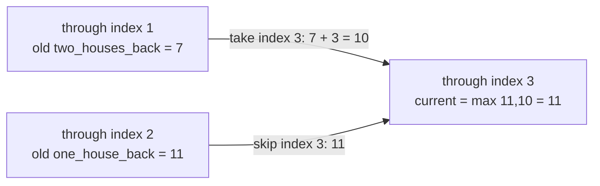

Compare skipping the current position with taking it after the last compatible prefix; retain the larger total.

## Problem

For values `[2,7,9,3,1]`, select nonadjacent positions with maximum total.
The answer is `12`, achieved at indices `[0,2,4]`.
Choosing nothing is allowed, so empty and all-negative inputs return `0`.
Values are integers; positions form a line.

## Picture

At index `3`, taking value `3` excludes index `2`.
It can extend the best prefix through index `1`, not the immediately preceding prefix.



These cases are exhaustive: a selection either contains the current position or does not.
Neither saved prefix optimum must select its last position.
Taking the current value after the two-back optimum is compatible; skipping preserves the one-back optimum.

<!-- visual:house-robber-state -->
<figure class="learning-figure coding-visual-figure" aria-labelledby="house-robber-state-title"><p class="visual-kicker">Problem trace</p><p class="visual-title" id="house-robber-state-title">Compare skipping the current item with its last compatible prefix: For each prefix, compare skipping the current house with taking it after the last compatible prefix.</p><div class="coding-visual" data-coding-visual data-coding-mode="trace" data-coding-slug="house-robber" role="group" tabindex="0" aria-label="Compare skipping the current item with its last compatible prefix: For each prefix, compare skipping the current house with taking it after the last compatible prefix."><div class="coding-visual-example"><span>Input and goal</span><strong>Find the most money that can be taken without choosing neighboring houses.</strong></div><div class="coding-trace" data-coding-trace><div class="coding-trace-frame" data-coding-frame="0" data-frame-key="initialize" role="group" aria-label="Initialize before house 0"><div class="coding-trace-frame-heading"><span>Initialize before house 0</span><strong>For money [2, 7, 9, 3, 1], both saved prefix answers start at zero.</strong></div><div class="coding-trace-array" role="list" aria-label="Array state"><span class="coding-trace-array-item trace-tone-focus" role="listitem" data-motion-key="value-0"><span class="coding-trace-array-pointer" data-motion-key="current-house">next i=0</span><span class="coding-trace-array-cell">house 0: $2</span><small class="coding-trace-array-index">0</small></span><span class="coding-trace-array-item" role="listitem" data-motion-key="value-1"><span class="coding-trace-array-mark"></span><span class="coding-trace-array-cell">house 1: $7</span><small class="coding-trace-array-index">1</small></span><span class="coding-trace-array-item" role="listitem" data-motion-key="value-2"><span class="coding-trace-array-mark"></span><span class="coding-trace-array-cell">house 2: $9</span><small class="coding-trace-array-index">2</small></span><span class="coding-trace-array-item" role="listitem" data-motion-key="value-3"><span class="coding-trace-array-mark"></span><span class="coding-trace-array-cell">house 3: $3</span><small class="coding-trace-array-index">3</small></span><span class="coding-trace-array-item" role="listitem" data-motion-key="value-4"><span class="coding-trace-array-mark"></span><span class="coding-trace-array-cell">house 4: $1</span><small class="coding-trace-array-index">4</small></span></div><div class="coding-trace-meta"><span><b>state</b>two_houses_back=0, one_house_back=0</span><span><b>meaning</b>best totals before any house</span></div></div><div class="coding-trace-frame" data-coding-frame="1" data-frame-key="house-0" hidden role="group" aria-label="Choose house 0"><div class="coding-trace-frame-heading"><span>Choose house 0</span><strong>Skip gives 0; take gives 0 + 2 = 2. Keep current = 2, then shift the saved states to (0, 2).</strong></div><div class="coding-trace-array" role="list" aria-label="Array state"><span class="coding-trace-array-item trace-tone-focus" role="listitem" data-motion-key="value-0"><span class="coding-trace-array-pointer" data-motion-key="current-house">current i=0</span><span class="coding-trace-array-cell">house 0: $2</span><small class="coding-trace-array-index">0</small></span><span class="coding-trace-array-item" role="listitem" data-motion-key="value-1"><span class="coding-trace-array-mark"></span><span class="coding-trace-array-cell">house 1: $7</span><small class="coding-trace-array-index">1</small></span><span class="coding-trace-array-item" role="listitem" data-motion-key="value-2"><span class="coding-trace-array-mark"></span><span class="coding-trace-array-cell">house 2: $9</span><small class="coding-trace-array-index">2</small></span><span class="coding-trace-array-item" role="listitem" data-motion-key="value-3"><span class="coding-trace-array-mark"></span><span class="coding-trace-array-cell">house 3: $3</span><small class="coding-trace-array-index">3</small></span><span class="coding-trace-array-item" role="listitem" data-motion-key="value-4"><span class="coding-trace-array-mark"></span><span class="coding-trace-array-cell">house 4: $1</span><small class="coding-trace-array-index">4</small></span></div><div class="coding-trace-meta"><span><b>input</b>[2, 7, 9, 3, 1]</span><span><b>priorState</b>two_back=0, one_back=0</span><span><b>candidates</b>skip=0; take=0+2=2</span><span><b>decision</b>take is larger; current=2</span><span><b>shiftedState</b>two_back=0, one_back=2</span></div></div><div class="coding-trace-frame" data-coding-frame="2" data-frame-key="house-1" hidden role="group" aria-label="Choose house 1 instead"><div class="coding-trace-frame-heading"><span>Choose house 1 instead</span><strong>Skip gives 2; take gives 0 + 7 = 7. Keep 7 for the first two houses and shift to (2, 7).</strong></div><div class="coding-trace-array" role="list" aria-label="Array state"><span class="coding-trace-array-item" role="listitem" data-motion-key="value-0"><span class="coding-trace-array-mark"></span><span class="coding-trace-array-cell">house 0: $2</span><small class="coding-trace-array-index">0</small></span><span class="coding-trace-array-item trace-tone-focus" role="listitem" data-motion-key="value-1"><span class="coding-trace-array-pointer" data-motion-key="current-house">current i=1</span><span class="coding-trace-array-cell">house 1: $7</span><small class="coding-trace-array-index">1</small></span><span class="coding-trace-array-item" role="listitem" data-motion-key="value-2"><span class="coding-trace-array-mark"></span><span class="coding-trace-array-cell">house 2: $9</span><small class="coding-trace-array-index">2</small></span><span class="coding-trace-array-item" role="listitem" data-motion-key="value-3"><span class="coding-trace-array-mark"></span><span class="coding-trace-array-cell">house 3: $3</span><small class="coding-trace-array-index">3</small></span><span class="coding-trace-array-item" role="listitem" data-motion-key="value-4"><span class="coding-trace-array-mark"></span><span class="coding-trace-array-cell">house 4: $1</span><small class="coding-trace-array-index">4</small></span></div><div class="coding-trace-meta"><span><b>input</b>[2, 7, 9, 3, 1]</span><span><b>priorState</b>two_back=0, one_back=2</span><span><b>candidates</b>skip=2; take=0+7=7</span><span><b>decision</b>take is larger; current=7</span><span><b>shiftedState</b>two_back=2, one_back=7</span></div></div><div class="coding-trace-frame" data-coding-frame="3" data-frame-key="house-2" hidden role="group" aria-label="Combine house 2 with house 0"><div class="coding-trace-frame-heading"><span>Combine house 2 with house 0</span><strong>Skip gives 7; take gives 2 + 9 = 11. Keep 11 and shift to (7, 11).</strong></div><div class="coding-trace-array" role="list" aria-label="Array state"><span class="coding-trace-array-item" role="listitem" data-motion-key="value-0"><span class="coding-trace-array-mark"></span><span class="coding-trace-array-cell">house 0: $2</span><small class="coding-trace-array-index">0</small></span><span class="coding-trace-array-item" role="listitem" data-motion-key="value-1"><span class="coding-trace-array-mark"></span><span class="coding-trace-array-cell">house 1: $7</span><small class="coding-trace-array-index">1</small></span><span class="coding-trace-array-item trace-tone-focus" role="listitem" data-motion-key="value-2"><span class="coding-trace-array-pointer" data-motion-key="current-house">current i=2</span><span class="coding-trace-array-cell">house 2: $9</span><small class="coding-trace-array-index">2</small></span><span class="coding-trace-array-item" role="listitem" data-motion-key="value-3"><span class="coding-trace-array-mark"></span><span class="coding-trace-array-cell">house 3: $3</span><small class="coding-trace-array-index">3</small></span><span class="coding-trace-array-item" role="listitem" data-motion-key="value-4"><span class="coding-trace-array-mark"></span><span class="coding-trace-array-cell">house 4: $1</span><small class="coding-trace-array-index">4</small></span></div><div class="coding-trace-meta"><span><b>input</b>[2, 7, 9, 3, 1]</span><span><b>priorState</b>two_back=2, one_back=7</span><span><b>candidates</b>skip=7; take=2+9=11</span><span><b>decision</b>take is larger; current=11</span><span><b>shiftedState</b>two_back=7, one_back=11</span></div></div><div class="coding-trace-frame" data-coding-frame="4" data-frame-key="house-3" hidden role="group" aria-label="Skip house 3"><div class="coding-trace-frame-heading"><span>Skip house 3</span><strong>Skip preserves 11; take gives 7 + 3 = 10. Because 11 is larger, current stays 11 and state shifts to (11, 11).</strong></div><div class="coding-trace-array" role="list" aria-label="Array state"><span class="coding-trace-array-item" role="listitem" data-motion-key="value-0"><span class="coding-trace-array-mark"></span><span class="coding-trace-array-cell">house 0: $2</span><small class="coding-trace-array-index">0</small></span><span class="coding-trace-array-item" role="listitem" data-motion-key="value-1"><span class="coding-trace-array-mark"></span><span class="coding-trace-array-cell">house 1: $7</span><small class="coding-trace-array-index">1</small></span><span class="coding-trace-array-item" role="listitem" data-motion-key="value-2"><span class="coding-trace-array-mark"></span><span class="coding-trace-array-cell">house 2: $9</span><small class="coding-trace-array-index">2</small></span><span class="coding-trace-array-item trace-tone-focus" role="listitem" data-motion-key="value-3"><span class="coding-trace-array-pointer" data-motion-key="current-house">current i=3</span><span class="coding-trace-array-cell">house 3: $3</span><small class="coding-trace-array-index">3</small></span><span class="coding-trace-array-item" role="listitem" data-motion-key="value-4"><span class="coding-trace-array-mark"></span><span class="coding-trace-array-cell">house 4: $1</span><small class="coding-trace-array-index">4</small></span></div><div class="coding-trace-meta"><span><b>input</b>[2, 7, 9, 3, 1]</span><span><b>priorState</b>two_back=7, one_back=11</span><span><b>candidates</b>skip=11; take=7+3=10</span><span><b>decision</b>skip is larger; current=11</span><span><b>shiftedState</b>two_back=11, one_back=11</span></div></div><div class="coding-trace-frame" data-coding-frame="5" data-frame-key="house-4" hidden role="group" aria-label="Take house 4 and return"><div class="coding-trace-frame-heading"><span>Take house 4 and return</span><strong>Skip gives 11; take gives 11 + 1 = 12. The final saved answer is 12, achieved by houses 0, 2, and 4.</strong></div><div class="coding-trace-array" role="list" aria-label="Array state"><span class="coding-trace-array-item" role="listitem" data-motion-key="value-0"><span class="coding-trace-array-mark"></span><span class="coding-trace-array-cell">house 0: $2</span><small class="coding-trace-array-index">0</small></span><span class="coding-trace-array-item" role="listitem" data-motion-key="value-1"><span class="coding-trace-array-mark"></span><span class="coding-trace-array-cell">house 1: $7</span><small class="coding-trace-array-index">1</small></span><span class="coding-trace-array-item" role="listitem" data-motion-key="value-2"><span class="coding-trace-array-mark"></span><span class="coding-trace-array-cell">house 2: $9</span><small class="coding-trace-array-index">2</small></span><span class="coding-trace-array-item" role="listitem" data-motion-key="value-3"><span class="coding-trace-array-mark"></span><span class="coding-trace-array-cell">house 3: $3</span><small class="coding-trace-array-index">3</small></span><span class="coding-trace-array-item trace-tone-output" role="listitem" data-motion-key="value-4"><span class="coding-trace-array-pointer" data-motion-key="current-house">current i=4</span><span class="coding-trace-array-cell">house 4: $1</span><small class="coding-trace-array-index">4</small></span></div><div class="coding-trace-meta"><span><b>input</b>[2, 7, 9, 3, 1]</span><span><b>priorState</b>two_back=11, one_back=11</span><span><b>candidates</b>skip=11; take=11+1=12</span><span><b>decision</b>take is larger; current=12</span><span><b>shiftedState</b>two_back=11, one_back=12</span><span><b>result</b>12</span></div></div><div class="coding-trace-controls" data-coding-controls hidden><div class="coding-trace-control-buttons"><button type="button" data-coding-previous disabled><span aria-hidden="true">&larr;</span><span>Previous</span></button><button type="button" data-coding-play><span aria-hidden="true">&#9654;</span><span data-coding-play-label>Play trace</span></button><button type="button" data-coding-next><span>Next</span><span aria-hidden="true">&rarr;</span></button></div><output data-coding-progress>Step 1 of 6</output></div><div class="coding-trace-timeline" data-coding-timeline hidden role="group" aria-label="Trace steps"><button type="button" data-coding-frame-button="0" aria-current="step"><span>1</span><strong>Initialize before house 0</strong></button><button type="button" data-coding-frame-button="1"><span>2</span><strong>Choose house 0</strong></button><button type="button" data-coding-frame-button="2"><span>3</span><strong>Choose house 1 instead</strong></button><button type="button" data-coding-frame-button="3"><span>4</span><strong>Combine house 2 with house 0</strong></button><button type="button" data-coding-frame-button="4"><span>5</span><strong>Skip house 3</strong></button><button type="button" data-coding-frame-button="5"><span>6</span><strong>Take house 4 and return</strong></button></div><p class="coding-trace-status sr-only" data-coding-status aria-live="polite"></p></div><dl class="coding-visual-lessons" aria-label="Pattern recognition and transfer"><div class="coding-visual-lesson"><dt>Recognize it</dt><dd data-coding-review="recognitionCue">Items lie in a line, adjacent choices conflict, and the objective asks for a maximum total rather than the exact chosen sequence.</dd></div><div class="coding-visual-lesson"><dt>Keep true</dt><dd data-coding-review="invariant">Before house i, one_house_back is the optimum for houses through i - 1 and two_houses_back is the optimum through i - 2. Therefore max(one_back, two_back + money[i]) is the complete optimum through i.</dd></div><div class="coding-visual-lesson"><dt>Reuse it</dt><dd data-coding-review="transferLesson">When choosing item i only conflicts with a fixed neighborhood, compare the optimum that excludes i with value[i] plus the last compatible optimum. This transfers to weighted independent sets on paths and cooldown scheduling.</dd></div></dl></div><figcaption><strong>Read it this way:</strong> For money [2, 7, 9, 3, 1], both saved prefix answers start at zero. Step through the frames to watch the state change. The last frame shows the answer or the stopping condition.</figcaption></figure>

After each value, the prefix optima are `2,7,11,11,12`.
Compute `current` before shifting either dependency.

## Code

```python
def house_robber(nums: list[int]) -> int:
   two_houses_back = 0
   one_house_back = 0

   for money in nums:
      current = max(one_house_back, two_houses_back + money)
      two_houses_back, one_house_back = one_house_back, current

   return one_house_back
```

At value `9`, taking gives `2+9=11`, beating `7`.
At value `3`, skipping keeps `11`, beating `7+3=10`.
At value `1`, taking gives `11+1=12`.
The displayed indices are a checked witness, not state retained by this function.

There are $O(n)$ scalar updates and $O(1)$ scalar slots, excluding input and integer-size costs.
Greedily choosing a locally larger value does not compare the required compatible prefix optima.
An arbitrary conflict graph does not share this line-prefix guarantee.

<!-- learning:core-end -->

## Change the Endpoint Conflict

**New task:** First and last positions also conflict.

**Picture and change:** At least one endpoint must be excluded.
Compare the line without the last position against the line without the first.
Handle a single position separately.

```python
def circular_robber(nums):
   if not nums:
      return 0
   if len(nums) == 1:
      return max(0, nums[0])
   return max(house_robber(nums[:-1]), house_robber(nums[1:]))
```

**Check:** `[2,3,2]` returns `3`; its two endpoint values cannot be combined.
`[-1]` returns `0`.
Python slices add $O(n)$ storage despite each line computation's two saved scalars.

**Use when:** Only endpoint compatibility changes.

## Change the Required Output

**New task:** Return the total and selected indices.

**Picture and change:** Retain every prefix optimum, then walk backward.
Skip on ties; otherwise take this index and jump over its excluded neighbor.

```python
def robber_with_indices(nums):
   best = [0] * (len(nums) + 1)
   for index, value in enumerate(nums, 1):
      compatible = best[index - 2] if index >= 2 else 0
      best[index] = max(best[index - 1], value + compatible)
   chosen, index = [], len(nums)
   while index > 0:
      if best[index] == best[index - 1]:
         index -= 1
      else:
         chosen.append(index - 1)
         index -= 2
   return best[-1], chosen[::-1]
```

**Check:** `[2,7,9,3,1]` returns `(12,[0,2,4])`; `[0,0]` returns `(0,[])`.
Selected values must sum to the reported optimum, with no adjacent indices.
This reconstruction retains $O(n)$ table slots plus its output.
Several witnesses can be optimal; the tie policy selects one deterministically.

**Use when:** The decision must be recovered, not only its value.

### Transfer Check

What changes if selecting index `i` excludes the preceding three positions?

### Answer

The take branch needs the optimum through `i-4`.
The skip branch still uses the preceding prefix optimum.
The compatibility horizon and retained state must expand.
