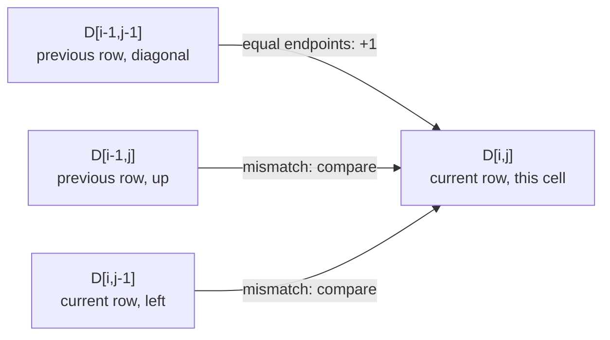

Define one answer per prefix pair; matching endpoints extend the diagonal, while mismatches keep the better one-endpoint skip.

## Problem

Find the longest common subsequence length for `first="abc"`, `second="ac"`.
The answer is `2`, witnessed by `"ac"`.
Relative order matters, but adjacency does not: the `b` can be skipped.
Return a length, not the actual subsequence.

## Picture

Define $D[i,j]$ as the best length for `first[:i]` and `second[:j]`.
Every empty-prefix border is zero.
This cell's dependencies have different storage locations:



Equal endpoints can extend an optimal shorter pair by one.
An optimal common sequence can use those endpoints: move its final matching occurrences there, or append the shared endpoint.
On a mismatch, a common sequence cannot use both unequal endpoints together.
It must skip at least one; `max(up,left)` covers both cases.

<!-- visual:longest-common-subsequence-state -->
<figure class="learning-figure coding-visual-figure" aria-labelledby="longest-common-subsequence-state-title"><p class="visual-kicker">Problem trace</p><p class="visual-title" id="longest-common-subsequence-state-title">Define two-prefix answers before compressing the table to rows: Fill prefix states left to right: a match takes diagonal + 1; a mismatch takes max(left, up).</p><div class="coding-visual" data-coding-visual data-coding-mode="trace" data-coding-slug="longest-common-subsequence" role="group" tabindex="0" aria-label="Define two-prefix answers before compressing the table to rows: Fill prefix states left to right: a match takes diagonal + 1; a mismatch takes max(left, up)."><div class="coding-visual-example"><span>Input and goal</span><strong>Find the longest sequence of characters that appears in two strings in the same order. Characters do not need to be next to each other.</strong></div><div class="coding-trace" data-coding-trace><div class="coding-trace-frame" data-coding-frame="0" data-frame-key="initialize" role="group" aria-label="Initialize empty-prefix answers"><div class="coding-trace-frame-heading"><span>Initialize empty-prefix answers</span><strong>For abc and ac, initialize every empty-prefix answer to zero.</strong></div><div class="coding-trace-grid" style="--trace-cols:3" role="group" aria-label="Grid state"><span class="coding-trace-grid-cell trace-tone-state" data-motion-key="base-cell"><span>0</span><small>base</small></span><span class="coding-trace-grid-cell" data-motion-key="grid-0-1"><span>0</span></span><span class="coding-trace-grid-cell" data-motion-key="grid-0-2"><span>0</span></span><span class="coding-trace-grid-cell" data-motion-key="grid-1-0"><span>0</span></span><span class="coding-trace-grid-cell" data-motion-key="grid-1-1"><span>?</span></span><span class="coding-trace-grid-cell" data-motion-key="grid-1-2"><span>?</span></span><span class="coding-trace-grid-cell" data-motion-key="grid-2-0"><span>0</span></span><span class="coding-trace-grid-cell" data-motion-key="grid-2-1"><span>?</span></span><span class="coding-trace-grid-cell" data-motion-key="grid-2-2"><span>?</span></span><span class="coding-trace-grid-cell" data-motion-key="grid-3-0"><span>0</span></span><span class="coding-trace-grid-cell" data-motion-key="grid-3-1"><span>?</span></span><span class="coding-trace-grid-cell" data-motion-key="grid-3-2"><span>?</span></span></div><div class="coding-trace-meta"><span><b>columns</b>empty, a, c</span><span><b>rowAxis</b>empty, a, b, c</span></div></div><div class="coding-trace-frame" data-coding-frame="1" data-frame-key="match-a-a" hidden role="group" aria-label="Match a with a"><div class="coding-trace-frame-heading"><span>Match a with a</span><strong>Characters match at (a,a), so current[1] = 1 + previous[0] = 1.</strong></div><div class="coding-trace-grid" style="--trace-cols:3" role="group" aria-label="Grid state"><span class="coding-trace-grid-cell trace-tone-state" data-motion-key="diagonal-dependency"><span>0</span><small>diagonal</small></span><span class="coding-trace-grid-cell" data-motion-key="grid-0-1"><span>0</span></span><span class="coding-trace-grid-cell" data-motion-key="grid-0-2"><span>0</span></span><span class="coding-trace-grid-cell" data-motion-key="grid-1-0"><span>0</span></span><span class="coding-trace-grid-cell trace-tone-focus" data-motion-key="current-cell"><span>1</span><small>current</small></span><span class="coding-trace-grid-cell" data-motion-key="grid-1-2"><span>?</span></span><span class="coding-trace-grid-cell" data-motion-key="grid-2-0"><span>0</span></span><span class="coding-trace-grid-cell" data-motion-key="grid-2-1"><span>?</span></span><span class="coding-trace-grid-cell" data-motion-key="grid-2-2"><span>?</span></span><span class="coding-trace-grid-cell" data-motion-key="grid-3-0"><span>0</span></span><span class="coding-trace-grid-cell" data-motion-key="grid-3-1"><span>?</span></span><span class="coding-trace-grid-cell" data-motion-key="grid-3-2"><span>?</span></span></div><div class="coding-trace-meta"><span><b>recurrence</b>1 + diagonal 0 = 1</span></div></div><div class="coding-trace-frame" data-coding-frame="2" data-frame-key="mismatch-a-c" hidden role="group" aria-label="Skip one prefix at a versus c"><div class="coding-trace-frame-heading"><span>Skip one prefix at a versus c</span><strong>a differs from c, so current[2] = max(current[1], previous[2]) = max(1, 0) = 1.</strong></div><div class="coding-trace-grid" style="--trace-cols:3" role="group" aria-label="Grid state"><span class="coding-trace-grid-cell" data-motion-key="grid-0-0"><span>0</span></span><span class="coding-trace-grid-cell" data-motion-key="grid-0-1"><span>0</span></span><span class="coding-trace-grid-cell trace-tone-state" data-motion-key="up-dependency"><span>0</span><small>up</small></span><span class="coding-trace-grid-cell" data-motion-key="grid-1-0"><span>0</span></span><span class="coding-trace-grid-cell trace-tone-state" data-motion-key="left-dependency"><span>1</span><small>left</small></span><span class="coding-trace-grid-cell trace-tone-focus" data-motion-key="current-cell"><span>1</span><small>current</small></span><span class="coding-trace-grid-cell" data-motion-key="grid-2-0"><span>0</span></span><span class="coding-trace-grid-cell" data-motion-key="grid-2-1"><span>?</span></span><span class="coding-trace-grid-cell" data-motion-key="grid-2-2"><span>?</span></span><span class="coding-trace-grid-cell" data-motion-key="grid-3-0"><span>0</span></span><span class="coding-trace-grid-cell" data-motion-key="grid-3-1"><span>?</span></span><span class="coding-trace-grid-cell" data-motion-key="grid-3-2"><span>?</span></span></div><div class="coding-trace-meta"><span><b>recurrence</b>max(left 1, up 0) = 1</span><span><b>completedRow</b>previous = [0,1,1]</span></div></div><div class="coding-trace-frame" data-coding-frame="3" data-frame-key="mismatch-b-a" hidden role="group" aria-label="Skip b against a"><div class="coding-trace-frame-heading"><span>Skip b against a</span><strong>b differs from a, so current[1] = max(current[0], previous[1]) = max(0, 1) = 1.</strong></div><div class="coding-trace-grid" style="--trace-cols:3" role="group" aria-label="Grid state"><span class="coding-trace-grid-cell" data-motion-key="grid-0-0"><span>0</span></span><span class="coding-trace-grid-cell" data-motion-key="grid-0-1"><span>0</span></span><span class="coding-trace-grid-cell" data-motion-key="grid-0-2"><span>0</span></span><span class="coding-trace-grid-cell" data-motion-key="grid-1-0"><span>0</span></span><span class="coding-trace-grid-cell trace-tone-state" data-motion-key="up-dependency"><span>1</span><small>up</small></span><span class="coding-trace-grid-cell" data-motion-key="grid-1-2"><span>1</span></span><span class="coding-trace-grid-cell trace-tone-state" data-motion-key="left-dependency"><span>0</span><small>left</small></span><span class="coding-trace-grid-cell trace-tone-focus" data-motion-key="current-cell"><span>1</span><small>current</small></span><span class="coding-trace-grid-cell" data-motion-key="grid-2-2"><span>?</span></span><span class="coding-trace-grid-cell" data-motion-key="grid-3-0"><span>0</span></span><span class="coding-trace-grid-cell" data-motion-key="grid-3-1"><span>?</span></span><span class="coding-trace-grid-cell" data-motion-key="grid-3-2"><span>?</span></span></div><div class="coding-trace-meta"><span><b>recurrence</b>max(left 0, up 1) = 1</span></div></div><div class="coding-trace-frame" data-coding-frame="4" data-frame-key="mismatch-b-c" hidden role="group" aria-label="Skip b against c"><div class="coding-trace-frame-heading"><span>Skip b against c</span><strong>b differs from c, so current[2] = max(current[1], previous[2]) = max(1, 1) = 1.</strong></div><div class="coding-trace-grid" style="--trace-cols:3" role="group" aria-label="Grid state"><span class="coding-trace-grid-cell" data-motion-key="grid-0-0"><span>0</span></span><span class="coding-trace-grid-cell" data-motion-key="grid-0-1"><span>0</span></span><span class="coding-trace-grid-cell" data-motion-key="grid-0-2"><span>0</span></span><span class="coding-trace-grid-cell" data-motion-key="grid-1-0"><span>0</span></span><span class="coding-trace-grid-cell" data-motion-key="grid-1-1"><span>1</span></span><span class="coding-trace-grid-cell trace-tone-state" data-motion-key="up-dependency"><span>1</span><small>up</small></span><span class="coding-trace-grid-cell" data-motion-key="grid-2-0"><span>0</span></span><span class="coding-trace-grid-cell trace-tone-state" data-motion-key="left-dependency"><span>1</span><small>left</small></span><span class="coding-trace-grid-cell trace-tone-focus" data-motion-key="current-cell"><span>1</span><small>current</small></span><span class="coding-trace-grid-cell" data-motion-key="grid-3-0"><span>0</span></span><span class="coding-trace-grid-cell" data-motion-key="grid-3-1"><span>?</span></span><span class="coding-trace-grid-cell" data-motion-key="grid-3-2"><span>?</span></span></div><div class="coding-trace-meta"><span><b>recurrence</b>max(left 1, up 1) = 1</span><span><b>completedRow</b>previous = [0,1,1]</span></div></div><div class="coding-trace-frame" data-coding-frame="5" data-frame-key="mismatch-c-a" hidden role="group" aria-label="Skip c against a"><div class="coding-trace-frame-heading"><span>Skip c against a</span><strong>c differs from a, so current[1] = max(current[0], previous[1]) = max(0, 1) = 1.</strong></div><div class="coding-trace-grid" style="--trace-cols:3" role="group" aria-label="Grid state"><span class="coding-trace-grid-cell" data-motion-key="grid-0-0"><span>0</span></span><span class="coding-trace-grid-cell" data-motion-key="grid-0-1"><span>0</span></span><span class="coding-trace-grid-cell" data-motion-key="grid-0-2"><span>0</span></span><span class="coding-trace-grid-cell" data-motion-key="grid-1-0"><span>0</span></span><span class="coding-trace-grid-cell" data-motion-key="grid-1-1"><span>1</span></span><span class="coding-trace-grid-cell" data-motion-key="grid-1-2"><span>1</span></span><span class="coding-trace-grid-cell" data-motion-key="grid-2-0"><span>0</span></span><span class="coding-trace-grid-cell trace-tone-state" data-motion-key="up-dependency"><span>1</span><small>up</small></span><span class="coding-trace-grid-cell" data-motion-key="grid-2-2"><span>1</span></span><span class="coding-trace-grid-cell trace-tone-state" data-motion-key="left-dependency"><span>0</span><small>left</small></span><span class="coding-trace-grid-cell trace-tone-focus" data-motion-key="current-cell"><span>1</span><small>current</small></span><span class="coding-trace-grid-cell" data-motion-key="grid-3-2"><span>?</span></span></div><div class="coding-trace-meta"><span><b>recurrence</b>max(left 0, up 1) = 1</span></div></div><div class="coding-trace-frame" data-coding-frame="6" data-frame-key="match-c-c" hidden role="group" aria-label="Match c with c"><div class="coding-trace-frame-heading"><span>Match c with c</span><strong>Characters match at (c,c), so current[2] = 1 + previous[1] = 2. The final row is [0,1,2].</strong></div><div class="coding-trace-grid" style="--trace-cols:3" role="group" aria-label="Grid state"><span class="coding-trace-grid-cell" data-motion-key="grid-0-0"><span>0</span></span><span class="coding-trace-grid-cell" data-motion-key="grid-0-1"><span>0</span></span><span class="coding-trace-grid-cell" data-motion-key="grid-0-2"><span>0</span></span><span class="coding-trace-grid-cell" data-motion-key="grid-1-0"><span>0</span></span><span class="coding-trace-grid-cell" data-motion-key="grid-1-1"><span>1</span></span><span class="coding-trace-grid-cell" data-motion-key="grid-1-2"><span>1</span></span><span class="coding-trace-grid-cell" data-motion-key="grid-2-0"><span>0</span></span><span class="coding-trace-grid-cell trace-tone-state" data-motion-key="diagonal-dependency"><span>1</span><small>diagonal</small></span><span class="coding-trace-grid-cell" data-motion-key="grid-2-2"><span>1</span></span><span class="coding-trace-grid-cell" data-motion-key="grid-3-0"><span>0</span></span><span class="coding-trace-grid-cell" data-motion-key="grid-3-1"><span>1</span></span><span class="coding-trace-grid-cell trace-tone-focus" data-motion-key="current-cell"><span>2</span><small>current</small></span></div><div class="coding-trace-meta"><span><b>recurrence</b>1 + diagonal 1 = 2</span><span><b>subsequence</b>&quot;ac&quot;</span><span><b>result</b>2</span></div></div><div class="coding-trace-controls" data-coding-controls hidden><div class="coding-trace-control-buttons"><button type="button" data-coding-previous disabled><span aria-hidden="true">&larr;</span><span>Previous</span></button><button type="button" data-coding-play><span aria-hidden="true">&#9654;</span><span data-coding-play-label>Play trace</span></button><button type="button" data-coding-next><span>Next</span><span aria-hidden="true">&rarr;</span></button></div><output data-coding-progress>Step 1 of 7</output></div><div class="coding-trace-timeline" data-coding-timeline hidden role="group" aria-label="Trace steps"><button type="button" data-coding-frame-button="0" aria-current="step"><span>1</span><strong>Initialize empty-prefix answers</strong></button><button type="button" data-coding-frame-button="1"><span>2</span><strong>Match a with a</strong></button><button type="button" data-coding-frame-button="2"><span>3</span><strong>Skip one prefix at a versus c</strong></button><button type="button" data-coding-frame-button="3"><span>4</span><strong>Skip b against a</strong></button><button type="button" data-coding-frame-button="4"><span>5</span><strong>Skip b against c</strong></button><button type="button" data-coding-frame-button="5"><span>6</span><strong>Skip c against a</strong></button><button type="button" data-coding-frame-button="6"><span>7</span><strong>Match c with c</strong></button></div><p class="coding-trace-status sr-only" data-coding-status aria-live="polite"></p></div><dl class="coding-visual-lessons" aria-label="Pattern recognition and transfer"><div class="coding-visual-lesson"><dt>Recognize it</dt><dd data-coding-review="recognitionCue">Use it when two sequences must retain relative order while allowing skips, and the answer for two prefixes depends only on shorter prefixes of one or both sequences.</dd></div><div class="coding-visual-lesson"><dt>Keep true</dt><dd data-coding-review="invariant">After writing current[index], it is the LCS length for the processed first-string prefix and second[:index]; previous holds the complete answers for the prior first-string prefix.</dd></div><div class="coding-visual-lesson"><dt>Reuse it</dt><dd data-coding-review="transferLesson">For ordered matching problems, define a state on two prefixes; matching endpoints consume both, while mismatching endpoints branch by skipping one side and combining optimal smaller states.</dd></div></dl></div><figcaption><strong>Read it this way:</strong> For abc and ac, initialize every empty-prefix answer to zero. Step through the frames to watch the state change. The last frame shows the answer or the stopping condition.</figcaption></figure>

Columns run through the empty prefix, `a`, then `ac`.
Rows run through the empty prefix, `a`, `ab`, then `abc`.
Completed rows are `[0,0,0]`, `[0,1,1]`, `[0,1,1]`, `[0,1,2]`.

## Code

Fill left-to-right: `previous` preserves up and diagonal; `current[-1]` supplies left.
Replace `previous` only after the entire current row is complete.

```python
def longest_common_subsequence(first: str, second: str) -> int:
   previous = [0] * (len(second) + 1)

   for first_char in first:
      current = [0]
      for index, second_char in enumerate(second, 1):
         if first_char == second_char:
            current.append(1 + previous[index - 1])
         else:
            current.append(max(current[-1], previous[index]))
      previous = current

   return previous[-1]
```

For lengths $m,n$, there are $mn$ comparison cells plus boundary and row work.
Including empty-boundary cases, time is $O((m+1)(n+1))$ and storage is $O(n+1)$ slots.
Here $n$ is `len(second)`, not automatically the shorter length.
These are scalar-operation bounds.
Python strings compare code points, not automatically grapheme clusters or normalized text.

### Failure Check

Longest common substring requires adjacency; it would reject the noncontiguous `"ac"` witness in `"abc"`.
Overwriting old-row values too early loses required diagonals.
Two rows compute length but do not retain a ready-made witness.

<!-- learning:core-end -->

## Change the Storage Axis

**New task:** One string is much longer, and only length is needed.

**Picture and change:** Length is symmetric in the inputs.
Make the shorter string the column axis, then use the unchanged recurrence.

```python
def lcs_short_axis(first, second):
   if len(second) > len(first):
      first, second = second, first
   return longest_common_subsequence(first, second)
```

**Check:** `("ac","abc")` still returns `2`; `("","abc")` returns `0`.
Row storage becomes $O(\min(m,n)+1)$ slots without retaining an alignment.

**Use when:** Symmetric length output permits reorientation.

## Change to Witness Output

**New task:** Return one actual common subsequence.

**Picture and change:** Retain the full prefix table.
Walk backward through matches or a maximizing predecessor; move up on mismatch ties.

```python
def lcs_witness(first, second):
   table = [[0] * (len(second) + 1)
          for _ in range(len(first) + 1)]
   for first_index, first_char in enumerate(first, 1):
      for second_index, second_char in enumerate(second, 1):
         if first_char == second_char:
            table[first_index][second_index] = (
               table[first_index - 1][second_index - 1] + 1)
         else:
            table[first_index][second_index] = max(
               table[first_index - 1][second_index],
               table[first_index][second_index - 1])
   first_index, second_index = len(first), len(second)
   answer = []
   while first_index and second_index:
      if first[first_index - 1] == second[second_index - 1]:
         answer.append(first[first_index - 1])
         first_index -= 1
         second_index -= 1
      elif table[first_index - 1][second_index] >= table[first_index][second_index - 1]:
         first_index -= 1
      else:
         second_index -= 1
   return "".join(reversed(answer))
```

**Check:** `("abc","ac")` returns `"ac"`.
Check order in both inputs and equality between witness length and the reference result.
The full table uses $O((m+1)(n+1))$ slots, unlike two-row length computation.
Ties can admit several valid witnesses.

**Use when:** A subsequence must be recovered and full-table storage is acceptable.

### Transfer Check

What does edit distance share with this algorithm, and what changes?

### Answer

Both use a two-prefix dependency graph and safe row updates.
LCS maximizes matched length with free skips.
Edit distance minimizes priced operations, with nonzero costs on its empty-prefix borders.
