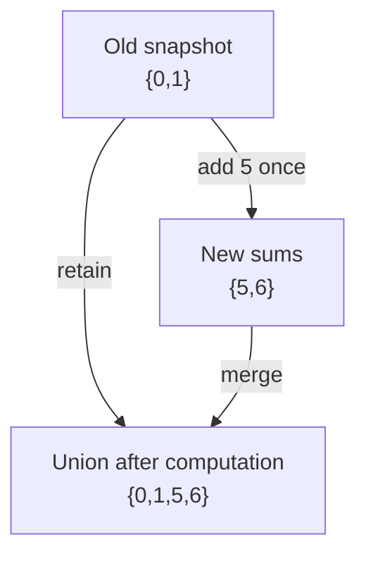

Determine whether all input occurrences can be divided into two groups with equal total value.

## Problem

**Input.** A list `nums` of nonnegative integers, possibly containing zeros and duplicates.

**Output.** Return `True` if the occurrences can be partitioned into two equal-sum groups; otherwise return `False`.

**Rules.** Every occurrence belongs to exactly one group and may not be reused.
Groups need not be contiguous, and repeated values remain separate occurrences.
Empty groups are allowed, so empty input returns `True`. Preserve the list; return feasibility rather than group contents.

**Example.** `[1, 5, 11, 5]` returns `True`, using `[11]` and `[1, 5, 5]`.
For `[1, 2, 3, 5]`, return `False`.

## Picture

After processing `1`, the old reachable set is `{0,1}`.
The first `5` extends only that snapshot:

<p class="visual-title" data-supplemental-visual="subset-sum-old-snapshot">The current 5 creates 5 and 6, not 10</p>


<p class="diagram-caption"><strong>Read it this way:</strong> compute every addition from the old set before merging. Reusing the new five in this pass would reuse one item twice.</p>

The temporary set is complete before union changes `possible`.
New sums cannot feed more additions in this same occurrence's update.
After each prefix, `possible` contains exactly its reachable sums at or below the target.

With nonnegative inputs, an above-target sum cannot later decrease.
That fact permits pruning; signed inputs do not preserve it.

<!-- visual:partition-equal-subset-sum-state -->
<figure class="learning-figure coding-visual-figure" aria-labelledby="partition-equal-subset-sum-state-title"><p class="visual-kicker">Problem trace</p><p class="visual-title" id="partition-equal-subset-sum-state-title">Extend a snapshot of reachable sums to use each occurrence once: Each number extends a snapshot of previously reachable sums; reaching half the total proves an equal partition.</p><div class="coding-visual" data-coding-visual data-coding-mode="trace" data-coding-slug="partition-equal-subset-sum" role="group" tabindex="0" aria-label="Extend a snapshot of reachable sums to use each occurrence once: Each number extends a snapshot of previously reachable sums; reaching half the total proves an equal partition."><div class="coding-visual-example"><span>Input and goal</span><strong>Check whether the values can be split into two groups with equal sums.</strong></div><div class="coding-trace" data-coding-trace><div class="coding-trace-frame" data-coding-frame="0" data-frame-key="initialize" role="group" aria-label="Check the total and seed zero"><div class="coding-trace-frame-heading"><span>Check the total and seed zero</span><strong>The total is 22, so target is 11. Seed {0} using the empty subset.</strong></div><div class="coding-trace-array-map"><div class="coding-trace-array" role="list" aria-label="Array state"><span class="coding-trace-array-item trace-tone-focus" role="listitem" data-motion-key="value-0"><span class="coding-trace-array-pointer" data-motion-key="current-number">next=1</span><span class="coding-trace-array-cell">1</span><small class="coding-trace-array-index">0</small></span><span class="coding-trace-array-item" role="listitem" data-motion-key="value-1"><span class="coding-trace-array-mark"></span><span class="coding-trace-array-cell">5</span><small class="coding-trace-array-index">1</small></span><span class="coding-trace-array-item" role="listitem" data-motion-key="value-2"><span class="coding-trace-array-mark"></span><span class="coding-trace-array-cell">11</span><small class="coding-trace-array-index">2</small></span><span class="coding-trace-array-item" role="listitem" data-motion-key="value-3"><span class="coding-trace-array-mark"></span><span class="coding-trace-array-cell">5</span><small class="coding-trace-array-index">3</small></span></div><div class="coding-trace-meta"><span><b>mapLabel</b>possible sums at or below target 11</span><span><b>arithmetic</b>total=1+5+11+5=22; target=22/2=11</span><span><b>branch</b>22 % 2 = 0, continue</span></div><div class="coding-trace-map"><span class="coding-trace-label">possible sums at or below target 11</span><span class="coding-trace-map-entry"><b>0</b><span>reachable</span></span></div></div></div><div class="coding-trace-frame" data-coding-frame="1" data-frame-key="process-1" hidden role="group" aria-label="Process 1"><div class="coding-trace-frame-heading"><span>Process 1</span><strong>The set-comprehension snapshot is {0}. It adds 0 + 1 = 1, then union keeps both 0 and 1.</strong></div><div class="coding-trace-array-map"><div class="coding-trace-array" role="list" aria-label="Array state"><span class="coding-trace-array-item trace-tone-focus" role="listitem" data-motion-key="value-0"><span class="coding-trace-array-pointer" data-motion-key="current-number">current=1</span><span class="coding-trace-array-cell">1</span><small class="coding-trace-array-index">0</small></span><span class="coding-trace-array-item" role="listitem" data-motion-key="value-1"><span class="coding-trace-array-mark"></span><span class="coding-trace-array-cell">5</span><small class="coding-trace-array-index">1</small></span><span class="coding-trace-array-item" role="listitem" data-motion-key="value-2"><span class="coding-trace-array-mark"></span><span class="coding-trace-array-cell">11</span><small class="coding-trace-array-index">2</small></span><span class="coding-trace-array-item" role="listitem" data-motion-key="value-3"><span class="coding-trace-array-mark"></span><span class="coding-trace-array-cell">5</span><small class="coding-trace-array-index">3</small></span></div><div class="coding-trace-meta"><span><b>mapLabel</b>possible sums at or below target 11</span><span><b>oldSetSnapshot</b>from old {0}: 0+1=1</span><span><b>ignoredAboveTarget</b>none</span></div><div class="coding-trace-map"><span class="coding-trace-label">possible sums at or below target 11</span><span class="coding-trace-map-entry"><b>0</b><span>reachable</span></span><span class="coding-trace-map-entry"><b>1</b><span>reachable</span></span></div></div></div><div class="coding-trace-frame" data-coding-frame="2" data-frame-key="process-first-5" hidden role="group" aria-label="Process the first 5"><div class="coding-trace-frame-heading"><span>Process the first 5</span><strong>From old {0,1}, add 0 + 5 = 5 and 1 + 5 = 6. The reachable set becomes {0,1,5,6}.</strong></div><div class="coding-trace-array-map"><div class="coding-trace-array" role="list" aria-label="Array state"><span class="coding-trace-array-item" role="listitem" data-motion-key="value-0"><span class="coding-trace-array-mark"></span><span class="coding-trace-array-cell">1</span><small class="coding-trace-array-index">0</small></span><span class="coding-trace-array-item trace-tone-focus" role="listitem" data-motion-key="value-1"><span class="coding-trace-array-pointer" data-motion-key="current-number">current=5</span><span class="coding-trace-array-cell">5</span><small class="coding-trace-array-index">1</small></span><span class="coding-trace-array-item" role="listitem" data-motion-key="value-2"><span class="coding-trace-array-mark"></span><span class="coding-trace-array-cell">11</span><small class="coding-trace-array-index">2</small></span><span class="coding-trace-array-item" role="listitem" data-motion-key="value-3"><span class="coding-trace-array-mark"></span><span class="coding-trace-array-cell">5</span><small class="coding-trace-array-index">3</small></span></div><div class="coding-trace-meta"><span><b>mapLabel</b>possible sums at or below target 11</span><span><b>oldSetSnapshot</b>from old {0,1}: 0+5=5; 1+5=6</span><span><b>ignoredAboveTarget</b>none</span></div><div class="coding-trace-map"><span class="coding-trace-label">possible sums at or below target 11</span><span class="coding-trace-map-entry"><b>0</b><span>reachable</span></span><span class="coding-trace-map-entry"><b>1</b><span>reachable</span></span><span class="coding-trace-map-entry"><b>5</b><span>reachable</span></span><span class="coding-trace-map-entry"><b>6</b><span>reachable</span></span></div></div></div><div class="coding-trace-frame" data-coding-frame="3" data-frame-key="process-11" hidden role="group" aria-label="Process 11"><div class="coding-trace-frame-heading"><span>Process 11</span><strong>Only 0 + 11 stays within target. Sums 1, 5, and 6 would exceed 11, so union adds 11.</strong></div><div class="coding-trace-array-map"><div class="coding-trace-array" role="list" aria-label="Array state"><span class="coding-trace-array-item" role="listitem" data-motion-key="value-0"><span class="coding-trace-array-mark"></span><span class="coding-trace-array-cell">1</span><small class="coding-trace-array-index">0</small></span><span class="coding-trace-array-item" role="listitem" data-motion-key="value-1"><span class="coding-trace-array-mark"></span><span class="coding-trace-array-cell">5</span><small class="coding-trace-array-index">1</small></span><span class="coding-trace-array-item trace-tone-focus" role="listitem" data-motion-key="value-2"><span class="coding-trace-array-pointer" data-motion-key="current-number">current=11</span><span class="coding-trace-array-cell">11</span><small class="coding-trace-array-index">2</small></span><span class="coding-trace-array-item" role="listitem" data-motion-key="value-3"><span class="coding-trace-array-mark"></span><span class="coding-trace-array-cell">5</span><small class="coding-trace-array-index">3</small></span></div><div class="coding-trace-meta"><span><b>mapLabel</b>possible sums at or below target 11</span><span><b>oldSetSnapshot</b>from old {0,1,5,6}: 0+11=11</span><span><b>ignoredAboveTarget</b>12, 16, 17</span></div><div class="coding-trace-map"><span class="coding-trace-label">possible sums at or below target 11</span><span class="coding-trace-map-entry"><b>0</b><span>reachable</span></span><span class="coding-trace-map-entry"><b>1</b><span>reachable</span></span><span class="coding-trace-map-entry"><b>5</b><span>reachable</span></span><span class="coding-trace-map-entry"><b>6</b><span>reachable</span></span><span class="coding-trace-map-entry"><b>11</b><span>reachable</span></span></div></div></div><div class="coding-trace-frame" data-coding-frame="4" data-frame-key="process-final-5" hidden role="group" aria-label="Process the final 5"><div class="coding-trace-frame-heading"><span>Process the final 5</span><strong>The old-set snapshot adds 5, 6, 10, and 11. Values 16 are ignored; union preserves existing sums and adds 10.</strong></div><div class="coding-trace-array-map"><div class="coding-trace-array" role="list" aria-label="Array state"><span class="coding-trace-array-item" role="listitem" data-motion-key="value-0"><span class="coding-trace-array-mark"></span><span class="coding-trace-array-cell">1</span><small class="coding-trace-array-index">0</small></span><span class="coding-trace-array-item" role="listitem" data-motion-key="value-1"><span class="coding-trace-array-mark"></span><span class="coding-trace-array-cell">5</span><small class="coding-trace-array-index">1</small></span><span class="coding-trace-array-item" role="listitem" data-motion-key="value-2"><span class="coding-trace-array-mark"></span><span class="coding-trace-array-cell">11</span><small class="coding-trace-array-index">2</small></span><span class="coding-trace-array-item trace-tone-focus" role="listitem" data-motion-key="value-3"><span class="coding-trace-array-pointer" data-motion-key="current-number">current=5</span><span class="coding-trace-array-cell">5</span><small class="coding-trace-array-index">3</small></span></div><div class="coding-trace-meta"><span><b>mapLabel</b>possible sums at or below target 11</span><span><b>oldSetSnapshot</b>0+5=5; 1+5=6; 5+5=10; 6+5=11</span><span><b>ignoredAboveTarget</b>11+5=16</span></div><div class="coding-trace-map"><span class="coding-trace-label">possible sums at or below target 11</span><span class="coding-trace-map-entry"><b>0</b><span>reachable</span></span><span class="coding-trace-map-entry"><b>1</b><span>reachable</span></span><span class="coding-trace-map-entry"><b>5</b><span>reachable</span></span><span class="coding-trace-map-entry"><b>6</b><span>reachable</span></span><span class="coding-trace-map-entry"><b>10</b><span>reachable</span></span><span class="coding-trace-map-entry"><b>11</b><span>reachable</span></span></div></div></div><div class="coding-trace-frame" data-coding-frame="5" data-frame-key="return-true" hidden role="group" aria-label="Test target membership"><div class="coding-trace-frame-heading"><span>Test target membership</span><strong>After every input value is processed, target 11 is in possible. Subset [11] has sum 11 and the remaining [1,5,5] also sums to 11.</strong></div><div class="coding-trace-array-map"><div class="coding-trace-array" role="list" aria-label="Array state"><span class="coding-trace-array-item" role="listitem" data-motion-key="value-0"><span class="coding-trace-array-mark"></span><span class="coding-trace-array-cell">1</span><small class="coding-trace-array-index">0</small></span><span class="coding-trace-array-item" role="listitem" data-motion-key="value-1"><span class="coding-trace-array-mark"></span><span class="coding-trace-array-cell">5</span><small class="coding-trace-array-index">1</small></span><span class="coding-trace-array-item trace-tone-output" role="listitem" data-motion-key="value-2"><span class="coding-trace-array-pointer" data-motion-key="current-number">subset sum 11</span><span class="coding-trace-array-cell">11</span><small class="coding-trace-array-index">2</small></span><span class="coding-trace-array-item" role="listitem" data-motion-key="value-3"><span class="coding-trace-array-mark"></span><span class="coding-trace-array-cell">5</span><small class="coding-trace-array-index">3</small></span></div><div class="coding-trace-meta"><span><b>mapLabel</b>final possible sums</span><span><b>membership</b>11 in possible -&gt; true</span><span><b>partition</b>[11] | [1,5,5]</span><span><b>arithmetic</b>11 = 11</span><span><b>result</b>true</span></div><div class="coding-trace-map"><span class="coding-trace-label">final possible sums</span><span class="coding-trace-map-entry"><b>0</b><span>reachable</span></span><span class="coding-trace-map-entry"><b>1</b><span>reachable</span></span><span class="coding-trace-map-entry"><b>5</b><span>reachable</span></span><span class="coding-trace-map-entry"><b>6</b><span>reachable</span></span><span class="coding-trace-map-entry"><b>10</b><span>reachable</span></span><span class="coding-trace-map-entry"><b>11</b><span>reachable</span></span></div></div></div><div class="coding-trace-controls" data-coding-controls hidden><div class="coding-trace-control-buttons"><button type="button" data-coding-previous disabled><span aria-hidden="true">&larr;</span><span>Previous</span></button><button type="button" data-coding-play><span aria-hidden="true">&#9654;</span><span data-coding-play-label>Play trace</span></button><button type="button" data-coding-next><span>Next</span><span aria-hidden="true">&rarr;</span></button></div><output data-coding-progress>Step 1 of 6</output></div><div class="coding-trace-timeline" data-coding-timeline hidden role="group" aria-label="Trace steps"><button type="button" data-coding-frame-button="0" aria-current="step"><span>1</span><strong>Check the total and seed zero</strong></button><button type="button" data-coding-frame-button="1"><span>2</span><strong>Process 1</strong></button><button type="button" data-coding-frame-button="2"><span>3</span><strong>Process the first 5</strong></button><button type="button" data-coding-frame-button="3"><span>4</span><strong>Process 11</strong></button><button type="button" data-coding-frame-button="4"><span>5</span><strong>Process the final 5</strong></button><button type="button" data-coding-frame-button="5"><span>6</span><strong>Test target membership</strong></button></div><p class="coding-trace-status sr-only" data-coding-status aria-live="polite"></p></div><dl class="coding-visual-lessons" aria-label="Pattern recognition and transfer"><div class="coding-visual-lesson"><dt>Recognize it</dt><dd data-coding-review="recognitionCue">The input must split into equal-sum groups, so one group must realize exactly half the total; each positive number is either included once or excluded.</dd></div><div class="coding-visual-lesson"><dt>Keep true</dt><dd data-coding-review="invariant">After processing a prefix of nums, possible contains exactly the sums at most target realizable from that prefix. New sums are computed from an old-set snapshot, so the current number cannot be reused within its own iteration.</dd></div><div class="coding-visual-lesson"><dt>Reuse it</dt><dd data-coding-review="transferLesson">Convert a partition condition into a target-reachability problem, then update from a snapshot when each item may be used once. The same state model solves 0/1 knapsack feasibility and constrained subset sums.</dd></div></dl></div><figcaption><strong>Read it this way:</strong> The total is 22, so target is 11. Seed {0} using the empty subset. Step through the frames to watch the state change. The last frame shows the answer or the stopping condition.</figcaption></figure>

The full trace is `{0}`, `{0,1}`, `{0,1,5,6}`, `{0,1,5,6,11}`, then `{0,1,5,6,10,11}`.
The two positions holding `5` are distinct occurrences.

## Code

```python
def can_partition(nums: list[int]) -> bool:
   total = sum(nums)
   if total % 2:
      return False

   target = total // 2
   possible = {0}
   for num in nums:
      possible |= {value + num for value in possible if value + num <= target}
   return target in possible
```

An odd total cannot split into equal integer sums.
Empty input returns `True` under the stated empty-group convention.
The Boolean state does not retain a partition witness.

For target $T$, expected hashing gives $O(n(T+1))$ state work and $O(T+1)$ space.
This is pseudo-polynomial in the numeric target, not polynomial in its bit length.
Integer arithmetic and hashing costs also depend on representation size.

<!-- learning:core-end -->

## Change to Dense Coordinates

**New task:** Use a Boolean array when the target range is compact.

**Picture and change:** Visit subtotals downward.
Earlier writes then cannot supply the current occurrence again, matching snapshot eligibility.
Inputs must remain nonnegative integers.

```python
def partition_dense(nums):
   total = sum(nums)
   if total % 2:
      return False
   target = total // 2
   possible = [False] * (target + 1)
   possible[0] = True
   for value in nums:
      for subtotal in range(target, value - 1, -1):
         possible[subtotal] |= possible[subtotal - value]
   return possible[target]
```

**Check:** `[2,3,7]` returns `False`; no subset sums to target `6`.
An upward update can incorrectly reuse `3` to create `6`.
Both implementations accept `[1,5,11,5]`.

**Use when:** Direct target coordinates cost less than a hash set.

## Change to Signed Inputs

**New task:** Allow arbitrary integer signs.

**Picture and change:** Keep snapshots but remove the target cap.
An earlier above-target sum may become useful after a negative occurrence.

```python
def partition_signed(nums):
   total = sum(nums)
   if total % 2:
      return False
   possible = {0}
   for value in nums:
      possible |= {subtotal + value for subtotal in possible}
   return total // 2 in possible
```

**Check:** `[2,2,-1,-1]` returns `True`: each group can contain `2,-1`.
The capped reference discards both early `2` sums and incorrectly returns `False` outside its input contract.
The unpruned set can have exponentially many distinct sums.
Its cost follows those reachable states, not the old nonnegative target bound.

**Use when:** Negative values invalidate monotone pruning.

### Transfer Check

Why can upward iteration suit unlimited coin reuse but not once-per-occurrence selection?

### Answer

Upward writes can become sources later in the same update.
That permits repeated use.
Snapshots or descending updates prevent that feedback.
Mutating a set during its own iteration is not a substitute for either method.
