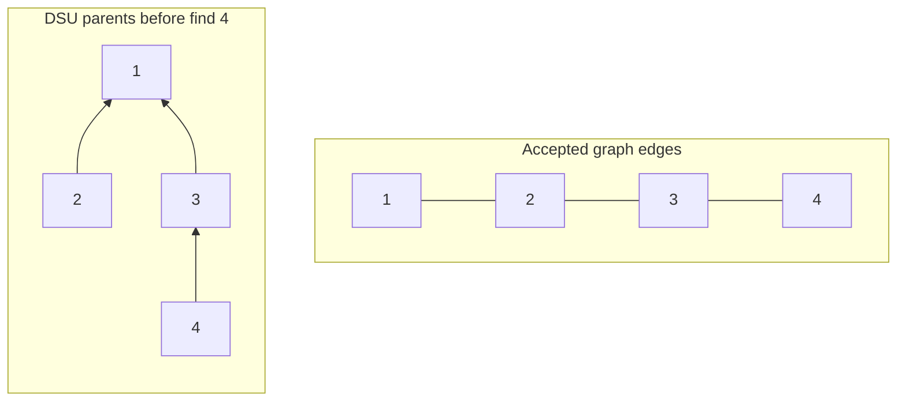

Find the first arriving undirected edge whose addition would create a cycle among previously accepted edges.

## Problem

**Input.** An ordered list `edges` of undirected endpoint pairs using nonnegative integer labels.

**Output.** Return the first edge whose endpoints are already connected by previously accepted edges, or `[]` if none exists.

**Rules.** Process edges in their given order without changing the list.
A self-loop or repeated connection can be the rejected edge.
This reports one first cycle-closing edge, not every cycle edge in a general graph.
Under the usual tree-plus-one-edge assumption, it is the last arriving edge of that cycle.

**Example.** `[[1, 2], [3, 4], [2, 3], [4, 2]]` returns `[4, 2]`.
The previously accepted edges already connect 4 to 2 through 3.

## Picture

Each component has one representative root.
Following parent pointers finds that root; only roots have authoritative component sizes.
After the first three edges, the two size-two components have merged under root `1`.

<p class="visual-title" data-supplemental-visual="dsu-edges-versus-parents">Graph edges and DSU parent pointers are different structures</p>


<p class="diagram-caption"><strong>Read it this way:</strong> compare an undirected input edge with a directed parent pointer. Path compression changes the parent forest, not the accepted graph.</p>

Read it this way: plain links are accepted graph edges.
Arrows are DSU parent pointers, not input edges.
For example, parent link `3 -> 1` does not assert an accepted edge between those graph nodes.

`find(4)` halves `4 -> 3 -> 1` into `4 -> 1`.
`find(2)` also returns `1`, so adding `[4,2]` would close the existing graph path.

<!-- visual:redundant-connection-state -->
<figure class="learning-figure coding-visual-figure" aria-labelledby="redundant-connection-state-title"><p class="visual-kicker">Problem trace</p><p class="visual-title" id="redundant-connection-state-title">Redundant Connection: Accept an edge only when its endpoints have different representative roots; otherwise it closes a cycle.</p><div class="coding-visual" data-coding-visual data-coding-mode="trace" data-coding-slug="redundant-connection" role="group" tabindex="0" aria-label="Redundant Connection: Accept an edge only when its endpoints have different representative roots; otherwise it closes a cycle."><div class="coding-visual-example"><span>Input and goal</span><strong>Find the edge that creates a cycle in an undirected graph.</strong></div><div class="coding-trace" data-coding-trace><div class="coding-trace-frame" data-coding-frame="0" data-frame-key="initialize-sets" role="group" aria-label="Initialize singleton components"><div class="coding-trace-frame-heading"><span>Initialize singleton components</span><strong>Nodes 1..4 each parent themselves and each root has size 1.</strong></div><div class="coding-trace-grid" style="--trace-cols:5" role="group" aria-label="Grid state"><span class="coding-trace-grid-cell" data-motion-key="grid-0-0"><span>node</span></span><span class="coding-trace-grid-cell trace-tone-focus" data-motion-key="first-root"><span>1</span><small>first</small></span><span class="coding-trace-grid-cell trace-tone-state" data-motion-key="second-root"><span>2</span><small>second</small></span><span class="coding-trace-grid-cell" data-motion-key="grid-0-3"><span>3</span></span><span class="coding-trace-grid-cell" data-motion-key="grid-0-4"><span>4</span></span><span class="coding-trace-grid-cell" data-motion-key="grid-1-0"><span>parent</span></span><span class="coding-trace-grid-cell" data-motion-key="grid-1-1"><span>1</span></span><span class="coding-trace-grid-cell" data-motion-key="grid-1-2"><span>2</span></span><span class="coding-trace-grid-cell" data-motion-key="grid-1-3"><span>3</span></span><span class="coding-trace-grid-cell" data-motion-key="grid-1-4"><span>4</span></span><span class="coding-trace-grid-cell" data-motion-key="grid-2-0"><span>root size</span></span><span class="coding-trace-grid-cell" data-motion-key="grid-2-1"><span>1</span></span><span class="coding-trace-grid-cell" data-motion-key="grid-2-2"><span>1</span></span><span class="coding-trace-grid-cell" data-motion-key="grid-2-3"><span>1</span></span><span class="coding-trace-grid-cell" data-motion-key="grid-2-4"><span>1</span></span><span class="coding-trace-grid-cell" data-motion-key="grid-3-0"><span>accepted edges</span></span><span class="coding-trace-grid-cell" data-motion-key="grid-3-1"><span>none</span></span><span class="coding-trace-grid-cell" data-motion-key="grid-3-2"><span></span></span><span class="coding-trace-grid-cell" data-motion-key="grid-3-3"><span></span></span><span class="coding-trace-grid-cell" data-motion-key="grid-3-4"><span></span></span></div><div class="coding-trace-meta"><span><b>example</b>edges=[[1,2],[3,4],[2,3],[4,2]]</span><span><b>currentEdge</b>[1,2]</span></div></div><div class="coding-trace-frame" data-coding-frame="1" data-frame-key="union-1-2" hidden role="group" aria-label="Union edge 1-2"><div class="coding-trace-frame-heading"><span>Union edge 1-2</span><strong>find(1)=1 and find(2)=2; attach root 2 under 1 and set size[1]=2.</strong></div><div class="coding-trace-grid" style="--trace-cols:5" role="group" aria-label="Grid state"><span class="coding-trace-grid-cell" data-motion-key="grid-0-0"><span>node</span></span><span class="coding-trace-grid-cell trace-tone-focus" data-motion-key="first-root"><span>1</span><small>first</small></span><span class="coding-trace-grid-cell trace-tone-state" data-motion-key="second-root"><span>2</span><small>second</small></span><span class="coding-trace-grid-cell" data-motion-key="grid-0-3"><span>3</span></span><span class="coding-trace-grid-cell" data-motion-key="grid-0-4"><span>4</span></span><span class="coding-trace-grid-cell" data-motion-key="grid-1-0"><span>parent</span></span><span class="coding-trace-grid-cell" data-motion-key="grid-1-1"><span>1</span></span><span class="coding-trace-grid-cell" data-motion-key="grid-1-2"><span>1</span></span><span class="coding-trace-grid-cell" data-motion-key="grid-1-3"><span>3</span></span><span class="coding-trace-grid-cell" data-motion-key="grid-1-4"><span>4</span></span><span class="coding-trace-grid-cell" data-motion-key="grid-2-0"><span>root size</span></span><span class="coding-trace-grid-cell" data-motion-key="grid-2-1"><span>2</span></span><span class="coding-trace-grid-cell" data-motion-key="grid-2-2"><span>-</span></span><span class="coding-trace-grid-cell" data-motion-key="grid-2-3"><span>1</span></span><span class="coding-trace-grid-cell" data-motion-key="grid-2-4"><span>1</span></span><span class="coding-trace-grid-cell" data-motion-key="grid-3-0"><span>accepted edges</span></span><span class="coding-trace-grid-cell" data-motion-key="grid-3-1"><span>1-2</span></span><span class="coding-trace-grid-cell" data-motion-key="grid-3-2"><span></span></span><span class="coding-trace-grid-cell" data-motion-key="grid-3-3"><span></span></span><span class="coding-trace-grid-cell" data-motion-key="grid-3-4"><span></span></span></div><div class="coding-trace-meta"><span><b>example</b>edges=[[1,2],[3,4],[2,3],[4,2]]</span><span><b>arithmetic</b>1+1=2</span></div></div><div class="coding-trace-frame" data-coding-frame="2" data-frame-key="union-3-4" hidden role="group" aria-label="Union edge 3-4"><div class="coding-trace-frame-heading"><span>Union edge 3-4</span><strong>find(3)=3 and find(4)=4; attach root 4 under 3 and set size[3]=2.</strong></div><div class="coding-trace-grid" style="--trace-cols:5" role="group" aria-label="Grid state"><span class="coding-trace-grid-cell" data-motion-key="grid-0-0"><span>node</span></span><span class="coding-trace-grid-cell" data-motion-key="grid-0-1"><span>1</span></span><span class="coding-trace-grid-cell" data-motion-key="grid-0-2"><span>2</span></span><span class="coding-trace-grid-cell trace-tone-focus" data-motion-key="first-root"><span>3</span><small>first</small></span><span class="coding-trace-grid-cell trace-tone-state" data-motion-key="second-root"><span>4</span><small>second</small></span><span class="coding-trace-grid-cell" data-motion-key="grid-1-0"><span>parent</span></span><span class="coding-trace-grid-cell" data-motion-key="grid-1-1"><span>1</span></span><span class="coding-trace-grid-cell" data-motion-key="grid-1-2"><span>1</span></span><span class="coding-trace-grid-cell" data-motion-key="grid-1-3"><span>3</span></span><span class="coding-trace-grid-cell" data-motion-key="grid-1-4"><span>3</span></span><span class="coding-trace-grid-cell" data-motion-key="grid-2-0"><span>root size</span></span><span class="coding-trace-grid-cell" data-motion-key="grid-2-1"><span>2</span></span><span class="coding-trace-grid-cell" data-motion-key="grid-2-2"><span>-</span></span><span class="coding-trace-grid-cell" data-motion-key="grid-2-3"><span>2</span></span><span class="coding-trace-grid-cell" data-motion-key="grid-2-4"><span>-</span></span><span class="coding-trace-grid-cell" data-motion-key="grid-3-0"><span>accepted edges</span></span><span class="coding-trace-grid-cell" data-motion-key="grid-3-1"><span>1-2, 3-4</span></span><span class="coding-trace-grid-cell" data-motion-key="grid-3-2"><span></span></span><span class="coding-trace-grid-cell" data-motion-key="grid-3-3"><span></span></span><span class="coding-trace-grid-cell" data-motion-key="grid-3-4"><span></span></span></div><div class="coding-trace-meta"><span><b>example</b>edges=[[1,2],[3,4],[2,3],[4,2]]</span></div></div><div class="coding-trace-frame" data-coding-frame="3" data-frame-key="find-2-3" hidden role="group" aria-label="Find roots for edge 2-3"><div class="coding-trace-frame-heading"><span>Find roots for edge 2-3</span><strong>find(2) follows 2-&gt;1 while find(3)=3; roots 1 and 3 differ and both have size 2.</strong></div><div class="coding-trace-grid" style="--trace-cols:5" role="group" aria-label="Grid state"><span class="coding-trace-grid-cell" data-motion-key="grid-0-0"><span>node</span></span><span class="coding-trace-grid-cell" data-motion-key="grid-0-1"><span>1</span></span><span class="coding-trace-grid-cell trace-tone-focus" data-motion-key="first-root"><span>2</span><small>first</small></span><span class="coding-trace-grid-cell trace-tone-state" data-motion-key="second-root"><span>3</span><small>second</small></span><span class="coding-trace-grid-cell" data-motion-key="grid-0-4"><span>4</span></span><span class="coding-trace-grid-cell" data-motion-key="grid-1-0"><span>parent</span></span><span class="coding-trace-grid-cell" data-motion-key="grid-1-1"><span>1</span></span><span class="coding-trace-grid-cell" data-motion-key="grid-1-2"><span>1</span></span><span class="coding-trace-grid-cell" data-motion-key="grid-1-3"><span>3</span></span><span class="coding-trace-grid-cell" data-motion-key="grid-1-4"><span>3</span></span><span class="coding-trace-grid-cell" data-motion-key="grid-2-0"><span>root size</span></span><span class="coding-trace-grid-cell" data-motion-key="grid-2-1"><span>2</span></span><span class="coding-trace-grid-cell" data-motion-key="grid-2-2"><span>-</span></span><span class="coding-trace-grid-cell" data-motion-key="grid-2-3"><span>2</span></span><span class="coding-trace-grid-cell" data-motion-key="grid-2-4"><span>-</span></span><span class="coding-trace-grid-cell" data-motion-key="grid-3-0"><span>accepted edges</span></span><span class="coding-trace-grid-cell" data-motion-key="grid-3-1"><span>1-2, 3-4</span></span><span class="coding-trace-grid-cell" data-motion-key="grid-3-2"><span></span></span><span class="coding-trace-grid-cell" data-motion-key="grid-3-3"><span></span></span><span class="coding-trace-grid-cell" data-motion-key="grid-3-4"><span></span></span></div><div class="coding-trace-meta"><span><b>example</b>edges=[[1,2],[3,4],[2,3],[4,2]]</span><span><b>roots</b>2-&gt;1; 3-&gt;3</span></div></div><div class="coding-trace-frame" data-coding-frame="4" data-frame-key="union-2-3" hidden role="group" aria-label="Join the two components"><div class="coding-trace-frame-heading"><span>Join the two components</span><strong>Equal sizes need no swap; parent[3]=1 and size[1]=2+2=4.</strong></div><div class="coding-trace-grid" style="--trace-cols:5" role="group" aria-label="Grid state"><span class="coding-trace-grid-cell" data-motion-key="grid-0-0"><span>node</span></span><span class="coding-trace-grid-cell" data-motion-key="grid-0-1"><span>1</span></span><span class="coding-trace-grid-cell trace-tone-focus" data-motion-key="first-root"><span>2</span><small>first</small></span><span class="coding-trace-grid-cell trace-tone-state" data-motion-key="second-root"><span>3</span><small>second</small></span><span class="coding-trace-grid-cell" data-motion-key="grid-0-4"><span>4</span></span><span class="coding-trace-grid-cell" data-motion-key="grid-1-0"><span>parent</span></span><span class="coding-trace-grid-cell" data-motion-key="grid-1-1"><span>1</span></span><span class="coding-trace-grid-cell" data-motion-key="grid-1-2"><span>1</span></span><span class="coding-trace-grid-cell" data-motion-key="grid-1-3"><span>1</span></span><span class="coding-trace-grid-cell" data-motion-key="grid-1-4"><span>3</span></span><span class="coding-trace-grid-cell" data-motion-key="grid-2-0"><span>root size</span></span><span class="coding-trace-grid-cell" data-motion-key="grid-2-1"><span>4</span></span><span class="coding-trace-grid-cell" data-motion-key="grid-2-2"><span>-</span></span><span class="coding-trace-grid-cell" data-motion-key="grid-2-3"><span>-</span></span><span class="coding-trace-grid-cell" data-motion-key="grid-2-4"><span>-</span></span><span class="coding-trace-grid-cell" data-motion-key="grid-3-0"><span>accepted edges</span></span><span class="coding-trace-grid-cell" data-motion-key="grid-3-1"><span>1-2, 3-4, 2-3</span></span><span class="coding-trace-grid-cell" data-motion-key="grid-3-2"><span></span></span><span class="coding-trace-grid-cell" data-motion-key="grid-3-3"><span></span></span><span class="coding-trace-grid-cell" data-motion-key="grid-3-4"><span></span></span></div><div class="coding-trace-meta"><span><b>example</b>edges=[[1,2],[3,4],[2,3],[4,2]]</span><span><b>arithmetic</b>2+2=4</span></div></div><div class="coding-trace-frame" data-coding-frame="5" data-frame-key="compress-4" hidden role="group" aria-label="Compress node 4"><div class="coding-trace-frame-heading"><span>Compress node 4</span><strong>For candidate 4-2, find(4) sees 4-&gt;3-&gt;1 and path halving writes parent[4]=1; find(2)=1.</strong></div><div class="coding-trace-grid" style="--trace-cols:5" role="group" aria-label="Grid state"><span class="coding-trace-grid-cell" data-motion-key="grid-0-0"><span>node</span></span><span class="coding-trace-grid-cell" data-motion-key="grid-0-1"><span>1</span></span><span class="coding-trace-grid-cell trace-tone-state" data-motion-key="second-root"><span>2</span><small>second</small></span><span class="coding-trace-grid-cell" data-motion-key="grid-0-3"><span>3</span></span><span class="coding-trace-grid-cell trace-tone-focus" data-motion-key="first-root"><span>4</span><small>first</small></span><span class="coding-trace-grid-cell" data-motion-key="grid-1-0"><span>parent</span></span><span class="coding-trace-grid-cell" data-motion-key="grid-1-1"><span>1</span></span><span class="coding-trace-grid-cell" data-motion-key="grid-1-2"><span>1</span></span><span class="coding-trace-grid-cell" data-motion-key="grid-1-3"><span>1</span></span><span class="coding-trace-grid-cell" data-motion-key="grid-1-4"><span>1</span></span><span class="coding-trace-grid-cell" data-motion-key="grid-2-0"><span>root size</span></span><span class="coding-trace-grid-cell" data-motion-key="grid-2-1"><span>4</span></span><span class="coding-trace-grid-cell" data-motion-key="grid-2-2"><span>-</span></span><span class="coding-trace-grid-cell" data-motion-key="grid-2-3"><span>-</span></span><span class="coding-trace-grid-cell" data-motion-key="grid-2-4"><span>-</span></span><span class="coding-trace-grid-cell" data-motion-key="grid-3-0"><span>accepted edges</span></span><span class="coding-trace-grid-cell" data-motion-key="grid-3-1"><span>1-2, 3-4, 2-3</span></span><span class="coding-trace-grid-cell" data-motion-key="grid-3-2"><span></span></span><span class="coding-trace-grid-cell" data-motion-key="grid-3-3"><span></span></span><span class="coding-trace-grid-cell" data-motion-key="grid-3-4"><span></span></span></div><div class="coding-trace-meta"><span><b>example</b>edges=[[1,2],[3,4],[2,3],[4,2]]</span><span><b>parentBefore</b>[1,1,1,3]</span><span><b>roots</b>4-&gt;3-&gt;1; 2-&gt;1</span></div></div><div class="coding-trace-frame" data-coding-frame="6" data-frame-key="return-redundant-edge" hidden role="group" aria-label="Reject the cycle-closing edge"><div class="coding-trace-frame-heading"><span>Reject the cycle-closing edge</span><strong>Both roots equal 1, so union returns false before adding 4-2; the accepted path 4-3-2 already connects them.</strong></div><div class="coding-trace-grid" style="--trace-cols:5" role="group" aria-label="Grid state"><span class="coding-trace-grid-cell" data-motion-key="grid-0-0"><span>node</span></span><span class="coding-trace-grid-cell" data-motion-key="grid-0-1"><span>1</span></span><span class="coding-trace-grid-cell trace-tone-state" data-motion-key="second-root"><span>2</span><small>second</small></span><span class="coding-trace-grid-cell" data-motion-key="grid-0-3"><span>3</span></span><span class="coding-trace-grid-cell trace-tone-focus" data-motion-key="first-root"><span>4</span><small>first</small></span><span class="coding-trace-grid-cell" data-motion-key="grid-1-0"><span>parent</span></span><span class="coding-trace-grid-cell" data-motion-key="grid-1-1"><span>1</span></span><span class="coding-trace-grid-cell" data-motion-key="grid-1-2"><span>1</span></span><span class="coding-trace-grid-cell" data-motion-key="grid-1-3"><span>1</span></span><span class="coding-trace-grid-cell" data-motion-key="grid-1-4"><span>1</span></span><span class="coding-trace-grid-cell" data-motion-key="grid-2-0"><span>root size</span></span><span class="coding-trace-grid-cell" data-motion-key="grid-2-1"><span>4</span></span><span class="coding-trace-grid-cell" data-motion-key="grid-2-2"><span>-</span></span><span class="coding-trace-grid-cell" data-motion-key="grid-2-3"><span>-</span></span><span class="coding-trace-grid-cell" data-motion-key="grid-2-4"><span>-</span></span><span class="coding-trace-grid-cell" data-motion-key="grid-3-0"><span>accepted edges</span></span><span class="coding-trace-grid-cell" data-motion-key="grid-3-1"><span>1-2, 3-4, 2-3</span></span><span class="coding-trace-grid-cell" data-motion-key="grid-3-2"><span></span></span><span class="coding-trace-grid-cell" data-motion-key="grid-3-3"><span></span></span><span class="coding-trace-grid-cell" data-motion-key="grid-3-4"><span></span></span></div><div class="coding-trace-meta"><span><b>example</b>edges=[[1,2],[3,4],[2,3],[4,2]]</span><span><b>union</b>false: 1 == 1</span><span><b>result</b>[4,2]</span></div></div><div class="coding-trace-controls" data-coding-controls hidden><div class="coding-trace-control-buttons"><button type="button" data-coding-previous disabled><span aria-hidden="true">&larr;</span><span>Previous</span></button><button type="button" data-coding-play><span aria-hidden="true">&#9654;</span><span data-coding-play-label>Play trace</span></button><button type="button" data-coding-next><span>Next</span><span aria-hidden="true">&rarr;</span></button></div><output data-coding-progress>Step 1 of 7</output></div><div class="coding-trace-timeline" data-coding-timeline hidden role="group" aria-label="Trace steps"><button type="button" data-coding-frame-button="0" aria-current="step"><span>1</span><strong>Initialize singleton components</strong></button><button type="button" data-coding-frame-button="1"><span>2</span><strong>Union edge 1-2</strong></button><button type="button" data-coding-frame-button="2"><span>3</span><strong>Union edge 3-4</strong></button><button type="button" data-coding-frame-button="3"><span>4</span><strong>Find roots for edge 2-3</strong></button><button type="button" data-coding-frame-button="4"><span>5</span><strong>Join the two components</strong></button><button type="button" data-coding-frame-button="5"><span>6</span><strong>Compress node 4</strong></button><button type="button" data-coding-frame-button="6"><span>7</span><strong>Reject the cycle-closing edge</strong></button></div><p class="coding-trace-status sr-only" data-coding-status aria-live="polite"></p></div><dl class="coding-visual-lessons" aria-label="Pattern recognition and transfer"><div class="coding-visual-lesson"><dt>Recognize it</dt><dd data-coding-review="recognitionCue">Undirected edges arrive incrementally and each needs an already-connected cycle check.</dd></div><div class="coding-visual-lesson"><dt>Keep true</dt><dd data-coding-review="invariant">Following parent links reaches one representative per component; size is authoritative at roots, and accepted edges join only different roots.</dd></div><div class="coding-visual-lesson"><dt>Reuse it</dt><dd data-coding-review="transferLesson">Compare roots before adding connectivity, attach the smaller tree under the larger, and compress paths during find.</dd></div></dl></div><figcaption><strong>Read it this way:</strong> Nodes 1..4 each parent themselves and each root has size 1. Step through the frames to watch the state change. The last frame shows the answer or the stopping condition.</figcaption></figure>

If roots differ, merge their components by attaching the smaller root tree under the larger.
Add their sizes at the surviving root.
If roots match, return `False` without merging.
Nonroot size entries can be stale; they are not component summaries.

## Code

```python
class DisjointSet:
   def __init__(self, size: int) -> None:
      self.parent = list(range(size))
      self.component_size = [1] * size

   def find(self, node: int) -> int:
      while node != self.parent[node]:
         self.parent[node] = self.parent[self.parent[node]]
         node = self.parent[node]
      return node

   def union(self, first: int, second: int) -> bool:
      first_root = self.find(first)
      second_root = self.find(second)
      if first_root == second_root:
         return False

      if self.component_size[first_root] < self.component_size[second_root]:
         first_root, second_root = second_root, first_root
      self.parent[second_root] = first_root
      self.component_size[first_root] += self.component_size[second_root]
      return True


def find_redundant_connection(edges: list[list[int]]) -> list[int]:
   if not edges:
      return []

   groups = DisjointSet(max(max(edge) for edge in edges) + 1)
   for first, second in edges:
      if not groups.union(first, second):
         return [first, second]
   return []
```

Let $L$ be maximum label plus one.
The literal allocation costs $O(L)$, even when only a few distinct labels occur.
Path halving and union by size give $O(L+E\alpha(L))$ amortized time and $O(L)$ storage.
The inverse-Ackermann factor is not a literal constant-time guarantee per operation.

### Failure Check

Compare roots, not immediate parents.
Ordinary DSU does not support arbitrary edge deletion or directed-cycle detection.
Recovering an actual path requires separate accepted graph edges; compressed parent links are not that evidence.

<!-- learning:core-end -->

## Change the Label Range

**New task:** Integer labels are sparse and very large.

**Picture and change:** Map the distinct labels to dense indices, but return original edge labels.
Reuse the supplied `DisjointSet` above.

```python
def redundant_sparse_labels(edges):
   labels = {label for edge in edges for label in edge}
   indices = {label: index for index, label in enumerate(labels)}
   groups = DisjointSet(len(indices))
   for first, second in edges:
      if not groups.union(indices[first], indices[second]):
         return [first, second]
   return []
```

**Check:** `[[1000000,9000000],[9000000,7000000],[7000000,1000000]]` returns `[7000000,1000000]`.
Allocate three representatives, not nine million.
Expected hashing plus DSU work is $O(V+E\alpha(V))$ with $O(V)$ state for distinct labels.

**Use when:** Vertex population, not label magnitude, should determine allocation.

## Change the Aggregate

**New task:** Count final components in the explicit universe `0..node_count-1`.

**Picture and change:** Start with one component per node.
Only successful unions reduce the count; isolated nodes remain represented.

```python
def component_count(node_count, edges):
   groups = DisjointSet(node_count)
   count = node_count
   for first, second in edges:
      if groups.union(first, second):
         count -= 1
   return count
```

**Check:** Five nodes with `[[0,1],[1,2],[2,0],[3,4]]` return `2`.
Three nodes and no edges return `3`.
The cycle edge does not decrease the count.
Require a nonnegative node count and valid endpoints.

**Use when:** Remaining connectivity matters, not the first rejection.

### Transfer Check

Why can compressed parent links not reconstruct an original graph path?

### Answer

They record component representation and can skip or replace several accepted edges.
Keep the accepted-edge graph separately when a path witness is required.
