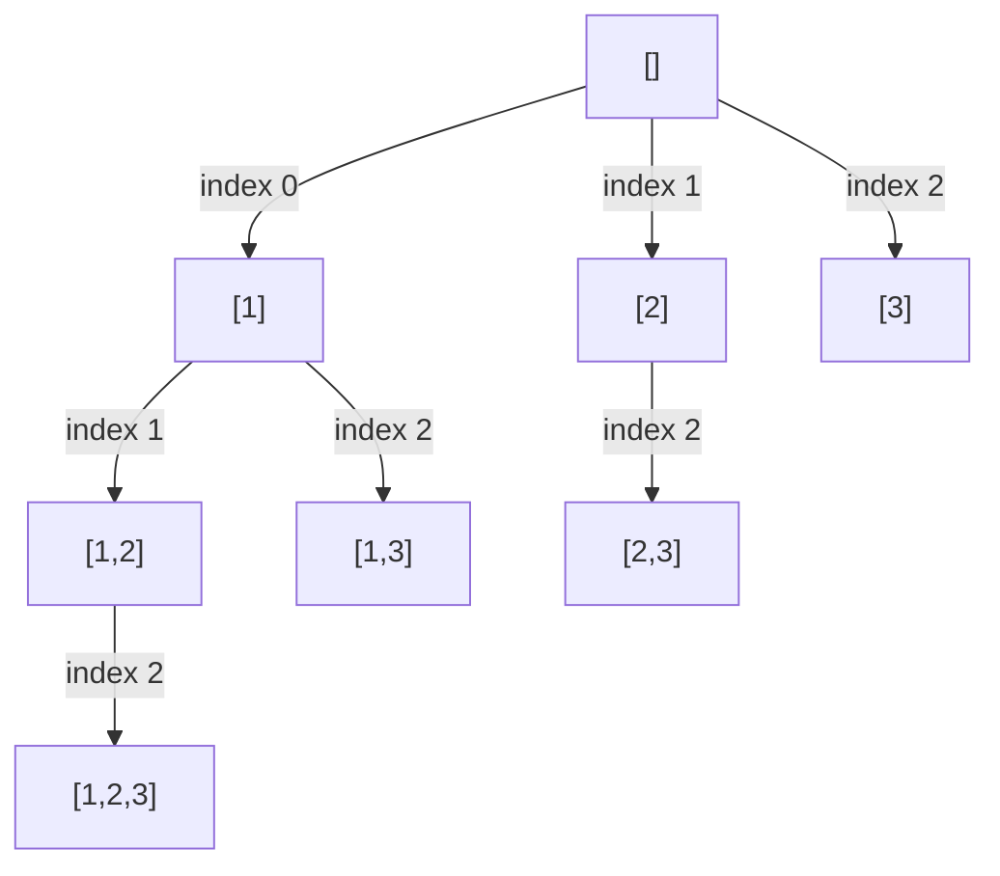

List every subset of a collection of distinct values, including choosing no values at all.

## Problem

**Input.** A list `nums` of distinct integers.

**Output.** Return one list for each subset, including the empty subset and the subset containing every value.

**Rules.** A value may be selected at most once per subset; changing selection order does not create a new subset.
Leave the input unchanged. Each returned list must be independent of the others.
Output order is not required. Empty input returns `[[]]`; duplicate values require the separate policy below.

**Example.** `[1, 2, 3]` has eight subsets: `[[], [1], [1, 2], [1, 2, 3], [1, 3], [2], [2, 3], [3]]`.
The selections `[1, 2]` and `[2, 1]` are the same subset, not two answers.

## Picture

Each node is a saved path; each edge chooses one input index.
Indices increase along every root-to-node route, so an unordered selection has only one construction order.

<p class="visual-title" data-supplemental-visual="subsets-increasing-index-tree">Increasing choice indices produce subsets without reordered duplicates</p>


<p class="diagram-caption"><strong>Read it this way:</strong> follow strictly increasing index labels. The tree contains [1,2], but never a second path that creates [2,1].</p>

Read it this way: save a copy at every node.
Return along an edge by undoing its choice before trying a sibling.

At `choose(start)`, the path contains only earlier, strictly increasing positions.
This call may extend it using any index from `start` onward.
It owns each append that it later removes.

<!-- visual:subsets-state -->
<figure class="learning-figure coding-visual-figure" aria-labelledby="subsets-state-title"><p class="visual-kicker">Problem trace</p><p class="visual-title" id="subsets-state-title">Subsets: Save every current path, then recurse only to larger indices and pop the chosen value on return.</p><div class="coding-visual" data-coding-visual data-coding-mode="trace" data-coding-slug="subsets" role="group" tabindex="0" aria-label="Subsets: Save every current path, then recurse only to larger indices and pop the chosen value on return."><div class="coding-visual-example"><span>Input and goal</span><strong>Return every subset of the input values.</strong></div><div class="coding-trace" data-coding-trace><div class="coding-trace-frame" data-coding-frame="0" data-frame-key="save-empty" role="group" aria-label="Save the empty path"><div class="coding-trace-frame-heading"><span>Save the empty path</span><strong>choose(0) first copies [] into answer; indices 0, 1, and 2 remain available.</strong></div><div class="coding-trace-grid" style="--trace-cols:2" role="group" aria-label="Grid state"><span class="coding-trace-grid-cell trace-tone-focus" data-motion-key="call-top"><span>[]</span><small>active call</small></span><span class="coding-trace-grid-cell" data-motion-key="grid-0-1"><span>start 0</span></span></div><div class="coding-trace-meta"><span><b>input</b>nums = [1, 2, 3]</span><span><b>columns</b>path | start</span><span><b>action</b>save []</span><span><b>answer</b>[[]]</span></div></div><div class="coding-trace-frame" data-coding-frame="1" data-frame-key="choose-one" hidden role="group" aria-label="Choose index 0"><div class="coding-trace-frame-heading"><span>Choose index 0</span><strong>Append nums[0]=1 and call choose(1); [1] is copied as the second subset.</strong></div><div class="coding-trace-grid" style="--trace-cols:2" role="group" aria-label="Grid state"><span class="coding-trace-grid-cell" data-motion-key="grid-0-0"><span>[]</span></span><span class="coding-trace-grid-cell" data-motion-key="grid-0-1"><span>start 0</span></span><span class="coding-trace-grid-cell trace-tone-focus" data-motion-key="call-top"><span>[1]</span><small>active call</small></span><span class="coding-trace-grid-cell" data-motion-key="grid-1-1"><span>start 1</span></span></div><div class="coding-trace-meta"><span><b>input</b>nums = [1, 2, 3]</span><span><b>columns</b>path | start</span><span><b>action</b>append 1; save [1]</span><span><b>answer</b>[[], [1]]</span></div></div><div class="coding-trace-frame" data-coding-frame="2" data-frame-key="choose-one-two" hidden role="group" aria-label="Choose index 1 after 1"><div class="coding-trace-frame-heading"><span>Choose index 1 after 1</span><strong>Append 2 and call choose(2); increasing start prevents producing [2,1].</strong></div><div class="coding-trace-grid" style="--trace-cols:2" role="group" aria-label="Grid state"><span class="coding-trace-grid-cell" data-motion-key="grid-0-0"><span>[]</span></span><span class="coding-trace-grid-cell" data-motion-key="grid-0-1"><span>start 0</span></span><span class="coding-trace-grid-cell" data-motion-key="grid-1-0"><span>[1]</span></span><span class="coding-trace-grid-cell" data-motion-key="grid-1-1"><span>start 1</span></span><span class="coding-trace-grid-cell trace-tone-focus" data-motion-key="call-top"><span>[1,2]</span><small>active call</small></span><span class="coding-trace-grid-cell" data-motion-key="grid-2-1"><span>start 2</span></span></div><div class="coding-trace-meta"><span><b>input</b>nums = [1, 2, 3]</span><span><b>columns</b>path | start</span><span><b>action</b>append 2; save [1,2]</span><span><b>answer</b>3 subsets saved</span></div></div><div class="coding-trace-frame" data-coding-frame="3" data-frame-key="choose-one-two-three" hidden role="group" aria-label="Choose index 2 after 2"><div class="coding-trace-frame-heading"><span>Choose index 2 after 2</span><strong>Append 3 and call choose(3); save [1,2,3], then the empty loop returns and pops 3.</strong></div><div class="coding-trace-grid" style="--trace-cols:2" role="group" aria-label="Grid state"><span class="coding-trace-grid-cell" data-motion-key="grid-0-0"><span>[]</span></span><span class="coding-trace-grid-cell" data-motion-key="grid-0-1"><span>start 0</span></span><span class="coding-trace-grid-cell" data-motion-key="grid-1-0"><span>[1]</span></span><span class="coding-trace-grid-cell" data-motion-key="grid-1-1"><span>start 1</span></span><span class="coding-trace-grid-cell" data-motion-key="grid-2-0"><span>[1,2]</span></span><span class="coding-trace-grid-cell" data-motion-key="grid-2-1"><span>start 2</span></span><span class="coding-trace-grid-cell trace-tone-focus" data-motion-key="call-top"><span>[1,2,3]</span><small>active call</small></span><span class="coding-trace-grid-cell" data-motion-key="grid-3-1"><span>start 3</span></span></div><div class="coding-trace-meta"><span><b>input</b>nums = [1, 2, 3]</span><span><b>columns</b>path | start</span><span><b>action</b>save [1,2,3]; return; pop 3</span><span><b>answer</b>4 subsets saved</span></div></div><div class="coding-trace-frame" data-coding-frame="4" data-frame-key="choose-one-three" hidden role="group" aria-label="Backtrack and choose 3 after 1"><div class="coding-trace-frame-heading"><span>Backtrack and choose 3 after 1</span><strong>After choose(2) returns, pop 2; its loop advances to index 2, appends 3, and saves [1,3].</strong></div><div class="coding-trace-grid" style="--trace-cols:2" role="group" aria-label="Grid state"><span class="coding-trace-grid-cell" data-motion-key="grid-0-0"><span>[]</span></span><span class="coding-trace-grid-cell" data-motion-key="grid-0-1"><span>start 0</span></span><span class="coding-trace-grid-cell" data-motion-key="grid-1-0"><span>[1]</span></span><span class="coding-trace-grid-cell" data-motion-key="grid-1-1"><span>start 1</span></span><span class="coding-trace-grid-cell trace-tone-focus" data-motion-key="call-top"><span>[1,3]</span><small>active call</small></span><span class="coding-trace-grid-cell" data-motion-key="grid-2-1"><span>start 3</span></span></div><div class="coding-trace-meta"><span><b>input</b>nums = [1, 2, 3]</span><span><b>columns</b>path | start</span><span><b>action</b>pop 2; append 3; save [1,3]</span><span><b>answer</b>5 subsets saved</span></div></div><div class="coding-trace-frame" data-coding-frame="5" data-frame-key="choose-two" hidden role="group" aria-label="Backtrack to choose 2"><div class="coding-trace-frame-heading"><span>Backtrack to choose 2</span><strong>Return twice, popping 3 then 1; choose(0) advances to index 1 and saves [2].</strong></div><div class="coding-trace-grid" style="--trace-cols:2" role="group" aria-label="Grid state"><span class="coding-trace-grid-cell" data-motion-key="grid-0-0"><span>[]</span></span><span class="coding-trace-grid-cell" data-motion-key="grid-0-1"><span>start 0</span></span><span class="coding-trace-grid-cell trace-tone-focus" data-motion-key="call-top"><span>[2]</span><small>active call</small></span><span class="coding-trace-grid-cell" data-motion-key="grid-1-1"><span>start 2</span></span></div><div class="coding-trace-meta"><span><b>input</b>nums = [1, 2, 3]</span><span><b>columns</b>path | start</span><span><b>action</b>pop 3; pop 1; append 2; save [2]</span><span><b>answer</b>6 subsets saved</span></div></div><div class="coding-trace-frame" data-coding-frame="6" data-frame-key="choose-two-three" hidden role="group" aria-label="Extend 2 with 3"><div class="coding-trace-frame-heading"><span>Extend 2 with 3</span><strong>From start 2, append nums[2]=3, call choose(3), and save [2,3].</strong></div><div class="coding-trace-grid" style="--trace-cols:2" role="group" aria-label="Grid state"><span class="coding-trace-grid-cell" data-motion-key="grid-0-0"><span>[]</span></span><span class="coding-trace-grid-cell" data-motion-key="grid-0-1"><span>start 0</span></span><span class="coding-trace-grid-cell" data-motion-key="grid-1-0"><span>[2]</span></span><span class="coding-trace-grid-cell" data-motion-key="grid-1-1"><span>start 2</span></span><span class="coding-trace-grid-cell trace-tone-focus" data-motion-key="call-top"><span>[2,3]</span><small>active call</small></span><span class="coding-trace-grid-cell" data-motion-key="grid-2-1"><span>start 3</span></span></div><div class="coding-trace-meta"><span><b>input</b>nums = [1, 2, 3]</span><span><b>columns</b>path | start</span><span><b>action</b>append 3; save [2,3]</span><span><b>answer</b>7 subsets saved</span></div></div><div class="coding-trace-frame" data-coding-frame="7" data-frame-key="choose-three" hidden role="group" aria-label="Backtrack to choose 3 alone"><div class="coding-trace-frame-heading"><span>Backtrack to choose 3 alone</span><strong>Pop 3 and 2; the root loop advances to index 2, appends 3, and saves the final subset [3].</strong></div><div class="coding-trace-grid" style="--trace-cols:2" role="group" aria-label="Grid state"><span class="coding-trace-grid-cell" data-motion-key="grid-0-0"><span>[]</span></span><span class="coding-trace-grid-cell" data-motion-key="grid-0-1"><span>start 0</span></span><span class="coding-trace-grid-cell trace-tone-focus" data-motion-key="call-top"><span>[3]</span><small>active call</small></span><span class="coding-trace-grid-cell" data-motion-key="grid-1-1"><span>start 3</span></span></div><div class="coding-trace-meta"><span><b>input</b>nums = [1, 2, 3]</span><span><b>columns</b>path | start</span><span><b>action</b>pop 3; pop 2; append 3; save [3]</span><span><b>result</b>[[],[1],[1,2],[1,2,3],[1,3],[2],[2,3],[3]]</span></div></div><div class="coding-trace-controls" data-coding-controls hidden><div class="coding-trace-control-buttons"><button type="button" data-coding-previous disabled><span aria-hidden="true">&larr;</span><span>Previous</span></button><button type="button" data-coding-play><span aria-hidden="true">&#9654;</span><span data-coding-play-label>Play trace</span></button><button type="button" data-coding-next><span>Next</span><span aria-hidden="true">&rarr;</span></button></div><output data-coding-progress>Step 1 of 8</output></div><div class="coding-trace-timeline" data-coding-timeline hidden role="group" aria-label="Trace steps"><button type="button" data-coding-frame-button="0" aria-current="step"><span>1</span><strong>Save the empty path</strong></button><button type="button" data-coding-frame-button="1"><span>2</span><strong>Choose index 0</strong></button><button type="button" data-coding-frame-button="2"><span>3</span><strong>Choose index 1 after 1</strong></button><button type="button" data-coding-frame-button="3"><span>4</span><strong>Choose index 2 after 2</strong></button><button type="button" data-coding-frame-button="4"><span>5</span><strong>Backtrack and choose 3 after 1</strong></button><button type="button" data-coding-frame-button="5"><span>6</span><strong>Backtrack to choose 2</strong></button><button type="button" data-coding-frame-button="6"><span>7</span><strong>Extend 2 with 3</strong></button><button type="button" data-coding-frame-button="7"><span>8</span><strong>Backtrack to choose 3 alone</strong></button></div><p class="coding-trace-status sr-only" data-coding-status aria-live="polite"></p></div><dl class="coding-visual-lessons" aria-label="Pattern recognition and transfer"><div class="coding-visual-lesson"><dt>Recognize it</dt><dd data-coding-review="recognitionCue">Use this pattern when every combination of distinct input positions is valid and order does not matter, so each partial selection must be emitted once.</dd></div><div class="coding-visual-lesson"><dt>Keep true</dt><dd data-coding-review="invariant">On entry to choose(start), path contains indices in strictly increasing order, answer already contains every path visited earlier in DFS order, and only indices start or greater may extend this path.</dd></div><div class="coding-visual-lesson"><dt>Reuse it</dt><dd data-coding-review="transferLesson">When order should not create duplicates, advance a start boundary after each choice; this same skeleton generates combinations, k-subsets, and increasing-index selections.</dd></div></dl></div><figcaption><strong>Read it this way:</strong> choose(0) first copies [] into answer; indices 0, 1, and 2 remain available. Step through the frames to watch the state change. The last frame shows the answer or the stopping condition.</figcaption></figure>

Save `path.copy()`, not `path` itself.
All recursion levels share the active mutable list, but saved answers must not share that list.

## Code

```python
def subsets(nums: list[int]) -> list[list[int]]:
   answer: list[list[int]] = []
   path: list[int] = []

   def choose(start: int) -> None:
      answer.append(path.copy())
      for index in range(start, len(nums)):
         path.append(nums[index])
         choose(index + 1)
         path.pop()

   choose(0)
   return answer
```

There are $2^n$ position subsets.
Materializing their copied lists takes $O(n2^n)$ time and output space.
The active path and recursive stack separately use $O(n)$ working space.
Python's recursion limit still applies.
Empty input returns `[[]]`, not `[]`.

### Failure Check

Saving `path` directly makes all answers track the same later mutations.
Forgetting `pop` leaves a sibling with the previous branch's state.
Keeping the same start permits reuse instead of selecting each position at most once.
On `[1,1]`, the original emits two separate `[1]` answers; it has not promised duplicate-value suppression.

<!-- learning:core-end -->

## Change the Answer Length

**New task:** Return only selections of a fixed integer length.

**Picture and change:** Save only complete requested lengths.
Stop after saving; prune when too few positions remain.
Increasing indices still prevent alternative orderings of one selection.

```python
def k_subsets(nums, size):
   answer, path = [], []
   def choose(start):
      if len(path) == size:
         answer.append(path.copy())
         return
      if len(nums) - start < size - len(path):
         return
      for index in range(start, len(nums)):
         path.append(nums[index])
         choose(index + 1)
         path.pop()
   if size >= 0:
      choose(0)
   return answer
```

**Check:** `[1,2,3]`, size `2`, returns `[[1,2],[1,3],[2,3]]`.
Size zero returns `[[]]`; negative or excessive sizes return `[]`.

**Use when:** The output-length requirement changes.

## Change the Duplicate Policy

**New task:** Equal input values must not duplicate returned value subsets.

**Picture and change:** Sort a copy and skip equal choices among siblings only.
A deeper equal position remains available, so `[2,2]` is still possible.

```python
def unique_subsets(nums):
   choices = sorted(nums)
   answer, path = [], []
   def choose(start):
      answer.append(path.copy())
      for index in range(start, len(choices)):
         if index > start and choices[index] == choices[index - 1]:
            continue
         path.append(choices[index])
         choose(index + 1)
         path.pop()
   choose(0)
   return answer
```

**Check:** `[1,2,2]` returns `[[],[1],[1,2],[1,2,2],[2],[2,2]]` without changing the input.
Sorting adds $O(n\log(n+1))$ work and $O(n)$ storage before output enumeration.
Output can still be exponential; fewer duplicates are not a polynomial bound.

**Use when:** Unique value multisets replace distinct-position selections.

### Transfer Check

Why skip duplicate siblings but not every duplicate value?

### Answer

Equal sibling choices lead to the same value continuation.
Deeper equal positions represent legitimate multiplicity, such as `[2,2]`.
The skip must depend on the current `start` boundary.
